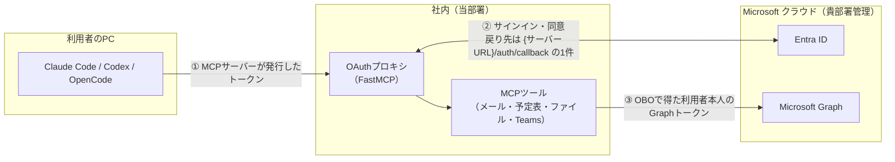
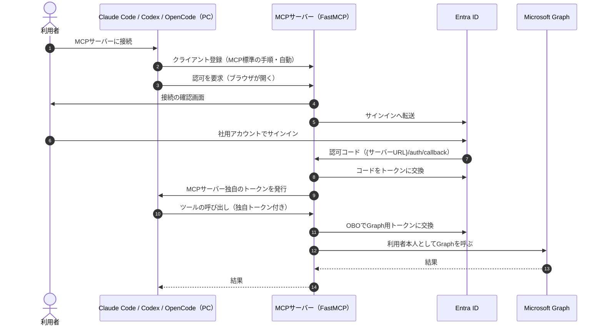
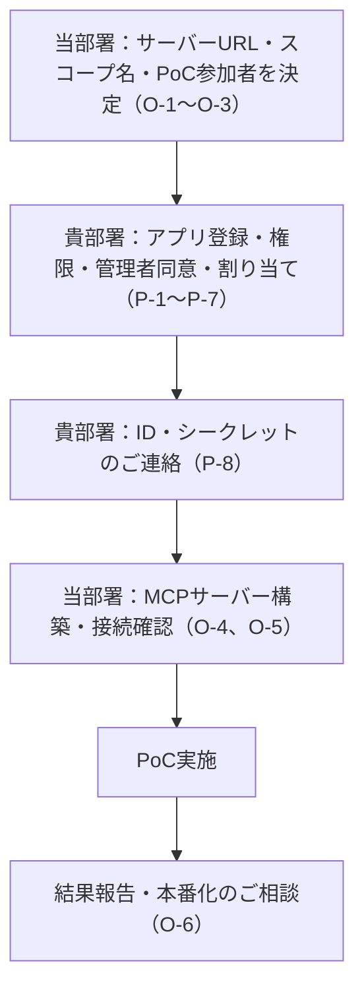
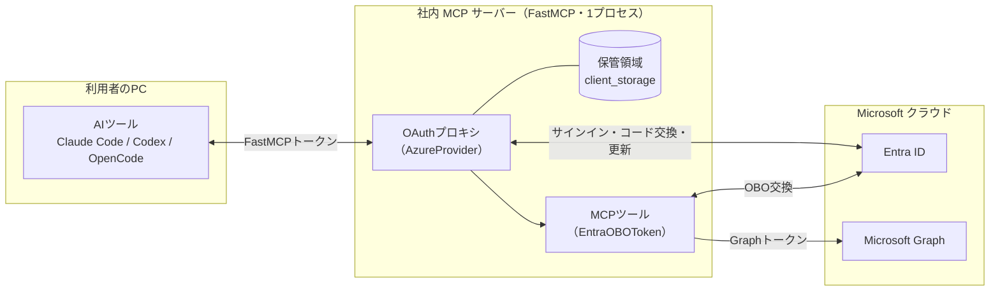
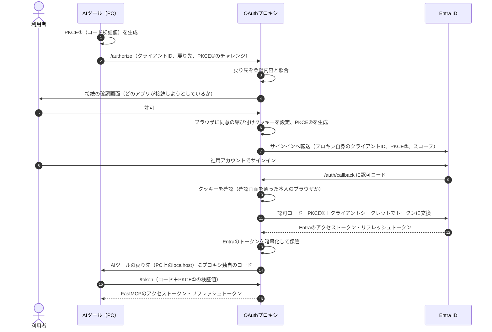
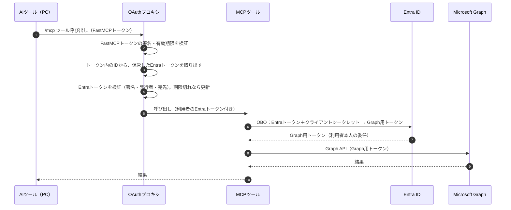

# セッションログ e11a6139

- セッション: `e11a6139-daf3-4567-9758-1d76e7b265ea`
- cwd: `/Users/notfolder/Documents/graph-mcp-gateway`（branch: main）
- 期間: 2026-10-31 22:24 〜 2026-11-01 00:09
- Claude Code: 2.1.316
- 発言: ユーザー 20 / Claude 20 / ツール呼び出し 166
- 書き出し: 2026-11-01 00:10 JST

> ユーザー発言と Claude の本文は逐語。ツール呼び出しは `🔧` の 1 行に要約し、ツール結果・思考ブロックは含まない。

---
## 1. ユーザー（2026-10-31 22:24）

docs配下の仕様書と設計書を見て問題がないか確認してください。必要があればインターネットを調査して実装に必要な情報が集まっているか、確証が取れているか確認して。

## 2. Claude

> 🔧 `Bash` List project files and read estimate log

> 🔧 `Read` /Users/notfolder/Documents/graph-mcp-gateway/docs/requirements.md

> 🔧 `Read` /Users/notfolder/Documents/graph-mcp-gateway/docs/design.md

> 🔧 `Bash` Check FastMCP latest version and dependencies on PyPI

> 🔧 `Bash` Show fastmcp-slim dependencies and download URLs

> 🔧 `Bash` Download and unpack FastMCP slim wheel for source inspection

FastMCP 4.1.4 の実ソースを取得したので、設計書に出てくる API（AzureProvider・EntraOBOToken・保管先の既定値など）を突き合わせています。

> 🔧 `Bash` Read FastMCP AzureProvider source

> 🔧 `Bash` Read rest of AzureProvider including OBO

> 🔧 `Bash` Grep OAuthProxy for storage and key handling

> 🔧 `Bash` Read OAuthProxy init docs, storage defaults and token loading

> 🔧 `Bash` Check FastMCP settings for home dir, stateless HTTP and error masking

> 🔧 `Bash` Find how dependency errors are surfaced to clients

> 🔧 `Bash` Read dependency resolution error handling

> 🔧 `Bash` Check whether injected params are stripped from client arguments

> 🔧 `Bash` Read injected parameter filtering logic

> 🔧 `Bash` Check py-key-value-aio Redis extra and httpx2 package info

> 🔧 `Bash` Inspect httpx2 for MockTransport and redirect auth stripping

> 🔧 `ToolSearch` select:WebSearch

Graph API の細かい仕様と AI ツール 3 種の OAuth 対応を、Microsoft と各ツールの公式ドキュメントで確認しています。

> 🔧 `WebSearch` Microsoft Graph messages $search cannot use $filter $orderby "search request"

> 🔧 `WebSearch` Microsoft Graph driveItem get content 302 Found preauthenticated download URL

> 🔧 `WebSearch` Codex CLI MCP streamable HTTP OAuth login dynamic client registration

> 🔧 `WebSearch` OpenCode remote MCP server OAuth dynamic client registration redirect uri

> 🔧 `WebSearch` Microsoft Graph list chat messages $top maximum 50 channel messages $top

> 🔧 `WebSearch` Microsoft Graph upload small file PUT content 250 MB limit createUploadSession 320 KiB

> 🔧 `WebSearch` Entra ID access token scp contains all consented scopes not only requested scopes

> 🔧 `WebSearch` Claude Code MCP OAuth client ID metadata document CIMD support remote server

> 🔧 `Bash` Check FastMCP redirect URI pattern matching rules

> 🔧 `WebSearch` learn.microsoft.com driveitem-put-content "250 MB"

> 🔧 `WebSearch` MCP streamable HTTP multiple instances load balancer session id sticky sessions FastMCP stateless_http

docs 配下の 2 本（`docs/requirements.md`、`docs/design.md`）を確認しました。そのまま実装に入ると不具合になる箇所が 5 件あります。ファイルはまだ何も変更していません。

FastMCP は 4.1.4 の公開ソースを取得して読み、設計書に出てくる引数・既定値・挙動を突き合わせました。Graph と AI ツールの仕様は公式ドキュメントで裏を取りました。

## 確証が取れたもの（直さなくてよい）

| 項目 | 結果 |
|---|---|
| FastMCP 4.1.4 が最新安定版 | ○ 2026-10-26 公開。4.2.0a1 はプレリリース。Python は 3.10 以上 |
| `fastmcp[azure]` で `azure-identity`・`PyJWT` が入る | ○ |
| `httpx2` | ○ 実在する。pydantic が作っている httpx の後継で、FastMCP の依存に入っている。`MockTransport` もある |
| `AzureProvider` の引数名（設計書 4・5 章） | ○ すべて一致。`require_authorization_consent` は `True` / `False` / `"remember"` / `"external"` を取る |
| `EntraOBOToken` の取り込み方と書き方（7.5） | ○ `fastmcp.server.auth.providers.azure` にある。`graph_token` はツールの引数一覧に出ず、AI ツールから値を渡しても FastMCP が捨てるので差し替えられない |
| リフレッシュ（RQ-009） | ○ `offline_access` は `AzureProvider` が自動で足すので、`scopes.py` に書かなくてよい |
| Redis と `FernetEncryptionWrapper` | ○ どちらも `py-key-value-aio` にある。Redis を使うときは `py-key-value-aio[redis]` を別に入れる |
| 3 つの AI ツールの OAuth 対応 | ○ Claude Code は CIMD と DCR、Codex は CIMD と DCR、OpenCode は DCR に対応 |

## 指摘事項

### 高：実装前に直すべきもの

| # | 箇所 | 問題 | 修正案 |
|---|---|---|---|
| H1 | 設計 8.2 ページング | 1 ページを `max_items` で切り詰めたあと `next_cursor` に `nextLink` を返すと、切り捨てた分は二度と取れない。データが黙って欠ける | 最初の要求に `$top=min(max_items, その API の上限)` を付け、ページの区切りで止める。Teams のチャット・チャネルのメッセージは `$top` が最大 50。`$top` に対応しない API の扱いも決める |
| H2 | 設計 7.3 `files_get_content` | `/content` は 302 で、認証済みのダウンロード URL へ転送される。`httpx2` は既定で転送をたどらないので失敗する。8.3 のエラー分岐にも 3xx の扱いがない | この要求だけ転送をたどる。`httpx2` は別のサーバーへ転送するとき `Authorization` を外すことをソースで確認した。8.2 の「Graph 以外の URL を拒否する」規則とぶつからないよう、別の処理経路として書く |
| H3 | 設計 7.3 `files_upload` | ファイルの中身を AI ツールからどう受け取るか（テキストか base64 か）と、サイズの上限が決まっていない。「境目のサイズは実装時確認」は公式で **250 MB** と確認できた | ツール引数は JSON なので、250 MB を引数で渡すのは現実的でない。分割アップロードが本当に要るかを含めて決める（確認事項 2） |
| H4 | 設計 10 章 構成B（複数台） | MCP の Streamable HTTP は、既定でセッションをプロセスのメモリに持つ。負荷分散で別の台に振られると要求が失敗する。署名鍵と Redis を共有するだけでは複数台にできない | セッションを持たない動作（`stateless_http=True`）にするか、`Mcp-Session-Id` で同じ台に固定するかを 10 章に書く（確認事項 3） |
| H5 | Entra 側の前提 | `AzureProvider` は v2 形式のトークンだけを受け付ける（発行者 `…/{tenant}/v2.0`）。アプリのマニフェストで `requestedAccessTokenVersion: 2` にしていないと、すべてのサインインが検証で落ちる。FastMCP のソースに手順として書かれている | 依頼資料にこの設定が入っているか確かめる。依頼資料が手元に無いので照合できていない |

### 中：記述を直す、または追記するもの

| # | 箇所 | 内容 |
|---|---|---|
| M1 | 設計 7.1 `mail_list_messages` | メールでは `$search` と `$filter` を一緒に使うと 400 エラーになる。`$search` と `$orderby` も同じ。同時に指定されたときの扱いを決める。7.5 の例は検索語に入った `"` をエスケープしていない |
| M2 | 要件 RQ-007 | 「必要なスコープだけ指定」しても、権限は絞られない。Entra は同じ Graph あての、同意済みのスコープ全部をトークンに入れて返す。指定は残してよいが、最小権限を保証するものでないと注記する |
| M3 | 要件 RQ-008 の理由 | 「含まれないと交換が失敗する」は正確でない。`additional_authorize_scopes` は利用者の同意を先に取るための設定で、管理者同意が済んでいれば含めなくても OBO は通る。今回は管理者同意が前提なので実害は無く、理由の書き方だけ直す |
| M4 | 設計 10 章「`jwt_signing_key` 未設定でも可」 | 未設定だと署名鍵はクライアントシークレットから作られ、保管先の暗号鍵とディレクトリもそこから作られる。Entra のシークレットには期限があり、更新すると全員のサインイン状態が読めなくなって再サインインになる。署名鍵の管理（U-4）を判断する材料として追記する |
| M5 | 設計 10 章 既定の保管先 | 既定の保存場所は `FASTMCP_HOME` の下（`oauth-proxy/…`、Fernet で暗号化したファイル）。コンテナで動かすならここを永続化しないと、再起動のたびに全員が再サインインになる |
| M6 | 未決事項の「既定値」が実際に何か | `enable_cimd` は既定で有効。Claude Code は CIMD を優先するので、未設定のままだと Claude Code では DCR の経路を試験できない（AC-001）。`allowed_client_redirect_uris` は既定ですべて許可。制限するなら Claude Code の `http://localhost/callback` と `http://127.0.0.1/callback`（ポートは任意）、OpenCode の `http://127.0.0.1:19876/mcp/oauth/callback` を通す必要がある。FastMCP は `localhost:*` のようなポートの任意指定に対応している |
| M7 | 設計 4 章 設定表 | 載っていない設定がある。①再試行回数（8.3 で「設定で変更可能」と書いたのに環境変数が無い）。②`APP_REQUIRED_SCOPES` は `api://…` を付けない名前で渡す（FastMCP が自動で付ける）ことの明記。③別部署が Application ID URI を既定の `api://{client_id}` から変えた場合の `identifier_uri`。④`APP_REQUIRE_CONSENT` の文字列を値に変換する規則 |
| M8 | RQ-192 と OBO の失敗 | OBO が失敗すると、FastMCP は「Failed to resolve dependency 'graph_token' for …」という、AI ツールには意味の分からない例外に包む。設計 8.3 は Graph の HTTP エラーしか扱っていないので、OBO の失敗をどこで変換するかを書く |
| M9 | 要件と設計のずれ | 再試行する状態コードが、要件 NF-006 は 429・503、設計 8.1 は 504 も含む。提案 PP-003・PP-004 が要件 12 章に無い |

### 低

| # | 内容 |
|---|---|
| L1 | 貼り付けたときの自動リンクで、表記が崩れている。`[ChannelMessage.Read](http://ChannelMessage.Read).All`（要件 RQ-144、設計 7.4）、`[User.Read](http://User.Read)`、`graph/[scopes.py](http://scopes.py)`、設計 8.1 の壊れたリンク。AI がスコープ名を読み違えるおそれがある |
| L2 | `folder_id` などの ID をそのまま URL のパスにつないでいる。Graph が権限を判定するので他人のデータには届かないが、`/` を含む値で別の API を呼べてしまう。パスに入れる値は URL エンコードする方針を書く |
| L3 | 要件 AI-004（コードのコメントに要件 ID を書く）は、このマシンの isdd スキル（ID は対応表に書き、コードには書かない）と方針が逆。isdd で実装するならどちらかに揃える |

確認しきれていないものが 2 つあります。各 Graph API に必要な権限は手元の知識と一致していますが、全 API の公式ページは照合していません。Codex のコールバックのポート（1455）も公式では確かめていません。

## お願い

- 要件に出てくる「依頼資料」と「プロキシ仕様」が `docs/` にありません。置いてもらえれば、P-1〜P-8 の値と H5、プロキシ仕様 11 章の未決事項を照合します。

## 確認事項

3 問は互いに依存しないので、「1A, 2B, 3A」のようにまとめて答えてください。

**1. 指摘を docs に反映するか**
今は報告だけで、ファイルは変えていません。

| 案 | 内容 | 影響 |
|---|---|---|
| A | 高・中・低をすべて要件仕様書と設計書に反映する | ただし確認事項 2・3 の答えが要る部分は、答えをもらってから書く |
| B | 高（H1〜H5）だけ反映する | 中の記述のずれは実装時に AI が迷う原因として残る |
| C | 反映しない（報告のみ） | 文書は今のまま |

おすすめ: A。中の M2・M3・M6 は、実装する AI が要件を誤解する原因になります。M9 は要件と設計が食い違ったままで、AI-002（要件に無いものを足さない）とぶつかります。

**2. `files_upload` で中身をどう受け取るか（H3）**

| 案 | 内容 | 影響 |
|---|---|---|
| A | テキストのみ受け取る | 一番簡単。Office ファイルや画像は上げられない |
| B | テキストと base64 を受け取り、サイズに上限を設ける（上限値は別途決める） | 実用的な範囲をカバーできる。分割アップロードは不要になる |
| C | B に加えて、250 MB を超える分割アップロードまで作る | 引数で巨大なファイルは送れないので、作っても使われない見込み |

おすすめ: B。JSON の引数で数百 MB を渡すのは現実的でなく、分割アップロードは作っても使われません。上限値は PP-002 と同じく、提案として扱います。

**3. 複数台構成で MCP のセッションをどう扱うか（H4）**
台数（U-9）は未決ですが、構造として対応できることが NF-005 の要件です。

| 案 | 内容 | 影響 |
|---|---|---|
| A | セッションを持たない動作（`stateless_http`）を環境変数で切り替えられるようにする | 負荷分散は単純な振り分けでよい。サーバーから AI ツールへの通知は使えなくなるが、今回のツールでは使わない |
| B | 負荷分散で同じ台に固定する前提を 10 章に書く | コードは変わらない。負荷分散装置の設定に条件が付く |

おすすめ: A。台数が決まっていない段階で、設定 1 つで両方の構成に対応できます。

---

出典:
- [FastMCP（PyPI）](https://pypi.org/project/fastmcp/)／[httpx2](https://github.com/pydantic/httpx2)
- [Download driveItem content（302 転送）](https://learn.microsoft.com/en-us/graph/api/driveitem-get-content)
- [Upload small files（250 MB）](https://learn.microsoft.com/en-us/graph/api/driveitem-put-content?view=graph-rest-1.0)
- [List messages in a chat（`$top` 最大 50）](https://learn.microsoft.com/en-us/graph/api/chat-list-messages)／[channel list messages](https://learn.microsoft.com/ja-jp/graph/api/channel-list-messages)
- [`$search` と `$filter` の併用（Microsoft Q&A）](https://learn.microsoft.com/en-us/answers/questions/1401458/using-search-and-filter-parameters-for-messages-en)
- [MSAL: resources and scopes（同意済みスコープがすべて返る）](https://learn.microsoft.com/en-us/entra/msal/javascript/browser/resources-and-scopes)／[access token claims reference](https://learn.microsoft.com/en-us/entra/identity-platform/access-token-claims-reference)
- [Claude connectors authentication（Claude Code の CIMD）](https://www.claude.com/docs/connectors/building/authentication)
- [Codex MCP docs](https://developers.openai.com/ja-JP/docs/extend/mcp)／[Codex PR #22575](https://github.com/openai/codex/issues/22575)
- [OpenCode issue #23787（固定コールバック）](https://github.com/anomalyco/opencode/issues/23787)
- [python-sdk PR #1697（複数台とスティッキー）](https://github.com/modelcontextprotocol/python-sdk/pull/1697/files)

## 3. ユーザー（2026-10-31 22:31）

現状をgitにコミットしてgithubに公開で出して。
1 A
2 B
3 A


<pasted_content id="53a9">
# 社内共有 M365 MCP サーバー 関連資料（依頼資料・OAuth プロキシ仕様）

- 作成日：2026-10-31
- 作成：［氏名］（［メールアドレス］）

本書は、要件仕様書・設計書で参照している次の2つの資料を1つにまとめたものです。

| 部 | 資料 | 要件仕様書・設計書での呼び方 | 主な読者 |
|---|---|---|---|
| 第1部 | 社内共有MCPサーバーから Microsoft Graph（M365データ）を利用する PoC のご説明と Entra ID 設定のご依頼 | 依頼資料 | Entra ID ご担当部署、当部署 |
| 第2部 | 社内共有 M365 MCP サーバー OAuth プロキシ仕様（FastMCP / PoC） | プロキシ仕様 | 当部署、実装担当（AI エージェントを含む） |

第2部の中の「依頼資料 P-1〜P-8、C-1〜C-6」は、第1部7章・8章の番号を指します。

---

## 第1部　依頼資料：社内共有MCPサーバーから Microsoft Graph（M365データ）を利用する PoC のご説明と Entra ID 設定のご依頼

- 作成日：2026-10-31
- 作成：［氏名］（［メールアドレス］）
- 対象：Microsoft Entra ID（Azure AD）ご担当部署 様

---

### 1. 目的

社内に共有の MCP サーバーを1台置き、社員が **Claude Code・Codex・OpenCode** から自分のメール・予定表・SharePoint/OneDrive・Teams の情報を読み書きできるかを PoC で確認します。

- 各利用者は **自分の Entra ID でサインイン**し、**本人の権限の範囲のデータだけ**を扱います（委任アクセス）。
- 利用者に鍵（APIキーなど）は配布しません。
- 本書は PoC 段階のご依頼です。本番化のご依頼は、PoC の結果を踏まえて改めてご相談します。

---

### 2. 役割分担

| 範囲 | 担当 |
|---|---|
| Entra ID のアプリ登録、API 権限、管理者同意、利用者の割り当て | **貴部署**（本書でご依頼する範囲） |
| 共有 MCP サーバー（FastMCP で自作）の構築・運用、Claude Code・Codex・OpenCode の利用手順 | 当部署 |

---

### 3. 用語

| 用語 | 説明 |
|---|---|
| MCP（Model Context Protocol） | AI ツールが外部のシステムやデータを呼び出すための共通の接続方式 |
| Claude Code / Codex / OpenCode | 各利用者の PC で動く AI ツール（それぞれ Anthropic、OpenAI、オープンソースの製品）。MCP サーバーに接続して機能を使う |
| MCP サーバー | AI ツールに機能（例：メールを検索する）を提供するサーバー。今回は社内に1台置いて全員で共有する |
| FastMCP | MCP サーバーを作るためのオープンソースのライブラリ（Python、Apache 2.0 ライセンス）。Entra ID と連携するための部品（`AzureProvider`）を持つ |
| OAuth プロキシ | MCP サーバーの入口で、Entra ID へのサインインを仲介する仕組み。FastMCP に組み込まれている |
| 委任アクセス | アプリが「サインインした利用者本人として」データにアクセスする方式。本人に権限のないデータは見えない |
| OBO（On-Behalf-Of） | サーバーが、利用者のトークンを Entra ID に提示して、Graph 用のトークンに交換する仕組み。利用者本人としてのアクセスのまま |
| 管理者同意 | 組織全体として、アプリに権限を与えることを管理者が承認する操作 |
| エンタープライズアプリの「割り当てが必要」 | 指定したユーザー・グループ以外がアプリにサインインできないようにする設定 |

---

### 4. 構成



**ポイント**

- Entra ID に登録する戻り先（リダイレクト URI）は、**MCP サーバーの URL 1件だけ**です。利用者の PC 側の戻り先（Claude Code・Codex・OpenCode がそれぞれ使う localhost / 127.0.0.1 のアドレス）は MCP サーバーとの間だけで使われるため、Entra ID への登録は不要です。利用する AI ツールを追加しても、Entra ID 側のリダイレクト URI の変更は発生しません。
- Graph 用のトークンは MCP サーバーの中で取得・使用し、**利用者の PC には渡りません**。各ツールが持つのは、MCP サーバーが発行したトークンだけです。
- Graph へのアクセスは利用者本人としての委任アクセスです。本人に権限のないデータは取得できません。

---

### 5. 認証の流れ



---

### 6. 利用者から見た初回の流れ（Claude Code・Codex・OpenCode 共通）

1. 使うツールに MCP サーバーを登録する（ツールごとの手順は当部署が案内します）。
2. ツールで認証を開始すると、ブラウザが開きます。
3. MCP サーバーの確認画面で接続を許可します。
4. Entra ID のサインイン画面で社用アカウントでサインインします。
5. 以降はそのツールからメール・予定表などの機能を使えます。

---

### 7. ご依頼事項（PoC）

#### 7.0 作業の全体像

作業はすべて **Microsoft Entra 管理センター（https://entra.microsoft.com）** で行います。所要の作業と場所は以下のとおりです。

| No. | 作業 | 場所（管理センターのメニュー） | 目的 |
|---|---|---|---|
| P-1 | アプリ登録の作成 | Entra ID ＞ アプリの登録 ＞ 新規登録 | MCP サーバーを Entra ID に「アプリ」として登録し、サインインの窓口にする |
| P-2 | API の公開 | （作成したアプリ）＞ API の公開 | MCP サーバー自身に対するアクセス用のスコープを作る |
| P-3 | トークンのバージョン設定 | （作成したアプリ）＞ マニフェスト | FastMCP が前提とする v2 形式のトークンを発行させる |
| P-4 | クライアントシークレットの発行 | （作成したアプリ）＞ 証明書とシークレット | MCP サーバーが Entra ID とやり取りするための合言葉 |
| P-5 | API のアクセス許可の追加 | （作成したアプリ）＞ API のアクセス許可 | メール・予定表などを利用者本人として扱う権限を付ける |
| P-6 | 管理者の同意 | （作成したアプリ）＞ API のアクセス許可 | 組織として P-5 の権限を承認する |
| P-7 | 利用者の割り当て | Entra ID ＞ エンタープライズ アプリケーション ＞ （作成したアプリ） | サインインできる人を PoC 参加者だけに限定する |
| P-8 | 当部署へのご連絡 | （作成したアプリ）＞ 概要 | MCP サーバーの設定に必要な値をお知らせいただく |

**必要な管理者ロール**

- P-1〜P-5、P-7：アプリケーション管理者、またはクラウド アプリケーション管理者
- P-6（管理者の同意）：クラウド アプリケーション管理者、アプリケーション管理者、または特権ロール管理者
  - 今回は委任された権限だけを使うため、Microsoft のドキュメント上、クラウド アプリケーション管理者・アプリケーション管理者でも同意できます。

> メニュー名は管理センターの表示言語や画面の更新によって多少異なる場合があります。

---

#### P-1. アプリ登録の作成

**場所**：Entra ID ＞ アプリの登録 ＞ ［新規登録］

**操作と設定値**

| 画面の項目 | 設定値 |
|---|---|
| 名前 | 任意（例：社内 M365 MCP サーバー（PoC））※名前は貴部署の命名規則に合わせてください |
| サポートされているアカウントの種類 | この組織ディレクトリのみに含まれるアカウント（シングル テナント） |
| リダイレクト URI ＞ プラットフォームの選択 | Web |
| リダイレクト URI ＞ 値 | `https://{サーバーURL}/auth/callback` |

［登録］を押すと、アプリが作成されます。同時に、同じ名前のエンタープライズ アプリケーションも自動で作成されます（P-7 で使います）。

**補足**

- サーバー URL は未定です。決まり次第ご連絡しますので、リダイレクト URI はその時点で設定いただいても構いません（後から「認証」メニューで追加できます）。
- リダイレクト URI は、この **1件だけ** です。利用者の PC の AI ツール（Claude Code・Codex・OpenCode）の分は登録不要です（4章のとおり）。

---

#### P-2. API の公開

**場所**：（P-1 で作成したアプリ）＞ 管理 ＞ API の公開

**操作と設定値**

1. 「アプリケーション ID の URI」の［追加］（または［設定］）を押し、既定値の `api://{クライアントID}` のまま保存します。
2. ［Scope の追加］を押し、以下を入力して保存します。

| 画面の項目 | 設定値 |
|---|---|
| スコープ名 | 当部署からご提示します |
| 同意できるのはだれですか？ | 貴部署の規程に合わせてご選択ください（P-6 で管理者の同意を行うため、どちらでも動作します） |
| 管理者の同意の表示名・説明 | 例：「社内 M365 MCP サーバーへのアクセス」 |
| 状態 | 有効 |

**目的**：利用者がサインインしたときに、Entra ID が「この MCP サーバー宛て」のトークンを発行するようにするためです。MCP サーバーはこのトークンを受け取って本人確認をし、P-5 の権限で Graph 用のトークンに交換（OBO）します。

---

#### P-3. トークンのバージョン設定

**場所**：（作成したアプリ）＞ 管理 ＞ マニフェスト

**操作**：マニフェストの `api` の中にある `requestedAccessTokenVersion` を `2` に変更し、［保存］を押します。

```json
"api": {
  "requestedAccessTokenVersion": 2,
  ...
}
```

**目的**：FastMCP は v2 形式のアクセストークンを前提としています。既定値（null）のままだと、認証エラーになる場合があります。

---

#### P-4. クライアントシークレットの発行

**場所**：（作成したアプリ）＞ 管理 ＞ 証明書とシークレット ＞ クライアント シークレット ＞ ［新しいクライアント シークレット］

**操作**：説明と有効期限を入力して［追加］を押します。表示された **「値」** を控えてください（画面を離れると二度と表示されません）。

- 有効期限と受け渡し方法は、8章（C-1、C-2）でご相談させてください。

**目的**：MCP サーバーが Entra ID に対して「登録されたアプリ本人である」ことを示すために使います。サインイン後のトークン取得と、OBO での交換に必要です。

---

#### P-5. API のアクセス許可の追加

**場所**：（作成したアプリ）＞ 管理 ＞ API のアクセス許可 ＞ ［アクセス許可の追加］

**操作①：Microsoft Graph の権限**

［Microsoft Graph］＞［委任されたアクセス許可］を選び、以下を検索してチェックし、［アクセス許可の追加］を押します。**アプリケーションの許可は使いません。**

| 対象 | 権限 | 用途 | Microsoft の既定で管理者の同意が必要か |
|---|---|---|---|
| 共通 | `User.Read` | サインインした利用者の基本情報 | 不要 |
| メール | `Mail.ReadWrite` | メールの読み取り・下書き作成・移動など | 不要 |
| メール | `Mail.Send` | メールの送信 | 不要 |
| 予定表 | `Calendars.ReadWrite` | 予定の読み取り・作成・変更 | 不要 |
| OneDrive・ファイル | `Files.ReadWrite.All` | 利用者がアクセスできるファイルの読み取り・作成・更新 | 不要 |
| SharePoint | `Sites.ReadWrite.All` | 利用者がアクセスできるサイトの読み取り・作成・更新 | 不要 |
| Teams チャット | `Chat.ReadWrite` | チャットの読み取り | 不要 |
| Teams チャット | `ChatMessage.Send` | チャットへの投稿 | 不要 |
| Teams チャネル | `Team.ReadBasic.All` / `Channel.ReadBasic.All` | 参加しているチーム・チャネルの一覧 | 不要 |
| Teams チャネル | `ChannelMessage.Read.All` | チャネルのメッセージの読み取り | **必要** |
| Teams チャネル | `ChannelMessage.Send` | チャネルへの投稿 | 不要 |

**操作②：P-2 で作ったスコープ**

もう一度［アクセス許可の追加］を押し、［自分の API］＞（作成したアプリ）＞ P-2 のスコープ を選んで追加します。

- 目的：P-6 の管理者の同意の対象にこのスコープも含め、利用者ごとの同意画面を出さないためです。

**補足**

- 委任された権限なので、各利用者は **本人に権限のあるデータだけ** を扱えます。他人のメールボックスや、本人が参加していないチーム・サイトにはアクセスできません。
- PoC 中に対象のデータを増やす場合は、権限の追加を改めてご依頼します。

---

#### P-6. 管理者の同意

**場所**：（作成したアプリ）＞ 管理 ＞ API のアクセス許可

**操作**：P-5 の権限が一覧に並んでいることを確認し、［{テナント名} に管理者の同意を与えます］を押して［はい］を選びます。各権限の「状態」欄が「付与済み」になれば完了です。

**目的**：

- MCP サーバーは OBO で Graph 用のトークンに交換するため、管理者の同意がないと交換が失敗します（エラー AADSTS65001）。
- `ChannelMessage.Read.All` は、Microsoft の既定で管理者の同意が必須です。
- 組織として同意しておくことで、利用者がサインインするたびに権限の同意画面が出ることもなくなります。

---

#### P-7. 利用者の割り当て（PoC 参加者に限定）

**場所**：Entra ID ＞ エンタープライズ アプリケーション ＞ すべてのアプリケーション ＞（P-1 と同じ名前のアプリ）

**操作①：割り当てを必須にする**

管理 ＞ プロパティ で「割り当てが必要ですか?」を **はい** にして［保存］を押します。

**操作②：PoC 参加者を割り当てる**

管理 ＞ ユーザーとグループ ＞ ［ユーザーまたはグループの追加］で、PoC 参加者（ユーザー、またはグループ）を選んで［割り当て］を押します。

- PoC 参加者の一覧は当部署からご提示します。
- グループで割り当てる場合、Microsoft の仕様で Entra ID P1 以上のライセンスが必要です（8章 C-4 でご確認ください）。

**目的**：割り当てられていない人は、この MCP サーバーにサインインできなくなります。PoC 期間中の利用者を限定するためです。

---

#### P-8. 当部署へのご連絡

**場所**：（作成したアプリ）＞ 概要

以下の値をお知らせください。

| 項目 | 画面での表示名 |
|---|---|
| クライアント ID | アプリケーション (クライアント) ID |
| テナント ID | ディレクトリ (テナント) ID |
| クライアントシークレット | P-4 で控えた「値」（受け渡し方法は C-2 でご相談） |

---

### 8. ご確認事項

| No. | 内容 |
|---|---|
| C-1 | クライアントシークレットの有効期限と、更新時の連絡方法 |
| C-2 | クライアントシークレットの安全な受け渡し方法 |
| C-3 | P-5 の権限のうち、社内の規程で追加の申請や審査が必要なものがあるか |
| C-4 | P-7 でグループによる割り当てが可能か（Entra ID P1 以上のライセンスの有無）。不可の場合はユーザー単位で割り当てをお願いします |
| C-5 | 条件付きアクセスなど、このアプリへのサインインに適用される社内ポリシーがあるか（PoC の動作確認に影響するため） |
| C-6 | 作業の所要期間 |

---

### 9. 当部署の作業

| No. | 内容 |
|---|---|
| O-1 | MCP サーバーの URL を決め、リダイレクト URI としてご連絡する |
| O-2 | API の公開で使うスコープ名をご提示する |
| O-3 | PoC 参加者の一覧をご提示する |
| O-4 | FastMCP で MCP サーバーとツール（メール・予定表・SharePoint/OneDrive・Teams の読み書き）を構築する |
| O-5 | Claude Code・Codex・OpenCode からの接続手順を作成し、PoC 参加者に案内する |
| O-6 | PoC の結果をまとめ、本番化の要否とご依頼内容を改めてご相談する |

---

### 10. ライセンス・費用

| 項目 | 内容 |
|---|---|
| Microsoft Graph API | 追加費用なし（今回使う API は従量課金の対象外） |
| Microsoft 365 Copilot ライセンス | 不要（Copilot の機能は使わない） |
| FastMCP | オープンソース（Apache 2.0）。ライセンス費用なし |
| サーバーの構築・運用 | 当部署で対応 |

---

### 11. 進め方



---

## 第2部　プロキシ仕様：社内共有 M365 MCP サーバー OAuth プロキシ仕様（FastMCP / PoC）

- 作成日：2026-10-31
- 作成：［氏名］（［メールアドレス］）
- 版：PoC 向け初版
- 関連資料：「社内共有MCPサーバーから Microsoft Graph（M365データ）を利用する PoC のご説明と Entra ID 設定のご依頼」（以下、依頼資料）

> 本書は FastMCP の OAuth プロキシ（`AzureProvider`）の動作を、公式ドキュメントとソースコード（PrefectHQ/fastmcp、2026-10-31 時点の main）で確認した内容に基づいて記述しています。
> **まだ決めていない設定は「未決」と明記し、値を記載していません。**

---

### 1. 目的と位置づけ

OAuth プロキシは、社内共有 MCP サーバーの入口で次の役割を担います。

1. AI ツール（Claude Code・Codex・OpenCode）に対して **OAuth の認可サーバー** として振る舞い、利用者に鍵を配らずに接続させる。
2. 利用者のサインインを **Entra ID に中継** する（Entra ID に登録する戻り先は MCP サーバーの1件だけ）。
3. **独自のトークン** を AI ツールに発行し、Entra ID や Graph のトークンは AI ツールに渡さない。
4. ツールの呼び出し時に、利用者の Entra トークンを **OBO で Graph 用トークンに交換** し、利用者本人として Graph を呼ぶ。

FastMCP では、OAuth プロキシと MCP ツールは **同じプロセスの中** で動きます（別製品・別サーバーではありません）。

---

### 2. 前提（決定事項）

| 項目 | 内容 |
|---|---|
| 方式 | 社内に共有の HTTP MCP サーバーを置き、全員で使う |
| 実装 | FastMCP（Python、Apache 2.0）で自作。認証は `AzureProvider`、Graph 呼び出しは `EntraOBOToken` |
| 認証 | Entra ID の委任アクセス（利用者本人として Graph を呼ぶ） |
| 利用者への鍵配布 | しない |
| 対象の AI ツール | Claude Code・Codex・OpenCode |
| 対象データ | メール、予定表、SharePoint/OneDrive、Teams（読み取り・書き込み）。他は PoC で追加を検討 |
| PoC の利用者 | Entra ID の「割り当てが必要」で指定者に限定 |
| Entra ID のアプリ | シングルテナント、Web プラットフォーム、リダイレクト URI は `{サーバーURL}/auth/callback` の1件 |

---

### 3. 構成要素



| 要素 | 役割 |
|---|---|
| OAuth プロキシ（`AzureProvider`） | AI ツールの登録受付、認可、FastMCP トークンの発行・検証、Entra ID との中継 |
| 保管領域（`client_storage`） | 登録された AI ツールの情報、認可途中の状態、Entra ID のトークン（暗号化）を保管 |
| MCP ツール | Graph を呼ぶ関数群。引数の `EntraOBOToken([...])` で Graph 用トークンを受け取る |

---

### 4. 公開するエンドポイント

| パス | 用途 | 呼び出し元 |
|---|---|---|
| `/.well-known/oauth-authorization-server` ほか | 認可サーバーのメタデータ（AI ツールが接続先の仕組みを自動で調べる） | AI ツール |
| `/.well-known/oauth-protected-resource` ほか | MCP サーバー（保護リソース）のメタデータ | AI ツール |
| `/register` | 動的クライアント登録（DCR） | AI ツール |
| `/authorize` | 認可の開始。接続の確認画面を表示し、Entra ID に転送 | 利用者のブラウザ |
| `/auth/callback`（`redirect_path` の既定値） | Entra ID からの戻り先。**Entra ID に登録するのはこの1件** | Entra ID（ブラウザ経由） |
| `/token` | FastMCP トークンの発行・更新 | AI ツール |
| `/mcp`（MCP の受け口） | ツールの呼び出し。FastMCP トークンが必要 | AI ツール |

> メタデータのパスは `base_url` / `issuer_url` にパスが含まれる場合、RFC 8414 に従ってパス付きになります。

---

### 5. 処理の流れ

#### 5.1 AI ツールの登録

AI ツールは次のどちらかの方法で、自動で OAuth プロキシに登録されます。利用者や管理者の作業は不要です。

| 方式 | 動作 | 既定 |
|---|---|---|
| DCR（動的クライアント登録） | AI ツールが `/register` に自分の戻り先（PC 上の localhost / 127.0.0.1）を送り、プロキシが **クライアント ID を払い出す**。AI ツールは **公開クライアント**（シークレットなし、`token_endpoint_auth_method: none`）として登録される | 有効 |
| CIMD（クライアント ID メタデータ文書） | AI ツールが自分の情報を置いた HTTPS の URL をクライアント ID として使う。プロキシがその文書を取得し、戻り先を確認する | 有効（`enable_cimd=True`） |

- AI ツールには、Entra ID のクライアント ID・シークレットは **渡りません**（ソースコードで確認：登録応答のシークレットは `None` に正規化される）。
- CIMD の文書取得では、localhost・プライベートアドレスへの取得は拒否されます。
- どの AI ツールが DCR / CIMD のどちらで接続するかは、PoC で確認します（12章）。

#### 5.2 認可（初回サインイン）



**要点**

- PKCE は **2区間で別々** です（AI ツール⇔プロキシ、プロキシ⇔Entra ID）。`forward_pkce` の既定値 `True` で、プロキシ⇔Entra ID 側にもプロキシ自身が生成した PKCE を使います。
- Entra ID に要求するスコープは、`required_scopes`（API の公開で作るスコープ）と `additional_authorize_scopes`（Graph の委任権限）です。
- 接続の確認画面と結び付けクッキーは、**混乱した代理人（confused deputy）攻撃** の対策です（8章）。

#### 5.3 ツールの呼び出しと OBO



- Entra トークンの検証：署名（RS256、テナントの公開鍵 `https://login.microsoftonline.com/{tenant_id}/discovery/v2.0/keys`）、発行者、宛先（`client_id` または `api://{client_id}`）を確認します。
- OBO で要求するスコープは、ツールごとに `EntraOBOToken([...])` で指定します。**`additional_authorize_scopes` に含まれていないスコープは交換に失敗** します。
- OBO の資格情報は利用者ごとにメモリ上にキャッシュされ、Azure SDK のトークンキャッシュにより同じ利用者の交換の繰り返しが抑えられます。Graph 用トークンは保管領域には保存されません。

#### 5.4 トークンの更新

- AI ツールは FastMCP のリフレッシュトークンで `/token` を呼びます。
- プロキシは、対応する Entra ID のリフレッシュトークンで Entra トークンを更新し、新しい FastMCP アクセストークンを発行します。

---

### 6. トークン一覧

| トークン | 発行者 | 宛先 | 持つ場所 | 内容・形式 | 有効期限 |
|---|---|---|---|---|---|
| FastMCP アクセストークン | OAuth プロキシ | MCP サーバー | AI ツール（PC） | JWT、HS256 署名。発行者・宛先・クライアント ID・スコープ・期限・JTI（保管した Entra トークンへの参照） | 既定では Entra トークンと同じ（`fastmcp_access_token_expiry_seconds` で変更可） |
| FastMCP リフレッシュトークン | OAuth プロキシ | OAuth プロキシ | AI ツール（PC） | Entra のリフレッシュトークンに対応付け | Entra が期限（`refresh_expires_in`）を返せばそれに従う。返さない場合は `fallback_refresh_token_expiry_seconds`（既定 1年） |
| Entra アクセストークン | Entra ID | MCP サーバー（`api://{client_id}`） | 保管領域（暗号化） | JWT（v2）、RS256 | Entra ID の設定に依存 |
| Entra リフレッシュトークン | Entra ID | Entra ID | 保管領域（暗号化） | — | Entra ID の設定に依存 |
| Graph アクセストークン | Entra ID（OBO） | Microsoft Graph | MCP サーバーのメモリ上のみ | — | Entra ID の設定に依存 |

**AI ツール（PC）が持つのは FastMCP のトークンだけ** で、Entra・Graph のトークンは PC に渡りません（トークンの素通しをしない）。

---

### 7. 保管領域（`client_storage`）

| 項目 | 内容 |
|---|---|
| 保管するもの | 登録された AI ツールの情報、認可途中の状態、Entra のトークン |
| 既定の保管先 | サーバーのディスク（プラットフォームのデータディレクトリ）。暗号化あり（鍵は JWT 署名鍵から導出） |
| 暗号化 | Fernet（AES-128-CBC＋HMAC-SHA256）。独自の保管先を使う場合は `FernetEncryptionWrapper` で包む必要があり、**包まないと平文** になる |
| 複数台で動かす場合 | `jwt_signing_key` の明示と、全台から使える共有の保管先（Redis など）が必須。既定値は開発向け |

---

### 8. セキュリティ上の仕組み

| 脅威・要件 | FastMCP の仕組み | 既定 |
|---|---|---|
| 混乱した代理人（悪意のあるクライアントが、共有の Entra アプリの承認済み状態を悪用） | 接続の確認画面＋ブラウザへの結び付けクッキー。戻り先で同じブラウザかを確認 | 有効（`require_authorization_consent=True`、毎回表示） |
| 認可コードの横取り | PKCE を2区間で別々に検証 | 有効（`forward_pkce=True`） |
| 不正な戻り先 | 登録時に戻り先を確認。`javascript:` `data:` `file:` `vbscript:` は常に拒否。`application_type` が `web` の場合は https・非ループバックのみ | `allowed_client_redirect_uris=None`（危険なスキーム以外は許可。ループバックはポート違いを許容） |
| トークンの素通し | AI ツールには FastMCP トークンだけを渡す。Graph へは OBO で交換したトークンを使う | 仕様上常に |
| なりすましトークン | Entra トークンの署名・発行者・宛先を検証 | 常に |
| 対象者の限定 | Entra ID の「割り当てが必要」で、割り当てられていない人はサインインできない | Entra 側の設定（依頼資料 P-7） |

---

### 9. Entra ID の設定との対応

| 依頼資料 | Entra ID の設定 | FastMCP の設定 |
|---|---|---|
| P-1 | テナント ID | `tenant_id`（特定のテナント ID を指定。`common` は新規アプリで不可） |
| P-1 | リダイレクト URI `{サーバーURL}/auth/callback` | `base_url`＋`redirect_path`（既定 `/auth/callback`）。**完全一致が必要** |
| P-2 | アプリケーション ID の URI `api://{client_id}` | `identifier_uri`（既定 `api://{client_id}`） |
| P-2 | スコープ | `required_scopes`（接頭辞なしの名前で指定） |
| P-3 | `requestedAccessTokenVersion: 2` | 前提条件（v2 トークンを検証） |
| P-4 | クライアントシークレット | `client_secret` |
| P-5 | Graph の委任権限 | `additional_authorize_scopes`、各ツールの `EntraOBOToken([...])` |
| P-6 | 管理者の同意 | 前提条件（ないと OBO が AADSTS65001 で失敗） |
| P-8 | クライアント ID | `client_id` |

---

### 10. 設定パラメータ

| パラメータ | 内容 | 既定値 | PoC での値 |
|---|---|---|---|
| `client_id` | Entra アプリのクライアント ID | — | 依頼資料 P-8 で受領 |
| `client_secret` | Entra アプリのシークレット | — | 依頼資料 P-8 で受領 |
| `tenant_id` | テナント ID | —（必須） | 依頼資料 P-8 で受領 |
| `base_url` | MCP サーバーの公開 URL | — | **未決**（サーバー URL 未定） |
| `redirect_path` | Entra からの戻り先のパス | `/auth/callback` | 既定値（依頼資料で `/auth/callback` として依頼済み） |
| `required_scopes` | API の公開で作るスコープ | —（必須） | **未決**（スコープ名未定） |
| `identifier_uri` | アプリケーション ID の URI | `api://{client_id}` | 既定値（依頼資料 P-2 で既定値として依頼済み） |
| `additional_authorize_scopes` | Graph の委任権限 | なし | 依頼資料 P-5 の権限 |
| `client_storage` | 保管先 | 暗号化ディスク | **未決** |
| `jwt_signing_key` | FastMCP トークンの署名鍵 | クライアントシークレットから導出 | **未決** |
| `require_authorization_consent` | 接続の確認画面 | `True`（毎回表示） | **未決**（`True` / `"remember"` / `False` / `"external"`） |
| `allowed_client_redirect_uris` | AI ツールの戻り先の制限 | `None`（危険なスキーム以外許可） | **未決** |
| `enable_cimd` | CIMD の受け付け | `True` | **未決** |
| `fastmcp_access_token_expiry_seconds` | FastMCP アクセストークンの有効期限 | Entra トークンと同じ | **未決** |
| `fallback_refresh_token_expiry_seconds` | Entra が期限を返さないときの FastMCP リフレッシュトークンの期限 | 1年 | **未決** |
| `forward_pkce` | Entra 側の PKCE | `True` | **未決** |

---

### 11. 未決事項

| No. | 内容 | 関係するパラメータ |
|---|---|---|
| U-1 | MCP サーバーの URL | `base_url` |
| U-2 | API の公開で作るスコープ名 | `required_scopes` |
| U-3 | 保管先（既定の暗号化ディスク／共有の保管先） | `client_storage` |
| U-4 | 署名鍵の管理（明示するか、シークレットから導出するか） | `jwt_signing_key` |
| U-5 | 接続の確認画面の出し方（毎回／記憶する／出さない） | `require_authorization_consent` |
| U-6 | AI ツールの戻り先を制限するか | `allowed_client_redirect_uris` |
| U-7 | CIMD を受け付けるか | `enable_cimd` |
| U-8 | トークンの有効期限 | `fastmcp_access_token_expiry_seconds` ほか |
| U-9 | 台数（1台／複数台）。複数台の場合は U-3・U-4 が必須条件になる | — |

---

### 12. PoC で確認すること

| No. | 確認内容 |
|---|---|
| T-1 | Claude Code・Codex・OpenCode が、それぞれ DCR または CIMD で鍵なしに接続できるか |
| T-2 | 初回のサインイン（接続の確認画面 → Entra ID）が完了し、ツールが使えるか |
| T-3 | 利用者ごとにデータが分かれるか（他人のメール等が見えないこと） |
| T-4 | 「割り当てが必要」で、割り当てのない人がサインインできないこと |
| T-5 | OBO で各権限（メール・予定表・ファイル・Teams の読み書き）の Graph 用トークンが取れるか |
| T-6 | トークンの期限切れ後に、再サインインなしで更新されるか |
| T-7 | サーバー再起動後もサインイン状態が保たれるか（保管先の設定による） |
| T-8 | 条件付きアクセスなど社内ポリシーの影響（依頼資料 C-5 の回答による） |

---

### 13. 参照

- FastMCP: Azure (Entra ID) Integration — https://gofastmcp.com/integrations/azure
- FastMCP: OAuth Proxy — https://gofastmcp.com/servers/auth/oauth-proxy
- FastMCP ソースコード（`fastmcp/server/auth/providers/azure.py`、`oauth_proxy/proxy.py`、`redirect_validation.py`）— https://github.com/PrefectHQ/fastmcp
- Microsoft Learn: Grant tenant-wide admin consent to an application — https://learn.microsoft.com/en-us/entra/identity/enterprise-apps/grant-admin-consent
</pasted_content id="53a9">

## 4. Claude

> 🔧 `Bash` Check repo status, remotes and GitHub auth

> 🔧 `Bash` Check whether forward_pkce exists in FastMCP 4.1.4

ご回答（1A・2B・3A）を反映します。まず現状をそのままコミットします。

> 🔧 `Bash` Commit current requirements and design docs

貼っていただいた関連資料を `docs/related_materials.md` として保存し、照合します。

> 🔧 `Write` /Users/notfolder/Documents/graph-mcp-gateway/docs/related_materials.md

関連資料で H5（v2 トークン）は P-3 で依頼済みと確認できました。続けて要件仕様書を直します。

> 🔧 `Edit` /Users/notfolder/Documents/graph-mcp-gateway/docs/requirements.md

> 🔧 `Edit` /Users/notfolder/Documents/graph-mcp-gateway/docs/requirements.md

> 🔧 `Edit` /Users/notfolder/Documents/graph-mcp-gateway/docs/requirements.md

> 🔧 `Edit` /Users/notfolder/Documents/graph-mcp-gateway/docs/requirements.md

> 🔧 `Edit` /Users/notfolder/Documents/graph-mcp-gateway/docs/requirements.md

> 🔧 `Edit` /Users/notfolder/Documents/graph-mcp-gateway/docs/requirements.md

> 🔧 `Edit` /Users/notfolder/Documents/graph-mcp-gateway/docs/requirements.md

> 🔧 `Edit` /Users/notfolder/Documents/graph-mcp-gateway/docs/requirements.md

> 🔧 `Edit` /Users/notfolder/Documents/graph-mcp-gateway/docs/requirements.md

要件仕様書の修正が終わりました。次は設計書です。

> 🔧 `Bash` Fix auto-link artifacts in design document

> 🔧 `Edit` /Users/notfolder/Documents/graph-mcp-gateway/docs/design.md

> 🔧 `Edit` /Users/notfolder/Documents/graph-mcp-gateway/docs/design.md

> 🔧 `Edit` /Users/notfolder/Documents/graph-mcp-gateway/docs/design.md

> 🔧 `Edit` /Users/notfolder/Documents/graph-mcp-gateway/docs/design.md

> 🔧 `Edit` /Users/notfolder/Documents/graph-mcp-gateway/docs/design.md

> 🔧 `Edit` /Users/notfolder/Documents/graph-mcp-gateway/docs/design.md

> 🔧 `Edit` /Users/notfolder/Documents/graph-mcp-gateway/docs/design.md

> 🔧 `Edit` /Users/notfolder/Documents/graph-mcp-gateway/docs/design.md

> 🔧 `Edit` /Users/notfolder/Documents/graph-mcp-gateway/docs/design.md

> 🔧 `Edit` /Users/notfolder/Documents/graph-mcp-gateway/docs/design.md

> 🔧 `Edit` /Users/notfolder/Documents/graph-mcp-gateway/docs/design.md

> 🔧 `Edit` /Users/notfolder/Documents/graph-mcp-gateway/docs/design.md

> 🔧 `Edit` /Users/notfolder/Documents/graph-mcp-gateway/docs/design.md

> 🔧 `Edit` /Users/notfolder/Documents/graph-mcp-gateway/docs/design.md

> 🔧 `Read` /Users/notfolder/Documents/graph-mcp-gateway/docs/design.md

> 🔧 `Bash` Rewrite paging design and retry/OBO error sections

> 🔧 `Bash` Verify middleware on_call_tool wraps dependency resolution

> 🔧 `Bash` Trace where dependencies resolve relative to middleware

> 🔧 `Bash` Update deployment section and proposals in design doc

> 🔧 `Bash` Add test rows and review design diff

文書の修正が終わったので、2 つ目のコミットを作ります。

> 🔧 `Bash` Commit review fixes and related materials

> 🔧 `Bash` Check if GitHub repo exists and count internal markings

ご回答の 1A・2B・3A を要件仕様書と設計書に反映し、ローカルで 2 つコミットしました。GitHub への公開はまだしていません。リポジトリを公開にしてよいか、確認させてください（末尾の確認事項）。

## コミット（ブランチ main）

| コミット | 内容 |
|---|---|
| `5b8bf90` | 修正前の要件仕様書と設計書（「現状」の分） |
| `736145c` | 貼っていただいた関連資料を `docs/related_materials.md` として追加し、レビューの指摘を反映 |

## 反映した内容

- **1A（指摘をすべて反映）**
  - H1：ページングで取りこぼしが出ないよう、`cursor` を「ページの URL ＋ 何件目から返すか」の組にしました（設計 8.2）。
  - H2：`files_get_content` は 302 の転送をたどる専用の処理にしました。
  - M8：OBO の失敗を、原因の分かるエラーに変換する方法を設計 8.4 に追加しました。
  - M2・M3：RQ-007・RQ-008 の記述を、Entra ID の実際の動作に合わせて直しました。
  - M4〜M6：未決事項の表に、未設定のときの FastMCP の動作と判断材料を足しました。
  - M9：再試行の対象は要件どおり 429・503 に揃え、504 を加えるかは提案 PP-006 にしました。
  - L1・L2：自動リンクの崩れを直し、パスに入れる値の URL エンコードを追記しました。
- **2B（アップロードの受け取り方）**：`files_upload` はテキストか base64 で受け取り、サイズに上限を設けます。上限値は提案 PP-005 として未承認のままです。分割アップロードは作りません。
- **3A（複数台のセッション）**：`APP_STATELESS_HTTP` で、セッションを持たない動作を選べるようにしました（NF-005、設計 10 章）。
- **H5（v2 トークン）**：関連資料の P-3 で依頼済みだったので、設計書にそのことを書くだけにしました。
- **L3（要件 ID をコードに書くか）**：反映していません。どちらの方式に揃えるか決める必要があるため、確認事項 2 にしました。

## 関連資料で見つかった点

承認範囲外なので、関連資料自体は貼られたまま保存し、直していません。

- プロキシ仕様 10 章が `forward_pkce` を「未決」の設定にしています。しかし FastMCP 4.1.4 の `AzureProvider` にはこの引数が無く、常に `True` です（`OAuthProxy` にはあります）。`AzureProvider` を使う限り、設定では変えられません。
- プロキシ仕様 5.3 の「`additional_authorize_scopes` に含まれないスコープは交換に失敗」は、要件の RQ-008 で直したのと同じ不正確さです。依頼資料 P-6 のとおり管理者同意があれば、交換は通ります。

## 確認事項

1 と 2 は互いに依存しないので、「1A, 2A」のようにまとめて答えてください。

**1. GitHub のリポジトリを公開にしてよいか**
3 本の文書すべてに「区分：社内限り」と書かれています。関連資料には作成者の氏名と会社のメールアドレス（［社名のドメイン］）、社内の Entra ID の設定依頼の中身も入っています。公開リポジトリに push すると、あとで消しても複製や検索エンジンのキャッシュに残ることがあります。`notfolder/graph-mcp-gateway` はまだ GitHub にありません。

| 案 | 内容 | 影響 |
|---|---|---|
| A | 非公開（private）で作成して push する | 今の内容のまま安全に置ける。公開はあとで設定 1 つで切り替えられる |
| B | 「社内限り」の表示・氏名・メールアドレス・社名を消したうえで、公開（public）で作成して push する | 公開はできる。どこまで消すかを先に決める必要がある |
| C | 今の内容のまま公開（public）で作成して push する | 社内限りの資料と個人情報が公開される |

おすすめ: A。文書自身が社内限りと明記しており、会社の規程上、外に出してよいかが私には判断できません。非公開なら、あとで公開に切り替えられます。逆に、公開したものは取り消せません。

**2. 要件 ID（RQ-xxx など）を、どこで実装と結び付けるか**
要件仕様書の AI-004 は「コードのコメント・テスト名・コミットメッセージに要件 ID を書く」と決めています。一方、このマシンの isdd スキルでの実装は「コードに ID を書かず、`docs/trace_map.md` の対応表で管理する」方式で、逆の方針です。

| 案 | 内容 | 影響 |
|---|---|---|
| A | AI-004 のまま（コードのコメントに ID を書く） | isdd スキルは使わずに実装する |
| B | AI-004 を対応表の方式に書き換え、isdd スキルで実装する | 設計書の名前を isdd の決まり（`docs/detail_design.md`）に合わせる作業も要る |

おすすめ: A。今の文書のまま実装に入れます。isdd の対応表のチェックを使いたい場合だけ B にしてください。

## 5. ユーザー（2026-10-31 22:39）

1 B
2 B
実装前にテストを検討したい。E2Eテストをしたいが、microsoftとの契約がなく、Oauthの動作が検証できない。googleや他のoauthサーバーでテストできるか？または、独自OAuthサーバーで検証できる？

## 6. Claude

1B・2B の作業に入る前に、必要なことを並行して調べます。isdd スキルの決まり、文書に残る個人情報の箇所、E2E テストに使えそうな手段の 3 つです。

> 🔧 `Bash` Read isdd coding skill and find identifiers to scrub

> 🔧 `WebSearch` navikt mock-oauth2-server jwt-bearer on-behalf-of grant Azure AD

> 🔧 `WebSearch` Microsoft 365 Developer Program sandbox eligibility 2026 Visual Studio subscription

> 🔧 `WebSearch` azure-identity OnBehalfOfCredential disable_instance_discovery custom authority

> 🔧 `WebSearch` Microsoft Dev Proxy mock Microsoft Graph API responses local testing

> 🔧 `WebSearch` Microsoft 365 Business Basic free trial one month 25 users credit card required 2026

> 🔧 `WebSearch` Microsoft Entra ID free tenant create without Azure subscription app registration "Microsoft Entra ID Free"

> 🔧 `Bash` Rewrite all commits to strip author name, email and internal marking

> 🔧 `Bash` Rename design doc and find IDs in code examples

> 🔧 `Bash` Rewrite AI-004 and remove IDs from design code examples

> 🔧 `Bash` Commit isdd changes and re-verify no PII in history

> 🔧 `Bash` Create public GitHub repo and push main branch only

1B・2B を反映して、GitHub に公開しました: https://github.com/notfolder/graph-mcp-gateway （public、push したのは main だけ）

## 1B・2B でやったこと

| 項目 | 内容 |
|---|---|
| 個人情報などの削除 | 3 本の文書から「区分：社内限り」と作成者の行（氏名・メールアドレス）を消しました。過去のコミットにも残っていたので、ローカルの全コミットを書き換えてから push しています。push 前に、全コミットの中身・コミットメッセージ・作成者欄に残っていないことを確かめました |
| 書き換え前の履歴 | ローカルのブランチ `backup-before-scrub` に残しています。push はしていません（確認事項 2） |
| 2B：要件 ID の扱い | AI-004 を「要件 ID とコードの対応は `docs/trace_map.md` に記録し、コードには ID を書かない」に変えました |
| 2B：設計書の名前 | `docs/design.md` を `docs/detail_design.md` に改名し、設計書のコード例から要件 ID のコメントを消しました |

2B には足りない部分があります。isdd の実装スキルは、設計書の各要素に設計 ID（DS-MD・DS-FN など）が振られていることを前提にしています。今の設計書には設計 ID が無いので、このまま実装スキルを動かすとチェックで止まります（確認事項 3）。

## E2E テストの検討

ご質問への答えです。Google でも独自の OAuth サーバーでも、検証できるのは一部だけです。ただ、独自に作る「模擬 Entra ID」なら、今回のコードの経路をほぼ全部たどれます。案と、それぞれで確かめられる範囲は次のとおりです。

| 案 | やり方 | 確かめられること | 確かめられないこと | 費用・手間 |
|---|---|---|---|---|
| A. Google | FastMCP の `GoogleProvider` に差し替えて動かす | OAuth プロキシの共通部分。3 つの AI ツールからの登録（DCR / CIMD）、確認画面、FastMCP トークンの発行と更新、保管先、再起動、複数台 | `AzureProvider` 固有の処理（スコープの扱い、v2 トークンの検証）、OBO、Graph。**ツールそのものが呼べない**（`EntraOBOToken` は `AzureProvider` が無いとエラーになる） | 無料（Google Cloud のプロジェクトを作る） |
| B. 模擬 Entra ID ＋ 模擬 Graph | `AzureProvider` の `base_authority` を手元の模擬サーバーに向ける。Graph は Microsoft 公式の Dev Proxy で応答を差し替える（コードの変更は不要） | `AzureProvider` を含む全経路。3 つの AI ツールからの接続 → サインイン → OBO → ツール → Graph。ネットワークなしで繰り返し流せる | 本物の Entra ID の挙動（トークンの中身、AADSTS エラー、割り当て、条件付きアクセス）と本物の Graph の挙動。**模擬が想定どおりなら通る、までしか言えない** | 模擬サーバーを作る手間が中くらい |
| C. 自分で作る Microsoft の試用テナント | Azure の無料アカウントで Entra ID のテナントを作り、M365 Business の 30 日試用（最大 25 人）を足す | 本物の Entra ID と Graph。割り当て（AC-003）も確かめられる。Entra ID は `http://localhost` の戻り先を許すので、手元のサーバーで試せる | 社内の条件付きアクセスなど、会社のテナント固有の設定 | 無料だが**クレジットカードの登録が要り**、解約しないと課金される。個人で Microsoft と契約することになる |
| D. 依頼済みの PoC 用テナント | 別部署に依頼した本番テナントで確かめる | すべて（受け入れ基準 AC-001〜006 は、本来ここで確かめる前提） | — | Entra ID の設定が終わるまで待つ |

M365 Developer Program の無料サンドボックスは、今は Visual Studio Professional / Enterprise の契約者などに限られるので、契約が無いと使えない見込みです。

### 案 B を選ぶ場合に分かっている注意点

- `AzureProvider` は `https://{base_authority}` に接続するので、模擬サーバーも HTTPS が必要です。手元で信頼させた証明書（mkcert など）を使います。
- OBO は `azure-identity`（中身は MSAL）を通ります。知らない接続先だと、MSAL の接続先の検証で失敗する可能性が高いです。FastMCP は検証を止める引数（`disable_instance_discovery`）を渡していません。そのため、テストのときだけ `get_obo_credential` を上書きする仕組みが要ります。FastMCP の説明文でも、この上書きが想定されています。設計に書くことになり、細かい点は実装時に確かめます。
- Azure AD を模した既存の OSS（navikt/azure-mock など）もあります。OBO の対応範囲は公式では確かめられていません。

### おすすめ

B を日常の E2E にして、最終確認を D で行う組み合わせです。B なら、AI ツール → OAuth プロキシ → OBO → ツール → Graph の全経路を、ネットワークなしで何度でも流せます。本物の Entra ID でしか分からないこと（トークンの実際の中身、割り当て、条件付きアクセス、Graph の実際の挙動）は、どの模擬でも確かめられないので D が要ります。

A は B の一部しか確かめられず、ツールも呼べないので、選ぶ意味はほとんどありません。D を待たずに本物で試したい場合だけ C を足してください。ただし個人のカードで契約するので、会社の規程を確かめてからにしてください。

今回は「検討」のご依頼なので、テストの設計書やコードはまだ作っていません。

## 確認事項

3 問は互いに依存しないので、「1A, 2A, 3A」のようにまとめて答えてください。

**1. E2E テストの方式**

| 案 | 内容 | 影響 |
|---|---|---|
| A | B（模擬 Entra ID ＋ Dev Proxy）を日常の E2E にし、D で最終確認する | 設計書に、模擬サーバー、テスト用の OBO の上書き、Dev Proxy の設定を足す |
| B | A に C（試用テナント）を足す | D を待たずに本物で確かめられる。個人のカード登録と、30 日での解約管理が要る |
| C | E2E は D だけで行う | 作るものは無い。Entra ID の設定が終わるまで何も確かめられない |

おすすめ: A。全経路を自動で繰り返し確かめられ、外部との契約も要りません。

**2. 書き換え前の履歴を残したローカルブランチ `backup-before-scrub` の扱い**
氏名・メールアドレス・「社内限り」の表示が残った、書き換え前のコミットが入っています。GitHub には出ていません。

| 案 | 内容 | 影響 |
|---|---|---|
| A | 削除する | 誤って push する心配がなくなる。書き換え前の文書は、元の資料が手元にあれば失うものは無い |
| B | 残す | ローカルに元の版が残る。今後の push でブランチを指定し間違えると公開される |

おすすめ: A。中身は今の版と、消した数行が違うだけです。

**3. 設計書に isdd の設計 ID を振るか**
isdd の実装スキルは設計 ID が前提で、今のままでは実装に入れません。

| 案 | 内容 | 影響 |
|---|---|---|
| A | 実装の前に isdd-design スキルで `docs/detail_design.md` を作り直し、設計 ID と `tasks.md` を作る。1 で決めたテスト方式もここで設計に入れる | 設計書の構成が isdd の形に変わる。実装スキルとチェッカーがそのまま使える |
| B | 設計 ID は振らず、isdd の実装スキルを使わずに実装する | 2B で決めた「対応表で管理する」が実質的に使えなくなる |

おすすめ: A。2B の方針どおりに進めるには設計 ID が必要で、テスト方式を設計に入れるのもこの作業でまとめてできます。

---

出典:
- [Dev Proxy（Microsoft）](https://www.Github.com/microsoft/dev-proxy)／[GraphMockResponsePlugin](https://learn.microsoft.com/ar-sa/microsoft-cloud/dev/dev-proxy/technical-reference/graphmockresponseplugin)
- [navikt/azure-mock](https://github.com/navikt/azure-mock)／[mock-oauth2-server（フォーク）](https://github.com/xuanswe/mock-oauth2-server)
- [OnBehalfOfCredential（azure-identity）](https://learn.microsoft.com/en-us/python/api/azure-identity/azure.identity.onbehalfofcredential?view=azure-python)
- [Microsoft 365 Developer Program](https://learn.microsoft.com/tr-tr/office/developer-program/microsoft-365-developer-program)
- [Try or buy a Microsoft 365 for business subscription](https://learn.microsoft.com/th-th/microsoft-365/commerce/try-or-buy-microsoft-365)／[Business Standard 1 か月試用](https://microsoft.com/en-us/microsoft-365/business/microsoft-365-business-standard-one-month-trial)
- [Entra ID Free で SSO を試す（Classmethod）](https://dev.classmethod.jp/en/articles/azure-entra-id-free-trial/)／[Entra External ID の試用テナント](https://learn.microsoft.com/en-in/entra/external-id/customers/quickstart-trial-setup)

## 7. ユーザー（2026-10-31 22:42）

1 A
2 A
3 A

## 8. Claude

> 🔧 `Bash` Delete pre-scrub backup branch and list branches

> 🔧 `Skill`

isdd の決まり（章立て・ID の振り方・網羅性チェックなど）を読み込んでいます。

> 🔧 `Bash` Read isdd-design chapter and ID references

> 🔧 `Read` /Users/notfolder/.claude/projects/-Users-notfolder-Documents-graph-mcp-gateway/e11a6139-daf3-4567-9758-1d76e7b265ea/tool-results/bnr8a6fhu.txt

> 🔧 `Bash` Read remaining isdd references and checker patterns

> 🔧 `Bash` Read external-research skill and requirements template headings

> 🔧 `Bash` Read isdd requirements chapter structure and change-req purpose

2A は完了しました。書き換え前の履歴を残したブランチ `backup-before-scrub` を削除し、ローカルにも GitHub にも main だけが残っています。

3A（isdd-design で設計書を作り直す）は、手順を読んだ結果、今の要件仕様書のままでは始められないと分かったので止めています。ファイルはまだ変更していません。

## isdd-design を始められない理由

isdd-design は、要件仕様書が isdd の形式で書かれていることを前提にしています。今の要件仕様書は形式が違います。

| 前提 | 今の要件仕様書 | 影響 |
|---|---|---|
| 要件 ID は `RQ-カテゴリ-内容`（例: `RQ-FT-LIST-MAIL`） | `RQ-001` のような連番。対応チェックのスクリプトは 2 区切りの ID を不完全として捨てるので、要件が 1 件も数えられない。`NF-`・`CN-`・`AC-`・`PR-` は ID として認識されない | 対応チェックが 0 件のまま通らない |
| どの要件も業務課題（`RQ-BK`）に結び付ける | 業務課題・業務の問題・見込み効果の章が無い。目的（1 章）はあるが、課題と目標値に分かれていない | 足りない内容を、ユーザーへの聞き取りで埋める必要がある |
| 技術制約（1-1）、外部連携（3-3）、CRUD 表（4-3）、テスト用利用シナリオ（`RQ-TS`）の章がある | 前提・制約・受け入れ基準はあるが、この章立てではない | 受け入れ基準 AC-001〜007 はテスト用利用シナリオに移せる見込み |
| 外部連携があるなら、設計の前に isdd-external-research を済ませる | Entra ID と Graph の連携があるのに未実施。このスキルは調査レポート・整合確認レポート・連携ライブラリ・模擬サーバー・E2E の土台を `external/` に作る | 1A で決めた E2E の方式（模擬 Entra ID と Dev Proxy）は、本来ここで具体化する |
| 技術選定は候補を比べた表を作り、ユーザーの承認を得てから他の章へ進む | 要件で FastMCP（Python）に決まっている | 比較表は形だけになるが、承認は 1 回もらう必要がある |

isdd の正規の順番は、要件定義（isdd-requirements）→ 外部連携の調査（isdd-external-research）→ 詳細設計（isdd-design）です。2B のときに私が案内した「設計書の名前を合わせる」だけでは足りませんでした。見込みが甘く、すみません。

## 確認事項

答えによって次の作業が変わるので、まずこの 1 問だけ答えてください。

**isdd の形式にするため、要件仕様書をどう直すか**

| 案 | 内容 | 影響 |
|---|---|---|
| A | 正規の順で進める。①isdd-requirements で、今の要件仕様書と関連資料を材料に isdd 形式で作り直す。②isdd-external-research で Entra ID と Graph を調べ、模擬サーバーと E2E の土台を作る。③isdd-design で技術選定の承認をもらってから設計書と tasks.md を作る | 聞き取りが要るのは、業務の問題、業務課題、見込み効果（目標値）など、今の文書に無い部分。調べ済みの Graph・FastMCP の内容は②でそのまま使える。要件の意味は変えず、ID と章立てを付け替える |
| B | 要件の ID と章立てだけ私が isdd 形式に付け替え、業務課題は今の目的（1 章）から 1 つ作る。外部連携の調査は省いて isdd-design へ進む | 聞き取りは最小限で済む。ただし isdd-design の前提（外部連携の調査済み）を破るので、模擬サーバーと連携ライブラリは設計の中で作ることになり、isdd の手順から外れる |
| C | isdd をやめ、2B の前の方式（要件 ID をコードのコメントに書く）に戻す | 今の要件仕様書と設計書がそのまま使える。対応表とチェッカーによる確認は無くなる |

おすすめ: A。2B で選んだ「対応表とチェッカーで要件と実装の対応を保証する」は、isdd の各工程の前提がそろって初めて働きます。B では外部連携の調査を飛ばすため、E2E で決めた模擬サーバーの設計が手順の外に出ます。①で聞くのは今の文書に無い部分だけで、調べ済みの内容は②に引き継げます。

## 9. ユーザー（2026-10-31 22:44）

A

## 10. Claude

> 🔧 `Skill`

> 🔧 `Bash` Read isdd-external-precheck skill instructions

> 🔧 `Bash` Read credential rules and probe Entra/Graph public endpoints

> 🔧 `Bash` Read complexity scoring rules for hearing questions

認証情報なしで、次のことを確かめました。

| 確認 | 結果 |
|---|---|
| Graph（`https://graph.microsoft.com/v1.0/me`）に届くか | 届く。トークンが無いので 401 が返り、`WWW-Authenticate` で Entra ID のサインインを求められる |
| Entra ID の公開メタデータ（`organizations` の OpenID 設定）を取れるか | 取れる。サインインの入口・トークンの発行先・公開鍵の場所が、FastMCP の `AzureProvider` が組み立てる URL と一致した |

この Mac からは、Entra ID にも Graph にも届きます。ただし実際のサインイン、OBO、Graph のデータの取得は、テナントとアプリ登録が無いので試せません。社内サーバーから外に出られるか（プロキシの有無など）も未確認です。

この事前確認の結果は `external/` 配下に `precheck_report.md` として書きます。その前に、実接続テストの扱いを決めてください。

## 確認事項

前の答えで次に聞くことが変わるので、1 問ずつ聞きます。まずこの 1 問です。

**事前確認で、実際の接続テストをどう扱うか**
isdd-external-precheck は、本来は実際に接続して確かめてから要件定義に進む手順です。今はテナントが無いので、それができません。

| 案 | 内容 | メリット | デメリット | 複雑さ | 根拠（効いている評価軸） |
|---|---|---|---|---|---|
| A | 今回確かめた範囲（届くか、公開メタデータ）と公式資料で事前確認の報告を書く。実接続テストは「未実施（テナント未発行）」と明記し、判定は「条件付きで要件定義に進む」にする。実接続は、別部署から値を受け取った時点で行う | すぐ要件定義に進める。費用も契約も要らない | サインイン・OBO・Graph の実データは、PoC テナントが来るまで確かめられない | C=1 | 外部連携負荷 1（認証は試さない）、運用変更負荷 0 |
| B | 自分で試用テナント（Azure の無料アカウント ＋ M365 の 30 日試用）を作り、`.env` に値を入れて実接続してから進む | 要件定義の前に、本物で確かめられる | クレジットカードの登録と、30 日以内の解約の管理が要る。会社の規程の確認も要る | C=3 | 外部連携負荷 2（実認証）、非機能制約負荷 1（秘密情報の管理）、運用変更負荷 1（試用の管理） |
| C | 別部署の Entra ID の設定（依頼資料 P-1〜P-8）が終わるまで待ち、PoC テナントで実接続してから要件定義に進む | 本物の環境で確かめられ、契約も要らない | 設定が終わるまで要件定義も止まる | C=2 | 外部連携負荷 1、運用変更負荷 1（待ち） |

推奨: A。実接続で確かめたい点（サインイン、OBO、Graph の挙動）は、すでに決めた最終確認（PoC テナント）と同じなので、要件定義を止めなくても失うものがありません。

## 11. ユーザー（2026-10-31 22:45）

A

## 12. Claude

A で進めます。事前確認の報告を書き、続けて要件の聞き取りに入ります。

> 🔧 `Bash` Check for .gitignore and current time

> 🔧 `Bash` Check whether .history and .env are git-ignored

> 🔧 `Write` /Users/notfolder/Documents/graph-mcp-gateway/external/entra-id/docs/precheck_report.md

> 🔧 `Write` /Users/notfolder/Documents/graph-mcp-gateway/external/microsoft-graph/docs/precheck_report.md

事前確認の報告を 2 本書きました。次は要件の聞き取りです。最初に聞く「業務の問題」の書き方を確認します。

> 🔧 `Bash` Read requirements chapters for business problem section

## 事前確認の結果

認証情報なしで確かめた範囲（届くか、公開メタデータ）と公式資料で、事前確認の報告を 2 本書きました。

- `external/entra-id/docs/precheck_report.md`
- `external/microsoft-graph/docs/precheck_report.md`

判定はどちらも「条件付きで要件定義に進んでよい」です。実際のサインイン・OBO・Graph のデータの確認は「未実施（テナント未発行）」と書き、PoC 用テナントでの最終確認に回しています。値は書いておらず、環境変数名だけを書いています。

この先 `.env` を作るときに備えて、お願いがあります。

- リポジトリに `.gitignore` がまだありません。`.env` と、非公開にする `.history/` も今は Git の除外対象になっていません。`.gitignore` に `.env` と `.history/` を足してよいか、次にコミットするときに確認させてください（今回は作っていません）。

## 確認事項

ここから要件の聞き取りです。前の答えで次の問いが変わるので、1 問ずつ聞きます。

isdd では、すべての要件を「業務の問題」と、それを解く「業務課題」に結び付けます。今の文書には目的（社員が AI ツールから本人の権限で M365 のデータを扱えることを PoC で確かめる）はありますが、「今は何が困っているか」が書かれていません。

**問 1. 今、社員が M365 のデータ（メール・予定表・ファイル・Teams）を AI ツールで扱いたいとき、実際はどうしているか**

| 案 | 内容 | メリット | デメリット | 複雑さ | 根拠（効いている評価軸） |
|---|---|---|---|---|---|
| A | 手段が無く、必要な内容を手でコピーして AI ツールに貼っている（または使っていない） | 問題を「手作業の手間」として書け、効果（浮く時間）も見積もりやすい | 実態と違うなら書き直しになる | C=1 | どの案でも作る機能は同じで、変わるのは問題の書き方だけ |
| B | 一部の社員が個人で MCP サーバーや API キーを使っていて、組織として管理できていない | 問題を「統制と安全性」として書ける | 実態の確認が要る | C=1 | 同上 |
| C | 今の業務の困りごとは扱わない。問題を「共有 MCP サーバー方式で実現できるかが分かっていない」とし、PoC の受け入れ基準を満たすことを目標にする | 今の文書の目的にそのまま合い、聞き取りが最小で済む | 本番化の判断に使う効果（時間や費用）は書けない | C=1 | 同上 |

推奨: C。今回は PoC で、今の文書の目的（実現できるかを確かめる）にそのまま合い、作る機能も変わりません。本番化の効果は PoC の後で改めて扱えます。A や B が実態に近ければ、そちらを選んでください。修正付きの答え（「A だが〜」）でも構いません。

## 13. ユーザー（2026-10-31 22:47）

1 A

## 14. Claude

1A で記録します。今の状態は「AI ツールで M365 のデータを扱う手段が無く、必要な内容を手でコピーして AI ツールに貼っている（または使っていない）」です。

この答えをもとに、業務と問題を次のように書く予定です。まだ確定ではありません。

| 項目 | 下書き |
|---|---|
| 対象業務 | 社員が日常業務で、メール・予定表・ファイル・Teams の情報を AI ツール（Claude Code・Codex・OpenCode）で扱う作業 |
| あるべき姿 | AI ツールが、利用者本人の権限のまま M365 のデータを直接読み書きでき、手でのコピーが要らない |
| 現状 | 手段が無く、必要な内容を手でコピーして貼っている。または AI ツールで扱っていない |

## 確認事項

**問 2. この問題の大きさ（KPI の数値）は分かるか**
isdd では、問題をできるだけ数値で書きます。たとえば「1 人あたり 1 日に何回コピーしているか」「1 回に何分かかっているか」「対象の社員は何人か」などです。この数値は、のちに書く見込み効果（浮く作業時間）の根拠になります。

| 案 | 内容 | メリット | デメリット | 複雑さ | 根拠（効いている評価軸） |
|---|---|---|---|---|---|
| A | 分かる数値を答えてもらい、そのまま書く（概算でよい） | 問題と効果を数値で書ける | 数値の出どころを確かめる手間がかかる | C=1 | 作る機能は変わらない |
| B | 「未測定」と書く。目標は「PoC 参加者が、手でコピーせずに AI ツールから M365 のデータを扱える」とし、見込み効果は「算定しない（未測定のため）」とする | 聞き取りが最小で済む。PoC の目的にも合う | 本番化を判断するときの数値の根拠が無い | C=1 | 作る機能は変わらない |
| C | PoC の中で手間を測る（参加者へのアンケートなど）ことを、運用の要件として足す | 本番化の判断に使える数値が得られる | 要件と PoC の作業が増える | C=2 | 運用変更負荷 1（測定の手順と、参加者への依頼）、画面/操作追加量 1 |

推奨: B。PoC の目的（共有 MCP サーバー方式で実現できるかを確かめる）を満たすのに数値は要らず、作る機能も変わりません。概算でも数値をお持ちなら A を選び、数値を添えて答えてください。

## 15. ユーザー（2026-10-31 22:47）

B

## 16. Claude

B で記録します。問題は「未測定」とし、見込み効果は「算定しない（未測定のため）」と書きます。

## 確認事項

**問 3. 業務課題（問題を解くために取り組むこと）をいくつに分けるか**
業務課題は、要件を結び付ける先です。分け方を変えても作る機能は変わりませんが、あとで「この要件は何のためか」をたどるときの粒度が変わります。今の文書の内容は、次の 2 つの面に分けられます。

- データを扱えるようにする面：メール・予定表・ファイル・Teams のツール群
- 安全に使えるようにする面：鍵を配らない、本人の権限だけ、トークンを AI ツールに渡さない、指定者だけ

| 案 | 内容 | メリット | デメリット | 複雑さ | 根拠（効いている評価軸） |
|---|---|---|---|---|---|
| A | 業務課題を 1 つにする：「共有 MCP サーバーを置き、PoC 参加者が AI ツールから、本人の権限で M365 のデータを手でコピーせずに読み書きできるかを確かめる」 | 対応がいちばん単純になる。今の文書の目的（1 章）と 1 対 1 で合う | 安全性の要件が「何のためか」を、データの機能と区別してたどれない | C=1 | 作る機能は変わらない |
| B | 2 つに分ける：①上の「データを扱えるようにする」、②「鍵を配らず、本人の権限の範囲だけで、組織の管理の下で使えるようにする」 | 安全性の要件（トークンを渡さない、割り当てなど）の目的を別にたどれる。本番化のときの説明に使いやすい | ID と対応表の行が増える | C=1 | 作る機能は変わらない（文書の対応関係だけが増える） |

推奨: A。PoC の目的は 1 つで、分けても作る機能は変わりません。安全性の要件は、それぞれの「この要件が無いと何が困るか」の列で理由を説明できます。

## 17. ユーザー（2026-10-31 22:48）

A

## 18. Claude

A で記録します。業務課題は 1 つで、「共有 MCP サーバーを置き、PoC 参加者が AI ツールから、本人の権限で M365 のデータを手でコピーせずに読み書きできるかを確かめる」です。

次は、設計で技術を選ぶときの根拠になる「技術制約」です。今の文書で分かっていることは、聞かずにそのまま書きます。

| 制約項目 | 今の文書から分かること | 出どころ |
|---|---|---|
| 既存コードベース | 無い（文書だけ） | リポジトリの中身 |
| 実装の方式 | FastMCP（Python）。認証は `AzureProvider`、Graph 用のトークンは `EntraOBOToken` | 旧要件仕様書 PR-002 |
| 配備先 | 社内に置く共有の HTTP サーバー（各自の PC では動かさない） | 旧要件仕様書 PR-001 |
| 性能と規模の目安 | 本番を想定すると約 1 万人。PoC は指定者のみ | 旧要件仕様書 PR-008 |
| ライセンスとコスト | FastMCP は Apache 2.0、Graph の API に追加費用は無い | 依頼資料 10 章 |

分からないのは、配備先の詳しい条件（OS、コンテナを使えるか）、チームが扱える技術と禁止されている技術、有償ソフトの可否とランニングコストの上限です。1 問ずつ聞きます。

## 確認事項

**問 4. 社内サーバーで、コンテナ（Docker など）を使えるか**
E2E テストでは、模擬 Entra ID と Dev Proxy をサーバーと一緒に起動します。コンテナが使えるかで、本番の起動方法とテスト環境の組み方が変わります。

| 案 | 内容 | メリット | デメリット | 複雑さ | 根拠（効いている評価軸） |
|---|---|---|---|---|---|
| A | コンテナを使える（配備先はコンテナで動かす） | 本番とテストで同じ構成を作れ、模擬サーバーも一緒に起動できる | 配備先にコンテナの実行環境が要る | C=1 | 運用変更負荷 1（コンテナの運用） |
| B | コンテナは使えない（Linux などのサーバーに直接置く） | 配備先に追加の仕組みが要らない | テスト環境と本番の差が出やすく、模擬サーバーの起動手順を別に書く必要がある | C=2 | 運用変更負荷 1（起動手順を 2 通り書く）、外部連携負荷 1（模擬サーバーを個別に起動） |
| C | まだ決まっていない（「特に無い」と記録し、設計で選ぶ） | 今決めなくてよい | 配備先が決まったときに、設計を直す可能性がある | C=1 | 今は何も増えない |

推奨: 分かっていれば実態をそのまま答えてください。決まっていなければ C です。設計で比べて選べ、今の業務課題を満たすのに支障がありません。OS が分かれば添えてください。

## 19. ユーザー（2026-10-31 22:49）

A

## 20. Claude

A で記録します。配備先はコンテナで動かします。

## 確認事項

**問 5. 開発・運用を担う人が扱える技術と、使ってはいけない技術はあるか**
実装は FastMCP（Python）に決まっています。ここで聞くのは、それ以外に設計で選ぶもの（テストの道具、模擬サーバーの作り方、保管先の Redis など）に効く制約です。

| 案 | 内容 | メリット | デメリット | 複雑さ | 根拠（効いている評価軸） |
|---|---|---|---|---|---|
| A | 特に無い（Python が扱えればよく、禁止されている技術も無い） | 設計で、要件に合う道具を自由に比べて選べる | 選んだ道具を、運用する人が扱えるかは設計で確かめる | C=1 | 何も増えない |
| B | 制約がある（扱える言語・道具、または禁止されている技術・ライセンスを答えてもらう） | 運用できない技術を最初から外せる | 制約によっては、模擬サーバーなどを自作することになる | C=2 | 外部連携負荷 1（既存の模擬サーバーが使えない場合） |

推奨: A（実態が特に無い場合）。制約があれば B を選び、内容を添えて答えてください。

## 21. ユーザー（2026-10-31 22:49）

A

## 22. Claude

A で記録します。特に無し（Python が扱えればよく、禁止されている技術も無い）です。

## 確認事項

**問 6. 有償のソフトウェアやサービスを使ってよいか、ランニングコストに上限はあるか**
設計で選ぶ候補のうち、費用やライセンスが関わるのは主に次のものです。

- 保管先（複数台にする場合）：Redis。Redis はライセンスが何度か変わっていて、今の版は AGPL などの条件付きです。社内で動かすだけなら通常は問題になりませんが、規程によっては確認が要ります。
- 模擬サーバー：Microsoft Dev Proxy は無料（MIT ライセンス）です。

| 案 | 内容 | メリット | デメリット | 複雑さ | 根拠（効いている評価軸） |
|---|---|---|---|---|---|
| A | 無料の OSS だけを使う。ライセンスの種類は問わない。コストの上限は「追加費用なし」 | PoC の費用がかからない。今の候補はすべて当てはまる | 有償のマネージドサービス（クラウドの Redis など）は使えない | C=1 | 何も増えない |
| B | 無料の OSS だけを使い、ライセンスにも制約がある（例：AGPL は不可）。内容を答えてもらう | 社内の規程に合わない技術を最初から外せる | 保管先の候補が変わることがある | C=2 | 非機能制約負荷 1（ライセンス条件） |
| C | 有償のソフトウェアやサービスも使ってよい（上限額を答えてもらう） | 選べる候補が増える | 費用の管理と、社内の購入手続きが要る | C=2 | 運用変更負荷 1（費用と契約の管理） |

推奨: A。今の候補はすべて無料で、PoC の業務課題を満たすのに有償のものは要りません。社内の規程で禁止されているライセンスがあれば、B を選んで内容を添えてください。

## 23. ユーザー（2026-10-31 22:49）

A

## 24. Claude

A で記録します。無料の OSS だけを使い、ライセンスの種類は問わず、追加費用はなしです。

これで技術制約がそろいました。残りの聞き取りは互いに依存しないので、番号を付けてまとめて出します。「1A, 2A, …」のように答えてください。

今の文書から分かることは、聞かずにそのまま書きます。

| 章 | 書く内容 |
|---|---|
| システムの形態 | Web API（MCP の Streamable HTTP） |
| 機能 | 旧要件のツール（プロフィール、メール、予定表、ファイル、SharePoint、Teams）と認証の要件を、意味を変えずに `RQ-FT-*` に付け替える |
| 外部連携 | Entra ID と Microsoft Graph。模擬の方式は決定済み（Entra ID は手元の模擬サーバー、Graph は Dev Proxy） |
| データ | 本システムは DB を持たない。FastMCP が保管するもの（AI ツールの登録、Entra のトークン）だけを扱う |
| 移行 | 無い（新規のシステム） |
| テスト用利用シナリオ | 旧受け入れ基準 AC-001〜007 を `RQ-TS-*` に付け替える |

## 確認事項

**1. 利用者が MCP サーバーにつなぐ経路**

| 案 | 内容 | メリット | デメリット | 複雑さ | 根拠 |
|---|---|---|---|---|---|
| A | 社内ネットワーク（VPN を含む）からだけ | 公開に伴う対策が要らない | 社外から使うには VPN が要る | C=1 | 何も増えない |
| B | インターネットに公開する | どこからでも使える | 公開サーバーとしての対策（WAF など）が非機能要件に増える | C=3 | 非機能制約負荷 2、運用変更負荷 1 |

推奨: A（実態が社内限定の場合）。PoC の業務課題を満たすのに、公開は要りません。

**2. 応答時間の目標**

| 案 | 内容 | メリット | デメリット | 複雑さ | 根拠 |
|---|---|---|---|---|---|
| A | 目標は設けない（Graph の応答に従う） | 性能のテストが要らない | 遅くても不合格にならない | C=1 | 何も増えない |
| B | 目標を設ける（例: ツール 1 回の呼び出しが X 秒以内。値を答えてもらう） | 体感の基準ができる | 性能テストの設計と実施が増える | C=2 | 非機能制約負荷 1 |

推奨: A。応答時間のほとんどは Graph 側で決まり、PoC で確かめたいのは実現できるかどうかです。

**3. 可用性（止まってよい時間など）**

| 案 | 内容 | メリット | デメリット | 複雑さ | 根拠 |
|---|---|---|---|---|---|
| A | 可用性の要求は無い（PoC 中は止まってもよい） | 冗長構成が要らない | 止まっている間は使えない | C=1 | 何も増えない |
| B | 利用時間帯と復旧の目標時間を決める | 業務での利用に耐える | 複数台の構成や監視が要件になる | C=3 | 非機能制約負荷 2、運用変更負荷 1 |

推奨: A。PoC の参加者は指定者だけで、止まっても業務は止まりません。複数台にできる作り（設定で切り替え）は、要件として残します。

**4. 運用要件（ログ・監査ログ・監視・バックアップ）**

| 案 | 内容 | メリット | デメリット | 複雑さ | 根拠 |
|---|---|---|---|---|---|
| A | すべて特別なものは要らない。ログは一般的な動作ログ・エラーログだけ（トークンは書かない）。監査ログ・監視・バックアップは無し | 運用の手順が増えない | 誰がいつ何をしたかは、サーバー側では追えない（Microsoft 365 側の監査ログには残る） | C=1 | 何も増えない |
| B | 監査ログ（誰が・どのツールを・結果）を残す | サーバー側でも利用状況を追える | 監査ログの項目・保存期間・保存先が要件になる | C=3 | データ変更量 1、運用変更負荷 1、非機能制約負荷 1 |

推奨: A。保管先が消えても、利用者がサインインし直すだけで済みます。利用の記録は Microsoft 365 側の監査ログに残ります。

**5. ツールに「読み取り専用」「削除を伴う」などの目印（MCP のツール注釈）を付けるか（旧提案 PP-001）**

| 案 | 内容 | メリット | デメリット | 複雑さ | 根拠 |
|---|---|---|---|---|---|
| A | 付けない | 作るものが増えない | AI ツールが、書き込みと読み取りを区別する手がかりが無い | C=1 | 何も増えない |
| B | 全ツールに付ける | AI ツールが、書き込み・削除の前に確認を出す判断材料になる | ツールごとに注釈の要件が増える | C=1 | 画面/操作追加量 1 |

推奨: A。業務課題（実現できるかの確認）には要りません。付けたい場合は B でも複雑さはほぼ同じです。

**6. ファイルの中身を返すときの上限（旧提案 PP-002）**

| 案 | 内容 | メリット | デメリット | 複雑さ | 根拠 |
|---|---|---|---|---|---|
| A | 100 KB を上限にし、超えたら種類とサイズだけを返す | AI ツールの入力があふれない（Claude Code は、MCP の出力を既定で 25,000 トークンまでに制限している） | 大きな文書は中身を読めない | C=1 | 入力の検査が 1 つ増えるだけ |
| B | 上限を設けない | 実装が少ない | 大きなファイルで、AI ツール側で切り詰められるか、エラーになる | C=1 | 何も増えない |

推奨: A。上限が無いと、AI ツールの側で黙って切り詰められて、結果が分かりにくくなります。値を変えたい場合は添えてください。

**7. Graph の一時的なエラーで再試行する回数の既定値（旧提案 PP-003）**

| 案 | 内容 | メリット | デメリット | 複雑さ | 根拠 |
|---|---|---|---|---|---|
| A | 3 回（設定で変更可） | 一時的な混雑をほとんど吸収できる | 混雑が長いと、失敗するまで時間がかかる | C=1 | 何も増えない |
| B | 別の値（答えてもらう） | 運用に合わせられる | — | C=1 | 何も増えない |

推奨: A。

**8. ツール名を「対象_操作」の形（例: `mail_list_messages`）で確定するか（旧提案 PP-004）**

| 案 | 内容 | メリット | デメリット | 複雑さ | 根拠 |
|---|---|---|---|---|---|
| A | 旧設計書 7 章の名前で確定する | 設計書のまま進められる | — | C=1 | 何も増えない |
| B | 別の命名規則にする（答えてもらう） | 好みに合わせられる | 設計書の書き直しが要る | C=1 | 何も増えない |

推奨: A。

**9. ファイルのアップロードで受け取る大きさの上限（旧提案 PP-005）**
ツールの引数は AI が自分で書き出すので、実際に渡せるのは多くても数十 KB 程度です。

| 案 | 内容 | メリット | デメリット | 複雑さ | 根拠 |
|---|---|---|---|---|---|
| A | 1 MB（base64 を復号した後の大きさ） | 実際に渡せる大きさを十分に超え、誤って巨大なデータを送るのを防げる | — | C=1 | 入力の検査が 1 つ増えるだけ |
| B | 別の値（答えてもらう） | 運用に合わせられる | — | C=1 | 同上 |

推奨: A。

**10. 再試行の対象に 504（ゲートウェイのタイムアウト）を加えるか（旧提案 PP-006）**

| 案 | 内容 | メリット | デメリット | 複雑さ | 根拠 |
|---|---|---|---|---|---|
| A | 加えない（429・503 だけ） | 旧要件どおり | 504 が返るとすぐ失敗になる | C=1 | 何も増えない |
| B | 加える | 一時的な失敗をもう少し吸収できる | 書き込み系の要求で 504 が返ると、成功していたのに再送して二重に処理される恐れがある | C=1 | 何も増えない |

推奨: A。メール送信などの書き込み系で、二重送信の恐れを増やさないためです。

## 25. ユーザー（2026-10-31 22:53）

1 A
2 A
3 A
4 A
5 A
6 A値を変えられるようにしておきたい
7 A
8 A
9 Aだが、現実的な最大値を知りたい
10 A
非機能要件の確認をしたい。

## 26. Claude

9 の「現実的な最大値」は、AI ツールが 1 回に書き出せる量で決まるので調べます。

> 🔧 `WebSearch` Claude Code CLAUDE_CODE_MAX_OUTPUT_TOKENS default value MAX_MCP_OUTPUT_TOKENS

> 🔧 `WebSearch` Claude Opus 5.5 max output tokens per response; GPT-5 Codex max output tokens 128000

> 🔧 `WebSearch` base64 tokens per character LLM tokenizer base64 encoded data token count ratio

6 と 9 を記録します。

- **6（ファイルの中身を返す上限）**：100 KB を既定にし、設定で値を変えられるようにします。推奨より設定が 1 つ増えるので、「この要件が無いと何が困るか」の列には「ユーザーの選択（理由: 値を変えられるようにしておきたい）」と書きます。
- **9（アップロードで受け取る上限）**：1 MB で記録します。現実的な最大値は次の「アップロードの現実的な最大値」に書きました。

## アップロードの現実的な最大値（9 の補足）

ツールの引数は AI が自分の出力として書き出すので、上限は AI ツールが 1 回の応答で出せるトークン数で決まります。

| 前提 | 値 | 出どころ |
|---|---|---|
| Claude Code の出力上限 | 既定 32,000 トークン。新しい版では 64,000、上限 128,000 | Claude Code の設定の説明と、その改訂を報告した issue。公式ページそのものは確かめられていない |
| base64 のトークン効率 | 約 3 文字で 1 トークン | 開発者向けツールの経験則で、実測ではない |

| AI の出力上限 | base64 で渡せる元のファイルの大きさ | 英数字のテキストで渡せる大きさ |
|---|---|---|
| 32,000 トークン | 約 70 KB | 約 120 KB |
| 64,000 トークン | 約 140 KB | 約 250 KB |
| 128,000 トークン | 約 290 KB | 約 500 KB |

上限いっぱいまで引数だけを書き出すことはまず無いので、実際はこの半分以下です。日本語のテキストは 1 文字あたりのトークン数が多く、さらに小さくなります。現実的な最大値は数十〜百数十 KB で、1 MB の上限に届くことはありません。

1 MB の上限は「誤って巨大なデータを送らせない」ための安全弁として働きます。Codex と OpenCode の出力上限は、使うモデルによって変わるので確かめていません。

## 非機能要件の下書き

業務課題は 1 つなので、すべて `RQ-BK-SHARED-M365-MCP-POC`（共有 MCP サーバーで、PoC 参加者が AI ツールから本人の権限で M365 のデータを読み書きできるかを確かめる）に結び付けます。「旧 ID」は、作り直す前の要件仕様書での番号です。

**利用者・経路・性能・規模・可用性・移行**

| RQ-NF-ID | 要件 | 目標値・確かめ方 | この要件が無いと何が困るか | 旧 ID |
|---|---|---|---|---|
| `RQ-NF-INTERNAL-NETWORK-ACCESS` | 利用者は、Entra ID で割り当てられた PoC 参加者（社員）。経路は社内ネットワーク（VPN を含む）からだけ | 社内ネットワークからつながること | 公開を前提とした対策の要否が決まらない | PR-007（今回の回答 1A） |
| `RQ-NF-MULTI-INSTANCE-READY` | 設定の変更だけで、1 台構成と複数台構成を切り替えられる（署名鍵の明示、共有の保管先、MCP のセッションを持たない動作） | 2 台で負荷分散した構成で、サインインとツールの呼び出しが通ること | 本番想定の約 1 万人に向けて台数を増やすとき、作り直しになる | NF-005 |

- 応答時間の目標は設けない（回答 2A）。
- 可用性の要求は無い（回答 3A）。
- 移行は無い（新規のシステム）。

**セキュリティ**

| RQ-NF-ID | 要件 | 目標値・確かめ方 | この要件が無いと何が困るか | 旧 ID |
|---|---|---|---|---|
| `RQ-NF-NO-KEY-DISTRIBUTION` | 利用者に鍵（API キーなど）を配らない。MCP サーバーが OAuth の認可サーバーとして振る舞う | 3 つの AI ツールが、鍵の設定なしで接続できること | 鍵の配布と失効の管理が要り、漏れたときに本人以外が使える | PR-004、RQ-001 |
| `RQ-NF-DELEGATED-ACCESS-ONLY` | Graph は利用者本人の委任アクセスでだけ呼ぶ。アプリケーション権限も、サーバー自身のアカウントで呼ぶ経路も作らない | 利用者 A のトークンで、利用者 B のデータが取れないこと | 本人に権限の無いデータが見えてしまう | PR-003、CN-002、CN-003、RQ-190 |
| `RQ-NF-NO-TOKEN-EXPOSURE` | Entra・Graph のトークンを、AI ツール・ログ・エラーメッセージに出さない | AI ツール側の通信と設定ファイル、サーバーのログに、トークンが現れないこと | トークンが漏れると、本人になりすまして M365 を使われる | RQ-004、CN-001 |
| `RQ-NF-TOKEN-VALIDATION` | MCP の受け口は、有効な FastMCP のトークンが無い要求を拒む。Entra のトークンは、署名・発行者・宛先を確かめる | 無効・偽造のトークンが拒否されること | なりすました要求が通る | RQ-005、RQ-006 |
| `RQ-NF-SINGLE-TENANT` | 特定のテナント ID だけを受け付ける（`common` は起動時に拒否） | `common` を設定すると起動しないこと | 他の組織のアカウントでサインインされる | CN-004 |
| `RQ-NF-SINGLE-REDIRECT-URI` | Entra ID に登録する戻り先は `{base_url}/auth/callback` の 1 件だけ。AI ツールごとの戻り先を Entra ID に登録しない | AI ツールを足しても、Entra ID の設定を変えずに接続できること | ツールを足すたびに別部署への依頼が要る | RQ-003、CN-005 |
| `RQ-NF-ENCRYPTED-STORAGE` | 保管先は差し替えられ、独自の保管先は暗号化して使う | 保管先の中身が平文で読めないこと | サーバーのディスクや Redis から、Entra のトークンが盗まれる | NF-004 |
| `RQ-NF-SECRETS-FROM-ENV` | クライアントシークレットなどの設定値は環境変数から読み、コードやリポジトリに書かない | リポジトリに秘密情報が無いこと（公開リポジトリのため必須） | 公開リポジトリからシークレットが漏れる | NF-002、AI-005 |

**開発・運用のための要件**

| RQ-NF-ID | 要件 | 目標値・確かめ方 | この要件が無いと何が困るか | 旧 ID |
|---|---|---|---|---|
| `RQ-NF-STREAMABLE-HTTP` | MCP のトランスポートは Streamable HTTP | 3 つの AI ツールから HTTP で接続できること | 共有サーバーとして置けない | NF-001 |
| `RQ-NF-CONFIGURABLE-SETTINGS` | まだ決まっていない設定（URL、スコープ名、保管先、署名鍵、確認画面、戻り先の制限、CIMD、有効期限、台数）は環境変数で変えられ、未設定なら FastMCP の既定値を使う | 未設定の値が FastMCP に渡らないこと | 値が決まるたびにコードの修正が要る | NF-003、U-1〜U-9 |
| `RQ-NF-GRAPH-RETRY` | Graph の一時的なエラー（429・503）は、`Retry-After` に従って再試行する。既定 3 回、設定で変更可 | 429 が返った後に、待ってから再試行すること | 一時的な混雑で、すぐ失敗になる | NF-006、PP-003、PP-006 |
| `RQ-NF-PINNED-VERSIONS` | Python と FastMCP の版を固定する | ロックファイルがあること | 依存の更新で、知らないうちに動作が変わる | NF-007 |
| `RQ-NF-OFFLINE-UNIT-TEST` | 単体テストは、Graph と Entra ID に接続せずに実行できる | ネットワークを切っても単体テストが通ること | テナントが無いと、テストが回せない | NF-008 |

旧要件仕様書の残り（RQ-007〜009 のスコープとトークン更新、RQ-101〜145 のツール、RQ-191・192 の一覧とエラー）は機能要件（`RQ-FT-*`）に入れます。旧受け入れ基準の AC-003（割り当ての無い人はサインインできない）は、テスト用利用シナリオ（`RQ-TS-*`）にします。

## 確認事項

互いに依存しないので、「1A, 2A, 3A」のようにまとめて答えてください。

**1. 上の非機能要件の一覧で確定してよいか**

| 案 | 内容 | 影響 |
|---|---|---|
| A | この内容で確定する | 機能要件・データ・テスト用利用シナリオの下書きに進む |
| B | 修正する（足す・削る・言い回しを直す。内容を添えてもらう） | 修正してから進む |

推奨: A。旧要件仕様書の非機能要件・制約・前提を、意味を変えずにすべて移してあります。今回の回答（経路、性能、可用性、運用）も反映済みです。

**2. 本番想定の「約 1 万人」を、どこに書くか**

| 案 | 内容 | 影響 |
|---|---|---|
| A | 技術制約（1-1）の「性能と規模の目安」にだけ書き、PoC の要件の目標値にはしない。複数台への切り替え（`RQ-NF-MULTI-INSTANCE-READY`）は要件として残す | 1 万人の負荷試験は PoC では行わない |
| B | 非機能要件にして、同時接続数の目標値と負荷試験を設ける | 負荷試験の設計と実施が増える。PoC 用テナントで 1 万人分の負荷はかけられない |

推奨: A。PoC の参加者は指定者だけで、1 万人の負荷を確かめる手段もありません。

**3. アップロードの上限 1 MB も、6 と同じく設定で変えられるようにするか**

| 案 | 内容 | 影響 |
|---|---|---|
| A | 変えられるようにする（既定 1 MB） | ファイルの中身を返す上限と扱いがそろう。旧設計書にも設定（`APP_UPLOAD_MAX_BYTES`）として書かれていた |
| B | 1 MB に固定する | 設定が 1 つ減る |

推奨: A。6 で「値を変えられるようにしておきたい」と答えられたのと同じ考え方でそろえられます。旧設計書にも、もともと設定として書かれていました。

出典:
- [Claude Code の出力上限の既定値（issue #25569）](https://github.com/anthropics/claude-code/issues/25569)／[Environment variables page has outdated max output token limits](https://claudeissues.com/issue/35133-docs-environment-variables-page-has-outdated-max-output-token-limits)
- [Claude Code MCP tool exceeds maximum allowed tokens 25000](https://help.xpoz.ai/en/articles/12681842-claude-code-mcp-tool-exceeds-maximum-allowed-tokens-25000)
- [base64 のトークン換算の経験則（context-compressor estimate.ts）](https://lmstudio.ai/attitudejacket/context-compressor/files/src/estimate.ts)

## 27. ユーザー（2026-10-31 22:56）

1 B HTTPSにはできないのか？
2 A
3 A
dockerと決めたと思うが、docker composeを使うのか？

## 28. Claude

2・3 は A で記録します。本番想定の約 1 万人は技術制約の目安にだけ書き、アップロードの上限 1 MB は設定で変えられるようにします。1 については回答をそのまま要件にできるか、先に確かめさせてください。

## 1B の質問への答え（HTTPS にできるか）

HTTPS にできます。それどころか、本番では必須です。下書きに要件として書いていなかったのは私の漏れでした。

- Entra ID は、`localhost` 以外の戻り先に HTTPS を求めます。戻り先は `{base_url}/auth/callback` なので、サーバーの公開 URL が HTTPS でないと、Entra ID に登録できません。
- 旧設計書 10 章にも「公開 URL（`base_url`）は HTTPS」と書かれていましたが、要件の側に無かったので、下書きから落ちていました。
- FastMCP は、`base_url` が `http://` だと「開発用の安全でないクッキーを使う」と警告を出します（ソースで確認）。
- 通信ごとの状態は次のとおりです。
  - AI ツール ⇔ MCP サーバー：今回の要件で HTTPS にする
  - MCP サーバー ⇔ Entra ID・Graph：もともと HTTPS しか無い
  - 負荷分散の装置やリバースプロキシとコンテナの間：TLS をどこで終わらせるかによって、平文になり得る。これは設計で決める

そこで、非機能要件に次の 1 行を足します。

| RQ-NF-ID | 要件 | 目標値・確かめ方 | この要件が無いと何が困るか |
|---|---|---|---|
| `RQ-NF-HTTPS-ONLY` | AI ツールと利用者のブラウザから MCP サーバーへの通信は、すべて HTTPS にする。公開 URL（`base_url`）は `https://` で始まる | `https://` の公開 URL で、サインインからツールの呼び出しまでが通ること | Entra ID に戻り先を登録できない。トークンとクッキーが平文で流れる |

## docker compose を使うか（ご質問への答え）

使う前提です。isdd の設計の決まりで、実行形態がコンテナなら、起動は docker compose で書きます。E2E テストも、テスト用のサービスを compose に足し、通常の起動では動かないプロファイルにします。E2E では、MCP サーバー・模擬 Entra ID・Dev Proxy を compose で一緒に起動する形になります。

決まっていないのは、本番を compose で動かすか、社内のコンテナ基盤（Kubernetes など）に載せるかです（確認事項 3）。

## 確認事項

互いに依存しないので、「1A, 2A, 3A」のようにまとめて答えてください。

**1. 非機能要件の一覧を、`RQ-NF-HTTPS-ONLY` を足した形で確定してよいか**

| 案 | 内容 | 影響 |
|---|---|---|
| A | 足した形で確定する | 機能要件・データ・テスト用利用シナリオの下書きに進む |
| B | ほかにも直す（内容を添えてもらう） | 直してから進む |

推奨: A。1B で求められた HTTPS の要件を足し、ほかは前回の下書きのままです。

**2. HTTPS のサーバー証明書をどこから用意するか**
AI ツール（Claude Code、Codex、OpenCode）は、利用者の PC がその証明書を信頼していないと接続を拒みます。どの AI ツールも OS の証明書ストアを使うとは限りません（Node.js で動くものは、追加の設定が要る場合があります）。そのため、証明書の出どころで利用者の PC 側の手順が変わります。

| 案 | 内容 | メリット | デメリット | 複雑さ | 根拠（効いている評価軸） |
|---|---|---|---|---|---|
| A | 社内の認証局（または担当部署）が発行した証明書を使う。社用 PC は社内の認証局を信頼している前提 | 利用者の PC で追加の設定が要らない見込み。社内のサーバーとして普通の形 | 発行の依頼が要る。各 AI ツールが OS の証明書ストアを使うかは、外部連携の調査で確かめる | C=2 | 運用変更負荷 1（発行と更新の依頼）、外部連携負荷 1（AI ツールごとの信頼の確認） |
| B | 自己署名の証明書を使う | 依頼が要らず、すぐ用意できる | 利用者の PC ごとに、証明書を信頼させる設定が要る。接続手順書が AI ツールごとに増える | C=3 | 運用変更負荷 2（全参加者の PC の設定）、画面/操作追加量 1（手順の説明） |
| C | まだ決まっていない（設計では「証明書は設定で渡す」とだけ決める） | 今決めなくてよい | 接続手順書が書けず、PoC の開始前に決める必要がある | C=1 | 今は何も増えない |

推奨: 証明書の出どころが分かっていれば A（社内の認証局がある場合）です。決まっていなければ C で、どちらの証明書でも差し替えられる作りにしておきます。

**3. 本番の起動方法**

| 案 | 内容 | メリット | デメリット | 複雑さ | 根拠（効いている評価軸） |
|---|---|---|---|---|---|
| A | 本番も docker compose で、1 台のサーバー上で起動する（開発・E2E と同じ） | 本番とテストが同じ定義で動く。isdd の設計の決まりにそのまま合う | 複数台にするときは、compose を複数のサーバーに置き、前に負荷分散の装置を用意する | C=1 | 運用変更負荷 0（定義が 1 つ） |
| B | 本番は社内のコンテナ基盤（Kubernetes など）に載せる。compose は開発と E2E だけに使う | 社内基盤の監視や台数の調整を使える | 本番用の定義（マニフェストなど）が別に要る。基盤の担当との調整も要る | C=3 | 運用変更負荷 2（定義の二重管理と調整）、非機能制約負荷 1 |
| C | まだ決まっていない（compose を正とし、社内基盤に載せる場合は後で決める） | 今決めなくてよい | 配備先が決まったときに、運用の設計を直す可能性がある | C=1 | 今は何も増えない |

推奨: A。PoC は指定者だけで 1 台で足り、本番とテストを同じ定義で動かせます。社内基盤に載せる決まりがあれば、B を選んでください。

## 29. ユーザー（2026-10-31 22:57）

1 A
2 A
3 A

## 30. Claude

3 問とも A で記録します。HTTPS の要件を足して非機能要件を確定し、証明書は社内の認証局が発行したものを、本番の起動は docker compose で 1 台です。

残りの章（機能・データ・テスト用利用シナリオ）は、今の文書と回答からほぼ書けます。章立ての細かい決まりを確かめてから、要件定義書の全体を書きます。

> 🔧 `Bash` Read requirements chapters 3-7, Web API checklist and checker rules

要件定義書の全体を書きます。旧要件の内容は意味を変えずに isdd の ID へ付け替え、旧 ID は各表の「旧 ID」列に残します。

> 🔧 `Write` /Users/notfolder/Documents/graph-mcp-gateway/docs/requirements.md

> 🔧 `Read` /Users/notfolder/Documents/graph-mcp-gateway/docs/requirements.md

> 🔧 `Bash` Confirm requirements file is unchanged from last commit

> 🔧 `Write` /Users/notfolder/Documents/graph-mcp-gateway/docs/requirements.md

> 🔧 `Bash` Run isdd requirements integrity checker

> 🔧 `Bash` List RQ-EX IDs found in requirements

> 🔧 `Bash` Replace in-text IDs with names and list remaining non-table ID uses

> 🔧 `Bash` Fix last in-text ID and re-run integrity checker

要件定義書を isdd の形式で作り直しました（`docs/requirements.md`）。旧要件の内容は意味を変えずに新しい ID へ付け替え、各表の「旧 ID」列でたどれるようにしています。まだコミットはしていません。

## 整合チェックの結果

```
RQ Integrity Checker
検出: RQ-* ID 総数: 88（業務 1、業務課題 1、機能 31、Web API 2、外部連携 4、データ 14、非機能 16、運用 3、テストシナリオ 16）
✓ 全てのチェックに合格しました
  - BKマッピング欠落: 0件 / 孤立BK: 0件 / フォーマット違反: 0件
```

外部連携の要件は文書に 5 件書いていますが、チェッカーの集計では 4 件と出ています。合否には影響しないので、そのままにしています。

## 新しく決めたこと

ここまでの回答と旧文書からは直接出てこないことを、私が決めて書いた箇所があります。確認事項 1 で見てください。

| 箇所 | 書いた内容 | 根拠 |
|---|---|---|
| 3-0 ツール一覧の「主な入力」 | ツールごとの引数（宛先、件名、期間、タイムゾーンなど）と、必須かどうか | 旧設計書 7 章の Graph API と、Graph の公式の必須項目 |
| 4-1 外部データを保管しない（`RQ-DT-NO-M365-DATA-RETENTION`） | Graph から取ったデータと Graph 用のトークンはメモリ上だけで扱い、保管しない | プロキシ仕様 6 章「Graph のトークンはメモリ上のみ」を、データにも広げた |
| 4-4 状態遷移 | 本システムが管理する状態は無い（下書き・送信済みや招待への返答の状態は、M365 側が持つ） | 本システムは操作を中継するだけのため |
| 6 章 運用要件 3 件 | compose での起動、証明書の差し替え、接続手順書 | 今回の回答（コンテナ・HTTPS）と、旧文書の範囲（接続手順書） |
| 7 章 テストシナリオ 7 件（新規） | 一覧の件数と続き、上限、エラーの伝え方、無効なトークン、複数台、再起動、単体テスト | 既存の業務ルールと非機能要件を確かめるため（isdd ではテストで確かめる形にする） |

## 文書の自己レビュー

- **矛盾**：無いことを確かめました。
- **本文中の ID**：本文の文章に書いていた ID（6 か所）を、要件の名前に置き換えました。
- **図**：mermaid の図は 3 つ（全体像、業務フロー、利用フロー）で、構文を確かめました。

## お願い

- リポジトリはまだ `.env` と `.history/` を Git の除外対象にしていません。次の外部連携の調査では `.env.example` を作るので、その前に除外の扱いを決めたいです（確認事項 2）。

## 確認事項

互いに依存しないので、「1A, 2A」のようにまとめて答えてください。

**1. 要件定義書をこの内容で確定し、次の工程（外部連携の調査）へ進むか**
次の工程は isdd-external-research です。Entra ID と Graph について、ツールごとの API の突き合わせ、模擬 Entra ID と Dev Proxy の仕様、レート制限の値を調べます。成果物は `external/` に、調査レポート、整合確認レポート、連携ライブラリ、模擬サーバー、E2E の土台として作ります。食い違いが見つかれば、要件定義書を直してから設計に進みます。

| 案 | 内容 | 影響 |
|---|---|---|
| A | この内容で確定し、外部連携の調査に進む | 調査の中で要件と食い違う点が出たら、その都度直す |
| B | 先に直す（上の「新しく決めたこと」の表のうち、変えたいものと内容を添えてもらう） | 直してから調査に進む |

推奨: A。上の表に書いた内容は、どれも旧文書か今回の回答から導いたものです。ツールの引数は、外部連携の調査で Graph の仕様と 1 つずつ突き合わせるので、そこでも直せます。

**2. `.gitignore` に何を入れるか**
このリポジトリは公開です。`.env` には、PoC 用テナントのクライアントシークレットが入ります。`.history/` には、isdd の作業記録（tasks.md など）とセッションの記録が入ります。ふだんの運用では、`.history/` を非公開にしています。

| 案 | 内容 | 影響 |
|---|---|---|
| A | `.env` と `.history/` の両方を除外する | シークレットも作業記録も公開されない。tasks.md は手元にだけ残る |
| B | `.env` だけを除外する | tasks.md などの作業記録も公開される。セッションの記録に作業の中身が残る |

推奨: A。`.env` は必ず除外が要ります。`.history/` も、ふだんの運用どおり非公開にするのが安全です。

## 31. ユーザー（2026-10-31 23:09）

1 A
2 B .historyは公開です。どこに普段の運用として非公開とかいてありますか？書き換えたいです

## 32. Claude

`.history/` を非公開としている記述がどこにあるか、全マシン共通の設定と、このマシン固有の設定を探します。

> 🔧 `Bash` Search for where .history is described as private

> 🔧 `Bash` Read the surrounding text of the .history privacy rule

> 🔧 `Bash` Create .gitignore excluding only .env

書き換えの中身を決めてもらう必要があるので、末尾の確認事項で聞きます。その間に、承認済みの 1A（外部連携の調査）を始めます。

> 🔧 `Skill`

> 🔧 `Bash` Read subagent delegation rules for research

> 🔧 `Agent` Graph API operations research

> 🔧 `Agent` Library and Entra mock candidates

> 🔧 `Agent` Dev Proxy and AI tool TLS research

> 🔧 `Bash` Show current time

> 🔧 `Bash` Wait two minutes before first research progress check

> 🔧 `Bash` Find all mentions of .history being private across config and records

> 🔧 `Bash` Read context in past records and find other CLAUDE.md mentions

> 🔧 `Bash` Show history of the handover skill rule and older records

該当箇所をすべて洗い出しました。読み取りだけで、まだ何も変えていません。

## 「`.history/` を非公開」と書いてある場所

| 種類 | ファイル（行） | 書いてあること | 同期 |
|---|---|---|---|
| スキル（今の決まりの本体） | `~/.claude/skills/session-handover/SKILL.md`（90〜92 行目） | 「`.history/` は git に含めるが公開はしない」。理由は「NDA 下の資料の内容・契約条件・取引先とのやり取りが入りうる」。公開リポジトリへ移すときは `.history/` を除外する | 全マシン共通（git で同期し、公開もされている） |
| CLAUDE.md | `~/CLAUDE.md`（75 行目） | 過去セッションの一覧の要約に「`.history/` の非公開化」 | このマシンだけ |
| 過去の作業記録 | `~/docs/2026-09-24-session-handover.md`（146 行目） | コミット `83b6369` の説明「`.history/` を『公開する』から『git には含めるが公開しない』に訂正。NDA 下の資料・契約条件・取引先とのやり取りが入りうるため」 | このマシンだけ |
| 過去の作業記録 | `~/docs/2026-09-24-0211-claude設定整理-brief.md`（8 行目・17 行目） | 「`.history/` を非公開扱いに訂正し」「`.history/` を『公開しない』に訂正する」（完了） | このマシンだけ |
| バックログ | `~/docs/BACKLOG.md`（27 行目） | 完了済みの項目「`.history/` を『公開リポジトリでも公開する』から『git には含めるが公開しない』に訂正する」 | このマシンだけ |

`~/.claude/CLAUDE.md`（全マシン共通の CLAUDE.md）と、各プロジェクトの CLAUDE.md・AGENTS.md には記述がありませんでした。

## 分かった経緯

| 日付 | できごと | 記録 |
|---|---|---|
| 2026-09-06 | 「`.history/` は公開リポジトリでも公開する（秘密情報は書き出し後に目視で伏せる）」と決めた | `~/docs/2026-09-06-session-handover.md` 270 行目 |
| 2026-09-24 | NDA の資料などが入りうるという理由で、「git には含めるが公開しない」に戻した | 上の表のコミット `83b6369` と各記録 |

今回「公開」に戻すと、09-06 の決め方に戻ることになります。

## 戻す前に知っておいてほしいこと

`.history/` には、セッションの引き継ぎで `session.md`（会話の書き出し）が入ります。この書き出しには、ユーザーの発言がそのまま残ります。

**このセッションでは、関連資料を貼っていただいた発言に、作成者の氏名・会社のメールアドレス・社名が含まれています。** GitHub に出す前に履歴まで書き換えて消したものです。`.history/` を公開にしたままこのセッションの引き継ぎ準備をすると、それがそのまま公開されます。スキルには「書き出し後に伏せ字にする」手順がありますが、目視に頼る手順です。

## 確認事項

互いに依存しないので、「1A, 2A, 3A」のようにまとめて答えてください。

**1. スキルの決まりを、どう書き換えるか**

| 案 | 内容 | 影響 |
|---|---|---|
| A | 「`.history/` は公開リポジトリでも公開する。書き出した後、commit の前に、氏名・メールアドレス・社名・取引先・NDA の内容・秘密情報を伏せ字にする」 | 公開を基本にしつつ、伏せ字の対象を具体的に書いて、見落としを減らす |
| B | 「公開するかはリポジトリごとに決め、プロジェクトの CLAUDE.md に書く。書いていなければ公開しない」 | NDA の案件と公開してよい案件を分けられる。プロジェクトごとに 1 行足す手間がある |
| C | 「`.history/` は公開する」とだけ書く（09-06 の書き方に戻す） | いちばん簡単。伏せ字の確認は残る手順に頼る |

推奨: A。今回「公開」と決めたことをそのまま反映でき、上で挙げた氏名・社名のような見落としを、伏せ字の対象を具体的に書くことで防げます。

**2. 過去の作業記録（`~/CLAUDE.md` 75 行目、`~/docs` の 3 ファイル）をどう直すか**

| 案 | 内容 | 影響 |
|---|---|---|
| A | 記録の本文は書き換えず、該当箇所の後ろに「2026-10-31 に『公開する』へ戻した（理由）」と追記する | いつ何を決めたかの経緯が残る。今の決まりも分かる |
| B | 「非公開」の記述そのものを書き換える（または消す） | 記録と今の決まりが食い違わない。09-24 にそう決めた経緯は読み取れなくなる |

推奨: A。記録は「その時に何を決めたか」を残すもので、書き換えると、09-24 に NDA を理由に戻した判断が分からなくなります。

**3. この書き換えを、どのセッションで行うか**
全マシン共通の決まりで、`~/.claude` のコミットはホーム直下（cwd が `$HOME`）のセッションだけが行います。`~/CLAUDE.md` と `~/docs` もホーム側のファイルで、このプロジェクトのセッションから触ると、決まりにある「越境」に当たります。

| 案 | 内容 | 影響 |
|---|---|---|
| A | ホーム直下で別のセッションを開いて行う（このセッションでは、書き換える文面を用意するだけ） | 決まりどおり。このセッションは外部連携の調査を続けられる |
| B | このセッションでファイルを書き換え、コミットと push だけホームのセッションで行う | 早く済むが、決まりの「越境」に当たる |

推奨: A。決まりどおりで、こちらの調査も止まりません。用意した文面は、ホームのセッションにそのまま貼れる形で出します。

外部連携の調査（3 本）は、引き続き裏で進めています。

## 33. ユーザー（2026-10-31 23:13）

1 A
2 B
3 B

## 34. Claude

1A・2B・3B で進めます。このセッションでファイルを書き換え、コミットと push だけホームのセッションでお願いします。書き換える前に、対象の箇所の前後を確かめます。

> 🔧 `Bash` Locate every privacy-related line before editing

> 🔧 `Bash` Rewrite .history privacy rule and past records to public

`.history/` の書き換えは終わりました。過去セッションの一覧が CLAUDE.md にある理由を調べます。あわせて、裏の調査の待ち時間を延ばします。

> 🔧 `Bash` Find which rule puts past-session links into CLAUDE.md

> 🔧 `Bash` Wait 15 minutes before next research progress check

> 🔧 `Bash` Read home handover steps and the CLAUDE.md link rule

## `.history/` の書き換え（1A・2B・3B）

書き換えは終わりました。コミットと push はしていません。

| ファイル | 変えた内容 |
|---|---|
| `~/.claude/skills/session-handover/SKILL.md` | 「git に含めるが公開はしない」を「**公開リポジトリでも公開する**。書き出した後、commit の前に、氏名・メールアドレス・住所などの個人情報、社名・取引先、NDA 下の資料の内容、秘密情報を伏せ字にする」に変えた |
| `~/CLAUDE.md` 75 行目 | 09-24 の要約から「`.history/` の非公開化」を削った |
| `~/docs/2026-09-24-session-handover.md` 146 行目 | コミット `83b6369` の説明を「`.history/` の扱いの記述を変更（現在の決まりは公開し、commit の前に伏せ字にする）」に書き換えた。実在するコミットなので、行は消していない |
| `~/docs/2026-09-24-0211-claude設定整理-brief.md` | 概要から「`.history/` を非公開扱いに訂正し」を削り、完了済みの項目 1 行を消した |
| `~/docs/BACKLOG.md` | 完了済みの項目 1 行を消した |

残った「非公開」は、スキルの 94 行目「非公開 URL が混ざっていることはある」だけです。これは URL の話なので、そのままにしています。

## お願い

- **ホーム直下のセッションで、`~/.claude` の `skills/session-handover/SKILL.md` のコミットと push をお願いします。** `~/CLAUDE.md` と `~/docs` は git の管理外なので、コミットは要りません。
- `~/.claude` には、今回の作業と関係ない未コミットの変更が 2 つあります（`estimate-log.md` の変更と、未追跡の `keybindings.json`）。一緒にコミットするかは、ホームのセッションで判断してください。

## 過去セッションの一覧が CLAUDE.md に入った理由

全マシン共通の `~/.claude/CLAUDE.md` が、そう指示しているからです。

- **`~/.claude/CLAUDE.md` 16〜18 行目**：「`~/docs/` 配下へのリンクをここに書かない。`~/docs` は同期していないので、ほかのマシンでは必ずリンク切れになる。**過去セッションの記録へのリンクは各マシンの `~/CLAUDE.md` に置く**」
- **`skills/session-handover/SKILL.md`「ホームの場合」2 番**：引き継ぎ準備のたびに、そのセッションの強い指示を CLAUDE.md に短くまとめ、詳しくは `~/docs/<日付>-session-handover.md` を見るように書く。マシン固有なら `~/CLAUDE.md` に書く。

ホームで引き継ぎ準備をするたびに、`~/CLAUDE.md` の「過去セッションの作業記録」の節に 1 件ずつ足されてきた、ということです。

この決まりがいつ入ったかは、たどれませんでした。`~/.claude` の履歴は 2026-10-12 の「Initial public version」から始まっていて、それより前は残っていません。`~/CLAUDE.md` は git の管理外です。関係する残作業として、`~/docs/BACKLOG.md` に未完了の項目「`~/.claude/CLAUDE.md` の経緯の置き場所を決める」があります。

## 外部連携の調査の進み具合

3 本とも、まだ裏で動いています。23:28 にもう一度確かめます。最初の見込みどおり、23:30 ごろ終わる見込みです。

## 確認事項

**過去セッションの一覧を、`~/CLAUDE.md` に置いたままにするか**
`~/CLAUDE.md` は毎回のセッションで読み込まれるので、一覧が長くなるほど、毎回読む量が増えます。一覧の中身は、引き継ぎのときに参照する情報で、毎回の作業の決まりではありません。

| 案 | 内容 | 影響 |
|---|---|---|
| A | 今のまま（`~/CLAUDE.md` に一覧を置く） | 何も変わらない |
| B | 一覧を `~/docs/` の索引ファイル（例：`~/docs/INDEX.md`）に移し、`~/CLAUDE.md` にはその索引への 1 行だけを残す。`~/.claude/CLAUDE.md` 16〜18 行目とスキルの手順も、それに合わせて直す | 毎回読む量が減る。全マシン共通の決まりの変更なので、ホームのセッションでの作業になる |

推奨: 変えたい理由があれば B、特に無ければ A です。今回の質問は理由の確認だったので、変えるかどうかはお任せします。B にする場合は、ホームのセッションで行う作業になります。

Graph の各 API を調べた 1 本目が終わりました。要件に関わる点を、サブエージェントが落とした公式ドキュメントの写しで突き合わせます。

> 🔧 `Bash` Spot-check subagent Graph findings against downloaded docs

Graph の各 API の調査（3 本のうち 1 本目）が終わり、公式ドキュメントの写しと突き合わせました。メールの `$top` の範囲（1〜1000）、`/me/joinedTeams` が OData の引数を受け付けないこと、予定の一覧の日時の扱いは、原文どおりでした。

前に私が出した説明を 1 つ訂正します。

- **「メールでは `$search` と `$filter` を併用すると 400 になる」**：これは外部の解説記事が根拠で、Microsoft の公式ドキュメントには書かれていませんでした。公式には「対応していない組み合わせは、エラーにならず黙って無視されることがある」とあるだけです。要件では「同時には指定できない」という制限を残します。黙って無視されると結果が分からなくなるので、事前に止めておくほうが安全なためです。整合確認レポートには、根拠をこのとおり書き直します。

要件と食い違う点がいくつか見つかりました（予定の日時の解釈、件数の上限に最大値が無い、取りこぼし無しの保証、`$top` を受け付けない API）。残り 2 本の調査がそろってから、整合確認レポートの修正案としてまとめて出します。

残り 2 本（連携ライブラリと模擬 Entra ID の候補、Dev Proxy と AI ツールの証明書）はまだ動いています。23:28 に進み具合を確かめます。

Dev Proxy と AI ツールの証明書を調べた 2 本目が届きました。内容に怪しい指示は無く、調査結果だけです。サブエージェントは Dev Proxy を docker で実際に動かそうとして、自動許可の判定で止められていました。こちらから代わりに実行することはしません。

報告の Python 側の挙動は、FastMCP が使う `httpx2` ではなく、旧来の `httpx` のものでした。手元の `httpx2` のソースで確かめます。

> 🔧 `Bash` Check httpx2 TLS trust and proxy env var handling

> 🔧 `Bash` Read httpx2 SSL context creation defaults

> 🔧 `Bash` Inspect httpcore2 default SSL context trust behavior

> 🔧 `Bash` Read httpcore2 SSL defaults fully

`httpx2` について、報告と違う点が分かりました。

- **報告の内容**：旧来の `httpx` は certifi だけを信頼するので、Dev Proxy のルート証明書を使うには `SSL_CERT_FILE` で束を指定する必要がある。
- **`httpx2` の実際**：中で使っている `httpcore2` は、Linux では OS の証明書ストア（OpenSSL の既定の場所）を読みます（`httpcore2/_ssl.py` で確認）。コンテナで `update-ca-certificates` すれば信頼されます。`SSL_CERT_FILE` は、指定したときだけ、それで置き換わります。
- **プロキシの指定**：`HTTPS_PROXY`・`NO_PROXY` は、`httpx2` も環境変数から読みます。

ほかに分かったことは次のとおりです。

| 項目 | 結果 |
|---|---|
| Dev Proxy | v4.0.0（2026-10-29、MIT）。公式の Docker イメージ `ghcr.io/dotnet/dev-proxy` があり、対話なしで動かせる |
| 決まったエラーを返す | MockResponsePlugin で、401・403・404・503 を決まって返せる。429 を返した後に成功させることもできる |
| 302 の転送 | ソースを読む限り返せる見込みだが、実機では未確認 |
| Dev Proxy の制約 | 固定の応答を返すだけで、状態は持たない。状態を持つ CrudApiPlugin は、Graph の一覧の形（`value` で包む、`@odata.nextLink`）を再現できない |
| 社内の認証局の信頼 | Claude Code は OS の証明書ストアも見て、`NODE_EXTRA_CA_CERTS` が MCP にも効くことが報告されている。Codex は `CODEX_CA_CERTIFICATE` で足せる（MCP に効くかは未確認）。OpenCode は `NODE_EXTRA_CA_CERTS`（MCP に効くかは未確認） |
| OAuth の戻り先 | 前に書いた「Codex は 1455 番」は誤りでした。1455 は ChatGPT へのログイン用で、MCP の戻り先は `http://127.0.0.1:<任意のポート>/callback` です |

3 本目（連携ライブラリと模擬 Entra ID の候補）は、まだ動いています。23:28 に進み具合を確かめ、そろった時点で整合確認の修正案をまとめて出します。

3 本目（連携ライブラリと模擬 Entra ID の候補）も届きました。いちばん影響が大きいのは「`fastmcp[azure]` だけでは OBO が動かない（aiohttp が足りない）」という報告なので、依存の解決結果と azure-identity のソースで確かめます。

> 🔧 `Bash` Verify aiohttp dependency gap and async OBO implementation

3 本の調査がすべてそろいました（23:25 ごろ）。重要な報告は、手元のソースや依存の解決結果で確かめてあります。

## 調査で分かった、設計に効く事実

| 事実 | 確かめ方 | 影響 |
|---|---|---|
| **`fastmcp[azure]` だけでは OBO が動かない。** FastMCP の `EntraOBOToken` は azure-identity の非同期版を使い、非同期版は aiohttp が必須。`fastmcp[azure]==4.1.4` の依存解決結果に aiohttp は無い | 依存解決結果の行数（aiohttp は 0 件）と、azure-core のソース（`import aiohttp`） | aiohttp を自分で依存に足す必要がある。実測では、無いと `ImportError` で落ちた |
| 非同期版の OBO は MSAL を使わず、トークンの発行先へ直接要求を送る。接続先の検証（instance discovery）をしない | azure-identity のソース（`AadClient` を使う）と、サブエージェントの実測 | **模擬 Entra ID に向けても、そのまま動く。** 前に想定していた「テストのときだけ `get_obo_credential` を上書きする仕組み」は要らない |
| `httpx2` は Linux では OS の証明書ストアを読む（certifi ではない） | `httpcore2/_ssl.py` | コンテナで `update-ca-certificates` すれば、模擬サーバーや Dev Proxy の証明書を信頼できる |
| メールの `$search` と `$filter` を併用できないという公式の記述は無い | 公式ドキュメントの写し | 要件の制限は残し、根拠の書き方を直す（前回報告済み） |
| `/me/joinedTeams` は `$top` を含む OData の引数を一切受け付けない。チャネルの一覧も `$top` が書かれていない | 公式ドキュメントの写し | この 2 つは、サーバー側で件数を切り出す |
| Graph の同時実行の制限：Outlook は 1 つのメールボックスにつき同時 4 要求まで。Teams の投稿とチャットの一覧は、利用者ごとに 1 秒 1 要求 | 公式（スロットリングの上限のページ） | 再試行の要件（429・503）で吸収できる範囲 |

## 確認事項

7 問とも互いに依存しないので、「1A, 2A, 3A, …」のようにまとめて答えてください。

**1. Graph を呼ぶ連携ライブラリを何にするか**
連携ライブラリは、isdd の決まりで「Graph の API と 1 対 1 で対応する薄いラッパー」にします。その下で何を使うかの選択です。

| 案 | 内容 | メリット | デメリット | 複雑さ | 根拠 |
|---|---|---|---|---|---|
| A | `httpx2` の上に自分で薄いラッパーを書く | 依存が増えない（`httpx2` は FastMCP に入っている）。`httpx2.MockTransport` でネットワークなしのテストができる。OS の証明書ストアを読むので、Dev Proxy にそのまま通せる | 再試行・ページング・エラーの変換を自分で書く（どれも設計で決めてある） | C=2 | 外部連携負荷 1、運用変更負荷 1 |
| B | Microsoft 公式の `msgraph-sdk` を使う | Graph の全 API を網羅し、ページングの補助機能もある | インストール後に約 190 MB 増える。httpx 0.28・aiohttp・opentelemetry が入り、HTTP の層が 2 つ増える。取得済みのトークンを渡す方法が公式ドキュメントに無い（issue が未解決） | C=3 | 外部連携負荷 1、運用変更負荷 1、非機能制約負荷 1（依存の重さ） |

推奨: A。使う API は 39 個と決まっていて、薄いラッパーという決まりにもそのまま合います。ほかに使ったことのある候補や、組織で決まっている候補があれば添えてください。

**2. 模擬 Entra ID を何で作るか**
FastMCP は `https://{ホスト}/{テナント}/oauth2/v2.0/...` の形で要求を送ります。

| 案 | 内容 | メリット | デメリット | 複雑さ | 根拠 |
|---|---|---|---|---|---|
| A | Python で小さな模擬サーバーを自作する（サインインの入口、トークンの発行（認可コード・更新・OBO）、公開鍵、OpenID の設定） | Entra と同じ形のパスとトークンを出せる。割り当ての無い利用者の拒否（AADSTS50105）や、同意が無いときの OBO の失敗（AADSTS65001）を再現できる。FastMCP に既にある依存（starlette・uvicorn・PyJWT）だけで作れる | 自分で作って保守する | C=2 | 外部連携負荷 1、運用変更負荷 1 |
| B | 既存の navikt/mock-oauth2-server（MIT、活発に保守）を使う | 認可コード・更新・OBO に対応済み | パスの形が Entra と違うため、前にリバースプロキシを置いてパスを書き換える必要がある。OBO で受け取ったトークンを検証せず、Entra 固有のエラーも出せない（異常系のテストが別に要る）。JVM のコンテナが増える | C=3 | 外部連携負荷 2、運用変更負荷 1 |

推奨: A。要件のテストシナリオ（割り当ての無い利用者、OBO の失敗）を模擬で確かめるには、Entra 固有のエラーを出せる必要があります。

**3. 一覧の「件数の上限」に最大値を設けるか**
今の要件は「1 以上、既定 25」だけです。Graph には API ごとに 1 回の上限があります（メール 1000、Teams のメッセージ 50）。最大値が無いと、AI ツールが 5000 などを指定したとき、サーバーが何ページも取り続け、結果が AI ツールの入力にあふれます。

| 案 | 内容 | メリット | デメリット | 複雑さ | 根拠 |
|---|---|---|---|---|---|
| A | 最大 100。超える値は 100 として扱い、続きはカーソルで返す | 結果が大きくなりすぎない。続きは取れる | 多くを一度に取りたいときは、カーソルで何回か呼ぶことになる | C=1 | 入力の検査が 1 つ増えるだけ |
| B | 最大を設けない（指定どおり、何ページでも取る） | 要件のまま | 結果があふれて、AI ツールの側で切り詰められる | C=1 | 何も増えない |

推奨: A。値を変えたい場合は添えてください（設定で変えられるようにもできます）。

**4. 一覧の結果に、どの項目を返すか**
今の要件は「Graph の応答の項目をそのまま返す」です。メールの一覧ではメール本文がまるごと入るため、25 件でも AI ツールの入力の上限（25,000 トークン）を超えることがあります。

| 案 | 内容 | メリット | デメリット | 複雑さ | 根拠 |
|---|---|---|---|---|---|
| A | 一覧では主な項目だけを返す（メールなら件名・差出人・受信日時・既読・本文の冒頭のプレビュー。本文は取得のツールで返す）。項目は外部連携の調査で API ごとに決める | 一覧が軽くなり、件数を多くしても入力があふれにくい | どの項目を返すかを、API ごとに決める必要がある | C=2 | 画面/操作追加量 1（項目の決定） |
| B | そのまま返す | 要件のまま | メール・チャットの一覧で、入力があふれやすい | C=1 | 何も増えない |

推奨: A。メールの一覧が実際に使えないと、業務課題（手でコピーせずに扱う）を満たせません。

**5. メールフォルダーの下の階層を扱えるようにするか**
Graph のフォルダーの一覧は、いちばん上の階層のフォルダーしか返しません。下の階層のフォルダーは、親を指定して別に取る必要があります。今のツール一覧のままだと、下の階層のフォルダーへの移動や一覧ができません。

| 案 | 内容 | メリット | デメリット | 複雑さ | 根拠 |
|---|---|---|---|---|---|
| A | メールフォルダーの一覧のツールに「親フォルダー（任意）」を足す。指定するとその下を返す | 入力が 1 つ増えるだけで、どの階層のフォルダーも扱える。権限も今のままで足りる | — | C=1 | 入力の追加だけ |
| B | いちばん上の階層だけにする | 要件のまま | 下の階層のフォルダーを使う利用者は、移動や一覧ができない | C=1 | 何も増えない |

推奨: A。

**6. フォルダーの作成で、同じ名前のものがあったときの扱い**
Graph の既定の動きは公式に書かれていないので、要件で決める必要があります。ファイルのアップロードは、要件どおり上書きです（Graph の既定も上書き）。

| 案 | 内容 | メリット | デメリット | 複雑さ | 根拠 |
|---|---|---|---|---|---|
| A | エラーにする | 気づかないうちに何かが変わることが無い | AI ツールが別の名前で作り直す手間がある | C=1 | 何も増えない |
| B | 別の名前で作る（「名前 1」など） | 必ず作れる | 似た名前のフォルダーが増える | C=1 | 何も増えない |

推奨: A。

**7. 次の修正を、この内容で要件定義書に反映してよいか**

| 箇所 | 修正の内容 |
|---|---|
| 予定の日時（4-2） | 「タイムゾーンの付いていない日時は、タイムゾーンの引数で解釈する（省略時は UTC）」と書く。Graph は、オフセットの無い日時を常に UTC として扱うため。結果の表示に使うタイムゾーンの指定に、`Asia/Tokyo` のような名前を使えるかは公式で確かめられなかったので、PoC 用テナントでの確認項目にする |
| 一覧の取りこぼし・重複（3-2） | 「取得の途中で M365 側のデータが変わらない限り、取りこぼし・重複が無い」に弱める。Graph はページングの一貫性を保証していないため |
| 検索語と絞り込み条件（4-2） | 制限は残し、根拠を「Graph は対応していない組み合わせを黙って無視することがあるため」に直す |
| ファイルの移動（4-2） | 「ドライブをまたいだ移動はできない（エラーになる）」と書く（Graph の制約） |
| 技術制約（1-1） | 「OBO には aiohttp が要る（`fastmcp[azure]` に含まれない）」と書く |
| 接続手順書（6 章） | AI ツールごとに、社内の認証局を信頼させる設定（Claude Code と OpenCode は `NODE_EXTRA_CA_CERTS`、Codex は `CODEX_CA_CERTIFICATE`）を載せる、と書く |

推奨: 反映する。どれも外部の仕様に合わせるための修正で、作る機能の範囲は変わりません。

答えをもらってから、要件定義書を直します。そのあと、調査レポート・整合確認レポート・連携ライブラリ・模擬サーバー・E2E の土台を `external/` に作ります。

## 35. ユーザー（2026-10-31 23:28）

<task-notification>
<task-id>b6g7qm21a</task-id>
<tool-use-id>toolu_01AXCDpzkzH32Lhuudwvkzve</tool-use-id>
<output-file>/private/tmp/claude-501/-Users-notfolder-Documents-graph-mcp-gateway/e11a6139-daf3-4567-9758-1d76e7b265ea/tasks/b6g7qm21a.output</output-file>
<status>completed</status>
<summary>Background command "Wait 15 minutes before next research progress check" completed (exit code 0)</summary>
</task-notification>

## 36. Claude

15 分後に起こすよう置いていた待ちが終わりました。外部連携の調査の 3 本は、その前の 23:25 ごろにすべて終わり、結果は前回の報告にまとめてあります。

ほかに裏で動いている作業はありません。前回の確認事項 1〜7 の答えをお待ちしています。

## 37. ユーザー（2026-10-31 23:28）

1 A
2 A
3 A設定で変えられるようにしてください
4 A
5 A
6 A
7 反映する
今回確認が入ったのはメールだけですが、他のツールは必要なかったのですか？

## 38. Claude

7 問の答えを要件定義書に反映します。

ご質問への答えを先に書いておきます。Graph の調査は 39 ツールすべてを対象にしていて、メール以外の確認が要る点も、確認事項に含めていました。ただ、メールの例ばかり書いたので、そう見えなかったと思います。詳しくは最後にまとめます。

> 🔧 `Bash` Apply answers 3-7 to requirements and re-run checker

要件定義書に 7 問の答えを反映し、整合チェックも 0 件で通りました。続けて、調査レポートと整合確認レポートを書きます。

> 🔧 `Write` /Users/notfolder/Documents/graph-mcp-gateway/external/microsoft-graph/docs/research.md

> 🔧 `Write` /Users/notfolder/Documents/graph-mcp-gateway/external/entra-id/docs/research.md

> 🔧 `Write` /Users/notfolder/Documents/graph-mcp-gateway/external/microsoft-graph/docs/alignment_report.md

> 🔧 `Write` /Users/notfolder/Documents/graph-mcp-gateway/external/entra-id/docs/alignment_report.md

レポート 4 本ができました。次は連携ライブラリ（Graph の薄いラッパー）です。

> 🔧 `Write` /Users/notfolder/Documents/graph-mcp-gateway/external/microsoft-graph/src/graph_api/client.py

> 🔧 `Write` /Users/notfolder/Documents/graph-mcp-gateway/external/microsoft-graph/src/graph_api/__init__.py

連携ライブラリのメソッドは 41 になりました。調査レポートの数字を合わせてから、通信なしの簡単な試験で動作を確かめます。

> 🔧 `Bash` Fix endpoint count and find a venv with httpx2

> 🔧 `Bash` Run offline smoke test of the Graph wrapper with MockTransport

> 🔧 `Bash` Create scratch venv with httpx2 and run wrapper smoke test

> 🔧 `Edit` /Users/notfolder/Documents/graph-mcp-gateway/external/microsoft-graph/src/graph_api/client.py

> 🔧 `Bash` Re-run wrapper smoke test after query fix

次は模擬 Entra ID です。Python で小さなサーバーを書き、手元で起動して、FastMCP が使うのと同じ azure-identity の非同期版の OBO を流して確かめます。

> 🔧 `Write` /Users/notfolder/Documents/graph-mcp-gateway/external/entra-id/mock/mock_entra.py

> 🔧 `Write` /Users/notfolder/Documents/graph-mcp-gateway/external/entra-id/mock/users.json

手元の認証局と証明書を作るスクリプトを書き、模擬サーバーを手元で起動して確かめます。

> 🔧 `Bash` Tidy mock code, add certificate script, and compile check

> 🔧 `Bash` Generate test certs and start mock Entra locally on 8443

> 🔧 `Bash` Fix script echo and check mock server is serving over TLS

> 🔧 `Bash` Run mock Entra server in background on port 8443

> 🔧 `Bash` Test mock Entra with FastMCP verifier, refresh, async OBO, errors

> 🔧 `Bash` Diagnose TLS verification failure with strict X509 checks

模擬 Entra ID を手元で起動して試したところ、TLS の検証で止まっています。作った認証局の証明書の中身を確かめます。

> 🔧 `Bash` Inspect generated CA extensions and verify chain

> 🔧 `Bash` Check which certificate the local mock server presents

> 🔧 `Bash` Identify processes listening on port 8443

> 🔧 `Bash` Stop leftover subagent server and rerun mock Entra test

> 🔧 `Bash` Add key identifier extensions and regenerate test certs

> 🔧 `Bash` Restart mock Entra with regenerated certificate

> 🔧 `Bash` Rerun mock Entra end-to-end test

> 🔧 `Bash` Find Dev Proxy sample config format in source

> 🔧 `Bash` Read Dev Proxy v4 mock plugin and mocks file schemas

> 🔧 `Bash` Generate Dev Proxy config and Graph mock responses

> 🔧 `Write` /Users/notfolder/Documents/graph-mcp-gateway/external/microsoft-graph/mock/README.md

> 🔧 `Write` /Users/notfolder/Documents/graph-mcp-gateway/external/entra-id/mock/README.md

> 🔧 `Write` /Users/notfolder/Documents/graph-mcp-gateway/external/entra-id/src/README.md

> 🔧 `Bash` Write env examples, mode env files and e2e READMEs

`external/` の成果物がそろいました。手元の試験のために起動した模擬サーバーを止め、試験で出たキャッシュを消します。

> 🔧 `Bash` Stop local mock server, remove pycache, show repo status

外部連携の調査（isdd-external-research）が終わりました。どちらの連携先も、整合確認レポートの判定は「設計に進める」です。まだコミットはしていません。

## ご質問への答え（メール以外のツールは確認しなくてよかったのか）

Graph の調査は 39 ツールすべてを対象にしました。メール以外で要件と食い違っていた点も、前回の確認事項に入っていました。ただ、説明にメールの例ばかり使ったので、そう見えなかったと思います。分野ごとにまとめると次のとおりです。

| 分野 | 見つかったこと | 扱い |
|---|---|---|
| メール | 件数の上限・一覧の項目（本文が入る）・下の階層のフォルダー・検索と絞り込みの根拠 | 3A・4A・5A・7 で反映済み |
| 予定表 | 日時の解釈（オフセットが無いと UTC 扱い）。予定を作ると参加者に招待が送られる | 日時は 7 で反映済み。招待が送られるのは Graph の正しい動作なので、調査レポートに記録しただけ |
| ファイル | 同じ名前のフォルダー、ドライブをまたいだ移動はできない、内容の取得は 302 の転送、アップロードは上書き | 6A・7 で反映済み。302 は連携ライブラリで対応済み |
| SharePoint | サイトの検索が `$top` に対応するか未確認 | サーバー側で件数を切り出す。PoC 用テナントで確かめる |
| Teams | 参加しているチームとチャネルの一覧は `$top` を使えない。メッセージは最大 50 件。投稿は利用者ごとに 1 秒 1 回まで | 件数はサーバー側で切り出す（4A の「一覧で返す項目」にも Teams を入れた）。回数の制限は再試行の要件で吸収する |
| 全ツール共通 | 一覧の項目（4A）と、件数の最大値（3A） | メールだけでなく、一覧系のツールすべてに適用した（要件の「一覧で返す項目」の表） |

## できたもの

| 場所 | 内容 | 確かめたこと |
|---|---|---|
| `docs/requirements.md` | 7 問の答えと整合確認の結果を反映 | 整合チェック合格（88 件、問題 0） |
| `external/*/docs/research.md`、`alignment_report.md` | 調査レポートと整合確認レポート（Entra ID、Graph） | — |
| `external/microsoft-graph/src/graph_api/` | Graph の薄いラッパー（41 のエンドポイントと 1 対 1、httpx2 を使う） | 通信なしの試験で次を確かめた：パスのエンコード、429 での待ち、エラーの変換、302 の転送先に Authorization を送らない、`Content-Length: 0` |
| `external/entra-id/mock/` | 模擬 Entra ID（Python）と、模擬の利用者 4 人 | 手元で起動して次を確かめた：FastMCP の検証がトークンを受け付ける、更新できる、OBO できる、割り当て無しは AADSTS50105、同意無しは AADSTS65001 |
| `external/microsoft-graph/mock/` | Dev Proxy の設定と、模擬の応答 65 件 | JSON の形だけ。**実際に Dev Proxy を起動する確認はまだ**（docker の実行が自動許可で止められたため） |
| `external/*/e2e/`、`.env.example` | mock / real の環境ファイル、証明書を作るスクリプト | スクリプトで作った証明書で TLS が通ることを確かめた |

途中で分かった設計への影響です。

- 前に想定していた「テストのときだけ OBO の処理を差し替える仕組み」は要りません。FastMCP が使う azure-identity の非同期版は、接続先の検証をしないためです。
- 手元の試験で 2 つ直しました。
  - 調査でサブエージェントが立てた試験用のサーバーが、同じポートに残っていたので止めました。
  - macOS の openssl で作った証明書が、Python 3.13 以降の厳しい検証に通らなかったので、スクリプトに拡張を足しました。

## 確認事項

互いに依存しないので、「1A, 2A, 3A」のようにまとめて答えてください。

**1. 利用者ごとのデータの分離のテストで、期待する結果の書き方**
今の要件は「権限が無いことを示すエラーが返る」です。本物の Graph では、他人のメールの ID を `/me/…` で指定すると、「権限が無い」（403）ではなく「見つからない」（404）が返ることがあります。この点は公式で確かめられていません。

| 案 | 内容 | 影響 |
|---|---|---|
| A | 「取得できず、見つからないか権限が無いことを示すエラーが返る」に直す | どちらが返っても、データが見えていなければ合格にできる |
| B | 今のまま（権限が無いことを示すエラー） | 本物で 404 が返ると、データは守られているのに不合格になる |

推奨: A。確かめたいのは「他人のデータが返らないこと」で、エラーの種類ではないためです。

**2. ここまでをコミットして GitHub に push するか**
要件定義書の作り直し、`external/` 一式、`.gitignore` です。`external/` の模擬用の値（テナント ID、シークレット）は、模擬専用に作った固定の値で、本物の秘密ではありません。

| 案 | 内容 | 影響 |
|---|---|---|
| A | コミットして push する | 公開リポジトリに反映される |
| B | コミットだけする（push はしない） | 手元にだけ残る |
| C | まだコミットしない | 設計まで終えてからまとめてコミットする |

推奨: A。工程（要件定義、外部連携の調査）の区切りで、内容も公開して問題の無いものです。

**3. 次の工程（詳細設計 isdd-design）に進むか**
isdd-design は、最初に技術選定の比較表を出して承認をもらい、そのあと設計書と tasks.md を作ります。技術は要件でほぼ決まっていて、FastMCP（Python）、docker compose、httpx2、自作の模擬 Entra ID、Dev Proxy です。

| 案 | 内容 | 影響 |
|---|---|---|
| A | 進む（技術選定の比較表から始める） | 承認をもらうまで、設計書の他の章は書かない |
| B | ここで止める | 別のセッションで再開する |

推奨: A。

## 39. ユーザー（2026-11-01 00:09）

1 A
2 A
3 B
セッション引き継ぎをして、pushしてください

## 40. Claude

1A を反映してから、セッションの引き継ぎ準備をして、まとめてコミットと push を行います。

> 🔧 `Bash` Relax data-isolation expected result and re-run checker

> 🔧 `Skill`
