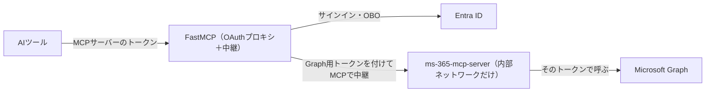

# セッションログ 6b558391

- セッション: `6b558391-76f2-4e68-9e8a-b7ec89d92f47`
- cwd: `/Users/notfolder/Documents/graph-mcp-gateway`（branch: main）
- 期間: 2026-11-01 00:12 〜 2026-11-01 10:38
- Claude Code: 2.1.316
- 発言: ユーザー 51 / Claude 44 / ツール呼び出し 264
- 書き出し: 2026-11-01 10:39 JST

> ユーザー発言と Claude の本文は逐語。ツール呼び出しは `🔧` の 1 行に要約し、ツール結果・思考ブロックは含まない。

---
## 1. ユーザー（2026-11-01 00:12）

（コマンド: /clear ）

## 2. ユーザー（2026-11-01 00:12）

設計をして

## 3. Claude

> 🔧 `Skill`

> 🔧 `Bash` プロジェクト構成とスキル参照ファイルを確認

> 🔧 `Bash` スキルの参照ファイルをすべて読む

> 🔧 `Read` /Users/notfolder/.claude/projects/-Users-notfolder-Documents-graph-mcp-gateway/6b558391-76f2-4e68-9e8a-b7ec89d92f47/tool-results/b1typzfk5.txt

Now the project documents.

> 🔧 `Read` /Users/notfolder/Documents/graph-mcp-gateway/docs/requirements.md

> 🔧 `Read` /Users/notfolder/Documents/graph-mcp-gateway/.history/2026-11-01-0010-要件isdd化と外部連携調査/summary.md

> 🔧 `Read` /Users/notfolder/Documents/graph-mcp-gateway/docs/requirements.md

> 🔧 `Bash` 外部連携の成果物の一覧を確認

> 🔧 `Bash` Entra ID の調査結果と模擬の資料を読む

> 🔧 `Bash` Graph の調査結果と模擬の資料を読む

> 🔧 `Read` /Users/notfolder/.claude/projects/-Users-notfolder-Documents-graph-mcp-gateway/6b558391-76f2-4e68-9e8a-b7ec89d92f47/tool-results/b1f23ohzx.txt

Graph の連携ライブラリと旧設計書を確認しています（設計に必要な前提の読み込み中です）。

> 🔧 `Bash` Graph 連携ライブラリの公開インターフェースを確認

> 🔧 `Bash` Graph 連携ライブラリの再試行・転送・エラー処理を読む

> 🔧 `Read` /Users/notfolder/Documents/graph-mcp-gateway/docs/detail_design.md

> 🔧 `Bash` 手元の FastMCP のソースと開発ツールの有無を探す

> 🔧 `Bash` 前回セッションの作業領域と開発ツールを確認

> 🔧 `Bash` 前回展開した FastMCP の場所を探す

> 🔧 `Bash` 不要になった背景の検索を止める

> 🔧 `Agent` 技術選定の候補をウェブ調査

> 🔧 `Bash` FastMCP のソース構成と AzureProvider の引数を確認

> 🔧 `Bash` HTTP 起動の引数（TLS・ステートレス）を確認

> 🔧 `Bash` HTTP 起動処理とホスト検証の既定を読む

> 🔧 `Bash` FastMCP の既定設定（ホスト保護・保存先）を確認

> 🔧 `Bash` 既定の保管先と署名鍵の扱いを確認

FastMCP のソースで、CIMD・接続の確認画面・OBO の失敗の扱いを確かめています（ウェブ調査はサブエージェントが並行中です）。

> 🔧 `Bash` CIMD の SSRF 対策と確認画面のフォームを確認

> 🔧 `Bash` CIMD の取得先制限と確認画面のフォーム項目を確認

> 🔧 `Bash` CIMD 取得時のプロキシの扱いを読む

> 🔧 `Bash` OBO 失敗の例外の形とミドルウェアの入口を確認

> 🔧 `Bash` 依存の解決失敗と EntraOBOToken の例外処理を読む

> 🔧 `Bash` 模擬 Entra ID の設定項目と模擬 Graph の応答一覧を確認

> 🔧 `Bash` 模擬 Entra ID の設定（トークンの期限など）を読む

前提の読み込みは終わりました。技術選定の比較表に載せる最新版・ライセンス・サポート期限をサブエージェントがウェブで調べている最中で、結果が届いたら比較表を作ってお見せします。

ここまでに FastMCP 4.1.4 のソースで確かめたこと（設計に使います）:
- 複数台構成用の `stateless_http` と、TLS などの `uvicorn_config` は `run_http_async` に渡せます。ホスト検証は既定で無効です。
- CIMD の文書を取りに行くときは、社内の IP アドレスを SSRF 対策で拒否します。そのため mock モードで CIMD を試すには、`FASTMCP_SSRF_TRUST_PROXY` を有効にして Dev Proxy に模擬の文書を返させる必要があります。
- OBO が失敗すると、FastMCP は例外を `RuntimeError("Failed to resolve dependency …")` に包み、元の例外を `__cause__` に入れます。旧設計に書いてある対処がそのまま使えます。

# 技術選定の案（詳細設計の第 1 章）

技術選定の承認をいただくまで、設計書のほかの章は書き始めません（isdd の手順で決まっています）。

要件定義書の技術制約で、すでに次の点が決まっています。今回選ぶのはその周りの部品です。

| 決まっていること | 中身 | 出どころ |
|---|---|---|
| 言語・フレームワーク | Python と FastMCP 4.1.4（`fastmcp[azure]`）。aiohttp を別に依存へ足す | 要件定義書 1-1 |
| 実行形態 | コンテナ。本番も docker compose で 1 台のサーバー上に置く | 要件定義書 1-1、6 章 |
| DB | 持たない。認証の状態は FastMCP の保管先に置く（既定は暗号化したディスク、設定で Redis に切り替える） | 要件定義書 4-1 |
| Graph の連携 | httpx2 の上に作った自前の薄いラッパー（`external/microsoft-graph/src/graph_api`） | 外部連携の調査で決定済み |
| 模擬 | Entra ID は自作、Graph は Dev Proxy 4.0.0（公式イメージがあることを確認済み） | 同上 |

## 候補の比較（2026-11-01 にウェブで確認）

**Python の版**（FastMCP 4.1.4 は 3.10 以上で動く）

| 候補 | 最新版 | サポート期限 | 備考 |
|---|---|---|---|
| **3.14（推奨）** | 3.14.10 | 2030-10（今はバグ修正も入る段階） | 模擬 Entra ID はこの版で動作を確かめた。uv の公式イメージに 3.14 と組み合わせたタグがある |
| 3.13 | 3.13.18 | 2029-10（セキュリティ修正だけの段階） | — |
| 3.12 | 3.12.16 | 2028-10（セキュリティ修正だけの段階） | — |

出典: https://devguide.python.org/versions/ 、https://pypi.org/project/fastmcp/4.1.4/

**HTTPS の受け口と、2 台への振り分け**（2 台構成のテストには振り分け役が必ず要る）

| 候補 | 最新版・ライセンス | 社内 CA の証明書 | Streamable HTTP（SSE）を通す | 2 台への振り分け |
|---|---|---|---|---|
| **Caddy（推奨）** | 2.11.7・Apache-2.0 | `tls` の 1 行で指定できる | 設定なしでそのまま流れる | `lb_policy round_robin` の 1 行 |
| nginx | 1.30.6・BSD-2 | `ssl_certificate` で指定する | バッファリングを切り、タイムアウトを延ばす設定が要る | 既定で順番に振り分ける |
| Traefik | 3.7.17・MIT | 静的設定とは別に動的設定のファイルが要る | 即時に流れるが、SSE についての記述は無い | 既定で重み付きの順番 |
| uvicorn で直接受ける | 0.54.0・BSD-3 | 引数で指定できる（実際には未検証） | — | できない。2 台構成には別に振り分け役が要る |

出典: https://caddyserver.com/docs/caddyfile/directives/reverse_proxy 、https://nginx.org/en/docs/http/ngx_http_proxy_module.html 、https://doc.traefik.io/traefik/ 、https://gofastmcp.com/deployment/http

**共有の保管先**（2 台構成のときだけ使う。FastMCP の保管先ライブラリ py-key-value-aio 0.4.6 は Redis と Valkey の両方に対応）

| 候補 | 最新版 | ライセンス |
|---|---|---|
| **Redis（推奨）** | 8.10.3 | AGPLv3 を含む 3 つから選べる。無料の OSS という条件を満たす |
| Valkey | 9.1.3 | BSD-3 |

**そのほか（候補の中で差が小さいもの）**

| 区分 | 選定 | 理由 |
|---|---|---|
| パッケージ管理と版の固定 | uv 0.13.6（`uv.lock` で固定） | 公式の Docker イメージがある。Poetry 2.5.1 や pip-tools 7.6.2 より手順が少ない |
| テスト | pytest 9.2.0、pytest-asyncio 1.4.1 | 非同期のツールを試せる。httpx2 の模擬トランスポートを使えば通信なしで動く |
| E2E | pytest で実際の HTTPS の API を呼ぶ。docker compose の `e2e` プロファイルで、mock モードと real モードを切り替える | システムの形態が Web API のため |

---

## 確認事項

4 問は互いに関係しないので、まとめて「1A, 2A, 3A, 4A」のように答えてください。

**1. Python の版**

| 案 | 内容 | 影響 |
|---|---|---|
| A | 3.14 | サポート期限がいちばん長い。模擬 Entra ID で動作を確かめた版と同じになる |
| B | 3.13 | 実績のある期間は長いが、すでにセキュリティ修正だけの段階に入っている |

おすすめは A です。新しく作るシステムなので期限の長い版が有利で、手元で確かめた版とそろえると差が出る心配もありません。

**2. HTTPS の受け口と振り分け**

| 案 | 内容 | 影響 |
|---|---|---|
| A | Caddy を前に置き、1 台構成でも 2 台構成でも Caddy で HTTPS を受ける。振り分け先は環境変数で切り替える | 構成がひとつで済む。証明書の差し替えは Caddy の再起動だけ |
| B | nginx を前に置く | FastMCP の公式ガイドに設定例がある。その代わり、SSE 用の設定を自分で書く必要がある |
| C | 1 台構成は uvicorn で直接受け、2 台構成のときだけ振り分け役を足す | 1 台構成の部品は減るが、HTTPS の受け方が 2 通りになり、テストも 2 通り要る |

おすすめは A です。設定がいちばん少なく、1 台構成と 2 台構成の違いが振り分け先の指定だけになります。

**3. 共有の保管先**

| 案 | 内容 | 影響 |
|---|---|---|
| A | Redis 8.10.3 | 要件定義書の「共有の保管先（Redis）」とそのまま一致する |
| B | Valkey 9.1.3 | ライセンスはより緩い。ただし要件の文言を「Redis 互換」に直す必要がある |

おすすめは A です。要件どおりで、AGPLv3 でも条件を満たしています。保管先として使うだけで、改変も再配布もしません。

**4. mock モードでの「3 つの AI ツールが鍵なしで接続できる」シナリオの確かめ方**

Claude Code・Codex・OpenCode は、ブラウザでのサインインを伴うため自動テストに組み込めません。

| 案 | 内容 | 影響 |
|---|---|---|
| A | mock モードでは、AI ツールの代わりにテスト用の MCP クライアントを使い、DCR と CIMD の両方の登録からツールの呼び出しまでを自動で確かめる。3 つの AI ツールそのものは real モード（PoC 用テナント）で手動で確かめる | 毎回の自動テストで登録とサインインの流れを保証できる |
| B | 3 つの AI ツールでの確認は real モードだけにし、mock モードではこのシナリオを実行しない | テストの部品は減るが、「全シナリオを両方のモードで実行する」という isdd の決まりから外れる |

おすすめは A です。なお、A で CIMD を試すには、FastMCP が CIMD の文書を Dev Proxy 経由で取りに行く設定（`FASTMCP_SSRF_TRUST_PROXY`）にして、Dev Proxy に模擬の文書を足します。社内の IP アドレスは FastMCP が拒否するので、この経路が要ります。この設定は mock モードの環境ファイルにだけ入れ、本番では有効にしません。

## 4. ユーザー（2026-11-01 00:19）

<task-notification>
<task-id>a9a472ef86b82142b</task-id>
<tool-use-id>toolu_01JHcka5DepvQWCg44gCfxxr</tool-use-id>
<output-file>/private/tmp/claude-501/-Users-notfolder-Documents-graph-mcp-gateway/e11a6139-daf3-4567-9758-1d76e7b265ea/tasks/a9a472ef86b82142b.output</output-file>
<status>completed</status>
<summary>Agent "技術選定の候補をウェブ調査" finished</summary>
<note>A task-notification fires each time this agent stops with no live background children of its own. The user can send it another message and resume it, so the same task-id may notify more than once.</note>
<result>This agent's report was delivered to you as a message from "a9a472ef86b82142b" (its SubagentHandback call). Read it there; it is not repeated here.
</result>
<usage><subagent_tokens>62461</subagent_tokens><tool_uses>26</tool_uses><duration_ms>165397</duration_ms></usage>
</task-notification>

## 5. ユーザー（2026-11-01 00:22）

1 A
2 B
3 A
4 A

## 6. Claude

承認ありがとうございます（Python 3.14、nginx、Redis、mock モードではテスト用のクライアントを使う、で進めます）。設計書の残りの章を書くのに必要な FastMCP の細かい動作を、もう少しソースで確かめます。

> 🔧 `Bash` 確認画面のクッキーと Fernet 暗号化の引数を確認

> 🔧 `Bash` ツールの例外がどこで包まれるかを確認

> 🔧 `Bash` ツール呼び出しの例外処理とミドルウェアの位置関係を読む

> 🔧 `Bash` 模擬 Entra ID のトークン形式とログイン画面のフォームを確認

> 🔧 `Bash` 模擬 Entra ID のサインイン処理を読む

設計に必要な事実はそろいました。設計書の本文を書き始める前に、整合チェッカーが設計書のどこをどう読むかを確かめます。

> 🔧 `Bash` 整合チェッカーの読み取り規則を確認

> 🔧 `Bash` チェッカーの対応付けと矛盾判定の処理を読む

> 🔧 `Bash` ToolError がそのまま返るかを確認

設計の材料がそろったので、設計書 `docs/detail_design.md` を書きます（旧版を全面的に書き直します）。

> 🔧 `Write` /Users/notfolder/Documents/graph-mcp-gateway/docs/detail_design.md

> 🔧 `Bash` 要件 ID と設計 ID の対応をチェック

チェッカーは合格しました。念のため、本文に出てくる設計 ID がすべて第 11 章の表にあるかと、図の構文を確かめます。

> 🔧 `Bash` 設計 ID の網羅と本文中の ID の有無を確認

> 🔧 `Bash` mermaid の図を取り出し、描画ツールを用意する

> 🔧 `Bash` mermaid の図 8 つが描画できるかを確かめる

> 🔧 `Edit` /Users/notfolder/Documents/graph-mcp-gateway/docs/detail_design.md

> 🔧 `Edit` /Users/notfolder/Documents/graph-mcp-gateway/docs/detail_design.md

> 🔧 `Edit` /Users/notfolder/Documents/graph-mcp-gateway/docs/detail_design.md

> 🔧 `Edit` /Users/notfolder/Documents/graph-mcp-gateway/docs/detail_design.md

> 🔧 `Edit` /Users/notfolder/Documents/graph-mcp-gateway/docs/detail_design.md

> 🔧 `Edit` /Users/notfolder/Documents/graph-mcp-gateway/docs/detail_design.md

> 🔧 `Edit` /Users/notfolder/Documents/graph-mcp-gateway/docs/detail_design.md

第 7 章に、網羅性チェックで求められる「削った設計要素」の一覧を足します。

> 🔧 `Edit` /Users/notfolder/Documents/graph-mcp-gateway/docs/detail_design.md

次に、実装タスクの一覧 `tasks.md` を作ります。

> 🔧 `Write` /Users/notfolder/Documents/graph-mcp-gateway/.history/20261101-詳細設計/tasks.md

> 🔧 `Bash` ms-365-mcp-server への言及を資料から探す

> 🔧 `Bash` リポジトリ全体で ms-365-mcp-server への言及を探す

> 🔧 `ToolSearch` select:WebSearch

> 🔧 `WebSearch` Softeria ms-365-mcp-server HTTP mode OAuth on-behalf-of shared server

> 🔧 `Bash` 修正後の設計書で対応チェックを再実行

**いいえ、使っていません。** 今回の設計は ms-365-mcp-server（Softeria 社のオープンソースの MCP サーバー）を使わず、FastMCP（Python）で MCP サーバーを自作する形です。

使わない形になったのは、要件定義書 1-1 の技術制約が「FastMCP（Python）。認証は `AzureProvider`、Graph 用のトークンは `EntraOBOToken`」になっていて、設計はそれに従ったためです。リポジトリの中（要件定義書・関連資料・外部連携の調査・前回の記録）も検索しましたが、ms-365-mcp-server への言及は 1 件もありませんでした。

ウェブで確かめた範囲では、ms-365-mcp-server には HTTP モード（OAuth 2.1）と On-Behalf-Of の方式があります。ただし、1 台を多数の利用者で共有するときに、利用者ごとのトークンの交換やキャッシュをどう扱うかを書いた資料は見つかりませんでした。共有サーバーとして使えるかは、ソースを読まないと判断できません（[mcp.so](https://mcp.so/servers/ms-365-mcp-server)、[metorial](https://metorial.com/marketplace/s/softeria/ms-365-mcp-server)、[glama.ai](https://glama.ai/mcp/servers/a6yu6mh3f0)、[archestra.ai](https://archestra.ai/mcp-catalog/softeria__ms-365-mcp-server)）。

## ここまでの作業の状態

FastMCP で作る前提の詳細設計は、ひととおり書き終えています。

- **設計書 `docs/detail_design.md` を全面的に書き直しました。**
  - 設計 ID は 135 件あり、要件 86 件（業務と業務課題を除く）をすべて受けています。除外した要件はありません。
  - 選んだ技術は、Python 3.14、FastMCP 4.1.4、nginx 1.30.6、Redis 8.10.3、uv 0.13.6、pytest です。
  - 図 8 つはすべて mermaid-cli で描画できました。
- **実装タスクの一覧 `.history/20261101-詳細設計/tasks.md` を作りました。** isdd-setup の導入から、実装の 14 タスク、完了確認の 6 タスクまでです。
- **整合チェッカーは合格しました**（修正後に再実行した結果）:

```
検出: RQ-* ID 数: 88 (コンテキストID除外後: 86)
検出: DS-* ID 数: 135
✓ 全てのチェックに合格しました（欠落 0 件、不整合 0 件）
```

- **書き終えた後に見直して、次を直しました。**
  - E2E の手順に、上限の設定を変えてサーバーを作り直す手段（compose の追加ファイル）が書かれていなかった。
  - サーバーを作り直すとログが消えるのに、作り直す前にログを保存する手順が無かった。
  - 同じ名前のフォルダーを作ったときのエラーの説明を、どこで付けるのかが決まっていなかった。
  - 承認の記録に、ユーザーが直接は答えていない項目（uv・pytest）まで「承認」と書いていたので、異論が無かったという書き方に直した。
  - 網羅性チェックで求められる「削った設計要素」の一覧を足した。

設計書と tasks.md は、まだコミットしていません。

## 確認事項

**1. ms-365-mcp-server を使う方針にしますか**

今の要件定義書と設計は FastMCP での自作を前提にしています。ms-365-mcp-server を使う場合は、要件定義書の技術制約を変えるところからやり直しになります。

| 案 | 内容 | 影響 |
|---|---|---|
| A | 今の設計のまま（FastMCP で自作） | 書き終えた設計書と tasks.md がそのまま使える。次は実装（isdd-traceable-coding） |
| B | ms-365-mcp-server を使う方向で検討し直す | 要件定義書の技術制約の変更と、外部連携の調査のやり直しが要る。先に、ソースを読んで複数の利用者での共有と OBO に対応しているかを調べる。今回の設計書と tasks.md は作り直しになる |
| C | まず ms-365-mcp-server を調べて比べ、その結果で決める | 読み取りだけで調べ、比較表を報告する。今回の設計書には手を付けない |

おすすめは C です。A と B の分かれ目は、ms-365-mcp-server が 1 台の共有サーバーで利用者ごとの OBO を正しく扱えるかどうかです。ここが今の公開資料からは分からないので、ソースで確かめてから決めるのが安全です。調べた結果、問題が無ければ B に、足りなければ A に進めます。

## 7. ユーザー（2026-11-01 00:42）

1 C

## 8. Claude

C で進めます。ms-365-mcp-server のソースを手元の作業領域に取得して読み、比較表にまとめます。読むだけで、プロジェクトのファイルには手を付けません。

> 🔧 `Bash` ms-365-mcp-server のソースを作業領域に取得

活発に保守されている（2026-10-30 に v0.178.0）ことが分かりました。HTTP モード・OAuth・OBO の部分を読みます。

> 🔧 `Bash` README の章立てと主要ファイルの規模を確認

> 🔧 `Bash` 認証方式の説明と OBO・OAuth の実装を読む

> 🔧 `Bash` HTTP モードの経路と OBO・利用者ごとのトークンの扱いを探す

> 🔧 `Bash` /authorize と /token の処理を読む

> 🔧 `Bash` MCP の受け口での利用者ごとのトークンの扱いを探す

> 🔧 `Bash` ベアラートークンの検証と OBO 交換の流れを読む

> 🔧 `Bash` トークンの検証方法と PKCE の保存先、ツール数を確認

> 🔧 `Bash` ベアラートークンの検証処理を読む

> 🔧 `Bash` 配備ガイドの戻り先・OBO・複数台の記述を探す

> 🔧 `Bash` CIMD 対応の有無と、ツール名の例を確認

# ms-365-mcp-server の調査結果

## 結論

ms-365-mcp-server をそのまま使うと、要件定義書の要件のうち 4 件を満たせません。トークンの扱いと Entra ID への登録の作りが根本的に違うためで、設定では直せません。**今の設計（FastMCP での自作）のまま進めることをおすすめします。**

調べた対象は GitHub の `Softeria/ms-365-mcp-server` の最新版（コミット `6f862af`、2026-10-30、v0.178.0）です。ソースと配備ガイドを読みました。

## 要件と照らした結果

| 要件 | ms-365-mcp-server の作り（根拠） | 判定 |
|---|---|---|
| AI ツールには MCP サーバーのトークンだけを渡す（Entra のトークンは渡さない） | `/token` は Entra ID の応答をそのまま AI ツールに返します（`src/server.ts` の `/token` の処理）。そのため AI ツールが Entra のアクセストークンとリフレッシュトークンを持ちます。OBO モードでも、AI ツールが持つのはこのアプリあての Entra のトークンです | **満たさない** |
| Entra ID の戻り先は 1 件で、AI ツールを足しても Entra ID の設定を変えない | `/authorize` は AI ツールの戻り先をそのまま Entra ID に渡します。配備ガイドにも「使う MCP クライアントごとに戻り先を 1 つずつ登録する」とあります（`docs/deployment.md` 144 行目） | **満たさない**（AI ツールを足すたびに別部署への依頼が要る） |
| CIMD の受け付け | ソースに CIMD の処理がありません | **満たさない** |
| サーバー側で Entra のトークンの署名・発行者・宛先を確かめる | サーバーは期限だけを確かめ、署名の確認は Graph か OBO の交換に任せています（`src/lib/microsoft-auth.ts`） | **一部だけ**（偽のトークンは Graph 側で落ちるが、要件の書き方とは違う） |
| 利用者ごとに本人の権限で Graph を呼ぶ | 要求ごとに利用者のトークンを持ち回し（`AsyncLocalStorage`）、OBO モードでは要求ごとに交換します | 満たす |
| 複数台構成 | MCP はセッションを持たない動作です。ただし、認可の途中の状態（PKCE）はプロセスのメモリにあります | 未確認（台をまたいだときの動作は試していない） |
| ツールと業務ルール | ツールは 362 個で、Graph の OpenAPI から生成されています。要件の 39 ツールの名前・引数・一覧の項目の絞り込み・署名付きのカーソル・内容とアップロードの上限・エラーの種類とは合いません | 要件を合わせ直す必要がある |
| 技術制約 | Node.js（TypeScript）、MIT ライセンス。活発に保守されています | 要件の「FastMCP（Python）」と違う |

## 案ごとの比較

| 案 | 内容 | 安全に変更できるか | 効果 |
|---|---|---|---|
| A. 今の設計のまま | FastMCP で自作する | 書き終えた設計書がそのまま使え、要件の変更も要らない | 要件をすべて満たす。実装の量は自作の分だけかかる |
| B. ms-365-mcp-server に切り替える | 要件を ms-365-mcp-server に合わせて変える | 要件の中心を変えることになる（Entra のトークンを PC に渡す、AI ツールごとに Entra ID への登録を依頼する、CIMD をやめる）。セキュリティの前提が下がる | ツールの実装が要らなくなる。そのかわり、別部署への登録の依頼が AI ツールの数だけ要る |
| C. 組み合わせる | FastMCP の OAuth プロキシを前に置き、OBO で得た Graph 用のトークンを付けて、後ろの ms-365-mcp-server に要求を流す | 理屈の上では、トークンの要件と戻り先の要件を守れる。ただし未検証で、仕組みが二重になる | 362 ツールが使える。ただし、要件の 39 ツールの業務ルール（上限、カーソル、エラーの種類）は満たせず、2 つの言語を保守することになる |

設計書（`docs/detail_design.md`）と tasks.md には今回手を付けていません。どちらもまだコミットしていません。

出典：
- [GitHub: Softeria/ms-365-mcp-server](https://github.com/Softeria/ms-365-mcp-server)
- [docs/deployment.md](https://github.com/Softeria/ms-365-mcp-server/blob/main/docs/deployment.md)
- [mcp.so](https://mcp.so/servers/ms-365-mcp-server)
- [metorial](https://metorial.com/marketplace/s/softeria/ms-365-mcp-server)
- [glama.ai](https://glama.ai/mcp/servers/a6yu6mh3f0)
- [archestra.ai](https://archestra.ai/mcp-catalog/softeria__ms-365-mcp-server)

---

## 確認事項

**1. どの方針で進めますか**

| 案 | 内容 | 影響 |
|---|---|---|
| A | 今の設計のまま進める（FastMCP で自作） | 次は設計書と tasks.md のコミット、続いて実装（isdd-setup、isdd-traceable-coding） |
| B | ms-365-mcp-server に切り替える | 要件定義書の技術制約とセキュリティの要件（トークンを PC に渡さない、戻り先は 1 件）を変えるところからやり直す。今回の設計書は作り直しになる |
| C | FastMCP を前に置いて ms-365-mcp-server と組み合わせる | 先に、組み合わせが動くかを試す調査が要る。要件の 39 ツールの業務ルールをどう満たすかも決め直す |

おすすめは A です。ms-365-mcp-server は AI ツールに Entra のトークンを渡す作りです。この点は要件の中心である「漏れても M365 を直接使われない」と正面からぶつかり、設定では避けられません。C はこの問題を避けられますが、仕組みが二重になり、業務ルールも満たせないため、PoC で得るものに比べて手間が大きくなります。

## 9. ユーザー（2026-11-01 00:45）

ms-365-mcp-serverをそのまま使いたかったが、oauth後に戻りURLの登録が必要で、ツールごとに戻りURLが変わるから、ms-365-mcp-serverの前にproxyをおくか、FastMCPで薄いラッパーを作るためにこのプロジェクトを立ち上げました。経緯が残っていない？
また、FastMCPからms-365-mcp-serverの関数を呼び出す実装は無理がある？

## 10. Claude

経緯がどこかに残っていないか、関連資料と前回の記録を確かめます。あわせて、FastMCP から ms-365-mcp-server を呼ぶ仕組みが FastMCP 4.1.4 にあるかをソースで確かめます。

> 🔧 `Bash` 関連資料と前回の記録から経緯の記述を探す

> 🔧 `Bash` FastMCP 4.1.4 のプロキシ機能とヘッダーの転送を確認

> 🔧 `Bash` プロキシのヘッダー転送と、要求ごとのクライアント作成の仕組みを読む

> 🔧 `Bash` 転送されるヘッダーから Authorization が除かれるかを確認

> 🔧 `Bash` ms-365 側の利用者トークンの取り方と FastMCP の OBO の取り出し方を確認

## 1. 経緯は残っていませんでした

リポジトリの全ファイルを調べましたが、記録はどこにもありませんでした。対象は要件定義書、関連資料（依頼資料・プロキシ仕様）、外部連携の調査、前回のセッションの記録（`session.md` 2,279 行を含む）です。

- ms-365-mcp-server という名前は 1 か所も出てきません。
- 「ms-365-mcp-server をそのまま使いたかったが、戻り URL の登録がツールごとに要るので、前に代理役を置く」という目的も、どこにも書かれていません。
- それどころか、関連資料の依頼資料の役割分担には、最初から「共有 MCP サーバー（FastMCP で自作）」と書かれていました。

そのため、要件定義も詳細設計も「Graph を呼ぶ 39 ツールを自作する」前提で進んでいました。経緯の書き漏れが、要件定義の段階から方向をずらしていたことになります。

## 2. FastMCP から ms-365-mcp-server を呼ぶ形に無理はありません

ms-365-mcp-server は Node.js なので、Python から関数を直接呼ぶことはできません。ただし、MCP の通信（HTTP）を挟んで呼ぶ形なら、FastMCP 4.1.4 の公開されている仕組みだけで組めることをソースで確かめました。



組める根拠は次の 3 点です。

- **FastMCP 側**
  - `create_proxy` の中継先のクライアントは、非同期の関数で要求のたびに作れます（`providers/proxy.py` の `ClientFactoryT`）。
  - その関数の中で、`get_access_token()` から利用者の Entra のトークンを取り出せます。
  - `AzureProvider.get_obo_credential()` で、そのトークンを Graph 用のトークンに交換できます。
  - Graph 用のトークンを `Authorization` に付けて ms-365-mcp-server を呼べます。これは `EntraOBOToken` の中身と同じ手順です。
- **AI ツールのトークンが漏れないこと**：AI ツールが送ってきた `Authorization` は、FastMCP が既定で中継先に転送しません（`get_http_headers` で除外されます）。
- **ms-365-mcp-server 側**
  - HTTP モードでは、受け取ったベアラートークンを要求ごとに持ち回して Graph を呼びます（`graph-client.ts` 315 行目の `getRequestTokens`）。
  - MCP のセッションを持たない動作なので、利用者が入れ替わっても混ざりません。

この形にすると、前回の調査で挙げた要件違反 4 件はすべて解消します。AI ツールが持つのは FastMCP のトークンだけになり、Entra ID の戻り先は FastMCP の 1 件で済み、DCR と CIMD は FastMCP が受けるからです。ms-365-mcp-server 自身の OAuth の受け口は使わず、外にも公開しません。

実装の前に確かめることも残っています。

| 確かめること | 理由 |
|---|---|
| 自分で付けた `Authorization` が、FastMCP のヘッダーの転送で上書きされないか | 上書きされると Graph 用のトークンが届かない |
| ms-365-mcp-server（Node.js）が `HTTPS_PROXY` を読むか（Node 24 は `NODE_USE_ENV_PROXY=1` が要る） | E2E の mock モードで、Graph への要求を Dev Proxy に通すため |
| 362 ツールの絞り方（`--org-mode`、`--enabled-tools`、プリセット） | 依頼資料の P-5 の権限の範囲に収めるため |
| 応答の大きさ | ms-365-mcp-server は Graph の応答をほぼそのまま返すので、AI ツールの入力があふれることがある |

## 3. 方針を C にした場合の進め方

要件の中心（自作の 39 ツールとその業務ルール）が変わるので、isdd の順番どおり次のように進め直します。

1. 要件定義書を直す（`isdd-change-req`）。経緯を目的の節に書く。
2. ms-365-mcp-server を新しい外部連携として調べる（`isdd-external-research`、`external/ms-365-mcp-server/`）。
3. 詳細設計をやり直す。

今回書いた設計書（`docs/detail_design.md`）と tasks.md はまだコミットしていません。どちらも自作の 39 ツールを前提にしています。

---

## 確認事項

3 問は互いに関係しないので、まとめて「1A, 2A, 3A」のように答えてください。

**1. ツールの要件をどう直すか**

| 案 | 内容 | 影響 |
|---|---|---|
| A | ms-365-mcp-server のツールをそのまま出す。どのツールを出すかは ms-365-mcp-server の絞り込みの機能で決める。自作の業務ルール（一覧の件数とカーソル、内容とアップロードの上限、一覧の項目の絞り込み、エラーの種類）は要件から外す | FastMCP 側は認証と中継だけになり、薄いラッパーという当初の狙いどおりになる |
| B | A に加えて、FastMCP 側で一部のルールを足す（例：結果の大きさの上限、エラーのメッセージの言い換え） | AI ツールの入力があふれる心配は減るが、中継の処理が厚くなる |
| C | 今の 39 ツールの要件を残し、中身を ms-365-mcp-server のツールに振り替える | 2 つのツールの体系を対応づける手間が大きく、ms-365-mcp-server を使う意味が薄れる |

おすすめは A です。当初の「そのまま使いたい」という狙いに最も近いからです。応答の大きさの問題は外部連携の調査で実際の大きさを測り、問題があればそのときに B へ広げます。

**2. 経緯をどこに残すか**

| 案 | 内容 | 影響 |
|---|---|---|
| A | 要件定義書の「目的・前提」に背景として書く。あわせて関連資料の依頼資料の「FastMCP で自作」の言い方も直す | 要件から読めるようになり、同じずれを防げる。依頼資料は別部署に出す前の文書なので、今直しても問題ない |
| B | 要件定義書にだけ書く | 依頼資料に「自作」の言い方が残る |

おすすめは A です。依頼資料と要件定義書がずれたままだと、別部署への説明と実装の前提が食い違います。

**3. 今回書いた設計書と tasks.md の扱い**

| 案 | 内容 | 影響 |
|---|---|---|
| A | コミットせず、作業ツリーのまま置いておく。設計をやり直すときに、使える部分（受け口の nginx、compose、E2E の 2 モード、技術選定の記録）を流用し、残りは上書きする | 作業の結果を失わない。不要な版も履歴に残らない |
| B | 旧版に戻し、tasks.md も消す | すっきりするが、流用できる部分を書き直すことになる |

おすすめは A です。受け口・compose・E2E の設計は、方針 C でもほぼそのまま使えます。

この 3 問に答えていただいたら、要件定義書の変更（`isdd-change-req`）から始めます。

## 11. ユーザー（2026-11-01 00:47）

ms-365-mcp-serverをstdioで呼び出す方がよくないか検討して

## 12. Claude

「検討して」とのことなので、説明だけにして、ファイルは作りません。判断材料として、ms-365-mcp-server を stdio で動かしたときのトークンの受け取り方を、取得済みのソースで確かめます。

> 🔧 `Bash` stdio 時のトークンの受け取り方と認証ツールの扱いを確認

# ms-365-mcp-server を stdio で呼ぶ案の検討

## 結論

**HTTP で呼ぶ形のほうがよい、と考えます。** stdio には「待ち受けるポートが要らない」「利用者ごとにプロセスが分かれる」という利点があります。ただ、stdio ではトークンをプロセスの起動時にしか渡せません。そのため、利用者ごとにプロセスを起動し、トークンが切れるたびに作り直す仕組みを自分で作ることになり、その手間が利点を上回ります。

## ソースで確かめた前提

- **stdio では、トークンを起動時の環境変数（`MS365_MCP_OAUTH_TOKEN`）でしか受け取れません**（`src/auth.ts` 868 行目）。README にも「トークンの更新は行わない」とあります。
  - トークンはプロセス全体で 1 つなので、1 つのプロセスで扱える利用者は 1 人だけです。
  - OBO で得る Graph 用のトークンは 60〜90 分で切れます。切れたらプロセスを作り直す必要があります。
- **stdio では、`login`・`logout` などの認証ツールが必ず登録されます**（`src/server.ts` 342 行目。HTTP 以外では止める設定がありません）。AI ツールに見せないよう、FastMCP 側で隠す必要があります。
- **HTTP では、要求ごとにベアラートークンを持ち回します**（`graph-client.ts` 315 行目）。1 つのプロセスで複数の利用者を扱え、トークンの更新もヘッダーを替えるだけで済みます。

## stdio の 2 つのやり方と HTTP の比較

| 観点 | HTTP（ms-365-mcp-server を 1 コンテナ、要求ごとにトークンを渡す） | stdio・呼び出しのたびに起動 | stdio・利用者ごとに起動しておく |
|---|---|---|---|
| トークンの更新 | ヘッダーを替えるだけ | 毎回起動するので考えなくてよい | トークンが替わるたびにプロセスを作り直す仕組みが要る |
| 応答の速さ | 速い | 毎回 Node.js の起動と 362 ツールの読み込みが入る（何秒かかるかは未計測） | 起動の後は速い |
| 自分で作るもの | 中継の部品だけ | 中継の部品と、要求ごとのプロセスの起動 | プロセスの一覧の管理、使わなくなったプロセスの停止、作り直しの排他 |
| 利用者の分離 | 要求ごとにトークンが分かれる（ms-365-mcp-server の作りに頼る） | プロセスが分かれる（最も強い） | プロセスが分かれる |
| トークンの置き場所 | 要求のヘッダーだけで、残らない | 子プロセスの環境変数（同じコンテナの同じ利用者からは読める） | 同左。プロセスが動いている間ずっと残る |
| 待ち受けるポート | 内部ネットワークに 1 つ（どんなトークンでも受け付けるので、外に出さないことが前提） | 無い | 無い |
| 本番の約 1 万人への広げやすさ | コンテナを増やせばよい | 同時に呼ばれる数だけ起動の負荷がかかる | 同時に使う利用者の数だけプロセスがあり、メモリが膨らむ |
| コンテナ | FastMCP（Python）と ms-365-mcp-server（公式イメージ）の 2 つ。版を別々に固定できる | 1 つのイメージに Python と Node.js の両方を入れる | 同左 |
| FastMCP の中継の注意 | 自分で付ける `Authorization` が上書きされないか確かめる | 利用者ごとに別のプロセスを使うよう、プロセスを使い回さない設定にする（使い回すと、別の利用者のトークンで動く危険がある） | 同左に加え、プロセスの一覧の管理を自作する |
| 安全に採れるか | 採れる。内部ネットワークのポートを外に公開しなければよい | 採れる。ただし速さが未計測 | 採れるが、自作の部分に不具合が入る余地が大きい |
| 効果 | 薄いラッパーという狙いに最も合う | 作りは単純だが、毎回の起動が重い | 速いが、作るものが最も多い |

stdio の利点（ポートが無い、プロセスが分かれる）は、HTTP でも「ms-365-mcp-server のポートを compose の内部ネットワークだけに置き、FastMCP 以外からは届かないようにする」ことで、ほぼ同じ安全性にできます。逆に、stdio の弱点（トークンの更新、プロセスの管理、規模）は設定では消せません。

---

## 確認事項

**1. ms-365-mcp-server の呼び方**

| 案 | 内容 | 影響 |
|---|---|---|
| A | HTTP で呼ぶ（内部ネットワークだけに置いた 1 コンテナに、要求ごとに Graph 用のトークンを渡す） | 自作の部分が最も少ない。本番の規模にも広げやすい |
| B | stdio で、呼び出しのたびにプロセスを起動する | 作りは単純だが、1 回の呼び出しごとに起動の時間がかかる |
| C | stdio で、利用者ごとにプロセスを起動しておく | 速いが、プロセスの管理とトークンが切れたときの作り直しを自作する |
| D | 先に、stdio での 1 回の起動にかかる時間を計測してから決める | 作業領域で ms-365-mcp-server をコンテナの中で起動し、計測する。プロジェクトのファイルには手を付けない |

おすすめは A です。stdio の利点は内部ネットワークへの配置でほぼ補えますが、stdio の弱点は避けられません。B を本気で考える場合だけ、D で起動の時間を測ってから判断してください。

前回の確認事項 3 問（ツールの要件をどう直すか、経緯をどこに残すか、今回書いた設計書と tasks.md の扱い）は、まだ答えをいただいていません。この問いと一緒に答えていただければ、要件定義書の変更から始めます。

## 13. ユーザー（2026-11-01 00:50）

1. ms-365-mcp-server の呼び方
A
1. ツールの要件をどう直すか
A
2. 経緯をどこに残すか
A
3. 今回書いた設計書と tasks.md の扱い
A

## 14. Claude

回答ありがとうございます。方針は次のとおりです。

- ms-365-mcp-server は HTTP で呼ぶ。
- ツールは ms-365-mcp-server のものをそのまま出す。
- 経緯は要件定義書と依頼資料の両方に残す。
- 今回書いた設計書と tasks.md は作業ツリーに置いたままにする。

この方針で、要件定義書の変更から始めます。

> 🔧 `Skill`

> 🔧 `Skill`

> 🔧 `Bash` 配備ガイドと公式イメージ、起動オプションを読む

> 🔧 `Bash` ms-365-mcp-server の公式イメージを使い捨てで起動

> 🔧 `Bash` 起動したコンテナの状態とログを確認

> 🔧 `Bash` トークンなし・偽のトークンで MCP の受け口の動作を確かめる

> 🔧 `Bash` プリセットの一覧と、必要な Graph の権限を確認

`--allowed-scopes` を使うと、依頼資料 P-5 の 12 の権限で使えるツールだけに絞れます。絞った後のツールの数と一覧の大きさを測ります。

> 🔧 `Bash` P-5 の権限に絞ったときのツール数と一覧の大きさを測る

P-5 の権限で絞るとツールが 12 個しか残らず、メールの一覧などの主要なツールが消えました。`--allowed-scopes` の判定のしかたを確かめます。

> 🔧 `Bash` 権限での絞り込みの判定規則を確認

README の例は空白区切りなので、カンマ区切りでは 1 つの権限として読まれたようです。空白区切りで測り直します。

> 🔧 `Bash` 空白区切りの権限で絞り込みを測り直す

> 🔧 `Bash` 必要時に読み込む方式の一覧の大きさとレート制限のヘッダーを確認

分かったことを事前確認レポートにまとめます。

> 🔧 `Write` /Users/notfolder/Documents/graph-mcp-gateway/external/ms-365-mcp-server/docs/precheck_report.md

> 🔧 `Bash` 変更要件の聞き取りの決まりと章立てを読む

## 事前確認の結果（ms-365-mcp-server）

`external/ms-365-mcp-server/docs/precheck_report.md` を作りました。判定は「**条件付きで進んでよい**」です。公式イメージ 0.178.0 を使い捨てのコンテナで起動して、次を確かめました。

| 確かめたこと | 結果 |
|---|---|
| トークンが無い要求 | 401 で拒否する |
| Graph 用のトークンを付けた要求 | そのトークンで Graph を呼ぶ。要求ごとにトークンを持ち回すので、利用者が混ざらない |
| ツールの数と一覧の大きさ | 組織用のモードで 367 ツール・約 2.2 MB。依頼資料 P-5 の権限で絞っても 175 ツール・約 1 MB で、AI ツールの入力に収まらない |
| 必要なときに読み込む方式（`--discovery`） | 3 ツール・約 2.7 KB まで小さくなる（実験的な機能） |
| レート制限 | IP ごとに毎分 120 回。FastMCP の後ろに置くと全員で毎分 120 回になるので、外す設定が要る |
| 権限での絞り込みの書き方 | 空白区切りで渡す必要がある（カンマ区切りだと、ほぼ全部のツールが消える） |

「条件付き」の条件は、変更要件で次の 3 つを決めることです。出すツールの範囲と絞り方（必須）、レート制限の扱い、応答の大きさとエラーの返し方。

使ったコンテナは片付けました。プロジェクトで変えたのはこのレポートの追加だけで、`docs/requirements.md` は書き換えていません（正本への反映は変更設計のときに行う決まりです）。

ここから変更要件の聞き取りに入ります。決まりで 1 回に 1 問ずつ聞くので、最初は業務課題の扱いです。

---

## 確認事項

**今回の変更で、業務課題（要件をひも付ける大もとの取り組み）をどう扱うか**

今の業務課題は 1 つだけです。「共有 MCP サーバーを置き、PoC 参加者が AI ツールから本人の権限で M365 のデータを手でコピーせずに読み書きできるかを確かめる」というものです。今回の変更は「ツールを自作するか、ms-365-mcp-server を使うか」という作り方の変更です。業務の問題（手でコピーしている）そのものは変わりません。

| 案 | 内容 | メリット | デメリット | 複雑さ（C=1〜5） | 根拠（効いている評価軸） |
|---|---|---|---|---|---|
| A | 今の業務課題のまま進める。ms-365-mcp-server を使うことは、技術制約と目的の背景（経緯）に書く。消すツールの要件と足す要件は、すべて今の業務課題にひも付ける | 業務の問題・目標値・業務課題の対応表を作り直さずに済む | 「既存の OSS を使って自作を減らす」という狙いが、業務課題としては見えない（背景と技術制約にだけ書かれる） | 1 | T=0（業務課題の追加が無く、どの軸も増えない） |
| B | 新しい業務課題を足す（例：「既存の OSS の MCP サーバーを使い、自作の範囲を認証と中継に限る」）。解決する問題として「自作ではツールが 39 個に限られ、作って保守する手間がかかる」を書き、目標値を決める | 狙いが業務課題として残り、ツールの要件をその業務課題にひも付けられる | 新しい問題のあるべき姿・現状・目標値を決める必要がある（自作の手間はまだ測っていない） | 1 | T=1（運用変更負荷：目標値の測り方を決める説明の負荷） |

推奨は A です。どちらも複雑さは同じ 1ですが、A は目標値の測り方を新しく決める必要が無いぶん小さく、変更の理由は背景と技術制約で十分に残せます。

## 15. ユーザー（2026-11-01 01:50）

This session is being continued from a previous conversation that ran out of context. The summary below covers the earlier portion of the conversation.


Summary:
1. Primary Request and Intent:
   - The user first asked 「設計をして」 for the project at /Users/notfolder/Documents/graph-mcp-gateway. The project is an isdd (要件定義 → 外部連携調査 → 詳細設計 → 実装) PoC for a shared, company-internal M365 MCP server. I ran the isdd-design skill: tech-selection approval, then a full rewrite of `docs/detail_design.md` and creation of tasks.md.
   - Mid-way the user asked 「ms-365-mcp-serverを使うようになっていますか？」. Answer: no. Investigation showed ms-365-mcp-server used as-is violates requirements: it passes Entra tokens to the AI tool, needs one Entra redirect URI per AI tool, has no CIMD, and only checks token expiry.
   - The user explained the true project motivation, which had been lost from all docs: 「ms-365-mcp-serverをそのまま使いたかったが、oauth後に戻りURLの登録が必要で、ツールごとに戻りURLが変わるから、ms-365-mcp-serverの前にproxyをおくか、FastMCPで薄いラッパーを作るためにこのプロジェクトを立ち上げました。経緯が残っていない？ また、FastMCPからms-365-mcp-serverの関数を呼び出す実装は無理がある？」 Then: 「方針としてはCです」. C means FastMCP OAuth proxy in front, relaying to ms-365-mcp-server.
   - The user asked 「ms-365-mcp-serverをstdioで呼び出す方がよくないか検討して」. I explained only and recommended HTTP.
   - Final decisions (user answers):
     - 呼び方: A, HTTP.
     - ツールの要件: A. Expose ms-365-mcp-server's tools as-is, scoped via its filter features. Drop the self-made business rules: list limit/cursor, content/upload size limits, list field projection, error kinds.
     - 経緯の記録: A. Write it in requirements.md 目的・前提, and fix the 依頼資料 wording 「FastMCP で自作」 in docs/related_materials.md.
     - 設計書と tasks.md: A. Keep them uncommitted in the working tree and reuse them in the redesign (nginx gateway, compose, E2E 2 modes, tech-selection record).
   - Process now under way: isdd-change-req, then isdd-external-research (ms-365-mcp-server), then redesign (isdd-change-design).

2. Key Technical Concepts:
   - FastMCP 4.1.4 (`fastmcp[azure]`):
     - AzureProvider (OAuth proxy, redirect `{base_url}/auth/callback`).
     - EntraOBOToken. It internally uses `get_access_token().token` (the upstream Entra token) and `AzureProvider.get_obo_credential(user_assertion=...)`, then `credential.get_token(*scopes)`.
     - `create_proxy` / ProxyProvider with `ClientFactoryT = Callable[[], Client] | Callable[[], Awaitable[Client]]`. An async per-request client factory can do OBO and attach `Authorization: Bearer <graph token>`.
     - The proxy uses `forward_incoming_headers=True`, but `get_http_headers` excludes authorization/cookie by default.
     - aiohttp needed separately.
     - `mask_error_details`. Middleware sits above the core, which wraps tool exceptions in ToolError (cause chain retained).
     - Failure to resolve the OBO dependency raises `RuntimeError("Failed to resolve dependency ...")` with `__cause__`.
     - CIMD fetches go through SSRF protection that blocks non-global IPs. `FASTMCP_SSRF_TRUST_PROXY` routes the fetch through HTTPS_PROXY.
     - `run_http_async(uvicorn_config, stateless_http, host_origin_protection default False)`.
     - The default storage is a FileTreeStore under `settings.home/oauth-proxy`, Fernet-encrypted with a key derived from jwt_signing_key.
   - ms-365-mcp-server (Softeria, Node/TS, MIT, v0.178.0, commit 6f862af, image `ghcr.io/softeria/ms-365-mcp-server:0.178.0`, node:24-alpine, non-root):
     - HTTP mode `--http`, stateless.
     - Per-request bearer via AsyncLocalStorage (`graph-client.ts` line 315 `getRequestTokens`).
     - The bearer middleware checks expiry only.
     - Its own `/authorize` forwards the client redirect_uri to Entra, and `/token` returns the Entra response directly.
     - `--obo` mode exists.
     - stdio takes the token only via env `MS365_MCP_OAUTH_TOKEN` at start, with no refresh, and always registers login/logout tools.
     - Rate limit: 120 req/min per IP on `/mcp` (`MS365_MCP_RATE_LIMIT_DISABLED`, `MS365_MCP_TRUST_PROXY_HOPS`).
     - `--allowed-scopes` must be space-separated.
     - `--enabled-tools(-file)`, `--preset`, `--discovery` (3 tools: search-tools/get-tool-schema/execute-tool), `--read-only`.
     - `MS365_MCP_MAX_TOP/MAX_PAGES/MAX_ITEMS`, `MS365_MCP_BODY_FORMAT`.
     - `graph-batch` allows arbitrary Graph requests.
   - Tech selection approved 2026-11-01:
     - Python 3.14 (`python:3.14.10-slim`), uv 0.13.6, nginx 1.30.6 (user chose nginx over the recommended Caddy), Redis 8.10.3, pytest 9.2.0, pytest-asyncio 1.4.1.
     - Dev Proxy 4.0.0 for the Graph mock; self-made mock Entra (Starlette).
     - httpx2 thin Graph wrapper.
     - mock-mode E2E uses a test MCP client (DCR+CIMD); the 3 real AI tools are checked manually in real mode.
   - isdd rules:
     - IDs go only in table columns, never in prose or diagrams.
     - Code holds no IDs; the mapping lives in `docs/trace_map.md`.
     - `rq_ds_link_checker.py` maps any line containing both DS and RQ IDs.

3. Files and Code Sections:
   - `docs/requirements.md` (read, NOT modified; 88 RQ IDs, BK `RQ-BK-SHARED-M365-MCP-POC`)
     - Currently specifies 39 self-made tools plus business rules `RQ-FT-PAGINATE-LIST-RESULTS`, `RQ-FT-REPORT-ERRORS-READABLY`, `RQ-FT-LIMIT-FILE-CONTENT-SIZE`, `RQ-FT-LIMIT-UPLOAD-SIZE`.
     - Tech constraint 1-1 says FastMCP Python.
     - isdd-change-req says do not edit it; change requirements go to `.history/[YYYYMMDD]-[タスク名]/change_requirements.md`.
   - `docs/detail_design.md` (fully rewritten, uncommitted)
     - 11 chapters with 135 DS IDs: tech selection with comparison tables and approval record; components; network diagram.
     - Data:
       - DS-SC items: cursor = HMAC-SHA256 signed JSON with a key derived by HKDF from the client secret.
       - list result `{items,next_cursor}`.
       - file content result.
     - 39 tool DS-FN tables.
     - Classes: Settings, ToolContext, ToolGroup, ListPager, ErrorKind, ErrorTranslationMiddleware, Me/Mail/Calendar/File/Site/TeamsTools, GraphClient, GraphError.
     - Error-kind codes: reauth_required, permission_denied, not_found, throttled, invalid_input, limit_exceeded, upstream_error.
     - File list (src/graph_mcp_gateway/*.py plus external graph_api).
     - Tests: `docker compose --profile test run --rm unit`; E2E `bash e2e/run.sh mock|real` with e2e/compose.mock.yaml, compose.limits.yaml, compose.multi.yaml.
     - Ops env vars (APP_*, GATEWAY_*).
     - Checker passed: 88 RQ, 135 DS, 0 missing. All 8 mermaid diagrams render with mermaid-cli 11.4.2.
     - Edits after review:
       - approval note for uv/pytest
       - compose.limits.yaml step and saving logs before recreation
       - size-limit E2E wording
       - 409 nameAlreadyExists message
       - removed the alternative command
       - nginx template envsubst note
       - added 7-4 削った設計要素
   - `.history/20261101-詳細設計/tasks.md` (created, uncommitted): task 0 isdd-setup, tasks 1–14, fixed completion tasks 1–6.
   - `external/ms-365-mcp-server/docs/precheck_report.md` (created)
     - Judgment: 条件付きで進んでよい.
     - Real container test results:
       - no token → 401
       - fake JWT tools/list: 367 tools, 2,252,468 bytes
       - get-current-user forwarded to Graph → 401 InvalidAuthenticationToken
       - `--allowed-scopes` with P-5 (space-separated): 175 tools, 985,980 bytes; comma-separated gave 12 tools
       - `--discovery`: 3 tools, 2,680 bytes
       - RateLimit-Policy 120;w=60
     - Env var names; research scope items 1–7; schema = tool domains.
   - Reference: `external/entra-id/*`, `external/microsoft-graph/*`
     - Includes `src/graph_api/client.py`, a GraphClient with request/get_page/endpoint methods; retry on 429/503; `get_item_content` follows redirects.
     - `mock/mocks.json` has 65 mocks; `mock_entra.py` has users alice/bob/carol(unassigned)/dave(User.Read only), `login_hint` auto sign-in, `MOCK_ACCESS_TOKEN_LIFETIME`.
   - Source clone: `/private/tmp/claude-501/-Users-notfolder-Documents-graph-mcp-gateway/6b558391-76f2-4e68-9e8a-b7ec89d92f47/scratchpad/ms365src/repo`. FastMCP source: `/private/tmp/claude-501/-Users-notfolder-Documents-graph-mcp-gateway/e11a6139-daf3-4567-9758-1d76e7b265ea/scratchpad/dl/x/fastmcp_slim-4.1.4-py3-none-any/fastmcp`.

4. Errors and fixes:
   - A background `find /` timed out; killed it with pkill.
   - The `timeout` command is not on macOS; ran mmdc without it.
   - The `--allowed-scopes` comma format hid almost all tools; space-separated works. Recorded in the precheck report.
   - The first draft recorded uv/pytest as "approved" though the user hadn't explicitly answered. Reworded to 「比較表で案として示し、上の 4 項目の回答で異論が無かった」.
   - Major process issue: the project's motivation (wrapping ms-365-mcp-server) was never recorded, so requirements and design went toward self-implementing 39 tools. The user pointed this out; it is being fixed via change requirements.

5. Problem Solving:
   - Verified feasibility of FastMCP → ms-365-mcp-server over HTTP using public FastMCP APIs.
   - Items still to verify:
     - header precedence of the explicit Authorization vs forwarding
     - Node `NODE_USE_ENV_PROXY=1` / `NODE_EXTRA_CA_CERTS` for the Dev Proxy mock
     - tools/list needing a user token
     - disabling ms-365's own OAuth endpoints
     - response size
   - stdio evaluated: process-global token, no refresh, per-user processes, scaling. HTTP recommended and chosen.

6. All user messages:
   - 「設計をして」
   - Tech-selection answers: 「1 A / 2 B / 3 A / 4 A」 (Python 3.14, nginx, Redis, test-client approach for mock).
   - 「ms-365-mcp-serverを使うようになっていますか？」
   - 「1 C」 (investigate ms-365-mcp-server and compare)
   - 「ms-365-mcp-serverをそのまま使いたかったが、oauth後に戻りURLの登録が必要で、ツールごとに戻りURLが変わるから、ms-365-mcp-serverの前にproxyをおくか、FastMCPで薄いラッパーを作るためにこのプロジェクトを立ち上げました。経緯が残っていない？ また、FastMCPからms-365-mcp-serverの関数を呼び出す実装は無理がある？」
   - 「方針としてはCです」
   - 「ms-365-mcp-serverをstdioで呼び出す方がよくないか検討して」
   - 「1. ms-365-mcp-server の呼び方 A / 1. ツールの要件をどう直すか A / 2. 経緯をどこに残すか A / 3. 今回書いた設計書と tasks.md の扱い A」
   - Standing constraints from CLAUDE.md (user global + project), to keep applying:
     - Respond in Japanese.
     - Diagrams in Mermaid, no ASCII art.
     - 調査依頼と作業依頼を混同しない. 承認された項目だけを実行する.
     - 「検討して」なら作成せず説明だけ.
     - Questions go at the end under 確認事項, numbered if independent and one at a time if dependent, each with options / おすすめ / 根拠.
     - Search the internet to verify.
     - 10+ minute tasks need a clock-time ETA plus background sleep checks.
     - Project CLAUDE.md:
       - 「このリポジトリは公開。秘密情報・氏名・メールアドレス・社名をコミットしない。`.env` は `.gitignore` 済み。」
       - 「`.history/` も公開する。commit の前に、`session.md` の個人情報・社名・NDA の内容・秘密情報を伏せ字にする。」
       - 「要件 ID・設計 ID とコードの対応は `docs/trace_map.md` に記録し、コード（コメントを含む）に ID を書かない。」
       - 「外部連携の模擬は `external/` が正本。」
       - 「E2E は mock モードの全件通過が必須で、real モードは手動。」
       - 「FastMCP 4.1.4 の `EntraOBOToken` は aiohttp が要る」
     - Commit only when asked. Nothing has been committed this session.

7. Pending Tasks:
   - isdd-change-req: create `.history/20261101-<task>/change_requirements.md`. Content:
     - Background/経緯.
     - Tech constraint change: ms-365-mcp-server HTTP behind FastMCP.
     - [削除] the self-made tool and business-rule requirements; [追加] new ones (tool exposure via ms-365 filters, rate-limit handling, etc.).
     - Full CRUD table, BK mapping.
     - Run `rq_integrity_checker.py`.
     - Also fix the 依頼資料 wording in docs/related_materials.md. Per the skill, the requirements.md body itself is updated later by isdd-change-design.
   - Then isdd-external-research for ms-365-mcp-server, then isdd-change-design (redesign reusing uncommitted detail_design parts), then a new tasks.md.
   - Update `.history/BACKLOG.md` as states change. The existing backlog item "詳細設計で detail_design.md を作り直し" is now superseded by the change.

8. Current Work:
   - Inside the isdd-change-req skill. The external precheck (isdd-external-precheck) for ms-365-mcp-server is complete; the report was written and the disposable container cleaned up.
   - I then read `~/.claude/skills/isdd-change-req/references/hearing-rules.md` and the start of `requirements-chapters.md`. Hearing rules: one question per response; option table with columns 案/内容/メリット/デメリット/複雑さ(C=1〜5)/根拠 plus 「推奨: …」; complexity is computed from 5 axes scored 0–2.
   - Next in the skill flow: 「業務の問題と変更業務課題の確定」. Decide the business problem for this change and the change BK (RQ-BK-*), possibly reusing or adding to `RQ-BK-SHARED-M365-MCP-POC`. Then hear chapter by chapter, one question at a time. Open decisions noted by the precheck:
     - tool exposure method (name allowlist vs `--discovery`)
     - rate limit
     - response size / error pass-through
     - whether to expose graph-batch

9. Optional Next Step:
   - Continue isdd-change-req by reporting the precheck result briefly. Then ask the first single hearing question, about the change's business problem/業務課題 (問題 = あるべき姿と現状のギャップ, plus a candidate BK, with the option table and recommendation).
   - The user's latest instruction confirming this path: 「1. ms-365-mcp-server の呼び方 A / 1. ツールの要件をどう直すか A / 2. 経緯をどこに残すか A / 3. 今回書いた設計書と tasks.md の扱い A」.
   - My stated plan: 「この方針で、要件定義書の変更から始めます。」 and 「変更要件の聞き取りの前に、決まりどおり外部連携の事前確認（isdd-external-precheck）を行います。」 The precheck is now done.

If you need specific details from before compaction (like exact code snippets, error messages, or content you generated), read the full transcript at: /Users/notfolder/.claude/projects/-Users-notfolder-Documents-graph-mcp-gateway/6b558391-76f2-4e68-9e8a-b7ec89d92f47.jsonl
Continue the conversation from where it left off without asking the user any further questions. Resume directly — do not acknowledge the summary, do not recap what was happening, do not preface with "I'll continue" or similar. Pick up the last task as if the break never happened.

The messages after this summary are the most recent messages from before compaction, kept verbatim. The summary was written without seeing them, so something it says has not happened yet may already have happened in them.

## 16. ユーザー（2026-11-01 07:55）

1 A

## 17. Claude

> 🔧 `Bash` 要件定義書の見出しと業務・効果の ID を一覧する

> 🔧 `Bash` 見込み経営効果の節を表示する

業務課題は今のもの（共有 MCP サーバーの PoC）のままにします。ms-365-mcp-server を使う理由は、技術制約と目的の背景に書きます。

次は、手順どおり見込み経営効果に変わりがあるかを確かめます。

---

## 確認事項

**今回の変更で、見込み経営効果（この PoC で会社が得る効果の見込み）を足すか**

今の要件定義書の「2-3. 見込み経営効果」には「算定しない（業務の問題の大きさが未測定のため）」とだけ書いてあり、効果の要件はありません。業務課題は今のままなので、業務の問題（手でコピーしている）とその大きさが未測定であることも変わりません。ms-365-mcp-server を使うと、ツールを作る・保守する手間が減ります。ただしこれは開発する側の効果で、業務の効果ではありません。

| 案 | 内容 | メリット | デメリット | 複雑さ（C=1〜5） | 根拠（効いている評価軸） |
|---|---|---|---|---|---|
| A | 変えない。「算定しない」のままにする | 測っていない数値を新しく決めずに済む | 自作をやめて手間が減ることは、効果としては残らない（背景にだけ書かれる） | 1 | T=0（増える軸が無い） |
| B | 効果を足す。例：「ツールを自作しないので、作る・保守する工数が減る」。減る工数の見込みも書く | OSS を使う狙いが効果として残る | 自作した場合の工数をまだ見積もっていないので、根拠の無い数値になる。業務課題の目標値とも結びつかない | 1 | T=1（運用変更負荷：工数の見込みを決めて説明する負荷） |

推奨: A（業務の問題の大きさが未測定のままで、効果の数値を出す根拠が無いため）。

## 18. ユーザー（2026-11-01 07:56）

1 A

## 19. Claude

> 🔧 `Bash` 要件定義書の第 1 章と第 3 章の前半を表示する

> 🔧 `Bash` 要件定義書の第 3 章後半以降を表示する

> 🔧 `Bash` 変更要件定義書の章立てを表示する

> 🔧 `Bash` 保存した要件定義書の後半（3-3 以降）を表示する

> 🔧 `Read` /Users/notfolder/.claude/projects/-Users-notfolder-Documents-graph-mcp-gateway/6b558391-76f2-4e68-9e8a-b7ec89d92f47/tool-results/b74hy12bl.txt

> 🔧 `Bash` 複雑さの算定ルールを表示する

> 🔧 `Bash` ms-365-mcp-server のイメージと作業領域の中身を確認する

ツールの絞り方を聞く前に、ツール 1 個あたりの一覧の大きさを実測します（問いの判断材料にするため）。

> 🔧 `Bash` 使い捨てコンテナで P-5 の権限で絞ったツール一覧を取得する

> 🔧 `Bash` ツールごとの定義の大きさを集計する

> 🔧 `Bash` 今のツール一覧と同じ範囲に当たるツールの大きさを合計する

> 🔧 `Bash` discovery モードとツール名の絞り込みの関係をソースで探す

ツール 1 個あたりの大きさを測りました。今の要件の 39 ツールと同じ範囲を ms-365-mcp-server のツールで覆うと 44 ツールになり、一覧は約 320 KB です。また、ソースを読むと、必要なときに読み込む方式（`--discovery`）でも、名前で絞り込んだ範囲だけが検索の対象になります。範囲と出し方は別々に決められるので、先に範囲を決めます。

---

## 確認事項

**AI ツールに出す ms-365-mcp-server のツールの範囲をどこまでにするか**

ms-365-mcp-server は、依頼資料 P-5 の 12 の権限で絞っても 175 ツールを出します。今の要件定義書にある 39 ツール（メール・予定表・OneDrive・SharePoint のサイト・Teams）の機能に当たるものは、そのうち 44 ツールです（実測）。範囲を決めると、模擬の Graph で用意する応答とテストの範囲も決まります。出し方（全部をそのまま出すか、必要なときに読み込む方式か）は、この次に聞きます。

| 案 | 内容 | メリット | デメリット | 複雑さ（C=1〜5） | 根拠（効いている評価軸） |
|---|---|---|---|---|---|
| A | 今の要件と同じ範囲に限る。プロフィール、メール（フォルダー・一覧・取得・添付の一覧・下書き・送信・返信・転送・移動・既読とフラグ・削除）、予定表（期間の一覧・取得・作成・変更・削除・招待への返答）、OneDrive（一覧・検索・取得・内容のダウンロード・アップロード・フォルダー作成・移動と名前の変更・削除）、SharePoint（サイトの検索・ドキュメントライブラリの一覧）、Teams（チャット・チーム・チャネルの一覧、メッセージと返信の取得、投稿と返信）の 44 ツール。ツール名の一覧で指定する | 今のテスト用利用シナリオと模擬の Graph の応答を流用できる。任意の Graph の要求を送る `graph-batch` は出さない | Excel の操作、SharePoint のリスト、ファイルの共有リンクなどは使えない（P-5 の権限では使えるのに出さない） | 1 | T=1（外部連携負荷 1：ツールは ms-365-mcp-server のもので、確かめる Graph の範囲は今と同じ） |
| B | P-5 の権限で使えるものを全部出す（175 ツール。Excel、SharePoint のリスト、共有リンク、変更の通知、`graph-batch` などを含む） | ms-365-mcp-server の機能をすべて試せる | 確かめる Graph の範囲が約 4 倍になり、模擬の応答とテストが増える。変更の通知は通知の受け口が無いので動かない。`graph-batch` で任意の Graph の要求を送れる | 2 | T=3（外部連携負荷 2：確かめる Graph の操作が大幅に増える、非機能制約負荷 1：任意の要求を送れるツールの扱い） |

推奨: A（業務課題の PoC で確かめる範囲が今の要件と同じで、複雑さが最小のため）。

## 20. ユーザー（2026-11-01 07:59）

B

## 21. Claude

推奨（A）より複雑な案が選ばれたので、決まりに従って、この応答では理由だけを伺います。

A と B の違いは次のとおりです。

| 観点 | A（今の要件と同じ 44 ツール） | B（P-5 の権限で使える 175 ツール） |
|---|---|---|
| 複雑さ | C=1 | C=2 |
| PoC 参加者ができること | メール・予定表・OneDrive・SharePoint のサイト・Teams の基本の読み書き | A に加えて、Excel の範囲・表・グラフの操作、SharePoint のリストとその項目、ファイルの共有リンクと版、メールの添付の追加、予定表の権限、フォーカス受信トレイの設定、`graph-batch`（任意の Graph の要求をまとめて送る）、Copilot の検索など |
| テストと模擬 | 今のテスト用利用シナリオと模擬の Graph の応答を、ほぼ流用できる | 確かめる Graph の操作が約 4 倍になり、模擬の応答とテスト用利用シナリオを大幅に足す |
| 動かないもの・注意が要るもの | 無い | 変更の通知（サブスクリプション）は、通知を受ける口が無いので動かない。`graph-batch` で、ツールの一覧に無い操作も本人の権限の範囲で送れる |
| AI ツールに渡る一覧の大きさ（出し方を「全部そのまま」にした場合） | 約 320 KB | 約 950 KB（必要なときに読み込む方式なら、どちらも約 2.7 KB） |

---

## 確認事項

**A（今の要件と同じ 44 ツール）では満たせない業務上の理由は何か**

B を選ぶと、上の表のとおりテストと模擬の作業が増えます。理由は、要件定義書のこの要件の「この要件が無いと何が困るか」の欄に、お答えの言葉をそのまま書きます。

| 案 | 内容 | メリット | デメリット | 複雑さ（C=1〜5） | 根拠（効いている評価軸） |
|---|---|---|---|---|---|
| 理由を答える | A では困る業務を具体的に書く（例：「PoC で Excel や SharePoint のリストを AI ツールで扱えるかも確かめたい」） | 理由が記録に残り、設計とテストで何を確かめるべきかが決まる | — | 2（B のまま） | T=3（B と同じ） |
| A に選び直す | 範囲を今の要件と同じ 44 ツールにする | テストと模擬の追加が無い | Excel・SharePoint のリストなどは PoC で確かめない | 1 | T=1 |
| 理由は特に無いが B のまま | B で進める | ms-365-mcp-server の機能をすべて試せる | 作業が増える理由が記録に残らない | 2 | T=3 |

推奨: 理由を答える（B で増える確認の範囲を、PoC で確かめたいことに合わせて決められるため）。

## 22. ユーザー（2026-11-01 08:00）

Claude Codeや他のツールでツール開発などの業務を行う際に社内情報にアクセスしたり書き込みをしたりしたい

## 23. Claude

> 🔧 `ToolSearch` select:WebSearch

> 🔧 `WebSearch` Claude Code MCP tool search defer tools context 10%

> 🔧 `WebSearch` OpenAI Codex CLI MCP many tools context tool search deferred loading

> 🔧 `WebSearch` opencode MCP servers too many tools context warning

理由を受け取りました。範囲は B（依頼資料 P-5 の権限で使える 175 ツール）にします。この要件の「この要件が無いと何が困るか」の欄には、「ユーザーの選択（理由: Claude Codeや他のツールでツール開発などの業務を行う際に社内情報にアクセスしたり書き込みをしたりしたい）」とそのまま書きます。

次は出し方です。175 ツールをそのまま出すと、一覧が約 950 KB になります。そこで、AI ツールの側でツールを必要なときに読み込む仕組みがあるかを調べました。

| AI ツール | 必要なときにツールを読み込む仕組み | 確かさ |
|---|---|---|
| Claude Code | ある（MCP Tool Search。ツールの説明が文脈の一定の割合を超えると、自動で後から読み込む） | 複数の解説記事。既定のしきい値は記事によって違う |
| Codex | ある（v0.142.2 から既定で後から読み込むという記事がある） | 第三者の記事だけ。公式のリリースノートでは確かめていない |
| OpenCode | 見つからない。設定でツールを絞る方法だけがある | 見つからなかった |

---

## 確認事項

**175 ツールを AI ツールにどう出すか**

範囲は 175 ツールに決まりました。出し方によって、AI ツールに渡る一覧の大きさと、AI ツールがツールを呼ぶまでの手順が変わります。どの案でも、呼べるツールの範囲は 175 ツールで同じです。

| 案 | 内容 | メリット | デメリット | 複雑さ（C=1〜5） | 根拠（効いている評価軸） |
|---|---|---|---|---|---|
| A | 必要なときに読み込む方式（`--discovery`）だけにする。AI ツールに見えるのは「ツールを探す」「ツールの引数を調べる」「ツールを実行する」の 3 ツールで、一覧は約 2.7 KB | 3 つの AI ツールのどれでも、一覧の大きさが同じく小さい。AI ツール側の仕組みや設定に頼らない | ms-365-mcp-server では実験的な機能。AI ツールは呼ぶ前に、探す・調べるの 2 手順を踏む | 1 | T=1（外部連携負荷 1：実験的な機能の動きを確かめる必要がある） |
| B | 175 ツールをそのまま出し、AI ツール側の「必要なときに読み込む仕組み」に任せる | ms-365-mcp-server の通常の動き。AI ツールはツールを直接呼べる | OpenCode には仕組みが見つからず、約 950 KB の一覧を読み込むことになる。接続手順書に、AI ツールごとの絞り込みの設定が要る | 2 | T=2（非機能制約負荷 1：AI ツールによっては入力があふれる、運用変更負荷 1：AI ツールごとの設定を手順書に足す） |
| C | 両方を組み合わせる。よく使うツール

## 24. ユーザー（2026-11-01 08:01）

[Request interrupted by user]

## 25. ユーザー（2026-11-01 08:01）

チャットで社内情報にアクセスしたり予定を入れたりしたい

## 26. Claude

理由に書き足します。この要件の欄は「ユーザーの選択（理由: Claude Codeや他のツールでツール開発などの業務を行う際に社内情報にアクセスしたり書き込みをしたりしたい。チャットで社内情報にアクセスしたり予定を入れたりしたい）」とします。

出し方の質問は途中で止まったので、取り下げます。お答えの「チャット」がどれを指すかで、対象の AI ツールが変わり、出し方の選び方も変わります。そのため、先にこちらを確かめます。

---

## 確認事項

**「チャットで社内情報にアクセスしたり予定を入れたりしたい」の「チャット」は何を指すか**

今の要件では、対象の AI ツールは Claude Code・Codex・OpenCode の 3 つです。Open WebUI からの利用は対象外としています。ここに別のチャットの道具を足すと、接続を確かめる相手と接続手順書が増えます。また、ツールの出し方（前の問い）にも関わります。道具によって、ツールの一覧が大きいときの扱いが違うためです。

| 案 | 内容 | メリット | デメリット | 複雑さ（C=1〜5） | 根拠（効いている評価軸） |
|---|---|---|---|---|---|
| A | 今の 3 つの AI ツールで、AI と会話しながら操作すること（例：Claude Code に「来週の火曜に予定を入れて」と頼む）。対象の AI ツールは変えない | 範囲が変わらない | 会話専用のアプリ（Claude Desktop など）からは使わない | 1 | T=0（増える軸が無い） |
| B | 会話専用のアプリ（例：Claude Desktop、Open WebUI）も対象の AI ツールに足す | 開発者以外も、会話専用のアプリから使える | 接続を確かめるアプリと接続手順書が増える。Open WebUI を対象外とした今の範囲を変える。claude.ai の Web 版のようにクラウドから接続するものは、社内ネットワークだけで使うという要件と合わない | 2 | T=2（外部連携負荷 1：接続を確かめるアプリが増える、運用変更負荷 1：手順書が増える） |
| C | Teams のチャットに、AI の相手（ボット）を置いて頼めるようにする | Teams だけで完結する | ボットの登録・受け口・会話の処理を新しく作ることになり、今回の方針（ms-365-mcp-server を中継する薄いラッパー）の範囲を超える | 4 | T=7（外部連携負荷 2、画面/操作追加量 2、非機能制約負荷 1、運用変更負荷 2） |

推奨: A（業務課題の PoC は今の 3 つの AI ツールで確かめられ、範囲を変えずに済むため）。

Sources:
- [What is Tool Search in Claude Code](https://claudelog.com/faqs/what-is-tool-search-in-claude-code/)
- [MCP Tool Search not auto-enabling when tools exceed 10% of context](https://claudeissues.com/issue/18298-mcp-tool-search-not-auto-enabling-when-tools-exceed-10-of-context)
- [MCP Tool Search by Default: Codex CLI](https://codex.danielvaughan.com/2026/06/25/codex-cli-mcp-tool-search-default-livemcpbench-retrieval-bottleneck-scalable-discovery/)
- [MCP Beyond the Spec: Inside Codex and Claude Code](https://www.outflank.nl/blog/2026/09/30/mcp-design/)
- [Best MCP servers for OpenCode](https://parallel.ai/articles/best-mcp-servers-for-opencode)

## 27. ユーザー（2026-11-01 08:01）

B

## 28. Claude

> 🔧 `WebSearch` Claude Desktop custom connector remote MCP server connection originates from Anthropic cloud IP addresses internal network

> 🔧 `WebSearch` Open WebUI MCP Streamable HTTP OAuth 2.1 support DCR

B（会話専用のアプリも対象に足す）は推奨の A より複雑なので、決まりに従い、この応答では理由だけを伺います。判断の材料として、会話専用のアプリから社内の MCP サーバーにつなげるかを調べました。結果は次のとおりです。

| アプリ | 社内ネットワークだけに置いた MCP サーバーにつなげるか | 根拠 |
|---|---|---|
| Claude Desktop・claude.ai（カスタムコネクター） | **つなげない。** 接続は利用者の PC からではなく Anthropic のクラウドから行われる。そのため、社内ネットワークや VPN の中のサーバーには届かない。つなぐには、Anthropic の IP からの受信をファイアウォールで許可する必要がある | Anthropic の公式ヘルプ |
| Claude Desktop（設定ファイルに書くローカルの MCP サーバー） | PC の上で動かすプログラム（stdio）としてなら使える。共有の HTTP サーバーへ直接つなぐ方式ではない | Anthropic の公式ヘルプ |
| Open WebUI | つなげる。Streamable HTTP と OAuth 2.1（DCR）に対応している（v0.6.31 以降） | Open WebUI の公式ドキュメント |

A と B の違いは次のとおりです。

| 観点 | A（今の 3 つの AI ツールで会話して操作） | B（会話専用のアプリも足す） |
|---|---|---|
| 複雑さ | C=1 | C=2 |
| 業務でできること | Claude Code・Codex・OpenCode に頼んで、社内情報の参照や予定の登録ができる（この 3 つも会話で頼める） | 開発の道具を使わない人も、会話専用のアプリから同じことができる |
| 増える作業 | 無い | 接続の確認と接続手順書が増える。範囲の「Open WebUI からの利用は対象外」を変える。Claude Desktop・claude.ai は社内ネットワークだけでは使えない |

---

## 確認事項

**A（今の 3 つの AI ツールで会話して操作）では満たせない業務上の理由は何か**

前にいただいた「チャットで社内情報にアクセスしたり予定を入れたりしたい」は、3 つの AI ツールでの会話でも満たせます。そのため、会話専用のアプリが要る理由を伺います。お答えの言葉は、この要件の「この要件が無いと何が困るか」の欄にそのまま書きます。

| 案 | 内容 | メリット | デメリット | 複雑さ（C=1〜5） | 根拠（効いている評価軸） |
|---|---|---|---|---|---|
| 理由を答える | 会話専用のアプリが要る業務を具体的に書く（例：「開発をしない社員にも Open WebUI から使わせて、PoC の対象を広げたい」） | 理由が記録に残り、足すアプリを絞って決められる | — | 2（B のまま） | T=2（B と同じ） |
| A に選び直す | 対象は今の 3 つの AI ツールのまま | 範囲と作業が増えない | 会話専用のアプリからは使わない | 1 | T=0 |
| 理由は特に無いが B のまま | B で進める | 会話専用のアプリからも使える | 作業が増える理由が記録に残らない | 2 | T=2 |

推奨: 理由を答える（調べた結果、社内ネットワークだけで使えるのは Open WebUI に限られるので、足すアプリを理由に合わせて決められるため）。

Sources:
- [About custom connectors using remote MCP（Anthropic）](https://support.claude.com/en/articles/11175166-about-custom-connectors-using-remote-mcp)
- [Building custom integrations via remote MCP servers（Anthropic）](https://support.claude.com/en/articles/11503834-building-custom-integrations-via-remote-mcp-servers)
- [Model Context Protocol (MCP)（Open WebUI）](https://docs.openwebui.com/features/extensibility/mcp)

## 29. ユーザー（2026-11-01 08:02）

開発をしない社員にもOpen WebUIから使わせたい

## 30. Claude

> 🔧 `WebSearch` Open WebUI MCP many tools context native function calling all tools sent to model tool search

理由をそのまま記録します。対象のアプリに Open WebUI を足し、この要件の欄は「ユーザーの選択（理由: 開発をしない社員にもOpen WebUIから使わせたい）」とします。

これで AI ツールは 4 つ（Claude Code・Codex・OpenCode・Open WebUI）になりました。そのうえで、途中で止めた「ツールの出し方」を改めて伺います。Open WebUI について、ツールを必要なときに読み込む仕組みがあるかを調べました。公式ドキュメントには見当たりませんでした。ツールの定義は、モデルへの要求にそのまま入れて送る作りです。

| AI ツール | ツールを必要なときに読み込む仕組み | 確かさ |
|---|---|---|
| Claude Code | ある（MCP Tool Search） | 複数の解説記事 |
| Codex | ある（v0.142.2 から既定という記事がある） | 第三者の記事だけ |
| OpenCode | 見つからない（設定でツールを絞れるだけ） | 見つからなかった |
| Open WebUI | 見つからない（ツールの定義をモデルへの要求にそのまま入れる） | 公式ドキュメントに記述が無い |

---

## 確認事項

**175 ツールを AI ツールにどう出すか**

範囲は依頼資料 P-5 の権限で使える 175 ツールに決まりました。出し方を変えても、呼べるツールは 175 ツールで変わりません。変わるのは、AI ツールに渡る一覧の大きさと、AI ツールがツールを呼ぶまでの手順です。175 ツールをそのまま出すと、一覧は約 950 KB になります（実測）。

| 案 | 内容 | メリット | デメリット | 複雑さ（C=1〜5） | 根拠（効いている評価軸） |
|---|---|---|---|---|---|
| A | 必要なときに読み込む方式（`--discovery`）だけにする。AI ツールに見えるのは「ツールを探す」「ツールの引数を調べる」「ツールを実行する」の 3 ツールで、一覧は約 2.7 KB | 4 つの AI ツールのどれでも一覧が小さく、AI ツール側の仕組みや設定に頼らない | ms-365-mcp-server では実験的な機能。AI ツールは、ツールを呼ぶ前に「探す」「調べる」の 2 手順を踏む | 1 | T=1（外部連携負荷 1：実験的な機能の動きを確かめる） |
| B | 175 ツールをそのまま出し、AI ツール側の仕組みに任せる | ms-365-mcp-server の通常の動き。AI ツールはツールを直接呼べる | OpenCode と Open WebUI は約 950 KB の一覧を読み込むことになり、モデルの入力に収まらないおそれが高い。AI ツールごとの絞り込みの設定を手順書に足す必要がある | 3 | T=4（非機能制約負荷 2：2 つの AI ツールで入力があふれる、運用変更負荷 1：AI ツールごとの設定、外部連携負荷 1：AI ツールごとの動きの違いを確かめる） |
| C | 組み合わせる（`--discovery` と、よく使うツールを直接出す設定 `--eager-tools`）。例：プロフィール・メールの一覧と取得・予定の一覧と作成など 10 個前後を直接出し、残りは探して使う | よく使う操作は直接呼べ、一覧も数十 KB に収まる | どのツールを直接出すかを決めて保守する必要がある。A と同じく実験的な機能を使う | 2 | T=2（外部連携負荷 1：実験的な機能、運用変更負荷 1：直接出すツールの一覧を保守する） |

推奨: A（4 つの AI ツールのどれでも一覧が小さく収まり、複雑さが最小のため）。

Sources:
- [What are Tools?（Open WebUI）](https://docs.openwebui.com/features/extensibility/plugin/tools/)
- [What is Tool Search in Claude Code](https://claudelog.com/faqs/what-is-tool-search-in-claude-code/)
- [MCP Tool Search by Default: Codex CLI](https://codex.danielvaughan.com/2026/06/25/codex-cli-mcp-tool-search-default-livemcpbench-retrieval-bottleneck-scalable-discovery/)

## 31. ユーザー（2026-11-01 08:04）

C PoCなので、どちらも使えるようにして評価したい

## 32. Claude

> 🔧 `Bash` 直接出すツールの候補ごとに一覧の大きさを計算する

## 33. ユーザー（2026-11-01 08:04）

[Request interrupted by user]

## 34. ユーザー（2026-11-01 08:04）

BとC切り替えられるようにしたい

## 35. Claude

「B（175 ツールをそのまま出す）」と「C（探して使う方式と、よく使うツールの直接の公開の組み合わせ）」を、設定で切り替えられるようにします。この要件の欄は「ユーザーの選択（理由: PoCなので、どちらも使えるようにして評価したい。BとC切り替えられるようにしたい）」とします。

C のときに直接出すツールの候補を 2 通り選び、一覧の大きさを実測しました。

| 候補 | ツールの数 | 一覧の大きさ |
|---|---|---|
| 読み取り中心と予定の作成 | 10 | 約 46 KB |
| 上に、メールの送信とチャットへの投稿を足したもの | 12 | 約 75 KB |
| 参考：175 ツール全部（B のとき） | 175 | 約 950 KB |

---

## 確認事項

**C（組み合わせ）に切り替えたとき、直接出すツールをどれにするか**

C では、ここで決めたツールは AI ツールがすぐに呼べます。それ以外のツールは「探す → 引数を調べる → 実行する」の 3 手順で呼びます。直接出すツールは ms-365-mcp-server の設定（環境変数 `MS365_MCP_EAGER_TOOLS`）で決まり、あとから設定だけで変えられます。ここで決めるのは、最初に入れておく値です。

| 案 | 内容 | メリット | デメリット | 複雑さ（C=1〜5） | 根拠（効いている評価軸） |
|---|---|---|---|---|---|
| A | 読み取り中心と予定の作成の 10 個：プロフィール、メールの一覧と取得、予定の期間の一覧と作成、OneDrive の検索と内容のダウンロード、Teams のチャットの一覧とメッセージの取得、SharePoint のサイトの検索（約 46 KB） | よく使う「調べる」操作と「予定を入れる」がすぐ呼べる。一覧が小さく、Open WebUI でも収まりやすい | メールの送信やチャットへの投稿は、探してから呼ぶ | 1 | T=1（運用変更負荷 1：直接出すツールの一覧を保守する） |
| B | A にメールの送信とチャットへの投稿を足した 12 個（約 75 KB） | 書き込みの代表的な操作もすぐ呼べる | 一覧が A の約 1.6 倍になる | 1 | T=1（運用変更負荷 1：同上） |
| C | 最初は空にしておき、評価のときに設定で入れる | 最初に一覧を決めなくてよい | 設定を入れるまでは、探して使う方式だけと同じになる。組み合わせの評価には、そのつど一覧を決める必要がある | 1 | T=1（運用変更負荷 1：評価のたびに一覧を決める） |

推奨: A（複雑さは同じ 1 で、お答えの「社内情報にアクセス」「予定を入れる」をすぐ呼べ、一覧が最も小さいため）。

## 36. ユーザー（2026-11-01 08:06）

C 設定というか、mcpサーバーとしてのエンドポイントを2種類提供するのはどうか？

## 37. Claude

> 🔧 `Bash` FastMCP の認証で MCP のパスとトークンの宛先の扱いを探す

> 🔧 `Bash` OAuth プロキシのトークンの宛先と resource の照合の箇所を読む

直接出すツールの最初の値は C（空にしておき、評価のときに設定で入れる）にします。

エンドポイントを 2 種類にする案を検討しました。ms-365-mcp-server は 1 つのプロセスで 1 つの出し方しか持てません。そのため、どの形でも ms-365-mcp-server のコンテナは 2 つになります（全部を出すものと、探して使う方式のもの）。問題は FastMCP 側で、FastMCP 4.1.4 のソースを読むと次の制約があります。

| 分かったこと | 根拠 | 影響 |
|---|---|---|
| FastMCP の OAuth プロキシ 1 つは、MCP のエンドポイント 1 つに結びつく | `oauth_proxy/proxy.py` の `set_mcp_path`。発行するトークンの宛先が `https://…/mcp` のように 1 つのパスに固定される。AI ツールが示す接続先（resource）がそのパスと違うと、認可を拒否する | 同じ OAuth プロキシで `/mcp` と `/mcp-discovery` の 2 つを受けることは、公開されている使い方ではできない |
| OAuth プロキシを 2 つにすると、Entra ID からの戻り先も 2 つになる | 戻り先は各プロキシの `{base_url}/auth/callback` | 今の要件「Entra ID に登録する戻り先は 1 件だけ」を「2 件（固定）」に変える必要がある。AI ツールごとに増えるわけではない |

---

## 確認事項

**2 つの出し方（175 ツールを全部出す / 探して使う方式と直接出すツールの組み合わせ）を、どう提供するか**

どの案でも、ms-365-mcp-server のコンテナは 2 つの出し方に分かれます（案 A は切り替えのときに 1 つを使います）。違うのは、AI ツールから同時に両方を使えるかと、Entra ID の設定への影響です。

| 案 | 内容 | メリット | デメリット | 複雑さ（C=1〜5） | 根拠（効いている評価軸） |
|---|---|---|---|---|---|
| A | 設定で切り替える。エンドポイントは 1 つで、どちらの出し方にするかを環境変数で決め、切り替えるときは再起動する | Entra ID の戻り先は 1 件のまま。構成が今の設計に近い | 同じ時期に両方を比べられない。切り替えると全員の出し方が変わる | 1 | T=1（運用変更負荷 1：切り替えの手順と再起動） |
| B | エンドポイントを 2 つにする（例：`https://<サーバー>/full/mcp` と `https://<サーバー>/discovery/mcp`）。FastMCP の OAuth プロキシも 2 つにする | 利用者が URL を選ぶだけで、同じ時期に両方を使って比べられる。FastMCP の公開されている使い方の範囲で作れる | Entra ID の戻り先が 2 件になり、別部署に 1 件の追加を依頼する。AI ツールは、2 つのエンドポイントにそれぞれサインインする。接続手順書に 2 つの URL を書く | 2 | T=3（外部連携負荷 1：Entra ID への戻り先の追加依頼、運用変更負荷 1：手順書と設定が 2 組、非機能制約負荷 1：戻り先 1 件の要件を変える） |
| C | エンドポイントを 2 つにし、OAuth プロキシは 1 つのまま（戻り先も 1 件）にする | Entra ID の設定は変えずに両方を使える | FastMCP の公開されていない部分（トークンの宛先の決め方）を変える必要があり、作れるかどうかが分からない。FastMCP の版を上げると壊れるおそれがある | 3 | T=4（外部連携負荷 2：FastMCP の内部の動きに頼る、非機能制約負荷 1：トークンの宛先の検証を変える、運用変更負荷 1：手順書に 2 つの URL） |

推奨: A（業務課題の PoC で両方を評価でき、Entra ID の設定も変えずに済み、複雑さが最小のため）。

## 38. ユーザー（2026-11-01 08:08）

B

## 39. Claude

B（エンドポイントを 2 つにし、OAuth プロキシも 2 つにする）は推奨の A より複雑です。決まりに従い、この応答では理由だけを伺います。

A と B の違いは次のとおりです。

| 観点 | A（設定で切り替え、エンドポイント 1 つ） | B（エンドポイント 2 つ、OAuth プロキシ 2 つ） |
|---|---|---|
| 複雑さ | C=1 | C=2 |
| 評価のしかた | ある期間は全部を出し、別の期間は探して使う方式にする。同じ時期には片方しか使えない | 利用者が URL を選ぶだけで、同じ時期に両方を使える。同じ利用者が同じ作業を両方で試せる |
| Entra ID への影響 | 戻り先は 1 件のまま | 戻り先が 2 件になる。別部署に 1 件の追加を依頼する（AI ツールを足しても増えないことは同じ） |
| 利用者の手間 | 接続の手順は 1 通り | AI ツールに 2 つの MCP サーバーとして登録し、それぞれでサインインする |
| 作るもの | FastMCP 1 つ、ms-365-mcp-server 1 つ（切り替えで出し方を変える） | FastMCP 2 つ、ms-365-mcp-server 2 つ。設定と接続手順書も 2 組 |

---

## 確認事項

**A（設定で切り替え）では満たせない業務上の理由は何か**

前にいただいた理由「PoCなので、どちらも使えるようにして評価したい」は、期間を分ければ A でも満たせます。そのため、同じ時期に両方を使える必要がある理由を伺います。お答えの言葉は、この要件の「この要件が無いと何が困るか」の欄にそのまま書きます。

| 案 | 内容 | メリット | デメリット | 複雑さ（C=1〜5） | 根拠（効いている評価軸） |
|---|---|---|---|---|---|
| 理由を答える | 同じ時期に両方が要る業務を具体的に書く（例：「同じ作業を両方で試して、その場で比べたい」「AI ツールによって合う方を使わせたい」） | 理由が記録に残り、テストで何を比べるかが決まる | — | 2（B のまま） | T=3（B と同じ） |
| A に選び直す | 設定で切り替える | Entra ID の設定を変えずに済む | 同じ時期には片方しか使えない | 1 | T=1 |
| 理由は特に無いが B のまま | B で進める | 同じ時期に両方を使える | 作業が増える理由が記録に残らない | 2 | T=3 |

推奨: 理由を答える（同じ時期に比べる必要があるなら B が要り、無ければ A で済むため、理由で判断できる）。

## 40. ユーザー（2026-11-01 08:09）

A PoCで評価したい。ツールの使い方によって合う方をユーザーに選択させたい

## 41. Claude

「A」は最初の行（理由を答える）のことと受け取りました。いただいた理由は「利用者が使い方に合う方を選ぶ」なので、同じ時期に両方が使える B のまま進めます（設定で切り替える案に選び直したという意味でしたら、そうお伝えください）。この要件の欄は「ユーザーの選択（理由: PoCで評価したい。ツールの使い方によって合う方をユーザーに選択させたい）」とします。

ここまでに決まったことは次のとおりです。

| 決めたこと | 内容 |
|---|---|
| 業務課題 | 今のもの（共有 MCP サーバーの PoC）のまま |
| 見込み経営効果 | 算定しないまま |
| ツールの範囲 | 依頼資料 P-5 の権限で使える 175 ツール（`graph-batch` を含む） |
| 対象の AI ツール | Claude Code・Codex・OpenCode に Open WebUI を足す |
| 出し方 | エンドポイントを 2 つにする。1 つは 175 ツールをそのまま出す。もう 1 つは探して使う方式に、直接出すツールを組み合わせる（最初は空。設定で入れる） |
| Entra ID の戻り先 | 2 件（固定）に変える |

---

## 確認事項

**Open WebUI は誰が用意したものを使うか**

Open WebUI は、会話の画面と、その裏で呼ぶ言語モデルを持つ Web アプリです。社員はブラウザで使います。MCP サーバーへのサインインは Open WebUI のサーバーが行うので、Open WebUI のサーバーも社内ネットワークに置く必要があります。今の要件では「Open WebUI からの利用は対象外」としていて、誰が Open WebUI を用意するかは決まっていません。今の技術制約は「無料の OSS だけ、追加費用なし」で、言語モデルの利用料はこれに関わります。

| 案 | 内容 | メリット | デメリット | 複雑さ（C=1〜5） | 根拠（効いている評価軸） |
|---|---|---|---|---|---|
| A | 社内で別に運用している（またはこれから別に用意される）Open WebUI から接続する。本システムで作るのは接続手順書と、接続の確認だけ | Open WebUI と言語モデルの運用・費用は本システムの範囲外になる | 確認に使える Open WebUI が無いと、Open WebUI からの接続を確かめられない | 2 | T=2（外部連携負荷 1：Open WebUI からの登録とサインインが通るかを確かめる、運用変更負荷 1：接続手順書を足す） |
| B | 本システムの docker compose に Open WebUI も入れて、一緒に提供する | 確認用の Open WebUI を自分たちで持てる | 言語モデルの接続先が別に要り、利用料がかかるなら技術制約「追加費用なし」と合わない。Open WebUI の利用者管理やモデル設定の運用も本システムが持つ | 3 | T=5（外部連携負荷 2：Open WebUI と言語モデルの 2 つ、運用変更負荷 2：Open WebUI の運用、非機能制約負荷 1：利用者の管理） |

推奨: A（Open WebUI の運用と費用を本システムの範囲に入れずに、接続できるかを確かめられるため）。

## 42. ユーザー（2026-11-01 08:10）

A

## 43. ユーザー（2026-11-01 08:10）

B

## 44. Claude

B（本システムの docker compose に Open WebUI も入れる）は推奨の A より複雑です。決まりに従い、この応答では理由だけを伺います。

A と B の違いは次のとおりです。

| 観点 | A（別に運用されている Open WebUI から接続） | B（本システムに Open WebUI も入れる） |
|---|---|---|
| 複雑さ | C=2 | C=3 |
| 本システムが持つもの | 接続手順書と接続の確認 | Open WebUI のコンテナ、その設定（利用者の管理、モデルの設定、社内の認証局の信頼）、言語モデルの接続先の設定 |
| 費用 | Open WebUI と言語モデルの費用は範囲外 | 言語モデルの接続先が要る。有料の API を使うなら、技術制約「追加費用なし」を変える必要がある |
| 確認のしやすさ | 確認に使える Open WebUI が別に要る | 自分たちの Open WebUI で、いつでも確かめられる |
| 本番を想定したとき | 社内の Open WebUI に MCP サーバーを足すだけ | 本システムが Open WebUI の運用まで持つことになる |

---

## 確認事項

**A（別に運用されている Open WebUI から接続）では満たせない業務上の理由は何か**

お答えの言葉は、この要件の「この要件が無いと何が困るか」の欄にそのまま書きます。B に決まった場合は、この次に言語モデルの接続先と費用を伺います。

| 案 | 内容 | メリット | デメリット | 複雑さ（C=1〜5） | 根拠（効いている評価軸） |
|---|---|---|---|---|---|
| 理由を答える | A では困る業務を具体的に書く（例：「社内に Open WebUI が無く、PoC 参加者が使う Open WebUI を用意する必要がある」） | 理由が記録に残り、Open WebUI をどこまで本システムが持つかを決められる | — | 3（B のまま） | T=5（B と同じ） |
| A に選び直す | 別に運用されている Open WebUI から接続する | Open WebUI と言語モデルの運用・費用を持たない | 確認に使える Open WebUI が別に要る | 2 | T=2 |
| 理由は特に無いが B のまま | B で進める | 自分たちの Open WebUI で確かめられる | 作業が増える理由が記録に残らない | 3 | T=5 |

推奨: 理由を答える（社内に使える Open WebUI があるかどうかで、A で足りるかが決まるため）。

## 45. ユーザー（2026-11-01 08:11）

社内で本番運用しているOpenwebuiはあるが、PoCでは専用のOpenWebuiで動作を確認したい。自由に切り替えられる認識だが、PoCとして確認ができないと本番には繋げられない。

## 46. Claude

理由を受け取りました。B（本システムの docker compose に PoC 専用の Open WebUI を入れる）で進めます。この要件の欄は「ユーザーの選択（理由: 社内で本番運用しているOpenwebuiはあるが、PoCでは専用のOpenWebuiで動作を確認したい。自由に切り替えられる認識だが、PoCとして確認ができないと本番には繋げられない。）」とします。

---

## 確認事項

**PoC 専用の Open WebUI が呼ぶ言語モデルを、どこにつなぐか**

Open WebUI は会話の画面だけを持ち、回答やツールの呼び出しは、つないだ言語モデルが行います。言語モデルが無いと、ツールを呼べるかを確かめられません。今の技術制約は「無料の OSS だけを使う。追加費用はなし」です。175 ツールをそのまま出すエンドポイントでは一覧が約 950 KB になるので、入力できる量の大きいモデルが要ります。

| 案 | 内容 | メリット | デメリット | 複雑さ（C=1〜5） | 根拠（効いている評価軸） |
|---|---|---|---|---|---|
| A | 本番の Open WebUI が使っている社内の言語モデルの接続先を、PoC 専用の Open WebUI にも設定する。接続先と鍵は環境変数で渡す | 本番と同じモデルで確かめられ、本番へ移すときの差が小さい。新しい契約は要らない | 社内の接続先の利用量が PoC の分だけ増える（費用の扱いを担当部署に確かめる必要がある）。接続先と鍵を担当部署から受け取る | 2 | T=2（外部連携負荷 1：社内の言語モデルの接続先、運用変更負荷 1：鍵の受け取りと管理） |
| B | 言語モデルも本システムの docker compose に入れる（無料の OSS のモデルを自分のサーバーで動かす） | 追加費用が無く、社内の接続先に頼らない | GPU と大きなメモリのあるサーバーが要る。小さなモデルは多数のツールを正しく選べないおそれが高く、本番のモデルと結果が違う | 3 | T=4（外部連携負荷 1：モデルを動かす仕組み、非機能制約負荷 2：サーバーの性能とツール選択の精度、運用変更負荷 1：モデルの管理） |

推奨: A（本番と同じモデルで確かめるので、PoC の結果をそのまま本番の判断に使え、複雑さも小さいため）。

## 47. ユーザー（2026-11-01 08:12）

Openwebuiを使ったテストもしておきたい

## 48. Claude

Open WebUI でのテストのしかたによって、つなぐ言語モデルも変わります。そこで、前の問い（言語モデルの接続先）を、テストのしかたとまとめて伺い直します。

今の決まりでは、E2E は 2 通りです。mock モード（模擬の Entra ID と Graph を使う。自動で実行し、全件通過が必須）と、real モード（PoC 用テナントを使う。手で確かめる）です。Claude Code・Codex・OpenCode は real モードで手で確かめ、mock モードではテスト用の MCP クライアントで代わりに確かめる設計です。

---

## 確認事項

**Open WebUI を使ったテストを、どの範囲で行うか**

| 案 | 内容 | メリット | デメリット | 複雑さ（C=1〜5） | 根拠（効いている評価軸） |
|---|---|---|---|---|---|
| A | real モード（手で確かめる）で、PoC 専用の Open WebUI から 2 つのエンドポイントに接続し、サインインしてツールを呼ぶ。言語モデルは本番の Open WebUI と同じ社内の接続先を使う。mock モードの自動テストには Open WebUI を入れない（他の 3 つの AI ツールと同じ扱い） | 本番と同じモデルで、本物の Open WebUI の動きを確かめられる。自動テストの仕組みは増えない | Open WebUI からの接続は自動では確かめられず、変更のたびに手で確かめる | 2 | T=2（外部連携負荷 1：社内の言語モデルの接続先、運用変更負荷 1：手での確認の手順） |
| B | A に加えて、mock モードの自動テストにも Open WebUI を入れる。言語モデルの代わりに、決まった応答（ツールの呼び出し）を返す模擬のモデルを作る。Open WebUI の画面での登録とサインインは、ブラウザを自動で操作して行う | Open WebUI からの接続とツールの呼び出しを、変更のたびに自動で確かめられる | 模擬のモデルとブラウザの自動操作を新しく作る。Open WebUI の画面が版で変わると、自動操作を直す必要がある | 3 | T=4（外部連携負荷 2：模擬のモデルと Open WebUI の 2 つ、画面/操作追加量 1：ブラウザの自動操作、運用変更負荷 1：Open WebUI の版を上げるときの手直し） |

推奨: A（PoC で確かめたい「本番に繋げられるか」は、本物のモデルでの real モードの確認で判断でき、複雑さが小さいため）。

## 49. ユーザー（2026-11-01 08:13）

B

## 50. Claude

B（mock モードの自動テストにも Open WebUI を入れる）は推奨の A より複雑です。決まりに従い、この応答では理由だけを伺います。

A と B の違いは次のとおりです。

| 観点 | A（real モードで手で確かめる） | B（A ＋ mock モードの自動テストにも入れる） |
|---|---|---|
| 複雑さ | C=2 | C=3 |
| 確かめられること | 本物の Open WebUI と社内の言語モデルで、接続・サインイン・ツールの呼び出しが通るか | A に加えて、本システムを変えるたびに、Open WebUI からの接続とツールの呼び出しが壊れていないかを自動で確かめられる |
| 新しく作るもの | 手での確認の手順 | A に加えて、決まった応答を返す模擬の言語モデルと、Open WebUI の画面を自動で操作するテスト |
| 保守 | 無い | Open WebUI の版を上げて画面が変わると、自動操作を直す |
| 他の 3 つの AI ツールとの関係 | 同じ扱い（real モードで手で確かめる） | Open WebUI だけ自動テストを持つ |

---

## 確認事項

**A（real モードで手で確かめる）では満たせない業務上の理由は何か**

前にいただいた「Openwebuiを使ったテストもしておきたい」は、A の手での確認でも満たせます。そのため、自動テストまで要る理由を伺います。お答えの言葉は、この要件の「この要件が無いと何が困るか」の欄にそのまま書きます。

| 案 | 内容 | メリット | デメリット | 複雑さ（C=1〜5） | 根拠（効いている評価軸） |
|---|---|---|---|---|---|
| 理由を答える | 自動テストが要る業務上の理由を具体的に書く（例：「本番に繋いだ後も、変更のたびに Open WebUI から使えることを自動で確かめたい」） | 理由が記録に残り、自動テストで確かめる範囲を決められる | — | 3（B のまま） | T=4（B と同じ） |
| A に選び直す | real モードで手で確かめる | 模擬の言語モデルとブラウザの自動操作を作らずに済む | 変更のたびに手で確かめる | 2 | T=2 |
| 理由は特に無いが B のまま | B で進める | 自動で確かめられる | 作業が増える理由が記録に残らない | 3 | T=4 |

推奨: 理由を答える（自動テストが要る場面がはっきりすれば、確かめる範囲を最小にできるため）。

## 51. ユーザー（2026-11-01 08:13）

本番に繋いだ後も、変更のたびにOpen WebUI から使えることを自動で確かめたい

## 52. Claude

理由を受け取りました。B で進めます。この要件の欄は「ユーザーの選択（理由: 本番に繋いだ後も、変更のたびにOpen WebUI から使えることを自動で確かめたい）」とします。real モードの Open WebUI は、本番の Open WebUI と同じ社内の言語モデルの接続先を使います（B は A を含むため）。

---

## 確認事項

**ツールの動作を、テストでどこまで確かめるか**

今のテスト用利用シナリオは、自作の 39 ツールを 1 つずつ呼んで確かめる内容です。ツールを ms-365-mcp-server のものに替えると、本システムが受け持つのは次の 4 つになります。認証、利用者本人の Graph 用トークンを付けた中継、2 つのエンドポイントでの出し方、利用者ごとの分離です。ツールそのものの動きは ms-365-mcp-server が受け持ちます。mock モードでは、呼ぶツールごとに模擬の Graph の応答（今は 65 件）を用意する必要があります。

| 案 | 内容 | メリット | デメリット | 複雑さ（C=1〜5） | 根拠（効いている評価軸） |
|---|---|---|---|---|---|
| A | 領域ごとに代表の操作だけを呼ぶ（プロフィール、メール・予定表・OneDrive・SharePoint・Teams・Excel のそれぞれで読み取り 1 つと書き込み 1 つ、計 13 前後）。2 つのエンドポイントのどちらでも呼ぶ。あわせて、各エンドポイントのツールの一覧に 175 ツール（探して使う方式では探せる対象）が揃っていることを確かめる | 本システムが受け持つ中継と認証を、全領域で確かめられる。模擬の応答の追加が少ない | 代表以外のツールの動きは、本システムのテストでは確かめない（ms-365-mcp-server を信頼する） | 1 | T=1（外部連携負荷 1：領域ごとの模擬の応答を用意する） |
| B | 今のテスト用利用シナリオと同じ範囲（今の 39 ツールに当たる 44 ツール）を呼ぶ。ツールの一覧の確認は A と同じ | 今のシナリオと模擬の応答を流用しやすい。業務でよく使う操作は一通り確かめられる | Excel・SharePoint のリストなど、新しく足した領域は確かめない。模擬の応答の作り直しが多い | 2 | T=2（外部連携負荷 2：44 ツール分の模擬の応答を ms-365-mcp-server の要求の形に合わせる） |
| C | 175 ツールを全部、少なくとも 1 回ずつ呼ぶ | 出すツールがすべて本システム経由で動くことを確かめられる | 模擬の応答を 175 ツール分用意し、ms-365-mcp-server の版を上げるたびに合わせる必要がある | 3 | T=4（外部連携負荷 2：175 ツール分の模擬の応答、運用変更負荷 2：版を上げるたびの手直し） |

推奨: A（本システムが受け持つ中継と認証を全領域で確かめられ、複雑さが最小のため）。

## 53. ユーザー（2026-11-01 08:14）

A

## 54. Claude

> 🔧 `Bash` ms-365-mcp-server の Graph の再試行の作りを探す

ツールのテストは A（領域ごとに代表の操作を呼び、2 つのエンドポイントでツールの一覧が揃っていることを確かめる）にします。

続けて、今の要件「Graph の一時的なエラー（429・503）で、`Retry-After` に従って再試行する。回数は既定 3 回で、設定で変えられる」を ms-365-mcp-server が満たすかを、ソースで確かめました。`src/lib/graph-resilience.ts` は 429・503・504 で `Retry-After` に従って再試行し、回数は既定 3 回で、`MS365_MCP_GRAPH_MAX_RETRIES` で変えられます。この要件は変えずに、ms-365-mcp-server の設定で満たします。

---

## 確認事項

**ms-365-mcp-server が持つ要求の回数の制限（毎分 120 回）をどう扱うか**

ms-365-mcp-server は、要求元の IP ごとに `/mcp` への要求を毎分 120 回までに制限します（実測）。本システムでは、すべての要求が FastMCP のコンテナという 1 つの IP から届きます。このままだと、全利用者を合わせて毎分 120 回で止まります。今の要件には、利用者ごとに回数を制限する要件はありません。Graph は利用者ごとに混雑の制限（429）をかけ、ms-365-mcp-server はそれに従って再試行します。

| 案 | 内容 | メリット | デメリット | 複雑さ（C=1〜5） | 根拠（効いている評価軸） |
|---|---|---|---|---|---|
| A | ms-365-mcp-server の回数の制限を外す（`MS365_MCP_RATE_LIMIT_DISABLED`）。ms-365-mcp-server は内部ネットワークにだけ置き、FastMCP からしか届かない | 全員で毎分 120 回という制限が無くなる。設定 1 つで済む | 1 人の利用者が大量に呼んでも、本システムでは止めない（Graph の利用者ごとの制限で止まる） | 1 | T=0（増える軸が無い） |
| B | 利用者ごとに回数を制限する。FastMCP が利用者を区別できる情報を ms-365-mcp-server に渡し、ms-365-mcp-server がそれで数える | 1 人の使いすぎを本システムで止められる | ms-365-mcp-server は IP で数えるので、利用者ごとに数えさせる工夫が要り、作れるかを調べる必要がある。今の要件に無い制限を足すことになる | 2 | T=3（外部連携負荷 1：ms-365-mcp-server の数え方に合わせる、非機能制約負荷 1：新しい制限、運用変更負荷 1：上限の値を決めて調整する） |

推奨: A（今の要件に利用者ごとの制限は無く、Graph の利用者ごとの制限と再試行で足りるため）。

## 55. ユーザー（2026-11-01 08:18）

ms-365-mcp-serverが一つだけなのはなぜですか？1万人規模で一つのms-365-mcp-serverで捌ききれますか？nginxで分散した方が良いのでは？もちろん回数制限を外す方が良いと思います

## 56. Claude

> 🔧 `Bash` ms-365-mcp-server が要求ごとに MCP サーバーを作るかを探す

> 🔧 `Bash` 要求ごとの MCP サーバーの作成とツールの登録の箇所を読む

> 🔧 `Bash` CPU 1 個に制限したコンテナで要求 1 回あたりの処理時間を測る

## ms-365-mcp-server と FastMCP の台数の検討

ms-365-mcp-server の要求の回数の制限は、お考えどおり外します（A）。

### ms-365-mcp-server が 1 つになっていた理由

1 つと決めたわけではありません。事前確認で使い捨てのコンテナを 1 つ起動して試しただけで、台数はまだ検討していませんでした。ms-365-mcp-server は HTTP モードではセッションを持たず、要求ごとにトークンを受け取ります。そのため台数を増やして振り分けられる作りで、nginx などで分散できます。

### 実測：要求 1 回あたりの処理時間（CPU 1 個に制限したコンテナ、30 回の平均）

ソースを読むと、ms-365-mcp-server は**要求のたびに MCP サーバーを作り直し、ツールを全部登録し直します**（`src/server.ts` 1097 行）。その費用を測りました。

| エンドポイント | 中身の無い要求（ping） | ツールの一覧（tools/list） | メモリ |
|---|---|---|---|
| 175 ツールをそのまま出す方 | 24 ms | 88 ms | 約 440 MB |
| 探して使う方式の方 | 16 ms | 14 ms | 約 210 MB |

ping は Graph を呼ばないので、ほぼ「ツールの登録」だけの時間です。つまり、ツールの呼び出し 1 回ごとに、Graph を待つ時間とは別に、CPU を 20 ms 前後使います。Node.js は 1 つのプロセスで CPU を 1 個しか使わないので、1 つのコンテナで処理できるのは毎秒 40 回前後が上限の目安です。

### 1 万人で 1 台で足りるか（仮定を置いた見積もり）

利用の実績が無いので、次の仮定で計算しました。仮定が変わると結果も大きく変わります。

| 項目 | 仮定・計算 |
|---|---|
| 同時に使っている人 | 1 万人の 10 % ＝ 1,000 人 |
| 1 人の呼び出しの頻度 | 30 秒に 1 回 |
| 全体の呼び出し | 毎秒 約 33 回 |
| ms-365-mcp-server の CPU | 1 回あたり 50 ms 前後と見込む。FastMCP の中継が要求ごとに接続の手続き（initialize）からやり直すなら、ms-365-mcp-server への要求は 2 回以上になるため。合計で CPU 約 1.7 個 |
| 結論 | **1 台では足りない見込み。** 余裕を見て、175 ツールを出す方だけで 3〜4 台。探して使う方式の方はその半分程度 |

### FastMCP は何台要るか

FastMCP の処理時間はまだ測っていないので、台数は言えません。FastMCP は呼び出しのたびに次の処理をします。

- AI ツールのトークンを確かめる
- Graph 用のトークンを取り出す（キャッシュが無ければ Entra ID に問い合わせる）
- ms-365-mcp-server へ中継する

さらに、175 ツールを出す方では、約 950 KB のツールの一覧を Python で読み込み直します。FastMCP も 1 つのプロセスで CPU を 1 個しか使いません。そのため ms-365-mcp-server と同じか、それより多い台数が要ると見込みます。正確な台数は、中継の動き（要求ごとに一覧を取り直すか、接続をやり直すか）を後の外部連携の詳細調査で確かめ、そのうえで測る必要があります。

FastMCP を複数台にする仕組みは、今の要件「複数台に切り替えられる」に入っています（署名鍵の明示、共有の保管先 Redis、セッションを持たない動作）。ms-365-mcp-server はこの要件に入っていません。台数の振り分けは、設計で選んだ nginx で FastMCP・ms-365-mcp-server の両方に行えます。エンドポイントが 2 つなので、構成は「2 種類 × それぞれの台数」になります。

---

## 確認事項

**1 万人に向けた台数を、PoC でどこまで扱うか**

今の要件では、FastMCP だけを「設定で 1 台と複数台を切り替えられる」ようにして 2 台構成の動作を確かめます。また、技術制約に「PoC では 1 万人の負荷は確かめない」（2026-10-31 のご回答）とあります。上の見積もりでは、ms-365-mcp-server も複数台が要る見込みです。

| 案 | 内容 | メリット | デメリット | 複雑さ（C=1〜5） | 根拠（効いている評価軸） |
|---|---|---|---|---|---|
| A | ms-365-mcp-server も「設定で台数を増やせる」対象に入れる。PoC では FastMCP と ms-365-mcp-server をそれぞれ 2 台にして、振り分けても動くことを確かめる。負荷は測らない（今の技術制約のまま） | 台数を増やせる作りを PoC で確かめられる。今のご回答を変えずに済む | 1 万人に何台要るかは、PoC の後に負荷を測って決めることになる | 2 | T=2（非機能制約負荷 1：複数台の対象が増える、運用変更負荷 1：台数の設定が 2 種類 × 2 つになる） |
| B | A に加えて、PoC で 1 台あたりの処理できる量を測る（模擬の Entra ID と Graph を使い、FastMCP と ms-365-mcp-server のそれぞれで毎秒何回まで処理できるかを測る）。その結果から 1 万人に要る台数を見積もる | 本番に何台要るかの根拠を PoC で得られる | 負荷を測る道具と手順を作る。技術制約「PoC では 1 万人の負荷は確かめない」を「1 台あたりの量は測る」に変える | 3 | T=4（非機能制約負荷 2：性能の目標と測り方を決める、運用変更負荷 1：測定の手順、外部連携負荷 1：模擬の応答を負荷に耐える形にする） |

推奨: A（PoC で確かめる範囲を今のご回答どおりに保ったまま、台数を増やせる作りは確かめられ、複雑さが小さいため）。

## 57. ユーザー（2026-11-01 08:21）

A

## 58. Claude

A で進めます。ms-365-mcp-server も設定で台数を増やせる対象に入れます。PoC では FastMCP と ms-365-mcp-server をそれぞれ 2 台にして、振り分けても動くことを確かめます。負荷は測りません。

---

## 確認事項

**PoC 参加者が、PoC 専用の Open WebUI にどうやってログインするか**

Open WebUI は、MCP サーバーへのサインインとは別に、Open WebUI 自身のログインを持っています。Open WebUI にログインした後、各利用者が Open WebUI の中で MCP サーバーに接続し、Entra ID でサインインします。そうすると、本人の権限で M365 のデータを扱えます。Open WebUI のログインのしかたは、まだ決まっていません。

| 案 | 内容 | メリット | デメリット | 複雑さ（C=1〜5） | 根拠（効いている評価軸） |
|---|---|---|---|---|---|
| A | Open WebUI の中だけのアカウントでログインする。管理者が PoC 参加者のアカウントを作る（または参加者が登録し、管理者が承認する） | Entra ID の設定は変えない。Open WebUI の標準の機能だけで済む | 利用者は社用アカウントとは別のパスワードを持つ。参加者が増えるたびに、管理者がアカウントを作るか承認する | 2 | T=2（運用変更負荷 1：アカウントの作成と承認、非機能制約負荷 1：Open WebUI のパスワードの管理） |
| B | Open WebUI のログインも Entra ID の SSO にする（社用アカウントでログイン） | 利用者は社用アカウントだけで使える。アカウントの作成が要らない | Open WebUI 用に、Entra ID のアプリ登録か戻り先の追加を別部署に依頼する。Open WebUI の SSO の設定と、その確認が増える | 3 | T=4（外部連携負荷 2：Entra ID への追加の依頼と SSO の確認、運用変更負荷 1：SSO の設定、非機能制約負荷 1：割り当ての範囲を合わせる） |

推奨: A（Entra ID の設定を変えずに、PoC 参加者が Open WebUI から MCP サーバーを使えることを確かめられ、複雑さが小さいため）。

## 59. ユーザー（2026-11-01 08:23）

1 万人に向けた台数を、PoC でどこまで扱うか
Bで。
PoC 参加者が、PoC 専用の Open WebUI にどうやってログインするか
A すでに運用しているOpenwebuiがentraのログインをしていないため

## 60. Claude

PoC 専用の Open WebUI のログインは A（Open WebUI の中だけのアカウント）にします。本番で運用している Open WebUI も Entra ID のログインを使っていないので、それに合わせる形です。

1 万人に向けた台数は B（PoC で 1 台あたりの処理できる量を測り、1 万人に要る台数を見積もる）に変わりました。推奨の A より複雑なので、決まりに従い、この応答では理由だけを伺います。

| 観点 | A（2 台ずつで振り分けの動作だけ確かめる） | B（A ＋ 1 台あたりの処理できる量を測る） |
|---|---|---|
| 複雑さ | C=2 | C=3 |
| PoC で分かること | 台数を増やしても正しく動くこと | A に加えて、FastMCP と ms-365-mcp-server の 1 台が毎秒何回まで処理できるか。そこから 1 万人に要る台数の見積もり |
| 新しく作るもの | 無い（2 台構成のテストは今の要件にある） | 負荷をかける道具と測る手順、負荷に耐える模擬の応答。性能の目標と測り方の要件 |
| 前のご回答との関係 | 技術制約「PoC では 1 万人の負荷は確かめない」のまま | この技術制約を「1 万人の負荷はかけないが、1 台あたりの処理できる量は測る」に変える |

---

## 確認事項

**A（2 台ずつで振り分けの動作だけ確かめる）では満たせない業務上の理由は何か**

お答えの言葉は、この要件の「この要件が無いと何が困るか」の欄にそのまま書きます。2026-10-31 には「PoC では 1 万人の負荷は確かめない」とお答えいただいていて、今回それを変えることになります。そのため、変える理由も一緒に残します。

| 案 | 内容 | メリット | デメリット | 複雑さ（C=1〜5） | 根拠（効いている評価軸） |
|---|---|---|---|---|---|
| 理由を答える | 測る必要がある業務上の理由を具体的に書く（例：「本番の稟議に、サーバーの台数と費用の根拠が要る」） | 理由が記録に残り、何をどこまで測るかを理由に合わせて決められる | — | 3（B のまま） | T=4（B と同じ） |
| A に選び直す | 2 台ずつで振り分けの動作だけを確かめる | 測定の道具と手順を作らずに済む | 本番の台数は PoC の後に決める | 2 | T=2 |
| 理由は特に無いが B のまま | B で進める | 台数の根拠を PoC で得られる | 作業が増える理由と、前のご回答を変えた理由が記録に残らない | 3 | T=4 |

推奨: 理由を答える（本番の台数の根拠が PoC のうちに要るかどうかで、B が要るかが決まるため）。

## 61. ユーザー（2026-11-01 08:23）

本番の稟議に、サーバーの台数と費用の根拠が要る

## 62. Claude

理由を受け取りました。B で進めます。この要件の欄は「ユーザーの選択（理由: 本番の稟議に、サーバーの台数と費用の根拠が要る）」とします。技術制約の「性能と規模の目安」は、「PoC では 1 万人の負荷はかけない。1 台あたりの処理できる量は測り、1 万人に要る台数を見積もる」に変えます。

---

## 確認事項

**1 万人に要る台数を見積もるときの「利用のしかたの仮定」を、どう決めるか**

台数は「全体で毎秒何回の呼び出しが来るか」÷「1 台が毎秒何回まで処理できるか」で決まります。後ろの「1 台の処理量」は PoC で測ることに決まりました。前の「全体の呼び出しの回数」は、利用のしかたの仮定（同時に使う人の割合、1 人が呼ぶ頻度、2 つのエンドポイントの使い分けの比率）で決まります。この仮定をどこから持ってくるかを伺います。

| 案 | 内容 | メリット | デメリット | 複雑さ（C=1〜5） | 根拠（効いている評価軸） |
|---|---|---|---|---|---|
| A | PoC が出すのは「1 台の処理量」と「台数を出す計算式」まで。仮定の値は、稟議を書く人が計算式に入れる | 追加の仕組みが要らない。仮定を変えて何通りも試算できる | 仮定の値そのものの根拠は、PoC の外で用意する | 1 | T=1（非機能制約負荷 1：1 台の処理量の測り方を決める） |
| B | A に加えて、PoC 参加者が実際に呼んだ回数を数えて記録し、その実績を 1 万人に引き延ばして仮定にする | 仮定の値に、社内での実際の使われ方という根拠が付く | 呼び出しの回数を利用者ごと・時間帯ごとに記録する仕組みと、その集計が要る（今の要件ではログは一般的な動作ログだけ）。PoC 参加者の使い方が本番と同じとは限らない | 2 | T=3（非機能制約負荷 1：測り方、運用変更負荷 1：回数の記録と集計、データ変更量 1：記録の保存と保存期間） |
| C | 仮定の値を今ここで決める（例：同時に使う人 10 %、30 秒に 1 回） | 追加の仕組みが要らず、見積もりの数字がすぐ出る | 値の根拠が無いので、稟議で根拠を問われたときに答えにくい | 1 | T=1（非機能制約負荷 1：同上） |

推奨: A（PoC で確かめられる「1 台の処理量」を確実に出し、仮定は稟議の側で何通りも試算できるので、複雑さが最小のため）。

## 63. ユーザー（2026-11-01 08:24）

A

## 64. Claude

> 🔧 `Skill`

> 🔧 `Bash` 接続情報の扱いのルールとプロジェクトの .env の状況を確認する

> 🔧 `WebSearch` Open WebUI latest release version 2026 github releases

> 🔧 `WebSearch` Open WebUI license branding clause users 50 BSD-3

> 🔧 `WebSearch` Open WebUI MCP OAuth 2.1 redirect URI callback path per-user authorization tool server

> 🔧 `Bash` Open WebUI の最新リリースの版と日付を GitHub から取得する

> 🔧 `Bash` Open WebUI v0.12.5 のバックエンドのソースだけを取得する

Open WebUI のソースを取得して、MCP の OAuth の戻り先と設定の方法を調べています。

> 🔧 `Bash` バックエンドを展開して MCP の OAuth の戻り先の経路を探す

> 🔧 `Bash` MCP の OAuth クライアント登録と、ツールサーバーの設定 API を読む

> 🔧 `Bash` Open WebUI v0.12.5 の公式イメージを取得する

> 🔧 `Bash` ツールサーバーの接続設定の形と認証の種類を読む

> 🔧 `Bash` MCP のツールをチャットで指定する ID の形を探す

> 🔧 `Bash` MCP のツール ID の作り方と接続先の選び方を読む

> 🔧 `Bash` 決まった応答を返す模擬の言語モデルを作業領域に作って起動する

> 🔧 `Bash` 模擬の言語モデルが動いているかを確かめる

> 🔧 `Bash` 使い捨てのネットワークで ms-365-mcp-server と Open WebUI を起動する

> 🔧 `Bash` Open WebUI の起動を最大 2 分待って確かめる

> 🔧 `Bash` Open WebUI に管理者を作り、模擬モデル経由で MCP のツールを呼ばせる

> 🔧 `Bash` ストリーミングの要求で、Open WebUI がツールを実行するかを確かめる

> 🔧 `Bash` チャットを作り、Open WebUI がツールを実行して結果をモデルに返すかを確かめる

> 🔧 `Bash` 使い捨てのコンテナ・ネットワーク・模擬モデルを片付ける

> 🔧 `Bash` Open WebUI の戻り先の基準 URL と証明書の検証の設定を探す

> 🔧 `Write` /Users/notfolder/Documents/graph-mcp-gateway/external/open-webui/docs/precheck_report.md

## 事前確認の途中経過（Open WebUI）

`external/open-webui/docs/precheck_report.md` を作りました。判定は「**条件付きで進んでよい**」です。Open WebUI v0.12.5 を使い捨てのコンテナで起動し、ms-365-mcp-server（探して使う方式）と、作業領域に作った模擬の言語モデルをつないで確かめました。

| 確かめたこと | 結果 |
|---|---|
| 言語モデルにツールが渡るか | ms-365-mcp-server の 3 ツールが模擬の言語モデルに渡った。Open WebUI の自前のツール 29 個も一緒に渡る |
| ツールの実行と結果の受け渡し | 模擬の言語モデルが「ツールを探す」を選ぶと、Open WebUI がそれを実行し、結果（175 ツール中 10 件が該当）を言語モデルに返した |
| 自動で動かせるか | 管理者の作成・ログイン・チャットの作成・発言を、画面を使わずに API で行えた。ただしツールが実行されるのは、チャットを作ってから送った要求のときだけ |
| Entra ID への影響 | Open WebUI の戻り先は本システムの OAuth プロキシに DCR で登録されるので、Entra ID の戻り先は増えない |

条件は 2 つです。1 つは、本システムの OAuth プロキシとの OAuth 2.1 の接続を、後の詳細調査で確かめること。もう 1 つは、社内の言語モデルの接続先を別に確かめることです。使ったコンテナと模擬の言語モデルは片付けました。

一つ、要件と食い違う点が見つかりました。Open WebUI はチャットの記録（ツールの結果を含む）を自分のサーバーに保管します。今の要件「Graph から取得したデータは保管しない」と合わないので、このあと変更要件の聞き取りで扱い方を伺います。

---

## 確認事項

**社内の言語モデルの接続先は、どの種類の API か**

社内の言語モデルの接続先を事前確認するために伺います。種類によって、PoC 専用の Open WebUI への設定のしかたと、接続テストに要る情報が変わります。本番の Open WebUI の管理画面（管理者設定の「接続」）に出ている種類で分かります。

| 案 | 内容 | メリット | デメリット | 複雑さ（C=1〜5） | 根拠（効いている評価軸） |
|---|---|---|---|---|---|
| A | OpenAI 互換の API（接続先の URL と API キーで使う。社内のゲートウェイ、vLLM、LiteLLM などを含む） | Open WebUI の標準の設定（`OPENAI_API_BASE_URL`・`OPENAI_API_KEY`）だけで使え、模擬の言語モデルとも同じ形で差し替えられる | — | 1 | T=1（外部連携負荷 1：接続先が 1 つ増える） |
| B | Azure OpenAI（接続先の URL、API キー、API の版、デプロイ名で使う） | 本番と同じ設定を写せる | Azure 用の設定項目が増え、模擬の言語モデルとの差し替えで形を合わせる必要がある | 2 | T=2（外部連携負荷 1、運用変更負荷 1：Azure 用の設定項目） |
| C | Ollama など、上のどちらでもないもの | — | 種類ごとに設定と模擬の作り方を調べる必要がある | 2 | T=2（外部連携負荷 2：種類ごとの調査） |
| D | 分からない | 本番の Open WebUI の担当者に確かめてから進める | 確かめるまで、言語モデルの事前確認が止まる | — | — |

推奨: 本番の Open WebUI の管理画面で確かめて、当てはまるものを選んでください（多くの社内の接続先は A の形です）。

Sources:
- [open-webui/open-webui releases（GitHub）](https://github.com/open-webui/open-webui/releases)
- [Open WebUI License](https://docs.openwebui.com/license/)
- [Model Context Protocol (MCP)（Open WebUI）](https://docs.openwebui.com/features/extensibility/mcp)

## 65. ユーザー（2026-11-01 08:35）

A

## 66. Claude

A（OpenAI 互換の API）として事前確認を進めます。接続テストのために、接続情報を `.env` に書いていただく必要があります。

## お願い：`.env` の作成

プロジェクトのいちばん上（`/Users/notfolder/Documents/graph-mcp-gateway/.env`）に、次の 3 つを書いてください。`.env` は `.gitignore` に入っているのでコミットされません。私は値を読み上げず、レポートにも変数名だけを書きます。

```dotenv
OPENWEBUI_LLM_BASE_URL=   # 社内の言語モデルの接続先（例: https://…/v1 の形）
OPENWEBUI_LLM_API_KEY=    # API キー（できれば PoC 用・検証用のもの）
OPENWEBUI_LLM_MODEL=      # 本番の Open WebUI で使っているモデルの名前
```

作成したら、その旨をお知らせください。次の 3 つの要求を、使い捨ての Python の実行環境から送ります。

| 順 | 要求 | 確かめること | 費用 |
|---|---|---|---|
| 1 | モデルの一覧（`GET /models`） | 接続できるか、鍵が通るか、指定のモデルがあるか | かからない見込み（読み取りだけ） |
| 2 | 短い発言 1 回（「OK とだけ返して」） | 応答が返るか、応答の時間 | 数十トークン |
| 3 | 偽のツールを 1 つ付けた発言 1 回（例：「天気を調べる」というツールを渡して、呼ぶかを見る） | モデルがツールの呼び出し（function calling）に対応しているか。対応していないと Open WebUI からツールを使えない | 数百トークン |

M365 のデータや社内の情報は送りません。この Mac から社内の接続先に届かない場合は（社内ネットワークや VPN の外にいるときなど）、届かなかったことを報告して止めます。

## 67. ユーザー（2026-11-01 08:36）

今は無いので、claudeのmaxプランについているAPIキーで代用したい

## 68. Claude

> 🔧 `WebSearch` Claude Max plan API key included? subscription OAuth token third-party apps policy Anthropic

> 🔧 `WebSearch` Anthropic API OpenAI SDK compatibility endpoint base_url api.anthropic.com/v1 tool calling streaming

## Claude の Max プランの鍵で代用できるか

**Max プランでは代用できません。** 理由は 2 つです。

| 分かったこと | 根拠 |
|---|---|
| Max プランには API キーが付いていない。プランの料金と API の料金は別々に払う | 複数の記事（Anthropic の説明を引用） |
| Max プランのログイン（Claude Code の OAuth のトークン）を、Claude Code と claude.ai 以外の道具で使うことは、Anthropic の規約で認められていない（2026-02-19 に文書で明確化）。Open WebUI から使うとこれに当たる | Anthropic の文書の記述を引用した報道 |

代わりに Claude を使うなら、Claude Console で発行する API キー（使った分だけ払う）を使います。Claude の API には OpenAI 互換の受け口（`https://api.anthropic.com/v1/`）があり、ツールの呼び出しにも対応しています。そのため、Open WebUI からは社内の接続先と同じ設定のしかたでつなげます。ただし利用料がかかり、技術制約の「追加費用なし」と合いません。

---

## 確認事項

**社内の言語モデルの接続情報が無い今、言語モデルの事前確認をどうするか**

mock モードの自動テストは模擬の言語モデルを使うので、本物の言語モデルが無くても作れます。本物の言語モデルが要るのは、real モードで手で確かめるときだけです。社内の接続先も Claude の API も OpenAI 互換の形でつなぐので、どちらを使っても要件の書き方は変わりません。

| 案 | 内容 | メリット | デメリット | 複雑さ（C=1〜5） | 根拠（効いている評価軸） |
|---|---|---|---|---|---|
| A | 言語モデルの事前確認は、社内の接続情報を受け取るまで保留にする。変更要件の聞き取りはこのまま続け、変更要件の「残っていること」に書いておく | 費用がかからず、本番と同じ接続先で確かめられる | 社内の言語モデルがツールの呼び出しに対応しているかは、接続情報を受け取るまで分からない | 1 | T=1（外部連携負荷 1：確認が後になる） |
| B | Claude Console で API キーを発行し（使った分だけ払う）、Claude の OpenAI 互換の受け口で代わりに確かめる。社内の接続先は後で確かめる | すぐに本物の言語モデルで、Open WebUI からツールを呼ぶところまで確かめられる | 利用料がかかり、技術制約「追加費用なし」を変える必要がある。本番のモデルとは違うので、社内の接続先での確認もやはり要る | 2 | T=2（外部連携負荷 1：接続先が 1 つ増える、運用変更負荷 1：費用と鍵の管理） |

推奨: A（費用をかけずに聞き取りを続けられ、本番と同じ接続先での確認はどちらの案でも要るため）。

Sources:
- [Anthropic officially bans using subscription authentication for third-party Claude use](https://alternativeto.net/news/2026/2/anthropic-officially-bans-using-subscription-authentication-for-third-party-claude-use)
- [Anthropic Bans Claude Subscription OAuth in Third-Party Apps](https://winbuzzer.com/2026/02/19/anthropic-bans-claude-subscription-oauth-in-third-party-apps-xcxwbn/)
- [OpenAI SDK compatibility（Claude Docs）](https://platform.claude.com/docs/en/api/openai-sdk)

## 69. ユーザー（2026-11-01 08:37）

B mockでのかくにもするようにしてください

## 70. Claude

mock モードでの確認は、前に決めたとおり行います。mock モードの自動テストでは、決まった応答を返す模擬の言語モデルを使って、Open WebUI からツールを呼ぶところまで確かめます。言語モデルの接続先を real モード（Claude の API や社内の接続先）と mock モード（模擬）で差し替えられるようにしておきます。

B（Claude Console の API キーで代わりに確かめる）は推奨の A より複雑なので、決まりに従い、この応答では理由だけを伺います。

| 観点 | A（社内の接続情報を受け取るまで保留） | B（Claude の API で代わりに確かめる） |
|---|---|---|
| 複雑さ | C=1 | C=2 |
| すぐに分かること | Open WebUI からツールを呼べること（模擬の言語モデルでは確認済み） | 本物の言語モデルが、2 つのエンドポイントのツールを選んで呼べるか（探して使う方式で探してから呼ぶ手順を踏めるか、175 ツールの一覧を受け取れるか） |
| 費用 | かからない | Claude の API の利用料（使った分だけ）。技術制約「追加費用なし」を変える |
| 用意するもの | 無い | Claude Console のアカウントと API キー（Max プランとは別の契約） |
| 社内の接続先での確認 | 接続情報を受け取ってから行う | やはり要る（本番のモデルと違うため） |

---

## 確認事項

**A（社内の接続情報を受け取るまで保留）では満たせない業務上の理由は何か**

お答えの言葉は、この要件の「この要件が無いと何が困るか」の欄にそのまま書きます。あわせて、技術制約の「ライセンスとコスト」を変える理由としても残します。

| 案 | 内容 | メリット | デメリット | 複雑さ（C=1〜5） | 根拠（効いている評価軸） |
|---|---|---|---|---|---|
| 理由を答える | 今のうちに本物の言語モデルで確かめる必要がある業務上の理由を具体的に書く（例：「社内の接続情報がいつ届くか分からず、それまでに本物のモデルでの動きを確かめておきたい」） | 理由と、費用をかけた理由が記録に残る | — | 2（B のまま） | T=2（B と同じ） |
| A に選び直す | 社内の接続情報を受け取るまで保留する | 費用がかからない | 本物のモデルでの確認は後になる | 1 | T=1 |
| 理由は特に無いが B のまま | B で進める | すぐに本物のモデルで確かめられる | 費用をかけた理由が記録に残らない | 2 | T=2 |

推奨: 理由を答える（費用がかかるので、その理由を技術制約の変更と一緒に残しておくため）。

## 71. ユーザー（2026-11-01 08:38）

社外でもPoCを出来るだけ確認できるようにしたい

## 72. Claude

理由を受け取りました。B で進めます。この要件の欄と、技術制約「ライセンスとコスト」の変更理由は、「ユーザーの選択（理由: 社外でもPoCを出来るだけ確認できるようにしたい）」とします。技術制約は「社内の言語モデルの接続先が使えない社外での確認には、Claude の API（使った分だけ払う）を使ってよい」に変えます。

## お願い：Claude の API キーを `.env` に書く

Claude Console（`https://platform.claude.com`）で API キーを発行してください。そのうえで、プロジェクトのいちばん上の `.env`（`/Users/notfolder/Documents/graph-mcp-gateway/.env`）に次の 3 つを書いてください。Console では使える金額の上限を設定できるので、PoC 用に低めの上限を設定しておくと安心です。

```dotenv
OPENWEBUI_LLM_BASE_URL=https://api.anthropic.com/v1/
OPENWEBUI_LLM_API_KEY=    # Claude Console で発行した API キー
OPENWEBUI_LLM_MODEL=claude-sonnet-5-5
```

モデルは、ツールを選ぶ精度と料金の釣り合いから Sonnet 5.5 を例に書きました。変えてもかまいません。作成したら、その旨をお知らせください。前に示した 3 つの要求（モデルの一覧、短い発言、偽のツールを付けた発言）を送ります。費用は合わせて数百トークンです。

---

## 確認事項

**PoC 専用の Open WebUI が保管するチャットの記録（M365 のデータを含む）をどう扱うか**

Open WebUI は、発言、言語モデルの応答、ツールの呼び出しとその結果を、チャットの記録として自分のサーバー（Open WebUI のコンテナのデータ領域）に保管します（事前確認で確かめました）。ツールの結果にはメールの本文や予定などの M365 のデータが含まれます。今の要件には「Graph から取得したデータと Graph 用のトークンは、要求の処理中にメモリ上で扱うだけで、保管しない」とあり、Open WebUI を本システムに入れると、これと合わなくなります。

| 案 | 内容 | メリット | デメリット | 複雑さ（C=1〜5） | 根拠（効いている評価軸） |
|---|---|---|---|---|---|
| A | 保管を認める。「保管しない」の要件の対象を、FastMCP と ms-365-mcp-server に限る。Open WebUI のチャットの記録は、本番の Open WebUI と同じ扱いにする（利用者が自分で消せる。PoC の終わりに Open WebUI のデータ領域ごと消す） | 本番の Open WebUI と同じ条件で確かめられる。Open WebUI の標準の動きのまま | PoC の間、M365 のデータの写しが Open WebUI のデータ領域に残る | 1 | T=1（データ変更量 1：保管の対象と、PoC の終わりの消去を決める） |
| B | 保管させない。Open WebUI を「一時的なチャット」だけにする設定にして、記録を残さない | 「保管しない」の要件をそのまま守れる | 一時的なチャットでツールが実行されるかが分からない（事前確認では、チャットの記録がある要求でだけツールが実行された）。調べて動かなければ使えない。本番の Open WebUI と条件が違う | 2 | T=3（外部連携負荷 1：一時的なチャットでの動きを調べる、非機能制約負荷 1：記録が残らないことを確かめる、データ変更量 1：設定） |
| C | 保管を認め、決まった期間（例：30 日）を過ぎた記録を自動で消す | 写しが残る期間を限れる | Open WebUI に期間で自動で消す機能があるかを調べ、無ければ消す仕組みを作る | 3 | T=4（データ変更量 2：保持期間と消去の仕組み、運用変更負荷 1：消去の確認、外部連携負荷 1：Open WebUI の機能の調査） |

推奨: A（本番の Open WebUI と同じ条件で確かめられ、PoC の終わりにデータ領域ごと消せば写しは残らないため）。

## 73. ユーザー（2026-11-01 08:39）

A

## 74. Claude

チャットの記録は A で扱います。「保管しない」の要件の対象を FastMCP と ms-365-mcp-server に限ります。Open WebUI のチャットの記録は本番の Open WebUI と同じ扱いにし（利用者が自分で消せる）、PoC の終わりに Open WebUI のデータ領域ごと消します。

---

## 確認事項

**「社外でも PoC をできるだけ確認したい」とは、社外で何を動かして確かめることか**

今の E2E は 2 通りです。mock モードは模擬の Entra ID と Graph を使い、どこでも自動で動きます。real モードは PoC 用テナントの本物の Entra ID と Graph を使い、社内に置いたサーバーで手で確かめます。real モードの Entra ID には、本システムの戻り先（`https://<社内のサーバー>/…/auth/callback` の 2 件）だけを登録します。そのため、社外の PC で本システムを動かすと、URL が違って Entra ID でのサインインが通りません。

| 案 | 内容 | メリット | デメリット | 複雑さ（C=1〜5） | 根拠（効いている評価軸） |
|---|---|---|---|---|---|
| A | 社外では、模擬の Entra ID と Graph に本物の言語モデル（Claude の API）を組み合わせて、手で確かめる。Open WebUI で本物のモデルがツールを選んで呼べるかを、模擬のデータで確かめる。本物の Entra ID と Graph は、社内のサーバーでだけ確かめる | Entra ID の設定を変えずに、社外の PC だけで本物のモデルの動きを確かめられる | 本物の M365 のデータでの確認は、社内のサーバーでだけ行う | 1 | T=1（運用変更負荷 1：確認のしかたが 1 通り増える） |
| B | 社外の PC でも、PoC 用テナントの本物の Entra ID と Graph まで確かめる | 社外だけで本物の M365 のデータまで確かめられる | 社外の PC の戻り先（例：`https://localhost:<ポート>/…/auth/callback` の 2 件）を Entra ID に足すよう、別部署に依頼する。社外の PC から PoC 用テナントにつなぐことを、会社の決まりで許されるかを確かめる必要がある | 3 | T=5（外部連携負荷 2：Entra ID への戻り先の追加と、社外からの接続、非機能制約負荷 2：戻り先が増え、社外の端末から M365 につなぐ、運用変更負荷 1：社外用の設定） |

推奨: A（Entra ID の設定を変えずに、社外の PC で本物のモデルの動きを確かめられ、複雑さが小さいため）。

## 75. ユーザー（2026-11-01 08:41）

A

## 76. Claude

聞き取りで決めることは、ほぼ揃いました。ここから変更要件定義書を書きます。まず ID と書き方の決まりを読みます。

> 🔧 `Bash` ID の決まりと文書の書き方の決まりを読む

> 🔧 `Bash` 整合チェッカーが読む書式を確かめる

> 🔧 `Bash` 文書の書き方の決まりと、チェッカーの対応の判定方法を読む

> 🔧 `Bash` 依頼資料の「自作」の言い方と戻り先の依頼の箇所を探す

聞き取りの結果で変更要件定義書の初版を書きます。分量が多いので、少し時間がかかります。

> 🔧 `Write` /Users/notfolder/Documents/graph-mcp-gateway/.history/20261101-relay-ms365-mcp-server/change_requirements.md

> 🔧 `Bash` 変更要件定義書の要件 ID の整合をチェックする

> 🔧 `Bash` 新しい ID の衝突と、変更後の対応表の過不足を確かめる

> 🔧 `Bash` 変更後の対応表の過不足を確かめ直す

> 🔧 `Bash` 変更要件定義書の Mermaid 図を取り出す

> 🔧 `Bash` Mermaid 図が描画できるかを mermaid-cli で確かめる

変更要件定義書の初版を書き終え、整合チェックと図の描画の確認が通りました。本文に ID が紛れた箇所などを直します。

> 🔧 `Edit` /Users/notfolder/Documents/graph-mcp-gateway/.history/20261101-relay-ms365-mcp-server/change_requirements.md

> 🔧 `Edit` /Users/notfolder/Documents/graph-mcp-gateway/.history/20261101-relay-ms365-mcp-server/change_requirements.md

> 🔧 `Bash` 整合チェックをやり直し、表の外に ID が無いかを確かめる

> 🔧 `Bash` 残作業の一覧を読む

> 🔧 `Edit` /Users/notfolder/Documents/graph-mcp-gateway/.history/BACKLOG.md

## 変更要件定義書の初版

`.history/20261101-relay-ms365-mcp-server/change_requirements.md` に書きました。`docs/requirements.md` は書き換えていません。正本への反映は、変更設計のときに行います。

### 変わること

| 章 | [削除] | [追加] | 主な中身 |
|---|---|---|---|
| 1 目的・前提 | — | （ID なし） | 経緯（戻り先の登録の問題で、薄いラッパーを作ることにした）、目的・範囲・用語、技術制約（実装の方式、言語モデル、Claude の API の費用、1 台あたりの量の測定、戻り先 2 件） |
| 3 機能 | 30 | 11 | 自作の 39 ツールと業務ルール 4 つを削除。2 つの MCP の受け口、中継、ms-365-mcp-server の 175 ツール、直接出すツール、PoC 専用の Open WebUI とそのアカウント、言語モデルとその模擬を追加 |
| 4 データ | 2 | 17 | 「保管しない」の対象を中継の部分に限り、Open WebUI のチャットの記録の扱いを追加。Excel・SharePoint のリストなどのエンティティを足し、CRUD テーブルを全 26 エンティティで作り直した |
| 5 非機能 | 6 | 11 | 台数を増やせる（ms-365-mcp-server も）、1 台の処理量の測定、戻り先 2 件、ms-365-mcp-server を内部にだけ置く、回数の制限を外す、Open WebUI も HTTPS、版の固定に ms-365-mcp-server と Open WebUI |
| 6 運用 | 1 | 3 | 4 つの AI ツールの接続手順書、Open WebUI の初期設定、PoC の終わりのデータの消去 |
| 7 テスト | 9 | 10 | 領域ごとの代表の操作、2 つの受け口のツールの一覧、Graph のエラーと再試行、Open WebUI の自動テストと本物の言語モデルでの確認、測定 |

推奨より複雑な案を選んだ要件 8 か所には、「この要件が無いと何が困るか」の欄に、いただいた理由をそのまま書きました。

### 整合チェック

```
文書種別: 変更要件定義書（[追加] / [削除] を検出）。RQ-BZ の存在確認は省く
✓ 全てのチェックに合格しました
  - RQ-* 総数: 140
  - RQ-BK-*: 1件
  - 非BK/BZ要件: 138件
  - BKマッピング欠落: 0件
  - 孤立BK: 0件
  - フォーマット違反: 0件
```

あわせて、別の方法でも 3 点を確かめました。

- 新しい ID が既存の ID とぶつからないこと
- 変更後の対応表（91 件）が「既存 − 削除 ＋ 追加」とぴったり一致すること
- 2 つの Mermaid 図が mermaid-cli 11.4.2 で描画できること

### レビュー

| 確認したこと | 結果 |
|---|---|
| 矛盾 | 2 か所を直した。「保管しない」とトークンのキャッシュの書き方、本文に入っていた ID |
| 冗長 | 変更の無い要件は再掲せず、名前だけを挙げて既存の要件定義書を参照した |
| 網羅性 | 全エンティティの CRUD、状態遷移（変更なし）、業務ルール（すべて削除）、外部連携、非機能、運用を確かめた |
| 正本を書き換えていないか | 書き換えていない |

### 私が決めたこと（聞いていない点）

- Open WebUI のアカウントは管理者が作り、利用者自身の登録は受け付けない、と書きました。お答えの A は「管理者が作る（または参加者が登録し、管理者が承認する）」でした。承認待ちの状態を持たない、簡単な方を選んでいます。
- 変更の通知のツール（通知を受ける口が無いので動かない）と `graph-batch` は、175 ツールの範囲から外していません。

### 残っていること

`.history/BACKLOG.md` に書きました。

- 言語モデル（Claude の API）の事前確認。`.env` の作成を待っています。
- 外部連携の詳細調査（ms-365-mcp-server、Open WebUI、FastMCP の中継）。
- 依頼資料の「FastMCP で自作」の修正と、戻り先を 2 件にする依頼。

## お願い

前の応答でお願いした `.env`（`OPENWEBUI_LLM_BASE_URL`・`OPENWEBUI_LLM_API_KEY`・`OPENWEBUI_LLM_MODEL`）を作成したら、お知らせください。言語モデルの事前確認を行います。

---

## 確認事項

**1. 外部連携の詳細調査に、今から入るか**

決まりでは、変更要件定義書の初版を書いた後に、外部連携の詳細調査（isdd-external-research）で外部の仕様と突き合わせます。調べるのは、ms-365-mcp-server・Open WebUI・FastMCP の中継の動きです（各事前確認レポートの「後続で調べる範囲」）。言語モデルの事前確認は `.env` 待ちです。ただし言語モデルは OpenAI 互換の形でつなぐので、詳細調査の多くはそれと関係なく進められます。

| 案 | 内容 | 影響 |
|---|---|---|
| A | 今から詳細調査に入る。言語モデルの事前確認は、`.env` が届いたら割り込んで行う | 待ち時間なく進む |
| B | `.env` が届いて言語モデルの事前確認が終わるまで待つ | 順番どおりだが、その間は止まる |

おすすめ: A。詳細調査の中身の大半は言語モデルと関係が無く、待つ理由が小さいため。

**2. Open WebUI のアカウントの作り方を、「管理者が作り、利用者自身の登録は受け付けない」でよいか**

| 案 | 内容 | 影響 |
|---|---|---|
| A | 管理者が作る。利用者自身の登録は受け付けない | 承認待ちの状態が無く、PoC 参加者以外が登録する心配が無い。参加者が増えるたびに管理者が作る |
| B | 利用者が自分で登録し、管理者が承認する | 管理者は承認するだけで済む。承認待ちの状態の扱いと、そのテストが増える |

おすすめ: A。状態を持たずに済み、PoC 参加者の人数なら管理者が作る手間も小さいため。

## 77. ユーザー（2026-11-01 09:03）

1 A キーがダミーの.envと.env.sampleを作ってください。モデルはhaikuで。
2 A

## 78. Claude

> 🔧 `Bash` .env の有無と .gitignore での扱いを確かめる

> 🔧 `Bash` ダミーの値で .env.sample と .env を作る

> 🔧 `Edit` /Users/notfolder/Documents/graph-mcp-gateway/.history/BACKLOG.md

> 🔧 `Skill`

> 🔧 `Bash` 現在時刻と既存の外部連携の成果物の構成、委譲のルールを確かめる

> 🔧 `Agent` ms-365-mcp-server の詳細調査

> 🔧 `Agent` FastMCP の中継の詳細調査

> 🔧 `Agent` Open WebUI の詳細調査

> 🔧 `Bash` 2 分待ってから、調査用のコンテナの状態を確かめる

`.env` の鍵を受け取ったので、調査を待つ間に言語モデル（Claude の API）の接続テストを行います。値は表示しません。

> 🔧 `Bash` Claude の API の OpenAI 互換の受け口に、モデルの一覧・短い発言・ツール付きの発言を送る

> 🔧 `Bash` Open WebUI がモデルの一覧を取らずにモデル名を指定できるかをソースで探す

> 🔧 `Bash` model_ids を指定したときの一覧の取り方と、Anthropic 向けの扱いを読む

> 🔧 `Bash` Open WebUI の Anthropic の受け口の扱いを確かめる

> 🔧 `Bash` Anthropic の形の要求でモデルの一覧が取れるかを確かめる

> 🔧 `Bash` 接続テストに使った一時ファイルを削除する

> 🔧 `Write` /Users/notfolder/Documents/graph-mcp-gateway/external/language-model/docs/precheck_report.md

> 🔧 `Edit` /Users/notfolder/Documents/graph-mcp-gateway/.history/20261101-relay-ms365-mcp-server/change_requirements.md

> 🔧 `Edit` /Users/notfolder/Documents/graph-mcp-gateway/.history/20261101-relay-ms365-mcp-server/change_requirements.md

> 🔧 `Edit` /Users/notfolder/Documents/graph-mcp-gateway/.history/BACKLOG.md

## 言語モデル（Claude の API）の事前確認

`external/language-model/docs/precheck_report.md` を作りました。判定は「**条件付きで進んでよい**」です。

| 確かめたこと | 結果 |
|---|---|
| 短い発言 | 約 1 秒で「OK」が返った |
| ツールの呼び出し | 偽のツール（天気を調べる）を渡すと、Claude Haiku 5.5 がそのツールを「東京」で呼ぶ応答を返した |
| モデルの一覧 | OpenAI の形では 400 で、Anthropic の形（`x-api-key` と `anthropic-version`）なら取れた（14 個、Haiku 5.5 を含む） |
| Open WebUI での扱い | Open WebUI は接続先の URL に `api.anthropic.com` が含まれると、Anthropic の形で一覧を取りに行く作り（ソースで確認）。そのため、設定は OpenAI 互換と同じ書き方でよい |

使ったのは 3 回の要求で、合わせて 446 トークンです。鍵の値は画面にもファイルにも出していません。テストのスクリプトは削除しました。社内の接続先は、接続情報を受け取ってから同じ確認を行います（残作業に記録しました）。

## 詳細調査の進み具合

3 つのサブエージェント（ms-365-mcp-server、FastMCP の中継、Open WebUI）が並行で調べています。**10:45 ごろ終了見込み**は変わりません。2 分後に、調査用のコンテナが正しく動いているかを一度確かめます。

## 79. ユーザー（2026-11-01 09:08）

<task-notification>
<task-id>bmcb9gmwk</task-id>
<tool-use-id>toolu_01Xu7Ra9ZgPNCTtJcRmz92zj</tool-use-id>
<output-file>/private/tmp/claude-501/-Users-notfolder-Documents-graph-mcp-gateway/e11a6139-daf3-4567-9758-1d76e7b265ea/tasks/bmcb9gmwk.output</output-file>
<status>completed</status>
<summary>Background command "2 分待ってから、調査用のコンテナの状態を確かめる" completed (exit code 0)</summary>
</task-notification>

## 80. Claude

> 🔧 `Bash` 2 分後の確認結果と、今のコンテナの状態を見る

> 🔧 `Bash` 30 分待ってから、調査の進み具合を確かめる

09:08 の時点で、Open WebUI の調査用のコンテナ（Open WebUI と ms-365-mcp-server）が起動中です。すぐに落ちる不具合は見当たりません。次は 09:38 ごろに進み具合を確かめます。サブエージェントがそれより早く終われば、その時点で結果の突き合わせに入ります。終了見込みは 10:45 ごろのままです。

FastMCP の中継の調査が先に戻りました。要点をソースと突き合わせて確かめます。

> 🔧 `Bash` サブエージェントの報告の要点を FastMCP のソースで確かめる

> 🔧 `Write` /private/tmp/claude-501/-Users-notfolder-Documents-graph-mcp-gateway/6b558391-76f2-4e68-9e8a-b7ec89d92f47/scratchpad/notes/fastmcp_relay_findings.md

FastMCP の中継の調査が終わりました（約 18 分）。残りの ms-365-mcp-server と Open WebUI の調査を待っています。

先に分かった大事な点は 4 つです。要件の見直しが要るので、全部の結果が揃ってからまとめて伺います。

- **ツールが 0 個に見える：** 中継先が落ちているときや OBO に失敗したときに、エラーではなく「ツールが 0 個」に見えてしまう。
- **毎回 950 KB を取り直す：** 全部を出す受け口では、ツールの一覧を求められるたびに、中継先から約 950 KB の一覧を取り直す。新しい版の MCP で通信する AI ツールなら、ツールを呼ぶたびにも取り直す。
- **一覧が 1 MB を超える：** FastMCP の既定の設定では、一覧が 1.35 MB に膨らむ。受け取りの上限が 1 MB の AI ツールでは取れなかった。設定 1 つで 950 KB に戻せる。
- **Open WebUI は https が必須：** Open WebUI の URL が https でないと、OAuth の登録が拒否される（要件に「Open WebUI も HTTPS」を入れてあるので、そのとおりで足りる）。

次の確認は 09:38 ごろです。

Open WebUI の調査も戻りました。要点をソースで確かめます。

> 🔧 `Bash` Open WebUI の調査の要点をソースで確かめる

Consistent. Save notes.

> 🔧 `Write` /private/tmp/claude-501/-Users-notfolder-Documents-graph-mcp-gateway/6b558391-76f2-4e68-9e8a-b7ec89d92f47/scratchpad/notes/openwebui_findings.md

Open WebUI の調査の要点（管理者の自動作成、モデルの公開設定、一覧の取得の時間の上限など）も、ソースと一致しました。残りは ms-365-mcp-server の調査です。終わったら 3 つを合わせて、要件との食い違いを整理します。

ms-365-mcp-server の調査も戻りました。影響の大きい点（回路遮断器が全員で 1 つ、OAuth の受け口を止められない、Graph の宛先を変える設定）をソースで確かめます。

> 🔧 `Bash` 回路遮断器・DCR の停止・Graph の宛先の設定をソースで確かめる

> 🔧 `Write` /private/tmp/claude-501/-Users-notfolder-Documents-graph-mcp-gateway/6b558391-76f2-4e68-9e8a-b7ec89d92f47/scratchpad/notes/ms365_findings.md

> 🔧 `Bash` 現在時刻を確かめる

## 詳細調査の途中経過

3 つの調査が終わりました（09:28）。重要な点は、ソースで私が確かめ直しました。

- **Open WebUI からの OAuth 2.1 は、最後まで通った。** Open WebUI → FastMCP の OAuth プロキシ → 模擬の Entra ID で、登録・認可・ツールの実行・トークンの更新まで通りました。ブラウザの自動操作は要らず、HTTP の要求だけで自動化できます。
- **FastMCP の中継は、公開されている使い方で作れる。** 利用者のトークンを OBO で替えて付けると、AI ツールのトークンは ms-365-mcp-server に届きません。OAuth プロキシを 2 つにして、戻り先を 2 件にする構成も確かめました。
- **mock モードで Graph の模擬を通せる。** ms-365-mcp-server は 2 つの環境変数（`NODE_USE_ENV_PROXY=1` と `NODE_EXTRA_CA_CERTS`）で模擬を通ります。ただし今の Graph の模擬の応答は、自作のツール向けに作ったものです。Excel・SharePoint のリスト・OneDrive の一部の要求には合わないので、作り直します。

要件と食い違う点や、要件で決めていない点が見つかりました。判断が要るものを下の確認事項にまとめます。ほかは設計で決められる内容です（2 つの受け口の nginx の振り分け、証明書の渡し方、Open WebUI の初期設定の手順など）。

終了見込みは、お答えをいただいてから約 70 分です（変更要件の修正、レポート 3 組、Graph の模擬の作り直し、模擬の言語モデル、E2E の設定）。

---

## 確認事項

依存関係が無いので、まとめて伺います（「1A, 2A…」の形でお答えください）。

**1. Open WebUI に「全部を出す受け口」もつなぐか**

Open WebUI はチャットの発言のたびに、ツールの定義を全部、言語モデルに送ります（キャッシュしない）。全部を出す受け口では、1 回の要求が約 945 KB になりました（実測。Open WebUI の自前のツール 29 個を含む）。トークンにすると数十万の規模になる見込みです。モデルの入力の上限を超えるおそれが高く、発言ごとに費用もかかります。Claude Code・Codex は、必要なときにツールを読み込む仕組みを持っています。

| 案 | 内容 | 影響 |
|---|---|---|
| A | Open WebUI には探して使う受け口だけを登録する。全部を出す受け口は Claude Code・Codex・OpenCode 向けにする | Open WebUI のテストと初期設定が 1 つの受け口だけになる。Open WebUI の利用者は受け口を選べない |
| B | 両方を登録し、全部を出す方が Open WebUI で使えるかを評価の結果として記録する | 使えないと分かること自体が評価の結果になる。本物のモデルで試すと、1 回の発言で数十万トークン分の費用がかかる |

おすすめ: A。全部を出す方は Open WebUI ではほぼ使えない見込みで、テストと費用を減らせるため。

**2. ms-365-mcp-server の「回路遮断器」をどうするか**

ms-365-mcp-server は、Graph の一時的なエラー（429・503 など）が 5 回続くと、30 秒のあいだ**全員の** Graph の呼び出しを止めます。数え方は 1 つのプロセスで全員共通です（実測：1 人の 503 の直後に、別のツールが止まった）。1 人の利用者の混雑の制限が、他の全員を止めることになります。

| 案 | 内容 | 影響 |
|---|---|---|
| A | 無効にする（`MS365_MCP_GRAPH_CIRCUIT_DISABLED=true`）。混雑は Graph の利用者ごとの制限と再試行に任せる | 1 人の混雑が他の人に響かない |
| B | 既定のまま使う | 1 人の 429 で全員が 30 秒止まることがある。mock モードの異常系のテストも、この影響を受ける |

おすすめ: A。利用者ごとの分離の要件と合い、設定 1 つで済むため。

**3. ツールの応答の大きさに上限を設けるか**

ms-365-mcp-server の既定は、上限がほぼありません。件数の指定（`$top`）は上限なし、全ページの取得は最大 100 ページ・1 万件、ファイルの中身の取得（`download-bytes`）も上限なしです。自作の上限の要件は前に外しましたが、AI ツールの入力を超えると、そのツールの結果を使えません。

| 案 | 内容 | 影響 |
|---|---|---|
| A | 上限を設けない（ms-365-mcp-server の既定のまま） | 大きな一覧やファイルで、AI ツールの入力があふれることがある |
| B | ms-365-mcp-server の設定で上限を決め、値は設定で変えられるようにする（件数の上限、全ページの取得のページ数、ファイルの中身の上限。値は設計で決める） | 作るものは無く、設定値だけで済む。上限を超えた分は「続きがある」と返る |

おすすめ: B。設定だけで、AI ツールの入力があふれるのを防げるため。

**4. 危ないツール・使えないツールを外すか**

今の範囲（P-5 の権限で使える 175 ツール）には、次の 2 つが含まれます。

- `get-download-url`：ファイルを**認証なしで取れる短期の URL**を AI ツールに返す。URL を知っていれば誰でも、短時間ですが本人以外もファイルを取れる。要件「トークンを外に出さない」の趣旨と合わない。
- `get-upload-url`：一覧に出るが、呼ぶと必ずエラーになる。

| 案 | 内容 | 影響 |
|---|---|---|
| A | 外さない（175 ツールのまま） | 認証なしの URL が AI ツールの会話や記録に残る |
| B | この 2 つを外す（ツール名での絞り込み。173 ツールになる）。ファイルの中身は `download-bytes` で取れる | 認証なしの URL が外に出ない |

おすすめ: B。ファイルの取得は別のツールでできて、困ることがないため。

**5. ms-365-mcp-server のログをどう扱うか**

既定では次の 2 つのログが出ます。今の要件の「ログは一般的な動作ログ・エラーログだけ」「監査ログは持たない」と合いません。

- 運用のログ：コンテナの中のファイルに、ツールの引数（メールの本文、検索の語など）を書く。ローテーションは無い。
- 監査のログ：利用者名を含み、docker のログに常に出る。

| 案 | 内容 | 影響 |
|---|---|---|
| A | 今の要件に合わせる。ログの水準を警告以上にして本文を書かせず、監査のログは止める | 個人のデータがログに残らない。利用の記録は M365 側の監査ログに任せる（今の要件のまま） |
| B | 既定のまま残し、ログの保管と消去の要件を足す | 誰がどのツールを使ったかを本システムでも追える。保管と消去の仕組みが要る |

おすすめ: A。今の要件のままで済み、個人のデータをログに残さないため。

**6. 調査で分かった次の修正を、変更要件定義書にまとめて反映してよいか**

| 修正 | 理由 |
|---|---|
| 「ms-365-mcp-server を内部にだけ置く」を、「OAuth の受け口は止められないので、外から届かないようにし、動的な登録は止める」に直す | 全体を止める設定が無いため |
| OBO で要求する権限の書き方を「P-5 の範囲（Entra ID の同意で決まる）」に直し、全部を並べるか `.default` かは設計で決める | どちらでもトークンに入る権限は同じで、要件で決める必要が無いため |
| 「ツールの一覧が取れないとき（OBO の失敗、中継先の停止）は、0 個ではなくエラーとして返す」を足す | 今のままだと「ツールが 0 個」に見え、利用者に原因が分からないため |
| Graph の再試行を「429 はすべて、503 は読み取りなどだけ再試行（送信などの POST は再試行しない）」に直す | ms-365-mcp-server の作りで、二重の送信を避ける動きのため |
| Open WebUI を HTTPS にする要件を、mock モードにも広げる | Open WebUI の戻り先が http だと、OAuth の登録が拒否されるため（実測） |
| Open WebUI のチャットの記録は暗号化されない（平文）と明記する | 実測で確かめたため |
| 403 のときに ms-365-mcp-server が返す、利用者には意味の通らない案内（「`--org-mode` で再起動」）は、そのまま返る既知の制限として書く | エラーをそのまま返す方針のため |

| 案 | 内容 |
|---|---|
| A | すべて反映する |
| B | 個別に確かめる（反映しないものを番号で指定） |

おすすめ: A。どれも調べて分かった事実に合わせる修正で、新しい機能を足すものではないため。

Sources:
- [Softeria/ms-365-mcp-server issue #387](https://github.com/Softeria/ms-365-mcp-server/issues/387)
- [Softeria/ms-365-mcp-server issue #513](https://github.com/Softeria/ms-365-mcp-server/issues/513)
- [FastMCP: Proxy provider](https://gofastmcp.com/servers/providers/proxy)
- [FastMCP: HTTP deployment](https://gofastmcp.com/deployment/http)
- [FastMCP: Azure integration](https://gofastmcp.com/integrations/azure)
- [Microsoft identity platform: scopes and permissions](https://learn.microsoft.com/en-us/entra/identity-platform/scopes-oidc)
- [Open WebUI: MCP](https://docs.openwebui.com/features/extensibility/mcp/)
- [Open WebUI: Environment configuration](https://docs.openwebui.com/reference/env-configuration)
- [Open WebUI License](https://docs.openwebui.com/license/)

## 81. ユーザー（2026-11-01 09:36）

1 A
2 A
3 B
4 B
5 A
6 A まだ実装していないので、要件定義書を直接変更するので良いのでは？

## 82. Claude

お答えを反映します。1〜6 は変更要件定義書に入れます。6 の後ろのご提案（要件定義書を直接直す）は、最後に説明して伺います。

> 🔧 `Bash` お答え 1〜6 の文言の修正を変更要件定義書に反映する

> 🔧 `Bash` 全部を出す受け口の行の今の文言を確かめる

> 🔧 `Edit` /Users/notfolder/Documents/graph-mcp-gateway/.history/20261101-relay-ms365-mcp-server/change_requirements.md

> 🔧 `Bash` 新しい要件（応答の上限、再試行、遮断器、ログ）を足し、整合チェックをやり直す

> 🔧 `Bash` 変更後の対応表の過不足と、直し漏れの文言を確かめる

> 🔧 `Bash` ツールの数の書き残しを探す

変更要件定義書への反映がほぼ終わりました。残りの書き残しを 1 か所直します。

> 🔧 `Edit` /Users/notfolder/Documents/graph-mcp-gateway/.history/20261101-relay-ms365-mcp-server/change_requirements.md

## 要件定義書を直接直すご提案について

お考えのとおり、今回は直接直すほうが合っていると考えます。

isdd の決まりで、変更要件を別のファイル（`.history/` の変更要件定義書）に書き、正本の `docs/requirements.md` は変更設計のときに直すのには理由があります。動いている実装と設計書がある状態で正本だけを先に直すと、正本と設計・実装が食い違う期間ができるからです。今回はこの前提が成り立ちません。

- 実装はまだ無い。
- 設計書（`docs/detail_design.md`）は未コミットで、作り直す予定。

| 観点 | 今すぐ正本を直す | 決まりどおり変更設計のときに直す |
|---|---|---|
| 正本と設計の食い違い | 設計書を作り直すので、困る期間は無い | 同じ |
| 読む人の手間 | 正本を読めば今の要件がそのまま分かる | 正本と変更要件定義書の 2 つを突き合わせて読む |
| 次の工程 | 詳細設計（isdd-design）で設計書を作り直す。未コミットの設計書の流用できる部分は使う | 変更設計（isdd-change-design）で差分を設計する。今回は変更が大きく、差分の形にするとかえって分かりにくい |
| 経緯の記録 | 変更要件定義書は「なぜ変えたか」の記録として `.history/` に残す | 同じ |

## ここまでの反映

お答えの 1〜6 を変更要件定義書に反映しました。整合チェックは通過しています（146 の ID、対応の欠落 0、孤立 0）。変更後の対応表（96 件）も、「既存 − 削除 ＋ 追加」と一致しました。

| お答え | 反映した内容 |
|---|---|
| 1 A | Open WebUI は探して使う受け口だけにつなぐ。図、受け口、手順書、テストの文言を直した |
| 2 A | 要件「1 人のエラーで他の利用者を止めない」を足した（回路遮断器を無効にする） |
| 3 B | 業務ルール「ツールの応答の大きさの上限」（ms-365-mcp-server の設定、値は設定で変えられる）と、それを確かめるテストを足した |
| 4 B | 認証なしの URL を返すツールと、使えないツールを外した（173 ツール） |
| 5 A | 運用要件「ログに個人のデータを書かない」（警告以上だけ、監査のログを止める）と、それを確かめるテストを足した |
| 6 A | 7 つの修正をすべて反映した。Graph の再試行は、旧要件を削除して新要件に置き換えた |

---

## 確認事項

**変更の内容を、今すぐ正本の要件定義書（`docs/requirements.md`）に反映するか**

反映すると、次の 3 つを行います。

- 変更要件定義書の [追加]・[削除] を正本に入れる（目的・前提の経緯、技術制約も含む）。
- 正本の整合チェックを通す。
- 依頼資料（`docs/related_materials.md`）の「FastMCP で自作」の言い方と、Entra ID の戻り先が 2 件になることを直す。

詳細調査の残り（レポート 3 組、Graph の模擬の作り直し、模擬の言語モデル、E2E の設定）はどちらの案でも行い、そのあと次の工程へ進みます。お答えをいただいてから約 80 分です。

| 案 | 内容 | 影響 |
|---|---|---|
| A | 今すぐ正本に反映し、次の工程は詳細設計（isdd-design）で設計書を作り直す。変更要件定義書は経緯の記録として残す | 正本だけで今の要件が分かる。isdd の決まり（変更設計のときに直す）からは外れるので、その理由を変更要件定義書に書いておく |
| B | 決まりどおり、変更設計（isdd-change-design）で正本に反映する | 決まりどおり。差分が大きく、設計書が差分の形になって読みにくい |

おすすめ: A。実装も確定した設計も無く、決まりが防ごうとしている食い違いが起きないため。

## 83. ユーザー（2026-11-01 09:38）

<task-notification>
<task-id>bnphr515e</task-id>
<tool-use-id>toolu_01Ae8tjtkwQjeFkuCU591kXr</tool-use-id>
<output-file>/private/tmp/claude-501/-Users-notfolder-Documents-graph-mcp-gateway/e11a6139-daf3-4567-9758-1d76e7b265ea/tasks/bnphr515e.output</output-file>
<status>completed</status>
<summary>Background command "30 分待ってから、調査の進み具合を確かめる" completed (exit code 0)</summary>
</task-notification>

## 84. Claude

> 🔧 `Bash` 30 分後の確認結果と、調査用のコンテナが片付いているかを見る

予定していた 09:38 の確認です。調査用のコンテナはすべて片付いていて、残っているものはありません。3 つの調査はどれも終わっていて、待っている作業はありません。

いまは、前の応答の確認事項（変更の内容を今すぐ正本の要件定義書 `docs/requirements.md` に反映するか）へのお答えを待っています。お答えをいただいてから、約 80 分で詳細調査の残りを仕上げます。

## 85. ユーザー（2026-11-01 09:41）

A

## 86. Claude

A で進めます。作業は次の 4 つです。

1. 正本の要件定義書への反映
2. 依頼資料の修正
3. 詳細調査の成果物（レポート 3 組、模擬の言語モデル、E2E の設定）
4. Graph の模擬の作り直し

Graph の模擬の作り直しは、実際に Dev Proxy を起動して確かめる必要があり、時間がかかります。そこでサブエージェントに並行で任せます。

> 🔧 `Bash` 現在時刻と、Graph の模擬の README・E2E の README・模擬の応答の一覧を確かめる

> 🔧 `Agent` Graph の模擬を ms-365-mcp-server 向けに作り直す

> 🔧 `Bash` 2 分後に、模擬の作り直しのコンテナの状態を確かめる

> 🔧 `Bash` 要件定義書の第 2 章を表示する

正本の要件定義書を、変更を反映した形で書き直します。

> 🔧 `Write` /Users/notfolder/Documents/graph-mcp-gateway/docs/requirements.md

> 🔧 `Bash` 2 分後の確認結果を見て、正本の要件定義書の整合と、変更要件定義書との一致を確かめる

> 🔧 `Bash` 30 分後に、模擬の作り直しの進み具合を確かめる

> 🔧 `Bash` 依頼資料の前半（役割分担と全体像）を読む

> 🔧 `Bash` 依頼資料とプロキシ仕様のうち、戻り先と自作に触れる箇所を読む

> 🔧 `Bash` 依頼資料とプロキシ仕様の「自作」と戻り先 1 件の記述を直す

> 🔧 `Bash` 依頼資料の目的に Open WebUI を足す

> 🔧 `Edit` /Users/notfolder/Documents/graph-mcp-gateway/.history/20261101-relay-ms365-mcp-server/change_requirements.md

> 🔧 `Bash` 残された模擬の言語モデルのスクリプトと、Entra ID の src の README を読む

> 🔧 `Write` /Users/notfolder/Documents/graph-mcp-gateway/external/language-model/mock/mock_llm.py

Quick test of the mock.

> 🔧 `Bash` 模擬の言語モデルを一時的に起動して、3 通りの応答を確かめる

> 🔧 `Bash` 試しに起動した模擬の言語モデルを止める

> 🔧 `Bash` 言語モデルの模擬の README・src の README・E2E の設定・.env.example を作る

> 🔧 `Bash` 言語モデルの調査レポートと整合確認レポートを書く

次は ms-365-mcp-server の成果物です。

> 🔧 `Bash` ms-365-mcp-server の調査レポートを書く

> 🔧 `Bash` ms-365-mcp-server の整合確認レポート・src の README・E2E の設定・.env.example を作る

> 🔧 `Bash` 既存の Graph の連携ライブラリの書き方を読む

> 🔧 `Bash` Graph の連携ライブラリのクライアントの作りの続きを読む

> 🔧 `Write` /Users/notfolder/Documents/graph-mcp-gateway/external/open-webui/src/openwebui_api/client.py

> 🔧 `Write` /Users/notfolder/Documents/graph-mcp-gateway/external/open-webui/src/openwebui_api/__init__.py

> 🔧 `Bash` 新しい Python のファイルの文法を確かめ、生成されたキャッシュを消す

Now Open WebUI docs, e2e, .env.example.

> 🔧 `Bash` Open WebUI の調査レポートを書く

> 🔧 `Bash` Open WebUI の整合確認レポート・src の README・E2E の設定・.env.example を作る

> 🔧 `Bash` Open WebUI の連携ライブラリの中身を確かめ、Entra ID の src の README の OBO の書き方を直す

残りは Graph の模擬の作り直し（サブエージェント）だけです。その間に、書き直した要件定義書と依頼資料の図が描画できるかを確かめます。

> 🔧 `Bash` 要件定義書と依頼資料の Mermaid 図をすべて描画して確かめる

図は 10 個とも描画できました。残作業の一覧を今の状態に合わせて直します。

> 🔧 `Bash` 残作業の一覧の今の中身を読む

> 🔧 `Bash` 残作業の一覧を今の状態に合わせて直す

> 🔧 `Bash` 現在時刻と模擬の作り直しのコンテナの状態を確かめる

09:53 時点の状況です。私の担当分は終わりました。残りは Graph の模擬の作り直しだけで、サブエージェントが Dev Proxy と ms-365-mcp-server を実際に起動して確かめています。

| 作業 | 状態 |
|---|---|
| 正本の要件定義書 `docs/requirements.md` への反映 | 済み（整合チェック合格、97 の ID、図 4 つ描画可） |
| 依頼資料 `docs/related_materials.md`（「自作」の言い方、戻り先 2 件、Open WebUI） | 済み |
| 変更要件定義書（正本へ直接反映した理由を追記） | 済み |
| 言語モデル：調査・整合確認レポート、模擬の言語モデル（動作確認済み）、E2E の設定、`.env.example` | 済み |
| ms-365-mcp-server：調査・整合確認レポート（FastMCP の中継の作りを含む）、E2E の設定、`.env.example` | 済み |
| Open WebUI：調査・整合確認レポート、API の薄い連携ライブラリ、E2E の設定、`.env.example` | 済み |
| Graph の模擬（`mocks.json` などを ms-365-mcp-server 向けに作り直し） | 作業中 |

Graph の模擬は 10:35 ごろ終了の見込みです（サブエージェントに 50 分を目安で任せたため）。10:15 ごろにも一度、進み具合を確かめます。終わったら結果を突き合わせて、ライブラリの採否などの確認事項と一緒に報告します。

Graph の模擬の作り直しも終わりました（約 20 分）。中身を確かめます。

> 🔧 `Bash` 作り直した Graph の模擬の件数・設定の文法・ファイルの大きさ・ID とアドレスの混入を確かめる

> 🔧 `Bash` コンテナの片付けを確かめ、Graph の既存のレポートの冒頭を読む

> 🔧 `Bash` Graph の既存のレポートに方針変更の注記を足す

> 🔧 `Bash` 残作業の Dev Proxy の項目を済みにし、見積もりの記録のルールを読む

> 🔧 `Bash` 見積もりと実績のずれを記録に 1 行足す

## 詳細調査が終わりました

Graph の模擬の作り直しも終わり、詳細調査の成果物が揃いました（10:02）。サブエージェントの報告は、件数・設定の文法・個人情報の混入（架空の `.test` のアドレスだけ）を確かめてから使いました。調査用のコンテナは全部片付いています。

### Graph の模擬（作り直し）

`external/microsoft-graph/mock/` を ms-365-mcp-server が送る要求に合わせました（65 件 → 50 件）。Dev Proxy 4.0.0 と ms-365-mcp-server を外へ出られないネットワークで実際に動かし、次をすべて確かめています。

| 確かめたこと | 結果 |
|---|---|
| 領域ごとの代表の 26 ツール（ID のつながりを含む。Excel・SharePoint のリストも） | すべて期待どおり |
| 異常系（401・403・404、429 の後に成功、429 の使い切り、503 の読み取りは再試行・送信は再試行しない、503 の直後に別の呼び出しが止まらない） | すべて期待どおり |
| 他人の ID への 403、模擬の無い要求は 502 | 期待どおり |
| 応答の大きさの上限（件数、全ページの取得、ファイルの中身） | 期待どおり。ただし既定の上限（5 MiB）を超えるファイルは作れないので、上限を小さく設定して試す前提にした |

Dev Proxy は URL を符号化されたままの形で照合することが分かったので、模擬もその形で書いています。

### 作ったもの・直したもの

| 場所 | 内容 |
|---|---|
| `docs/requirements.md` | 変更を反映した正本（97 の ID、整合チェック合格） |
| `docs/related_materials.md` | 「自作」の言い方、戻り先 2 件、Open WebUI |
| `external/ms-365-mcp-server/` | 調査・整合確認レポート（FastMCP の中継の作りを含む）、src の説明、E2E の設定、`.env.example` |
| `external/open-webui/` | 調査・整合確認レポート、API の薄い連携ライブラリ（`src/openwebui_api/`）、E2E の設定、`.env.example` |
| `external/language-model/` | 調査・整合確認レポート、模擬の言語モデル（動作確認済み）、E2E の設定、`.env.example` |
| `external/microsoft-graph/` | 模擬・E2E の設定の作り直し。既存のレポートに方針変更の注記 |
| `external/entra-id/src/README.md` | OBO の取り方（中継の中で行う形）に直した |

### セルフレビュー

| 確認項目 | 結果 |
|---|---|
| 調査レポートにオペレーション一覧・認証方式・制限事項がある | 3 つとも、ある |
| ライブラリの比較表・推奨理由・不採用理由・リスクがある | ある。採否は下の確認事項 1 で伺う |
| 連携ライブラリが 1 対 1 の薄いラッパーで、コードに ID が無い | Open WebUI のクライアントはそのとおり。ID は書いていない |
| 模擬の方式の ID を外部連携の表に書いた | Graph は既存の方式 C、言語モデルは方式 A |
| E2E の 2 モードの方針と切り替え方を書いた | 書いた。シンボリックリンクは設計で作る |
| 接続情報の値が `.env` 以外に無い | ない（`.env.example` はダミー） |
| 連携先のデータ構造の節がある | ある（3 つとも非 DB 系として、エンティティと CRUD） |
| 未解消の不整合を残していない | 残していない（3 つとも「設計に進めてよい」） |

ひとつ気づいた点があります。未コミットの設計書 `docs/detail_design.md` の 8-4 節は、ツールを自作する前の前提のままです（CIMD の模擬の追加、httpx2、OS の証明書の置き場など）。詳細設計の作り直しで直します。

---

## 確認事項

依存関係が無いので、まとめて伺います（「1A, 2A…」の形でお答えください）。

**1. 連携に使う部品の採否**

決まりで、既存のライブラリを使うか自作するかは、ユーザーの確認で決めます。比較表は各 `research.md` の「既存ライブラリの選定結果」の節にあります。

| 案 | 内容 | 影響 |
|---|---|---|
| A | 3 つとも推奨どおりにする。①中継は FastMCP の中継の部品（`ProxyProvider`）、②Open WebUI の初期設定と E2E は自作の薄いクライアント（ブラウザの自動操作なし）、③言語モデルの模擬は自作の最小のもの（標準ライブラリだけ、約 150 行） | 依存が増えない。①は実測で、②③は動作確認で、必要なことが通っている |
| B | 一部を変える（番号で指定。例：「②は Playwright」） | 変えたものは調べ直す |

おすすめ: A。どれも実測で必要な機能が揃っていて、依存が最も小さいため。

**2. 使わなくなった Graph の連携ライブラリ（`external/microsoft-graph/src/graph_api/`）を消すか**

自作のツールのために作った、Graph の薄い非同期クライアントです（コミット済み）。方針の変更で、本システムは Graph を直接呼ばなくなり、このコードはどこからも使いません。

| 案 | 内容 | 影響 |
|---|---|---|
| A | 消す（git の履歴には残る） | 使わないコードが残らない。設計の対応表に載せる手間も無くなる |
| B | 参考として残す | 使わないコードが残り、読む人が迷う |

おすすめ: A。git から戻せるので、消しても失うものが無いため。

**3. 次に詳細設計（isdd-design）に進むか**

正本の要件定義書と詳細調査が揃ったので、次は詳細設計で `docs/detail_design.md` と tasks.md を作り直します。未コミットの設計書のうち、流用できる部分（nginx、compose、E2E の 2 モード、技術選定の記録など）は使います。技術選定に Node.js（ms-365-mcp-server）と Open WebUI が加わるので、最初に技術選定の承認を伺います。

| 案 | 内容 |
|---|---|
| A | 続けて詳細設計に進む |
| B | ここで止める（コミットや、引き継ぎの準備を先にする） |

おすすめ: A。前提が揃っていて、待つ理由が無いため。

## 87. ユーザー（2026-11-01 10:09）

A

## 88. Claude

3 つとも A と受け取りました。採否を記録し、使わなくなったライブラリを中身を確かめてから消して、詳細設計に進みます。

> 🔧 `Bash` 消す前に、Graph の連携ライブラリの中身と、それを参照している箇所を確かめる

> 🔧 `Bash` Graph の連携ライブラリを参照している文書とコードを探す

参照しているのは、作り直す予定の設計書と過去の記録だけで、コードからの参照はありません。消します（コミット `b43a62c` に残っています）。

## 89. ユーザー（2026-11-01 10:10）

[Request interrupted by user]

## 90. ユーザー（2026-11-01 10:11）

1 A
2 A
3 A

## 91. Claude

> 🔧 `Bash` 使わなくなった Graph の連携ライブラリを消し、採否の決定を各レポートに記録する

> 🔧 `Skill`

詳細設計を始めます。まず未コミットの設計書の技術選定の章を読み、流用できるものと新しく決めるものを分けます。

> 🔧 `Bash` 未コミットの設計書の見出しの一覧を表示する

> 🔧 `Bash` 未コミットの設計書の第 1 章（技術選定）を読む

> 🔧 `Bash` 負荷を測る道具の候補（Locust と k6）の最新版とライセンスを確かめる

## 技術選定（詳細設計の第 1 章）

### 前回の承認をそのまま使うもの（2026-11-01 承認）

| 区分 | 選定 |
|---|---|
| 言語 | Python 3.14（`python:3.14.10-slim`）、FastMCP 4.1.4（`fastmcp[azure]`）、aiohttp |
| パッケージ管理・テスト | uv 0.13.6、pytest 9.2.0、pytest-asyncio 1.4.1 |
| HTTPS の受け口と振り分け | nginx 1.30.6 |
| 共有の保管先（台数を増やすとき） | Redis 8.10.3 |
| E2E の模擬 | Entra ID の模擬（自作）、Microsoft Dev Proxy 4.0.0 |
| mock モードの AI ツールの代わり | テスト用の MCP クライアント（3 つの AI ツールそのものは real モードで手で確かめる） |

### 要件と詳細調査で決まっているもの（選ぶ余地が無いもの）

| 区分 | 内容 |
|---|---|
| MCP のツール | ms-365-mcp-server 0.178.0 の公式イメージ（Node.js 24。改造しない） |
| 会話の画面 | Open WebUI v0.12.5 の公式イメージ |
| 中継 | FastMCP の中継の部品（採用済み） |
| Open WebUI の初期設定と E2E | 自作の薄いクライアント（httpx2、採用済み） |
| 言語モデルの模擬 | 自作の最小のもの（Python の標準ライブラリ、採用済み） |

### 新しく決めること

**① 2 つの OAuth プロキシの置き方**

| 候補 | 内容 | 台数の増やし方 | nginx の設定 | 根拠 |
|---|---|---|---|---|
| (a) 受け口ごとにコンテナを分ける | 同じイメージを 2 つのサービスとして起動し、`base_url` を `https://<host>/full` と `https://<host>/discovery` にする | 受け口ごとに別々に増やせる（重い全部を出す方だけ増やせる） | パスの振り分けに加えて、認可サーバーのメタデータ（パスを挿入した形）の書き換えが 2 行ずつ要る | FastMCP の公式ドキュメント「パスの前置きの下に置く」（https://gofastmcp.com/deployment/http 、確認日 2026-11-01）の範囲。ASGI で実測済み |
| (b) 1 つのコンテナに 2 つを載せる | 1 つのプロセスに 2 つの FastMCP を `Mount` で載せる | 両方まとめてしか増やせない | パスの振り分けだけ | 公式ドキュメントの例は 1 つだけで、2 つを載せる例は無い。ASGI で実測済み |

**② 1 台あたりの処理量を測る道具**

| 候補 | 最新版 | ライセンス | MCP（初期化 → 呼び出し）への対応 | 評価 | 出典（確認日 2026-11-01） |
|---|---|---|---|---|---|
| 自作の測定スクリプト（FastMCP のクライアントと asyncio） | — | — | FastMCP のクライアントでそのまま話せる | 依存が増えない。テスト用の MCP クライアントと部品を共有できる | — |
| Locust | 2.47.0（2026-10-21） | MIT | MCP の作法（初期化の手順、SSE）を自分で書く必要がある | 結果の画面と集計が付くが、依存が増える | https://pypi.org/project/locust/ |
| k6 | 2.3.0（2026-09-21） | AGPL-3.0 | JavaScript で MCP の作法を書く必要がある | 言語が増える | https://github.com/grafana/k6/releases |

---

## 確認事項

技術選定の承認をお願いします。依存関係が無いので、まとめて伺います。

**1. 2 つの OAuth プロキシの置き方**

| 案 | 内容 | 影響 |
|---|---|---|
| A | (a) 受け口ごとにコンテナを分ける | 要件「台数を増やせる（2 つの受け口のそれぞれについて）」をそのまま満たす。nginx の設定が少し増える |
| B | (b) 1 つのコンテナに 2 つを載せる | nginx は簡単になるが、受け口ごとに台数を変えられない。公式の例に無い使い方 |

おすすめ: A。要件どおり受け口ごとに台数を変えられ、公式ドキュメントの範囲の使い方のため。

**2. 1 台あたりの処理量を測る道具**

| 案 | 内容 | 影響 |
|---|---|---|
| A | 自作の測定スクリプト（FastMCP のクライアントと asyncio。毎秒の回数、エラーの割合、応答時間を出す） | 依存が増えない。テスト用の MCP クライアントと部品を共有できる |
| B | Locust | 集計と画面が付く。MCP の作法を書く手間は自作と同じくらいかかり、依存が増える |

おすすめ: A。MCP の作法をどの道具でも書く必要があり、それなら依存を増やさないほうが小さいため。

Sources:
- [FastMCP: HTTP deployment](https://gofastmcp.com/deployment/http)
- [locust · PyPI](https://pypi.org/project/locust/)
- [grafana/k6 releases](https://github.com/grafana/k6/releases)

## 92. ユーザー（2026-11-01 10:13）

1 A
2 A

## 93. Claude

承認ありがとうございます。設計書を書く前に、章立てと網羅性チェックと tasks.md の決まりを読み直します。

> 🔧 `Bash` 詳細設計書の章立ての決まりを読む

> 🔧 `Bash` 網羅性チェック・tasks.md・要件の除外の決まりを読む

> 🔧 `Bash` 対応表の決まりとチェッカーの読み方を確かめる

流用する部分（システム構成、テスト、運用）を旧設計書から読みます。

> 🔧 `Bash` 旧設計書の第 2 章（システム構成）を読む

> 🔧 `Bash` 旧設計書の第 8〜10 章（テスト・運用・障害対応）を読む

> 🔧 `Bash` 旧設計書の第 6・7 章（エラー・セキュリティ・コード設計）を読む

> 🔧 `Bash` 旧設計書の第 5 章と、Entra ID の模擬の使い方を読む

> 🔧 `Read` /Users/notfolder/.claude/projects/-Users-notfolder-Documents-graph-mcp-gateway/6b558391-76f2-4e68-9e8a-b7ec89d92f47/tool-results/b5sgw2cgq.txt

> 🔧 `Bash` 現在時刻と、FastMCP の一覧の取得の失敗の扱いの設定を確かめる

> 🔧 `Bash` FastMCP 本体が集約の部品をどう作るか（失敗の扱いを渡せるか）を探す

> 🔧 `Bash` FastMCP 本体での集約の部品の作り方を探す

> 🔧 `Bash` FastMCP 本体と中継の部品での失敗の扱いの切り替えを確かめる

> 🔧 `Bash` FastMCP 本体が集約の部品を継承しているかと、全体の設定の名前を確かめる

> 🔧 `Bash` FastMCP 本体の継承元と全体の設定の中身を読む

> 🔧 `Bash` ツール名の絞り込みの正規表現の使い方と、Entra の模擬の .default の扱いを確かめる

> 🔧 `Bash` FastMCP の起動の関数が JSON の応答の設定を受けるかと、中継のクライアントの引数を確かめる

Graph の模擬は 10:02 にすでに終わっているので、この待機の通知に対応することはありません。設計書の本文を書きます。

> 🔧 `Write` /Users/notfolder/Documents/graph-mcp-gateway/docs/detail_design.md

> 🔧 `Read` /Users/notfolder/Documents/graph-mcp-gateway/docs/detail_design.md

> 🔧 `Write` /Users/notfolder/Documents/graph-mcp-gateway/docs/detail_design.md

> 🔧 `Bash` 要件 ID と設計 ID の対応をチェックする

> 🔧 `Bash` ディレクトリの罫線の図を消し、表の外と図の中に ID が無いかを確かめる

> 🔧 `Bash` 設計書の Mermaid 図をすべて描画して確かめる

> 🔧 `Bash` 設計書の見本のファイル名を .env.sample に合わせる

設計書の直しが終わりました。続けて tasks.md を作ります。

> 🔧 `Write` /Users/notfolder/Documents/graph-mcp-gateway/.history/20261101-relay-ms365-mcp-server/tasks.md

> 🔧 `Bash` 設計書の全設計 ID が tasks.md にあるかを確かめる

tasks.md に、設計書の全設計 ID（76）が漏れなく入りました。残作業の一覧と見積もりの記録を更新します。

> 🔧 `Bash` 残作業の一覧を更新し、見積もりと実績のずれを記録する

## 詳細設計の作り直しが終わりました（10:34）

`docs/detail_design.md`（11 章）と `.history/20261101-relay-ms365-mcp-server/tasks.md` を作りました。見込みの 11:30 より早く終わっています。

### 設計の骨組み

| 部分 | 設計 |
|---|---|
| 受け口 | nginx が 443 番で 2 つの受け口（`/full/`、`/discovery/`）とそのメタデータを、8443 番で Open WebUI を受ける |
| 中継 | 同じアプリを 2 つのコンテナで、設定（公開 URL、中継先、保管の前置き）だけを変えて起動する。中身は次のとおり。<br>・`AzureProvider`<br>・`ProxyProvider`<br>・Graph 用のトークンを付ける工場（受信したヘッダーは転送しない）<br>・一覧が取れないときはエラーにする（「raise」の扱い）<br>・引数の定義を展開しない（1 MiB の上限を避ける）<br>・応答は JSON |
| ms-365-mcp-server | 2 つのコンテナ（全部を出す方、探して使う方）。設定は 9-3 の表のとおり（権限の絞り込み、2 ツールを外す正規表現、回数の制限と回路遮断器を外す、動的な登録を止める、ログは警告以上・監査のログなし、応答の上限は変えられる値） |
| OBO の権限 | 依頼資料 P-5 の 12 権限を並べて要求する。同意の無い権限があれば失敗するので気づける。`.default` は使わない |
| Open WebUI | 探して使う受け口だけにつなぐ。初期設定のスクリプトで設定する（モデルの公開、DCR、接続先の保存、参加者の作成）。何度実行しても同じ状態になる |
| 台数を増やす | `.env` に台数と Redis の設定を書くだけ。2 つの受け口は同じ Redis を名前空間を分けて使う |
| E2E | `bash e2e/run.sh mock` で全部を自動で実行する（Open WebUI と処理量の測定を含む）。real は社内・社外（`real-offsite`）の 2 通りで、手で確かめる |

### 整合チェック

```
RQ-DS Link Checker
検出: RQ-* ID 数: 97 (コンテキストID除外後: 95)
検出: DS-* ID 数: 75
マッピング: RQ-DS 対応数: 199
✓ 全てのチェックに合格しました
  - RQ-* 総数: 97
  - DS-* 総数: 75
  - 欠落: 0件
  - 不整合: 0件
```

### レビュー

| 確認したこと | 結果 |
|---|---|
| 矛盾 | 見本のファイル名を、作成済みの `.env.sample` に合わせた |
| 冗長な設計 | 7-4 に、削った 7 つを書いた（受け口ごとのアプリ、エラーを書き換える部品、一覧のキャッシュの自作など） |
| 網羅性 | 全エンティティにデータの構造がある。全テストシナリオに E2E がある。実現する要素の無い非機能要件にもテストがある。全ソースファイルにモジュールの ID がある |
| 承認の無い要件の除外 | 無い（除外要件は無い） |
| 書き方の決まり | ID は表の中だけにある。図は Mermaid だけにした（ディレクトリの罫線の図を消して表にした）。8 つの図はすべて描画できた |
| tasks.md | 設計 ID 76 がすべていずれかのタスクに入っている。先頭に isdd-setup、末尾に固定の 6 タスク |

### 実装のときに確かめること（設計で残した不確かさ）

- 認可サーバーのメタデータを nginx で書き換える振り分けは、ASGI でしか確かめていない。実際の nginx での確認は tasks.md のタスク 7 に入れてある。
- AI ツールが MCP の新しい版で通信すると、引数付きの呼び出しのたびに一覧（約 950 KB）の取り直しが増える。処理量の測定（タスク 11）で影響が見えるので、問題になれば対策を設計に戻す。
- 権限を並べた OBO が本物の Entra ID で通るか（Microsoft の文書には `.default` を求める記述がある）。real モードで確かめる。

---

## 確認事項

依存関係が無いので、まとめて伺います。

**1. 使わなくなった旧版の作業一覧（`.history/20261101-詳細設計/tasks.md`）を消すか**

ツールを自作する前提で、今日の最初に作った tasks.md です（コミットしていません）。新しい tasks.md に置き換わりました。

| 案 | 内容 | 影響 |
|---|---|---|
| A | 消す | 古い一覧を実装で間違って使う心配が無くなる。コミットしていないので、消すと元に戻せない |
| B | 経緯の記録として残す | 新しい tasks.md の冒頭に「旧版は使わない」と書いてあるが、2 つが並ぶ |

おすすめ: A。方針の経緯は変更要件定義書に残っていて、古い作業一覧そのものには残す価値が無いため。

**2. ここまでをコミットするか**

今日の変更（要件定義書・設計書・依頼資料の書き直し、外部連携の調査 5 つ、模擬、`.env.sample` など）は、まだ 1 つもコミットしていません。`.env` は `.gitignore` に入っていて、コミットされないことを確かめてあります。

| 案 | 内容 | 影響 |
|---|---|---|
| A | 今コミットする（1 つにまとめる） | 実装を始める前の区切りが残る。履歴の個人情報などは、決まりどおりコミットの前に確かめる |
| B | まだコミットしない | 実装と一緒にコミットする |

おすすめ: A。要件・設計の大きな方針変更なので、実装の前に区切りを残しておくと、後で差分を追いやすいため。

**3. 続けて実装（isdd-setup → isdd-traceable-coding）に進むか**

| 案 | 内容 |
|---|---|
| A | 続けて進む。まず isdd-setup で対応表チェックを入れ、tasks.md の順に実装する |
| B | ここで止める（引き継ぎの準備などを先にする） |

おすすめ: A。前提が揃っていて、待つ理由が無いため。ただし実装は量が多い（タスク 13）ので、始めるときに終了の見込みの時刻をお伝えします。

## 94. ユーザー（2026-11-01 10:38）

1 A
2 A
3 B
セッション引き継ぎの準備をしてpush

## 95. Claude

1 と 2 は A、3 は B（実装は次のセッション）で進めます。先に旧版の作業一覧の中身を確かめてから消し、そのあと引き継ぎの準備をして、コミットと push をします。

> 🔧 `Bash` 消す前に旧版の作業一覧のディレクトリの中身と、コミットされていないことを確かめる

Expected contents (single tasks.md, untracked). Delete.

> 🔧 `Bash` 旧版の作業一覧を消し、新しい tasks.md の言及を直す

> 🔧 `Skill`
