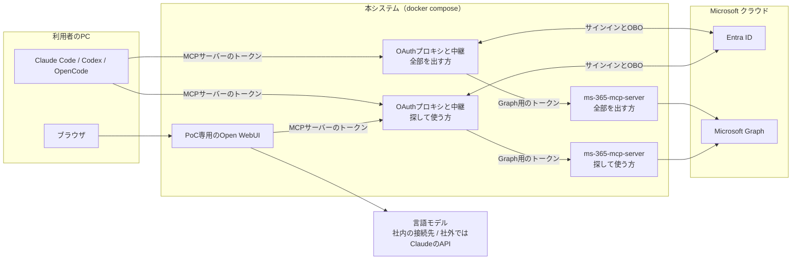
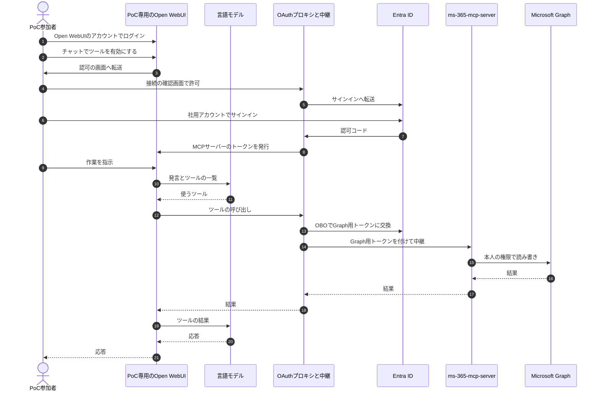

# 変更要件定義書：ms-365-mcp-server の中継への方針変更

- 作成日：2026-11-01
- 対象の要件定義書：`docs/requirements.md`（2026-10-31 版）
- 外部連携の事前確認：
  - `external/ms-365-mcp-server/docs/precheck_report.md`
  - `external/open-webui/docs/precheck_report.md`
  - `external/language-model/docs/precheck_report.md`（Claude の API は確認済み。社内の言語モデルの接続先は、接続情報を受け取ってから確かめる）
- 書き方：すべての要件に [追加] か [削除] を付ける。意味が変わる要件は、旧要件を [削除]、新要件を新しい ID で [追加] にした。変更の無い章は既存の要件定義書を参照する。
- 正本への反映：isdd の決まりでは変更設計のときに正本へ反映するが、実装も確定した設計も無いため、2026-11-01 に外部連携の詳細調査の結果まで含めて `docs/requirements.md` へ直接反映した（ユーザー回答、2026-11-01）。次の工程は変更設計ではなく詳細設計（設計書の作り直し）。本書は変更の理由の記録として残す。

---

## 変更の概要

MCP のツールを自作する方針をやめる。既製の MCP サーバー（ms-365-mcp-server）を内部ネットワークに置き、FastMCP は OAuth プロキシと中継だけを受け持つ薄いラッパーにする。あわせて、開発をしない社員向けに PoC 専用の Open WebUI を足す。

## 経緯

- 当初は ms-365-mcp-server をそのまま使いたかった。しかし ms-365-mcp-server をそのまま使うと、OAuth の後の戻り先の URL を、AI ツールごとに Entra ID に登録する必要がある。AI ツールごとに戻り先が変わるので、AI ツールを足すたびに別部署への依頼が要る。また、AI ツールに Entra のトークンが渡る。
- そのため、ms-365-mcp-server の前にプロキシを置くか、FastMCP で薄いラッパーを作るために、このプロジェクトを立ち上げた。この経緯が要件定義書に残っておらず、2026-10-31 版の要件定義書と詳細設計書は、ツールを自作する方針で書かれていた（ユーザーの指摘、2026-11-01）。
- 方針（ユーザー回答、2026-11-01）：FastMCP の OAuth プロキシを前に置き、ms-365-mcp-server へ中継する。中継は HTTP で行う（ms-365-mcp-server を利用者ごとのプロセスとして stdio で動かす方式は、トークンをプロセスの起動時にしか渡せず、更新もできないため採らない）。ツールは ms-365-mcp-server のものをそのまま出し、出す範囲は ms-365-mcp-server の絞り込みの機能で決める。自作の業務ルール（一覧の件数とカーソル、内容とアップロードの上限、一覧の項目の絞り込み、エラーの種類）は外す。

---

## 1. 目的・前提

### システムの目的（変更後）

社内に共有の MCP サーバーを置き、社員が Claude Code・Codex・OpenCode・Open WebUI から、利用者本人の権限で Microsoft 365 のデータ（メール、予定表、SharePoint/OneDrive、Excel、Teams など）を読み書きできることを PoC で確かめる。MCP のツールは既製の ms-365-mcp-server のものを使い、本システムはサインインの中継と、ツールの呼び出しの中継を受け持つ。

### 範囲（変更後）

| 区分 | 内容 |
|---|---|
| 対象 | OAuth プロキシと中継の設定（2 つの MCP エンドポイント）、ms-365-mcp-server の配置と設定、PoC 専用の Open WebUI の配置と設定、テスト、各 AI ツールからの接続手順書 |
| 対象 | ms-365-mcp-server のツールのうち、依頼資料 P-5 の権限で使えるもの（認証なしの URL を返すツールと、HTTP モードで使えないツールを除く） |
| 対象外 | Entra ID の設定作業（別部署が行う。依頼資料 P-1〜P-8 と、2 件目の戻り先の追加） |
| 対象外 | ツールの自作 |
| 対象外 | 社内で本番運用している Open WebUI への接続（PoC で確かめた後に別に行う） |
| 対象外 | 依頼資料 P-5 に無い権限を必要とする機能 |

### 全体像（変更後）

上の「変更の概要」の図のとおり。

### 用語集（追加・変更する用語）

| 用語 | 業務上の意味 | 本案件での使用範囲 | 同義語/類義語 |
|---|---|---|---|
| AI ツール（変更） | MCP サーバーに接続して機能を使うツール | Claude Code・Codex・OpenCode（利用者の PC で動く）と、PoC 専用の Open WebUI（本システムのサーバーで動く）の 4 つ | MCP クライアント |
| ツール（変更） | MCP サーバーが AI ツールに提供する、1 つの操作 | ms-365-mcp-server が提供するもの | MCP ツール |
| ms-365-mcp-server | Microsoft Graph を呼ぶ MCP のツールを提供する、既製の MCP サーバー（Softeria、Node.js、MIT ライセンス） | 本システムの内部ネットワークにだけ置き、OAuth プロキシから中継を受ける | — |
| 中継 | AI ツールからの MCP の要求を ms-365-mcp-server に渡し、その応答を AI ツールに返すこと。渡すときに利用者本人の Graph 用のトークンを付ける | OAuth プロキシが行う | プロキシ |
| 全部を出すエンドポイント | P-5 の権限で使えるツールを、AI ツールにそのまま全部見せる MCP の受け口 | 2 つの MCP の受け口の 1 つ | — |
| 探して使うエンドポイント | AI ツールには「ツールを探す」「ツールの引数を調べる」「ツールを実行する」の 3 つと、直接出すツールだけを見せ、それ以外は探してから呼ばせる MCP の受け口 | 2 つの MCP の受け口の 1 つ | 必要なときに読み込む方式 |
| 直接出すツール | 探して使うエンドポイントで、探さずにすぐ呼べるように見せるツール | 設定で指定する。最初は無し | — |
| Open WebUI | 会話の画面と言語モデルへの接続を持つ Web アプリ。言語モデルが選んだツールを MCP で呼ぶ | PoC 専用のものを本システムに入れる | — |
| 言語モデル | 利用者の発言から応答を作り、使うツールを選ぶ AI のモデル | Open WebUI がつなぐ。社内では社内の接続先、社外では Claude の API、mock モードでは模擬の言語モデル | LLM |
| 模擬の言語モデル | 決まった応答（ツールの呼び出しなど）を返す、テスト用の言語モデルの代わり | mock モードの E2E で使う | — |
| カーソル（削除） | 一覧の続きを取得するための値 | 自作の一覧のツールが無くなるため、用語から外す | — |

### システムの形態

変更なし。既存要件定義書 `docs/requirements.md` 1 章「システムの形態」を参照。本システムで作る画面は無い。Open WebUI の画面と、サインインの途中の接続の確認画面（FastMCP が提供）はそのまま使う。

### 実装を担当する AI エージェントへのルール

変更なし。既存要件定義書 `docs/requirements.md` 1 章を参照。「FastMCP・Microsoft Graph・Entra ID の仕様は、推測せず確かめる」の対象に、ms-365-mcp-server と Open WebUI を加える。

### 1-1. 技術制約（変更する項目）

| 制約項目 | 内容 | 出どころ（誰がいつ答えたか） |
|---|---|---|
| 実装の方式（変更） | FastMCP（Python）は、OAuth プロキシ（`AzureProvider`）と、ms-365-mcp-server への中継だけを受け持ち、ツールを自作しない。中継のたびに、OBO で得た利用者本人の Graph 用のトークンを付ける。OBO に使う azure-identity の非同期版のために aiohttp が要る（`fastmcp[azure]` に含まれない）。ツールは ms-365-mcp-server を HTTP モードで内部ネットワークに置いて使う。Entra ID の委任アクセスだけを使い、アプリケーション権限は使わない | ユーザー回答（2026-11-01） |
| 配備先（変更） | 社内に置く共有の HTTP サーバー。docker compose で 1 台のサーバー上で起動する。起動するのは、OAuth プロキシと中継（2 つのエンドポイントの分）、ms-365-mcp-server（2 つのエンドポイントの分）、PoC 専用の Open WebUI | ユーザー回答（2026-10-31、2026-11-01） |
| チームの技術（補足） | 変更なし（Python が扱えればよい）。ms-365-mcp-server（Node.js）と Open WebUI は、公式のコンテナイメージをそのまま使い、本システムでは改造しない | ユーザー回答（2026-10-31）、方針（2026-11-01） |
| ライセンスとコスト（変更） | 無料の OSS を使う。ライセンスの種類は問わない（ms-365-mcp-server は MIT、Open WebUI は Open WebUI License。Open WebUI の名前とロゴの表示は消さない）。社内の言語モデルの接続先が使えない社外での確認には、Claude の API（使った分だけ払う）を使ってよい | ユーザー回答（2026-10-31、2026-11-01）。Claude の API は、ユーザーの選択（理由: 社外でもPoCを出来るだけ確認できるようにしたい） |
| 性能と規模の目安（変更） | 本番を想定すると約 1 万人。PoC は PoC 参加者のみ。PoC では 1 万人の負荷はかけない。1 台あたりの処理できる量は測り、1 万人に要る台数を見積もれるようにする | ユーザー回答（2026-10-31、2026-11-01）。測定は、ユーザーの選択（理由: 本番の稟議に、サーバーの台数と費用の根拠が要る） |
| Entra ID の設定（変更） | アプリ登録・権限・管理者同意・割り当ては別部署が行う（依頼資料 P-1〜P-8）。Entra ID に登録する戻り先は、2 つのエンドポイントの分の 2 件（固定）になるので、2 件目の追加を別部署に依頼する | ユーザー回答（2026-11-01） |
| 言語モデル（追加） | Open WebUI は、OpenAI 互換の API で言語モデルにつなぐ。社内では、本番の Open WebUI と同じ社内の接続先を使う。社外では Claude の API（OpenAI 互換の受け口）を使う | ユーザー回答（2026-11-01） |

既存コードベース・サーバー証明書は変更なし。既存要件定義書 `docs/requirements.md` 1-1 を参照。

---

## 2. 業務

変更なし。既存要件定義書 `docs/requirements.md` セクション 2 を参照。

### 2-2. 業務課題一覧（変更なし。参照のために再掲）

| RQ-BK-ID | 業務課題（取り組むこと） | 解決する問題（2-1） | 解決後の状態（KPI の目標値） | 対象業務（RQ-BZ） |
|---|---|---|---|---|
| `RQ-BK-SHARED-M365-MCP-POC` | 共有 MCP サーバーを置き、PoC 参加者が AI ツールから、本人の権限で M365 のデータを手でコピーせずに読み書きできるかを確かめる | AI ツールから M365 のデータを直接扱えない | PoC 参加者が、手でコピーせずに AI ツールから M365 のデータを扱える。7 章のテスト用利用シナリオをすべて満たす | `RQ-BZ-M365-DATA-WORK` |

### 2-3. 見込み経営効果

変更なし（算定しない。業務の問題の大きさが未測定のため）。

---

## 3. 機能要件

### 入力データと出力データ（変更後）

| 区分 | 内容 |
|---|---|
| 入力（AI ツールから） | MCP の要求（ツールの一覧の取得、ツールの呼び出しと引数） |
| 入力（Open WebUI の利用者から） | 会話の発言 |
| 入力（外部連携） | Entra ID のトークン、ms-365-mcp-server の応答（その中身は Microsoft Graph の応答）、言語モデルの応答 |
| 出力（AI ツールへ） | ツールの一覧、ツールの結果、エラーのメッセージ（ms-365-mcp-server が返すもの） |
| 出力（外部連携） | ms-365-mcp-server への中継の要求（Graph 用のトークン付き）、言語モデルへの要求 |

### ユーザー利用フロー（変更後）

Claude Code・Codex・OpenCode からの流れは、既存のフローの「SV」が「OAuth プロキシと中継」と「ms-365-mcp-server」に分かれる。Open WebUI からの流れは次のとおり。

業務フローとの対応：上の 9〜21 が、業務フローの「AI ツールが共有 MCP サーバーのツールを呼ぶ」「本人の権限で M365 のデータを読み書き」に当たる。1〜8 は初回と、トークンの更新ができなくなったときだけ行う。

### 3-0. Web API

| 区分 | RQ-ID | API | 用途 | 入力 | 出力 | 利用者 | 対応業務課題ID（RQ-BK-*） | 削除理由 / この要件が無いと何が困るか |
|---|---|---|---|---|---|---|---|---|
| [削除] | `RQ-UI-MCP-ENDPOINT` | MCP の受け口 | 自作のツールの一覧と呼び出し | — | — | — | `RQ-BK-SHARED-M365-MCP-POC` | 削除理由：ツールを自作しないため。受け口は下の 2 つに置き換える。業務課題は解消せず、置き換え先が受け持つ |
| [削除] | `RQ-UI-OAUTH-ENDPOINTS` | OAuth の受け口 | 1 つの MCP の受け口のための OAuth | — | — | — | `RQ-BK-SHARED-M365-MCP-POC` | 削除理由：MCP の受け口が 2 つになり、OAuth の受け口も受け口ごとに持つため。置き換え先が受け持つ |
| [追加] | `RQ-UI-MCP-FULL-ENDPOINT` | 全部を出す MCP の受け口（Streamable HTTP） | 出す範囲のツール（機能一覧の「ms-365-mcp-server のツールを出す」）を、AI ツールにそのまま全部見せて呼ばせる | MCP の要求と、この受け口用の MCP サーバーのアクセストークン | ツールの一覧（全部）とツールの結果。エラーは ms-365-mcp-server が返すもの | Claude Code・Codex・OpenCode（Open WebUI は、ツールの定義を発言のたびに全部言語モデルに送り、約 945 KB になって使えないため、つながない） | `RQ-BK-SHARED-M365-MCP-POC` | AI ツールがツールを探さずに直接呼べない。ユーザーの選択（理由: PoCなので、どちらも使えるようにして評価したい。BとC切り替えられるようにしたい） |
| [追加] | `RQ-UI-MCP-DISCOVERY-ENDPOINT` | 探して使う MCP の受け口（Streamable HTTP） | AI ツールに「ツールを探す」「ツールの引数を調べる」「ツールを実行する」と直接出すツールだけを見せ、それ以外のツールは探してから呼ばせる。探せる範囲は全部を出す受け口と同じ | MCP の要求と、この受け口用の MCP サーバーのアクセストークン | 3 つのツールと直接出すツールの一覧、ツールの結果。エラーは ms-365-mcp-server が返すもの | AI ツール | `RQ-BK-SHARED-M365-MCP-POC` | ツールの一覧が大きく（約 950 KB）入力に収まらない AI ツールで、ツールを使えない。ユーザーの選択（理由: PoCなので、どちらも使えるようにして評価したい。BとC切り替えられるようにしたい） |
| [追加] | `RQ-UI-OAUTH-ENDPOINTS-BY-MCP-ENDPOINT` | OAuth の受け口（MCP の受け口ごと） | 2 つの MCP の受け口のそれぞれについて、認可サーバー・保護リソースのメタデータ、AI ツールの登録（DCR）、認可の開始と接続の確認画面、Entra ID からの戻り先（`{その受け口の base_url}/auth/callback`）、トークンの発行と更新 | OAuth 2.1（認可コード＋PKCE、DCR、CIMD）の要求 | メタデータ、クライアント ID、その受け口用の MCP サーバーのトークン。エラーは OAuth のエラー応答 | AI ツール、利用者のブラウザ、Entra ID | `RQ-BK-SHARED-M365-MCP-POC` | 2 つの MCP の受け口のそれぞれに、鍵なしでつなげない。受け口を 2 つにするのは、ユーザーの選択（理由: PoCで評価したい。ツールの使い方によって合う方をユーザーに選択させたい） |

**ツール一覧（削除）**：既存要件定義書の「ツール一覧」（39 の自作のツール）と「一覧で返す項目」の表をすべて削除する。出すツールは、機能一覧の「ms-365-mcp-server のツールを出す」で決める。

### 機能一覧

| 区分 | RQ-ID | カテゴリ | 機能名 | 対応業務課題ID（RQ-BK-*） | 削除理由 / この機能が無いと何が困るか |
|---|---|---|---|---|---|
| [削除] | `RQ-FT-EXCHANGE-GRAPH-TOKEN` | 共通（認証） | ツールごとに必要な Graph の委任スコープを指定して OBO で Graph 用のトークンを取得する | `RQ-BK-SHARED-M365-MCP-POC` | 削除理由：ツールを自作しないので、ツールごとにスコープを指定できない。下の「中継のための Graph 用のトークンの取得」に置き換える |
| [削除] | `RQ-FT-GET-MY-PROFILE` | 業務機能 | プロフィールの取得 | `RQ-BK-SHARED-M365-MCP-POC` | 削除理由：ツールを自作しない。ms-365-mcp-server のツールで同じことができ、「ms-365-mcp-server のツールを出す」が受け持つ |
| [削除] | `RQ-FT-LIST-MAIL-FOLDERS` | 業務機能 | メールフォルダーの一覧 | `RQ-BK-SHARED-M365-MCP-POC` | 削除理由：同上 |
| [削除] | `RQ-FT-LIST-MAIL-MESSAGES` | 業務機能 | メールの一覧・検索 | `RQ-BK-SHARED-M365-MCP-POC` | 削除理由：同上 |
| [削除] | `RQ-FT-GET-MAIL-MESSAGE` | 業務機能 | メールの取得 | `RQ-BK-SHARED-M365-MCP-POC` | 削除理由：同上 |
| [削除] | `RQ-FT-EDIT-MAIL-DRAFT` | 業務機能 | 下書きの作成・更新 | `RQ-BK-SHARED-M365-MCP-POC` | 削除理由：同上 |
| [削除] | `RQ-FT-SEND-MAIL` | 業務機能 | メールの送信 | `RQ-BK-SHARED-M365-MCP-POC` | 削除理由：同上 |
| [削除] | `RQ-FT-ORGANIZE-MAIL` | 業務機能 | メールの移動・既読・フラグ・削除 | `RQ-BK-SHARED-M365-MCP-POC` | 削除理由：同上 |
| [削除] | `RQ-FT-LIST-CALENDAR-EVENTS` | 業務機能 | 期間を指定した予定の一覧 | `RQ-BK-SHARED-M365-MCP-POC` | 削除理由：同上 |
| [削除] | `RQ-FT-GET-CALENDAR-EVENT` | 業務機能 | 予定の取得 | `RQ-BK-SHARED-M365-MCP-POC` | 削除理由：同上 |
| [削除] | `RQ-FT-EDIT-CALENDAR-EVENT` | 業務機能 | 予定の作成・変更・削除 | `RQ-BK-SHARED-M365-MCP-POC` | 削除理由：同上 |
| [削除] | `RQ-FT-RESPOND-CALENDAR-INVITE` | 業務機能 | 会議の招待への返答 | `RQ-BK-SHARED-M365-MCP-POC` | 削除理由：同上 |
| [削除] | `RQ-FT-LIST-DRIVE-ITEMS` | 業務機能 | フォルダーの中身の一覧 | `RQ-BK-SHARED-M365-MCP-POC` | 削除理由：同上 |
| [削除] | `RQ-FT-SEARCH-FILES` | 業務機能 | ファイルの検索 | `RQ-BK-SHARED-M365-MCP-POC` | 削除理由：同上 |
| [削除] | `RQ-FT-GET-FILE` | 業務機能 | ファイルの情報と内容の取得 | `RQ-BK-SHARED-M365-MCP-POC` | 削除理由：同上 |
| [削除] | `RQ-FT-UPLOAD-FILE` | 業務機能 | ファイルのアップロード | `RQ-BK-SHARED-M365-MCP-POC` | 削除理由：同上 |
| [削除] | `RQ-FT-MANAGE-DRIVE-ITEMS` | 業務機能 | フォルダーの作成、名前の変更・移動・削除 | `RQ-BK-SHARED-M365-MCP-POC` | 削除理由：同上 |
| [削除] | `RQ-FT-FIND-SHAREPOINT-SITES` | 業務機能 | SharePoint のサイトの検索とドキュメントライブラリの一覧 | `RQ-BK-SHARED-M365-MCP-POC` | 削除理由：同上 |
| [削除] | `RQ-FT-READ-TEAMS-CHATS` | 業務機能 | チャットの一覧とメッセージの取得 | `RQ-BK-SHARED-M365-MCP-POC` | 削除理由：同上 |
| [削除] | `RQ-FT-POST-TEAMS-CHAT-MESSAGE` | 業務機能 | チャットへの投稿 | `RQ-BK-SHARED-M365-MCP-POC` | 削除理由：同上 |
| [削除] | `RQ-FT-LIST-TEAMS-CHANNELS` | 業務機能 | チーム・チャネルの一覧 | `RQ-BK-SHARED-M365-MCP-POC` | 削除理由：同上 |
| [削除] | `RQ-FT-READ-CHANNEL-MESSAGES` | 業務機能 | チャネルのメッセージと返信の取得 | `RQ-BK-SHARED-M365-MCP-POC` | 削除理由：同上 |
| [削除] | `RQ-FT-POST-CHANNEL-MESSAGE` | 業務機能 | チャネルへの投稿と返信 | `RQ-BK-SHARED-M365-MCP-POC` | 削除理由：同上 |
| [追加] | `RQ-FT-EXCHANGE-GRAPH-TOKEN-FOR-RELAY` | 共通（認証） | 中継のための Graph 用のトークンの取得。ツールの呼び出しを中継するたびに、利用者の Entra のトークンを OBO で Graph 用のトークンに交換する（キャッシュがあれば使う）。得られる権限は依頼資料 P-5 の Graph の委任権限の範囲（Entra ID の管理者の同意で決まる）。要求のしかた（権限を並べるか `.default` か）は設計で決める | `RQ-BK-SHARED-M365-MCP-POC` | ms-365-mcp-server に本人の権限の Graph 用のトークンを渡せず、Graph を本人の権限で呼べない |
| [追加] | `RQ-FT-RELAY-MCP-REQUESTS` | 共通（認証） | MCP の要求の中継。AI ツールからの MCP の要求（ツールの一覧の取得とツールの呼び出し）を、受けた受け口に対応する ms-365-mcp-server に渡し、その応答を AI ツールに返す。渡すときは、AI ツールの MCP サーバーのトークンの代わりに、利用者本人の Graph 用のトークンを付ける。ツールの結果とエラーは ms-365-mcp-server が返したものをそのまま返す（403 のときに ms-365-mcp-server が付ける「`--org-mode` で再起動」という案内も、既知の制限としてそのまま返る）。ツールの一覧が取れないとき（OBO の失敗、ms-365-mcp-server の停止）は、ツールが 0 個の一覧ではなくエラーとして返す | `RQ-BK-SHARED-M365-MCP-POC` | AI ツールから ms-365-mcp-server のツールを、本人の権限で使えない。一覧が取れないときに 0 個に見えると、利用者に原因が分からない |
| [追加] | `RQ-FT-EXPOSE-MS365-MCP-TOOLS` | 業務機能 | ms-365-mcp-server のツールを出す。組織用のモードで、依頼資料 P-5 の権限で使えるツールを出す。ただし、ファイルを認証なしで取れる短期の URL を返すツール（`get-download-url`）と、HTTP モードでは必ずエラーになるツール（`get-upload-url`）は外す（2026-11-01 時点の 0.178.0 で 173 個。メール、メールフォルダー、添付、予定表、OneDrive、Excel、SharePoint のサイトとリスト、Teams のチャット・チーム・チャネル、変更の通知、任意の Graph の要求をまとめて送る `graph-batch` などを含む）。変更の通知のツールは、通知を受ける口が無いので動かないが、出す範囲からは外さない | `RQ-BK-SHARED-M365-MCP-POC` | AI ツールから M365 のデータを読み書きできない。範囲を P-5 の権限のすべてにするのは、ユーザーの選択（理由: Claude Codeや他のツールでツール開発などの業務を行う際に社内情報にアクセスしたり書き込みをしたりしたい。チャットで社内情報にアクセスしたり予定を入れたりしたい） |
| [追加] | `RQ-FT-PUBLISH-EAGER-TOOLS` | 業務機能 | 直接出すツールの指定。探して使う受け口で、探さずにすぐ呼べるように見せるツールを、ツールの名前の一覧で設定できる。最初は無し（指定しない） | `RQ-BK-SHARED-M365-MCP-POC` | 探して使う受け口で、よく使うツールも毎回探すことになり、組み合わせの評価ができない。ユーザーの選択（理由: PoCなので、どちらも使えるようにして評価したい。BとC切り替えられるようにしたい） |
| [追加] | `RQ-FT-PROVIDE-POC-OPEN-WEBUI` | 業務機能 | PoC 専用の Open WebUI の提供。Open WebUI を本システムと一緒に起動し、探して使う受け口をツールサーバーとして使えるようにする（全部を出す受け口はつながない）。利用者はチャットでツールを有効にしたときに、本人として MCP サーバーにサインインする | `RQ-BK-SHARED-M365-MCP-POC` | 開発をしない社員が M365 のデータを AI で扱えない。ユーザーの選択（理由: 開発をしない社員にもOpen WebUIから使わせたい）。本システムに入れるのは、ユーザーの選択（理由: 社内で本番運用しているOpenwebuiはあるが、PoCでは専用のOpenWebuiで動作を確認したい。自由に切り替えられる認識だが、PoCとして確認ができないと本番には繋げられない。） |
| [追加] | `RQ-FT-MANAGE-OPEN-WEBUI-ACCOUNTS` | 共通（認証） | Open WebUI のアカウントの管理。利用者は Open WebUI の中のアカウント（メールアドレスとパスワード）でログインする。PoC 参加者のアカウントは Open WebUI の管理者が作る。利用者自身による登録は受け付けない | `RQ-BK-SHARED-M365-MCP-POC` | PoC 参加者以外が PoC 専用の Open WebUI を使える。Entra ID のログインにしないのは、本番の Open WebUI も Entra ID のログインを使っていないため（ユーザー回答、2026-11-01） |

変更しない機能：AI ツールの登録、サインインの中継、MCP サーバーのトークンの発行、トークンの更新（既存要件定義書の機能一覧のとおり。AI ツールに Open WebUI が加わる）。

- マスタ管理の機能は無い。
- 認可（ロールごとの権限）の機能は無い。データ単位の権限は M365 側の権限に従う。Open WebUI の管理者と利用者の区別は Open WebUI の機能に従う。
- ログの機能は、一般的な動作ログ・エラーログだけ（6 章）。

### 3-1. 帳票・出力ファイル

変更なし。既存要件定義書 `docs/requirements.md` セクション 3-1 を参照（帳票・出力ファイルは無い）。

### 3-2. 業務ルール

| 区分 | RQ-ID | ルール名 | 対応業務課題ID（RQ-BK-*） | 削除理由 |
|---|---|---|---|---|
| [削除] | `RQ-FT-PAGINATE-LIST-RESULTS` | 一覧の件数と続き | `RQ-BK-SHARED-M365-MCP-POC` | ツールを自作しないため。一覧の件数は ms-365-mcp-server と Graph の動きに従う |
| [削除] | `RQ-FT-REPORT-ERRORS-READABLY` | エラーの伝え方 | `RQ-BK-SHARED-M365-MCP-POC` | ツールを自作しないため。エラーは ms-365-mcp-server が返すもの（状態コード、Graph のエラーコードとメッセージ）をそのまま返す。トークンを出さないことは、非機能要件「トークンを外に出さない」が受け持つ |
| [削除] | `RQ-FT-LIMIT-FILE-CONTENT-SIZE` | ファイルの内容を返す上限 | `RQ-BK-SHARED-M365-MCP-POC` | ツールを自作しないため。ファイルの内容の扱いは ms-365-mcp-server に従う |
| [削除] | `RQ-FT-LIMIT-UPLOAD-SIZE` | アップロードで受け取る上限 | `RQ-BK-SHARED-M365-MCP-POC` | ツールを自作しないため。アップロードの扱いは ms-365-mcp-server と Graph に従う |

| 区分 | RQ-ID | ルール名 | 内容（条件と結果） | 違反時・エラー時の業務上の扱い | 対応業務課題ID（RQ-BK-*） | この要件が無いと何が困るか |
|---|---|---|---|---|---|---|
| [追加] | `RQ-FT-LIMIT-TOOL-RESPONSE-SIZE` | ツールの応答の大きさの上限 | ツールの応答の大きさに、ms-365-mcp-server の設定で上限を設ける。対象は、1 回に取る件数の上限、全ページをまとめて取るときのページ数と件数の上限、ファイルの中身を取るときの大きさの上限。値は設計で決め、設定で変えられる | 件数やページの上限を超えた分は返さず、続きがあることを結果に示す（ms-365-mcp-server の動き）。ファイルの中身が上限を超えたときは、エラーとして返す | `RQ-BK-SHARED-M365-MCP-POC` | 大きな一覧やファイルで AI ツールの入力があふれ、そのツールの結果を使えない（ms-365-mcp-server の既定は、件数の上限なし、全ページの取得は 100 ページ・1 万件、ファイルの中身は上限なし） |

変更後の業務ルールは、上の「ツールの応答の大きさの上限」だけ。

### 3-3. 外部連携

| 区分 | RQ-ID | 連携先 | 方向（取得 / 送信 / 受信） | やり取りするデータ | タイミング | 対応業務課題ID（RQ-BK-*） | 削除理由 / この要件が無いと何が困るか |
|---|---|---|---|---|---|---|---|
| [削除] | `RQ-EX-CALL-MICROSOFT-GRAPH` | Microsoft Graph | — | 自作のツールが呼ぶ Graph のデータ | — | `RQ-BK-SHARED-M365-MCP-POC` | 削除理由：Graph を呼ぶのが ms-365-mcp-server に変わり、扱うデータの範囲も変わるため。下の 2 つに置き換える |
| [追加] | `RQ-EX-RELAY-TO-MS365-MCP-SERVER` | ms-365-mcp-server | 送信・受信 | MCP の要求と応答（Streamable HTTP）。要求には利用者本人の Graph 用のトークンを付ける | ツールの一覧の取得と、ツールの呼び出しのたび | `RQ-BK-SHARED-M365-MCP-POC` | ms-365-mcp-server のツールを使えない |
| [追加] | `RQ-EX-CALL-GRAPH-FROM-MS365-MCP-SERVER` | Microsoft Graph | 取得・送信 | ms-365-mcp-server のツールが扱う、依頼資料 P-5 の権限の範囲のデータ（メール、予定表、ファイル、Excel、SharePoint のサイトとリスト、Teams など） | ツールの呼び出しのたび | `RQ-BK-SHARED-M365-MCP-POC` | M365 のデータを読み書きできない |
| [追加] | `RQ-EX-CALL-LANGUAGE-MODEL` | 言語モデル（社内の接続先、社外では Claude の API） | 送信・受信 | 会話の発言、ツールの一覧、ツールの結果、言語モデルの応答（OpenAI 互換のチャットの API） | Open WebUI での発言のたび | `RQ-BK-SHARED-M365-MCP-POC` | Open WebUI が応答を作れず、ツールを選べない |
| [追加] | `RQ-EX-USE-LOCAL-LANGUAGE-MODEL-MOCK` | 言語モデルの模擬 | — | 決まった応答（ツールの呼び出しと、ツールの結果を受けた応答）を、手元の HTTP サーバーで返す（mock モードの E2E に使う） | E2E テストの実行時 | `RQ-BK-SHARED-M365-MCP-POC` | Open WebUI からの利用を、変更のたびに自動で確かめられない。ユーザーの選択（理由: 本番に繋いだ後も、変更のたびにOpen WebUI から使えることを自動で確かめたい） |

変更しない外部連携：Entra ID でのサインイン、Entra ID での OBO の交換（タイミングは「中継のたび」）、Entra ID の模擬、Graph の模擬（Dev Proxy。ms-365-mcp-server の Graph への要求を差し替える）。既存要件定義書 `docs/requirements.md` 3-3 を参照。

---

## 4. データ

### 4-1. データ要件一覧

| 区分 | RQ-ID | 種別 | 内容 | 対応業務課題ID（RQ-BK-*） | 削除理由 / この要件が無いと何が困るか |
|---|---|---|---|---|---|
| [削除] | `RQ-DT-NO-APP-DATABASE` | DB の必要性 | DB は持たない | `RQ-BK-SHARED-M365-MCP-POC` | 削除理由：Open WebUI が自分の DB を持つため、本システム全体としては「DB を持たない」と言えなくなった |
| [削除] | `RQ-DT-NO-M365-DATA-RETENTION` | 外部データの保持 | Graph のデータと Graph 用のトークンを保管しない | `RQ-BK-SHARED-M365-MCP-POC` | 削除理由：Open WebUI がチャットの記録として M365 のデータを保管するため、対象を中継の部分に限った要件に置き換える |
| [追加] | `RQ-DT-NO-DATABASE-IN-RELAY` | DB の必要性 | OAuth プロキシと中継、ms-365-mcp-server は DB を持たない。業務のデータは M365 側にある。Open WebUI は自分の DB（Open WebUI の既定のもの）に、アカウント、ツールサーバーの接続先、利用者ごとの MCP サーバーのトークン、チャットの記録を持つ | `RQ-BK-SHARED-M365-MCP-POC` | 不要な DB の設計・運用が生まれる |
| [追加] | `RQ-DT-NO-M365-DATA-RETENTION-IN-RELAY` | 外部データの保持 | OAuth プロキシと中継、ms-365-mcp-server は、Graph のデータと Graph 用のトークンを、要求の処理中にメモリ上で扱うだけで保管しない（Graph 用のトークンは、メモリ上のキャッシュにだけ置いてよい） | `RQ-BK-SHARED-M365-MCP-POC` | M365 のデータの複製が中継の部分に残り、漏洩の範囲が広がる |
| [追加] | `RQ-DT-OPEN-WEBUI-CHAT-RETENTION` | 外部データの保持 | PoC 専用の Open WebUI は、チャットの記録（発言、応答、ツールの呼び出しと結果。M365 のデータを含む）を、Open WebUI の DB に暗号化せずに保管する。本番の Open WebUI と同じ扱いにし、利用者は自分の記録を消せる。PoC の終わりに Open WebUI のデータ領域ごと消す | `RQ-BK-SHARED-M365-MCP-POC` | 記録の扱いが決まらず、PoC の後に M365 のデータの写しが残る |

変更しない要件：認証の状態の保管（既存要件定義書の 4-1 のとおり。保管先は OAuth プロキシごとに持つ）。

### 4-2. 業務エンティティとデータ項目

| 区分 | RQ-ID | カテゴリ | 業務エンティティ名 | 対応業務課題ID（RQ-BK-*） | この業務エンティティが無いと何が困るか |
|---|---|---|---|---|---|
| [追加] | `RQ-DT-MAIL-ATTACHMENT` | 外部データ | メールの添付ファイル | `RQ-BK-SHARED-M365-MCP-POC` | 添付ファイルの追加・取得・削除ができない |
| [追加] | `RQ-DT-FOCUSED-INBOX-OVERRIDE` | 外部データ | フォーカス受信トレイの振り分けの設定 | `RQ-BK-SHARED-M365-MCP-POC` | 振り分けの設定を AI ツールで扱えない |
| [追加] | `RQ-DT-CALENDAR` | 外部データ | 予定表（予定を入れる器。複数持てる） | `RQ-BK-SHARED-M365-MCP-POC` | 既定以外の予定表を扱えない |
| [追加] | `RQ-DT-CALENDAR-PERMISSION` | 外部データ | 予定表の共有の権限 | `RQ-BK-SHARED-M365-MCP-POC` | 予定表の共有を AI ツールで扱えない |
| [追加] | `RQ-DT-DRIVE-ITEM-PERMISSION` | 外部データ | ファイル・フォルダーの共有の権限と共有リンク | `RQ-BK-SHARED-M365-MCP-POC` | ファイルの共有を AI ツールで扱えない |
| [追加] | `RQ-DT-DRIVE-ITEM-VERSION` | 外部データ | ファイルの版 | `RQ-BK-SHARED-M365-MCP-POC` | ファイルの版を確かめられない |
| [追加] | `RQ-DT-EXCEL-WORKBOOK-CONTENT` | 外部データ | Excel のブックの中身（ワークシート、範囲、表とその行、グラフ） | `RQ-BK-SHARED-M365-MCP-POC` | Excel の中身を AI ツールで読み書きできない |
| [追加] | `RQ-DT-SHAREPOINT-LIST` | 外部データ | SharePoint のリスト（列、項目、項目の版） | `RQ-BK-SHARED-M365-MCP-POC` | SharePoint のリストを AI ツールで読み書きできない |
| [追加] | `RQ-DT-GRAPH-SUBSCRIPTION` | 外部データ | 変更の通知の購読 | `RQ-BK-SHARED-M365-MCP-POC` | 変更の通知のツールの対象が定まらない（通知を受ける口が無いので、作成は Graph がエラーにする） |
| [追加] | `RQ-DT-M365-REFERENCE-INFO` | 外部データ | 参照用の情報（メールの送信前の注意、空き時間、よく使うファイル、使える言語とタイムゾーン、Copilot による社内情報の検索結果） | `RQ-BK-SHARED-M365-MCP-POC` | 予定の調整や情報の検索に使う参照情報を扱えない |
| [追加] | `RQ-DT-OPEN-WEBUI-ACCOUNT` | 内部データ | Open WebUI のアカウント | `RQ-BK-SHARED-M365-MCP-POC` | PoC 参加者が Open WebUI にログインできない |
| [追加] | `RQ-DT-OPEN-WEBUI-TOOL-SERVER` | 内部データ | Open WebUI のツールサーバーの接続先（探して使う受け口） | `RQ-BK-SHARED-M365-MCP-POC` | Open WebUI から本システムのツールを使えない |
| [追加] | `RQ-DT-OPEN-WEBUI-MCP-TOKEN` | 内部データ | Open WebUI が利用者ごとに持つ MCP サーバーのトークン | `RQ-BK-SHARED-M365-MCP-POC` | Open WebUI から本人の権限でツールを呼べない |
| [追加] | `RQ-DT-OPEN-WEBUI-CHAT-HISTORY` | 内部データ | Open WebUI のチャットの記録 | `RQ-BK-SHARED-M365-MCP-POC` | Open WebUI がツールを実行できない（チャットの記録がある要求でだけツールを実行する） |

変更しない業務エンティティ：AI ツールの登録情報、利用者のトークンの組、利用者のプロフィール、メールフォルダー、メール、予定、ファイル・フォルダー、SharePoint サイト、Teams のチャット、Teams のチームとチャネル、Teams のメッセージ（既存要件定義書の 4-2 のとおり。AI ツールの登録情報には Open WebUI が加わる）。

**データ項目（変更）**

- 既存要件定義書の 4-2 のデータ項目の表のうち、自作のツールの入力の項目（「共通（一覧）」の件数の上限とカーソル、メール・予定・ファイル・フォルダー・SharePoint サイト・Teams の入力の項目）の行をすべて削除する。
- 外部データのエンティティの項目は、Graph のリソースの定義と ms-365-mcp-server のツールの引数に従う。本システムでは項目を定義せず、入力のチェックもしない（Graph と ms-365-mcp-server がチェックする）。
- AI ツールの登録情報と利用者のトークンの組の項目は変更なし。AI ツールの登録情報の「戻り先」には、Open WebUI の戻り先（`https://` の Open WebUI の URL の下）が加わる。
- Open WebUI のエンティティの項目は、本システムで使うものだけを次に書く。

| エンティティ名 | 項目名 | 業務上の意味 | 必須 | 形式・桁 | 値の範囲・制約 | 例 |
|---|---|---|---|---|---|---|
| Open WebUI のアカウント | メールアドレス | ログインに使う名前 | ○ | メールアドレスの形式 | PoC 参加者の社用のアドレス | `user@example.com` |
| Open WebUI のアカウント | パスワード | ログインに使う合言葉 | ○ | 文字列 | Open WebUI の規則に従う | — |
| Open WebUI のアカウント | 役割 | 管理者か利用者か | ○ | 選択 | 管理者 / 利用者 | 利用者 |
| Open WebUI のツールサーバーの接続先 | URL | MCP の受け口の URL | ○ | `https://` の URL | 探して使う受け口 | — |
| Open WebUI のツールサーバーの接続先 | 認証の種類 | 受け口への認証のしかた | ○ | 選択 | OAuth 2.1（DCR） | OAuth 2.1 |
| Open WebUI のツールサーバーの接続先 | クライアントの情報 | DCR で受け口から得たクライアント ID など | ○ | Open WebUI が暗号化して保管 | — | — |

### 4-3. CRUD テーブル（変更後の全エンティティ）

| エンティティ名 | Create | Read（一覧） | Read（詳細） | 検索 | Update | Delete | 備考 |
|---|---|---|---|---|---|---|---|
| AI ツールの登録情報 | ○ | × | ○ | × | × | × | 変更なし（FastMCP が行う）。OAuth プロキシごとに持つ |
| 利用者のトークンの組 | ○ | × | ○ | × | ○ | × | 変更なし（FastMCP が行う）。OAuth プロキシごとに持つ |
| 利用者のプロフィール | × | × | ○ | × | × | × | 変更なし |
| メールフォルダー | ○ | ○ | × | × | ○ | ○ | 下の階層の作成・一覧を含む |
| メール | ○ | ○ | ○ | ○ | ○ | ○ | 作成は下書き（新規・返信・全員に返信・転送の下書きを含む）。検索は検索語と絞り込み条件で。更新は下書きの変更・移動・コピー・既読・フラグ。送信（新規・返信・転送・下書きの送信）も含む。差分の取得を含む |
| メールの添付ファイル | ○ | ○ | ○ | × | × | ○ | 大きな添付はアップロードのセッションで作成する |
| フォーカス受信トレイの振り分けの設定 | ○ | ○ | × | × | ○ | ○ | — |
| 予定表 | ○ | ○ | × | × | ○ | ○ | — |
| 予定表の共有の権限 | ○ | ○ | × | × | ○ | ○ | — |
| 予定 | ○ | ○ | ○ | × | ○ | ○ | 一覧は期間の指定、繰り返しの予定の回、差分の取得を含む。更新には招待への返答、取り消し、転送、アラームの延期と消去、添付の追加を含む。既定以外の予定表の予定も扱う |
| ファイル・フォルダー | ○ | ○ | ○ | ○ | ○ | ○ | 作成はアップロードとフォルダーの作成。更新は上書き・名前の変更・移動・コピー。内容の取得（ダウンロード）、プレビュー、サムネイル、秘密度ラベル、差分の取得を含む |
| ファイル・フォルダーの共有の権限と共有リンク | ○ | ○ | × | × | × | ○ | 作成は共有と共有リンクの作成 |
| ファイルの版 | × | ○ | × | × | × | × | — |
| SharePoint サイト | × | ○ | ○ | ○ | × | × | 一覧はサイトのドキュメントライブラリと項目を含む。検索は検索語で。パスでの取得と差分の取得を含む |
| Excel のブックの中身 | ○ | ○ | ○ | × | ○ | ○ | 作成は表・表の行・グラフ。更新は範囲の値と書式、挿入・結合・解除・並べ替え、表の行。削除は範囲・表の行。範囲の消去を含む |
| SharePoint のリスト | ○ | ○ | ○ | × | ○ | ○ | 作成・更新・削除はリストの項目。リストと列は一覧と取得だけ。項目の版の一覧と取得、差分の取得を含む |
| 変更の通知の購読 | ○ | ○ | ○ | × | ○ | ○ | 通知を受ける口が無いので、作成は Graph がエラーにする |
| 参照用の情報 | × | ○ | ○ | ○ | × | × | 検索は Copilot による社内情報の検索 |
| Teams のチャット | × | ○ | ○ | × | × | × | — |
| Teams のチームとチャネル | × | ○ | ○ | × | × | × | — |
| Teams のメッセージ | ○ | ○ | ○ | × | ○ | × | 作成はチャット・チャネルへの投稿と返信。更新はチャットのメッセージの変更、ピン留めとその解除、リアクションの付け外し。添付の中身の一覧を含む |
| Open WebUI のアカウント | ○ | ○ | ○ | × | ○ | ○ | Open WebUI の管理者が行う（Open WebUI の機能） |
| Open WebUI のツールサーバーの接続先 | ○ | ○ | ○ | × | ○ | ○ | Open WebUI の管理者が行う。作成時に DCR でクライアントを登録する |
| Open WebUI の MCP サーバーのトークン | ○ | × | ○ | × | ○ | ○ | 利用者がツールを有効にしたときに作成し、ツールの呼び出しで読み、更新時に書き換える（Open WebUI が行う） |
| Open WebUI のチャットの記録 | ○ | ○ | ○ | ○ | ○ | ○ | 利用者が行う（Open WebUI の機能）。PoC の終わりにデータ領域ごと消す |

- 任意の Graph の要求をまとめて送るツール（`graph-batch`）は、上のどのエンティティの操作にもなりうる（本人の権限の範囲で）。
- トランザクション（複数操作の一体完了）が要る操作は無い。

### 4-4. 状態遷移

変更なし。既存要件定義書 `docs/requirements.md` セクション 4-4 を参照（本システムが状態を管理するエンティティは無い）。Open WebUI のアカウントは管理者が作るので、承認待ちの状態は使わない。

### 4-5. 画面一覧

変更なし。本システムで作る画面は無い。Open WebUI の画面と、FastMCP の接続の確認画面をそのまま使う。

---

## 5. 非機能要件

| 区分 | RQ-ID | カテゴリ | 非機能要件名 | 内容・目標値・確かめ方 | 対応業務課題ID（RQ-BK-*） | 削除理由 / この非機能要件が無いと何が困るか |
|---|---|---|---|---|---|---|
| [削除] | `RQ-NF-MULTI-INSTANCE-READY` | 利用人数 | 複数台に切り替えられる | — | `RQ-BK-SHARED-M365-MCP-POC` | 削除理由：対象に ms-365-mcp-server を加えるため、下の要件に置き換える |
| [削除] | `RQ-NF-NO-KEY-DISTRIBUTION` | セキュリティ（認証方式） | 鍵を配らない | — | `RQ-BK-SHARED-M365-MCP-POC` | 削除理由：確かめ方の対象（3 つの AI ツール）が 4 つになるため、下の要件に置き換える |
| [削除] | `RQ-NF-SINGLE-REDIRECT-URI` | セキュリティ | Entra ID の戻り先は 1 件 | — | `RQ-BK-SHARED-M365-MCP-POC` | 削除理由：MCP の受け口が 2 つになり、戻り先が 2 件になるため |
| [削除] | `RQ-NF-STREAMABLE-HTTP` | 接続方式 | Streamable HTTP | — | `RQ-BK-SHARED-M365-MCP-POC` | 削除理由：確かめ方の対象が 4 つの AI ツールになり、中継の先も Streamable HTTP になるため、下の要件に置き換える |
| [削除] | `RQ-NF-CONFIGURABLE-SETTINGS` | 保守性 | 未確定の値を設定で変えられる | — | `RQ-BK-SHARED-M365-MCP-POC` | 削除理由：設定で変える値が増えるため、下の要件に置き換える |
| [削除] | `RQ-NF-PINNED-VERSIONS` | 保守性 | 版を固定する | — | `RQ-BK-SHARED-M365-MCP-POC` | 削除理由：固定する対象に ms-365-mcp-server と Open WebUI を加えるため、下の要件に置き換える |
| [追加] | `RQ-NF-SCALE-OUT-RELAY-AND-MS365` | 利用人数 | 台数を増やせる | OAuth プロキシと中継、ms-365-mcp-server のどちらも、2 つの受け口のそれぞれについて、設定の変更だけで台数を増やせる（OAuth プロキシは署名鍵の明示・共有の保管先・MCP のセッションを持たない動作、ms-365-mcp-server はセッションを持たない動作）。それぞれ 2 台にして振り分けた構成で、サインインとツールの呼び出しが通ることで確かめる | `RQ-BK-SHARED-M365-MCP-POC` | 本番想定の約 1 万人に向けて台数を増やすとき、作り直しになる。ms-365-mcp-server は要求のたびにツールを登録し直すので、1 台では足りない見込み（実測で、全部を出す方は 1 回あたり CPU 約 20 ms） |
| [追加] | `RQ-NF-MEASURE-INSTANCE-CAPACITY` | 性能 | 1 台あたりの処理できる量を測る | 模擬の Entra ID と Graph を使い、OAuth プロキシと中継、ms-365-mcp-server のそれぞれについて、2 つの受け口ごとに、1 台がエラーを出さずに処理できる毎秒のツールの呼び出しの回数を測る。結果と、利用のしかたの仮定（同時に使う人の割合、1 人の呼び出しの頻度、2 つの受け口の使い分けの比率）から台数を出す計算式を、報告にまとめる。仮定の値は報告を使う人が入れる。1 万人の負荷はかけない | `RQ-BK-SHARED-M365-MCP-POC` | ユーザーの選択（理由: 本番の稟議に、サーバーの台数と費用の根拠が要る） |
| [追加] | `RQ-NF-NO-KEY-DISTRIBUTION-TO-AI-TOOLS` | セキュリティ（認証方式） | 鍵を配らない | 利用者に MCP サーバーの鍵（API キーなど）を配らない。認証は Entra ID の SSO（OAuth 2.0 / OpenID Connect、v2）で、OAuth プロキシが OAuth の認可サーバーとして振る舞う。Claude Code・Codex・OpenCode は 2 つの受け口に、Open WebUI は探して使う受け口に、MCP サーバーの鍵の設定なしで接続できることで確かめる | `RQ-BK-SHARED-M365-MCP-POC` | 鍵の配布と失効の管理が要り、漏れたときに本人以外が使える |
| [追加] | `RQ-NF-TWO-FIXED-REDIRECT-URIS` | セキュリティ | Entra ID の戻り先は 2 件（固定） | Entra ID に登録する戻り先は、2 つの受け口の `{base_url}/auth/callback` の 2 件だけ。AI ツールごとの戻り先を Entra ID に登録する前提の作りにしない。AI ツール（Open WebUI を含む）を足しても、Entra ID の設定を変えずに接続できることで確かめる | `RQ-BK-SHARED-M365-MCP-POC` | AI ツールを足すたびに別部署への依頼が要る。2 件にするのは、ユーザーの選択（理由: PoCで評価したい。ツールの使い方によって合う方をユーザーに選択させたい） |
| [追加] | `RQ-NF-STREAMABLE-HTTP-FOR-ALL-HOPS` | 接続方式 | Streamable HTTP | AI ツールから OAuth プロキシへ、OAuth プロキシから ms-365-mcp-server への MCP のトランスポートは、どちらも Streamable HTTP。4 つの AI ツールから接続でき、中継が通ることで確かめる | `RQ-BK-SHARED-M365-MCP-POC` | 共有サーバーとして置けない。ms-365-mcp-server を利用者ごとのプロセスにすることになる |
| [追加] | `RQ-NF-MS365-INTERNAL-ONLY` | セキュリティ | ms-365-mcp-server を内部にだけ置く | ms-365-mcp-server は、OAuth プロキシと中継からだけ届く内部ネットワークに置き、ホストや社内ネットワークには公開しない。ms-365-mcp-server 自身の OAuth の受け口（認可、トークン、メタデータなど）は止める設定が無いので、外から届かないことで使わせない。動的なクライアント登録の受け口は止める。ms-365-mcp-server に Entra ID のアプリの設定は渡さない。社内ネットワークから ms-365-mcp-server に届かないことで確かめる | `RQ-BK-SHARED-M365-MCP-POC` | ms-365-mcp-server はトークンの期限だけを確かめて受け付けるので、外から届くと、OAuth プロキシの検証を通らずに Graph を呼ばれる |
| [追加] | `RQ-NF-NO-MS365-RATE-LIMIT` | 利用人数 | ms-365-mcp-server の回数の制限を外す | ms-365-mcp-server の要求元ごとの回数の制限（毎分 120 回）を外す。混雑の制限は Graph の利用者ごとの制限に任せる。毎分 120 回を超える呼び出しで、ms-365-mcp-server が 429 を返さないことで確かめる | `RQ-BK-SHARED-M365-MCP-POC` | すべての要求が OAuth プロキシから届くので、全利用者を合わせて毎分 120 回で止まる |
| [削除] | `RQ-NF-GRAPH-RETRY` | 可用性 | Graph の一時的なエラーで再試行する | — | `RQ-BK-SHARED-M365-MCP-POC` | 削除理由：再試行するのが ms-365-mcp-server になり、送信（POST・PATCH）の 503・504 は再試行しない動きになるため、下の要件に置き換える |
| [追加] | `RQ-NF-GRAPH-RETRY-BY-MS365` | 可用性 | Graph の一時的なエラーで再試行する | ms-365-mcp-server が、Graph の 429 ではすべての要求を、503・504 では読み取りなど何度送っても結果の変わらない要求だけを、`Retry-After` に従って待って再試行する。送信など（POST・PATCH）の 503・504 は、二重の送信を避けるため再試行しない。回数は既定 3 回で、設定で変えられる。中継の側では再試行しない（二重にしない）。429 の後に待ってから再試行すること、送信の 503 を再試行しないことで確かめる | `RQ-BK-SHARED-M365-MCP-POC` | 一時的な混雑で、すぐ失敗になる |
| [追加] | `RQ-NF-NO-CROSS-USER-GRAPH-BLOCKING` | 可用性 | 1 人のエラーで他の利用者を止めない | ある利用者の Graph の呼び出しで一時的なエラーが続いても、他の利用者の Graph の呼び出しを止めない。ms-365-mcp-server の回路遮断器（一時的なエラーが 5 回続くと、30 秒のあいだ全員の Graph の呼び出しを止める仕組み）を無効にする。ある利用者で 503 を続けて起こした直後に、別の利用者のツールの呼び出しが通ることで確かめる | `RQ-BK-SHARED-M365-MCP-POC` | 1 人の利用者の混雑の制限（Graph の利用者ごとの 429）で、全員が 30 秒使えなくなる |
| [追加] | `RQ-NF-OPEN-WEBUI-HTTPS` | セキュリティ | Open WebUI も HTTPS で受ける | 利用者のブラウザから PoC 専用の Open WebUI への通信は HTTPS にする（mock モードでも同じ）。Open WebUI から MCP の受け口へは、`https://` の公開 URL で接続し、社内の認証局（mock モードでは手元の認証局）の証明書を確かめる | `RQ-BK-SHARED-M365-MCP-POC` | パスワードとチャットの中身が平文で流れる。Open WebUI の戻り先が `https://` でないと、OAuth の登録が拒否される（実測） |
| [追加] | `RQ-NF-CONFIGURABLE-SETTINGS-WITH-RELAY` | 保守性 | 未確定の値を設定で変えられる | まだ決まっていない値は環境変数で変えられ、未設定なら各ソフトの既定値を使う。対象は、既存の値（MCP サーバーの URL、API の公開で作るスコープ名、保管先、署名鍵、接続の確認画面の出し方、AI ツールの戻り先の制限、CIMD の受け付け、トークンの有効期限、MCP のセッションを持たない動作）を 2 つの受け口のそれぞれについて持つものと、追加の値（直接出すツール、Graph の再試行の回数、ツールの応答の大きさの上限、Open WebUI の公開 URL、言語モデルの接続先・鍵・モデル名、各部分の台数）。未設定の値が各ソフトに渡らないことで確かめる | `RQ-BK-SHARED-M365-MCP-POC` | 値が決まるたびにコードの修正が要る |
| [追加] | `RQ-NF-PINNED-VERSIONS-WITH-MS365-AND-OPEN-WEBUI` | 保守性 | 版を固定する | Python、FastMCP、ms-365-mcp-server、Open WebUI の版を固定する（2026-11-01 時点の最新は、FastMCP 4.1.4、ms-365-mcp-server 0.178.0、Open WebUI v0.12.5。実装開始時に再確認する）。ロックファイルとイメージの版のタグがあることで確かめる | `RQ-BK-SHARED-M365-MCP-POC` | 依存の更新で、知らないうちに動作が変わる。ms-365-mcp-server と Open WebUI は版の上がる間隔が短い |

変更しない非機能要件：社内ネットワークからだけ使う、HTTPS だけで受ける、本人の委任アクセスだけ、トークンを外に出さない、トークンを検証する、特定のテナントだけ、保管先を暗号化する、秘密情報を環境変数から読む（Claude の API の鍵と Open WebUI の鍵を含む）、単体テストは接続なしで動く。既存要件定義書 `docs/requirements.md` 5 章を参照。

- 応答時間の目標は設けない（変更なし）。
- 可用性の要求は無い（変更なし）。
- 移行は無い（変更なし）。
- 監査証跡の改ざん防止は要らない（変更なし）。

---

## 6. 運用要件

| 区分 | RQ-ID | 種別 | 内容 | 対応業務課題ID（RQ-BK-*） | 削除理由 / この要件が無いと何が困るか |
|---|---|---|---|---|---|
| [削除] | `RQ-OP-AI-TOOL-CONNECTION-GUIDE` | 手順書 | 3 つの AI ツールの接続手順書 | `RQ-BK-SHARED-M365-MCP-POC` | 削除理由：対象に Open WebUI と 2 つの受け口の選び方が加わるため、下の要件に置き換える |
| [追加] | `RQ-OP-CONNECTION-GUIDE-FOR-ALL-AI-TOOLS` | 手順書 | Claude Code・Codex・OpenCode・Open WebUI のそれぞれについて、MCP サーバーの登録からサインインまでの接続手順書を用意する。2 つの受け口の違いと選び方を載せる。Claude Code と OpenCode は `NODE_EXTRA_CA_CERTS`、Codex は `CODEX_CA_CERTIFICATE` で社内の認証局を信頼させる設定を載せる。Open WebUI は、チャットで探して使う受け口のツールを有効にしてサインインする手順を載せる | `RQ-BK-SHARED-M365-MCP-POC` | PoC 参加者が接続できない。どちらの受け口を使えばよいか分からない |
| [追加] | `RQ-OP-OPEN-WEBUI-SETUP` | 設定 | PoC 専用の Open WebUI の初期設定（管理者のアカウント、探して使う受け口のツールサーバーとしての登録と利用者への公開、言語モデルの接続先と利用者への公開）と、PoC 参加者のアカウントの作成を、手順書どおりに行える | `RQ-BK-SHARED-M365-MCP-POC` | Open WebUI を起動しても、本システムのツールを使えない |
| [追加] | `RQ-OP-NO-PERSONAL-DATA-IN-LOGS` | ログ | 本システムの各部分のログに、M365 のデータ（メールの本文、検索の語など）と利用者名を書かない。ms-365-mcp-server は警告以上だけを記録し、監査のログを止める（利用の記録は Microsoft 365 側の監査ログに任せる。既存の要件のまま） | `RQ-BK-SHARED-M365-MCP-POC` | ms-365-mcp-server の既定では、ツールの引数（メールの本文など）がコンテナの中のファイルに消えずに残り、利用者名を含む監査のログが docker のログに出る |
| [追加] | `RQ-OP-DELETE-OPEN-WEBUI-DATA-AT-POC-END` | 後片付け | PoC の終わりに、Open WebUI のデータ領域（アカウント、MCP サーバーのトークン、チャットの記録）を消す手順を用意する | `RQ-BK-SHARED-M365-MCP-POC` | M365 のデータの写しと MCP サーバーのトークンが、PoC の後も残る |

変更しない運用要件：docker compose での起動、サーバー証明書（Open WebUI の HTTPS にも使う）。既存要件定義書 `docs/requirements.md` 6 章を参照。ログは一般的な動作ログ・エラーログだけ、監査ログは持たない、監視・アラートは要らない、バックアップは要らない（Open WebUI のデータ領域を含む）は変更なし。ms-365-mcp-server を既定のまま使うとこれと合わなくなるので、上の「ログに個人のデータを書かない」を足した。

---

## 7. テスト用利用シナリオ

- E2E は、mock モード（模擬の Entra ID・Graph・言語モデル。自動で全シナリオを実行し、全件通過が必須）と real モード（手で確かめる）で行う。
- real モードは 2 通りある。社内では、PoC 用テナントの本物の Entra ID と Graph、社内の言語モデルの接続先を使う。社外では、模擬の Entra ID と Graph に、本物の言語モデル（Claude の API）を組み合わせる。
- ツールの動きそのものは ms-365-mcp-server が受け持つので、ツールは領域ごとの代表の操作だけを呼ぶ。

| 区分 | RQ-ID | テスト目的 | 前提条件 | テスト手順 | 期待される結果 | 対応業務課題ID（RQ-BK-*） | 削除理由 / この要件が無いと何が困るか |
|---|---|---|---|---|---|---|---|
| [削除] | `RQ-TS-VERIFY-KEYLESS-CONNECTION` | 3 つの AI ツールの鍵なしの接続 | — | — | — | `RQ-BK-SHARED-M365-MCP-POC` | 削除理由：対象が 4 つの AI ツールと 2 つの受け口になるため、下のシナリオに置き換える |
| [削除] | `RQ-TS-VERIFY-MAIL-TOOLS` | メールのツール | — | — | — | `RQ-BK-SHARED-M365-MCP-POC` | 削除理由：ツールを自作しないため。領域ごとの代表の操作のシナリオに置き換える |
| [削除] | `RQ-TS-VERIFY-CALENDAR-TOOLS` | 予定表のツール | — | — | — | `RQ-BK-SHARED-M365-MCP-POC` | 削除理由：同上 |
| [削除] | `RQ-TS-VERIFY-FILE-TOOLS` | ファイルと SharePoint のツール | — | — | — | `RQ-BK-SHARED-M365-MCP-POC` | 削除理由：同上 |
| [削除] | `RQ-TS-VERIFY-TEAMS-TOOLS` | Teams のツール | — | — | — | `RQ-BK-SHARED-M365-MCP-POC` | 削除理由：同上 |
| [削除] | `RQ-TS-VERIFY-LIST-PAGINATION` | 一覧の件数と続き | — | — | — | `RQ-BK-SHARED-M365-MCP-POC` | 削除理由：業務ルール「一覧の件数と続き」を削除したため |
| [削除] | `RQ-TS-VERIFY-SIZE-LIMITS` | ファイルの内容とアップロードの上限 | — | — | — | `RQ-BK-SHARED-M365-MCP-POC` | 削除理由：上限の業務ルールを削除したため |
| [削除] | `RQ-TS-VERIFY-ERROR-MESSAGES` | エラーの原因の種類 | — | — | — | `RQ-BK-SHARED-M365-MCP-POC` | 削除理由：業務ルール「エラーの伝え方」を削除したため。エラーの受け渡しと再試行は、下のシナリオに置き換える |
| [削除] | `RQ-TS-VERIFY-MULTI-INSTANCE` | 複数台の構成 | — | — | — | `RQ-BK-SHARED-M365-MCP-POC` | 削除理由：対象に ms-365-mcp-server を加えるため、下のシナリオに置き換える |
| [追加] | `RQ-TS-VERIFY-KEYLESS-CONNECTION-FROM-ALL-AI-TOOLS` | 4 つの AI ツールが、鍵なしで 2 つの受け口に接続・サインインし、ツールを使えること | 本システムが HTTPS で起動している。AI ツールに MCP サーバーの鍵を設定していない。Open WebUI は初期設定を済ませ、PoC 参加者のアカウントがある | 社内の real モードで、Claude Code・Codex・OpenCode のそれぞれに 2 つの受け口を登録し、認証を始め、確認画面で許可し、Entra ID でサインインし、プロフィールを取得するツールを呼ぶ。Open WebUI ではチャットで探して使う受け口のツールを有効にしてサインインし、プロフィールを尋ねる | Claude Code・Codex・OpenCode と 2 つの受け口のすべての組み合わせ、および Open WebUI と探して使う受け口で、本人のプロフィールが返る。DCR・CIMD のどちらで登録したかが記録される | `RQ-BK-SHARED-M365-MCP-POC` | AI ツールから鍵なしで使えるかを確かめられない |
| [追加] | `RQ-TS-VERIFY-TOOL-CATALOG-ON-BOTH-ENDPOINTS` | 2 つの受け口が、決めたとおりにツールを見せること | PoC 参加者がサインインしている | 全部を出す受け口でツールの一覧を取る。探して使う受け口でツールの一覧を取り、「ツールを探す」で各領域のツールを探す。直接出すツールを設定してから、探して使う受け口の一覧をもう一度取る | 全部を出す受け口は、P-5 の権限で使えるツールから外す 2 つを除いたもの（0.178.0 で 173 個）を返し、外した 2 つは含まない。探して使う受け口は 3 つのツールだけを返し、探すと全部を出す受け口と同じ範囲から見つかる。直接出すツールを設定すると、そのツールも一覧に出る | `RQ-BK-SHARED-M365-MCP-POC` | 出すツールの範囲と、2 つの受け口の違いを確かめられない |
| [追加] | `RQ-TS-VERIFY-REPRESENTATIVE-TOOLS-BY-DOMAIN` | 本人の権限での中継が、全領域で通ること | PoC 参加者がサインインしている。各領域に操作の対象がある | 2 つの受け口のそれぞれで、プロフィールの取得と、メール・予定表・OneDrive・SharePoint・Teams・Excel のそれぞれで読み取り 1 つと書き込み 1 つのツールを呼ぶ（探して使う受け口では、探す → 引数を調べる → 実行するの順に呼ぶ） | 各操作が M365 に反映され、結果が返る | `RQ-BK-SHARED-M365-MCP-POC` | 中継と本人の権限での呼び出しが、領域によって壊れていても気づけない |
| [追加] | `RQ-TS-VERIFY-GRAPH-ERRORS-AND-RETRY` | Graph のエラーが AI ツールに伝わり、一時的なエラーで再試行すること | 模擬で、Graph の 401・403・404・429・503 と、OBO の失敗を起こせる | それぞれのエラーが起きる状態でツールを呼ぶ。429 は、`Retry-After` の後に成功する場合と、再試行の回数を使い切る場合の両方を行う。503 は読み取りと送信（POST）の両方で起こす。ある利用者の呼び出しで 503 を続けて起こした直後に、別の利用者がツールを呼ぶ | ツールの失敗として、状態コードと Graph のエラーの内容（OBO の失敗はその旨）が返り、トークンを含まない。429 は待ってから再試行し、回数を使い切ると失敗が返る。503 は読み取りでは再試行し、送信では再試行しない。別の利用者の呼び出しは止められない | `RQ-BK-SHARED-M365-MCP-POC` | AI ツールが失敗の理由を判断できるか、トークンが漏れないか、再試行するかを確かめられない |
| [追加] | `RQ-TS-VERIFY-MS365-NOT-REACHABLE` | ms-365-mcp-server に外から届かないこと | 本システムが起動している | 社内ネットワーク（ホスト）から、ms-365-mcp-server の受け口とその OAuth の受け口に接続を試みる | 接続できない | `RQ-BK-SHARED-M365-MCP-POC` | OAuth プロキシを通らずに Graph を呼ばれる穴に気づけない |
| [追加] | `RQ-TS-VERIFY-RESPONSE-SIZE-LIMITS` | ツールの応答の大きさの上限が働くこと | 模擬の Graph に、上限より多い一覧と、上限より大きいファイルがある。上限の値を既定のまま、および設定で変えた状態で起動できる | 上限より大きい件数を指定して一覧を取る。全ページをまとめて取る。上限より大きいファイルの中身を取る。上限の設定を変えて同じことを行う | 一覧は上限の件数までで、続きがあることが示される。ファイルの中身はエラーになる。設定を変えると、その値で判定される | `RQ-BK-SHARED-M365-MCP-POC` | 上限が働かず、AI ツールの入力があふれることに気づけない |
| [追加] | `RQ-TS-VERIFY-NO-PERSONAL-DATA-IN-LOGS` | ログに個人のデータが残らないこと | 上のシナリオ（メールの送信、検索を含む）を実行した後 | 本システムの各部分のログ（docker のログと、ms-365-mcp-server のコンテナの中のログのファイル）を、送ったメールの本文、検索の語、利用者名で検索する | どれも見つからない | `RQ-BK-SHARED-M365-MCP-POC` | 個人のデータがログに残ることに気づけない |
| [追加] | `RQ-TS-VERIFY-SCALE-OUT` | 台数を増やした構成で動くこと | OAuth プロキシと中継、ms-365-mcp-server を、2 つの受け口のそれぞれについて 2 台にした構成を、設定だけで起動できる | その構成で、接続・サインイン・ツールの呼び出し・トークンの更新を行う | 振り分け先の台にかかわらず、すべて成功する | `RQ-BK-SHARED-M365-MCP-POC` | 台数を増やしたときに壊れることに気づけない |
| [追加] | `RQ-TS-MEASURE-INSTANCE-CAPACITY` | 1 台あたりの処理できる量を測ること | 模擬の Entra ID と Graph で起動できる。負荷をかける道具がある | OAuth プロキシと中継、ms-365-mcp-server のそれぞれ 1 台について、2 つの受け口ごとに、ツールの呼び出しの回数を増やしながら、エラーの割合と応答時間を測る。複数の利用者からの毎分 120 回を超える呼び出しも含める | 1 台がエラーを出さずに処理できる毎秒の回数と、台数を出す計算式が報告にまとまる。ms-365-mcp-server は毎分 120 回を超えても 429 を返さない | `RQ-BK-SHARED-M365-MCP-POC` | ユーザーの選択（理由: 本番の稟議に、サーバーの台数と費用の根拠が要る） |
| [追加] | `RQ-TS-VERIFY-OPEN-WEBUI-AUTOMATED` | Open WebUI からの利用を自動で確かめること | mock モードで、Open WebUI、模擬の言語モデル、模擬の Entra ID と Graph を起動できる | 管理者のアカウントで探して使う受け口をツールサーバーとして登録し（DCR を含む）、利用者に公開する。PoC 参加者のアカウントでログインし、チャットでツールを有効にして認可とサインインを進める。模擬の言語モデルがツールの呼び出しを返す発言を送る | Open WebUI が本システムのツールを実行し、その結果が模擬の言語モデルに渡り、応答がチャットの記録に残る | `RQ-BK-SHARED-M365-MCP-POC` | ユーザーの選択（理由: 本番に繋いだ後も、変更のたびにOpen WebUI から使えることを自動で確かめたい） |
| [追加] | `RQ-TS-VERIFY-OPEN-WEBUI-WITH-REAL-LANGUAGE-MODEL` | 本物の言語モデルが、探して使う受け口のツールを探して呼べること | 社外：模擬の Entra ID と Graph、Claude の API。社内：PoC 用テナントと社内の言語モデルの接続先 | 社外と社内のそれぞれで、Open WebUI から探して使う受け口を使い、「来週の予定を一覧にして」「明日 10 時に打ち合わせを入れて」などの依頼をする | 言語モデルが適切なツールを探してから呼び、依頼どおりの結果が返る | `RQ-BK-SHARED-M365-MCP-POC` | 本物の言語モデルで使えるかを確かめられない。社外での確認は、ユーザーの選択（理由: 社外でもPoCを出来るだけ確認できるようにしたい） |

変更しないシナリオ：利用者ごとのデータの分離、割り当ての無い利用者の拒否、無効なトークンの拒否、トークンの更新、トークンが外に出ないこと、再起動後もサインインが保たれること、単体テストが接続なしで通ること。既存要件定義書 `docs/requirements.md` 7 章を参照（対象は 2 つの受け口のそれぞれ）。

---

## 8. 変更後の業務課題と要件の対応表

| RQ-BK-ID | 対応する要件（変更後に有効なもの） |
|---|---|
| `RQ-BK-SHARED-M365-MCP-POC` | `RQ-UI-MCP-FULL-ENDPOINT`、`RQ-UI-MCP-DISCOVERY-ENDPOINT`、`RQ-UI-OAUTH-ENDPOINTS-BY-MCP-ENDPOINT`、`RQ-FT-REGISTER-AI-TOOL`、`RQ-FT-RELAY-SIGN-IN`、`RQ-FT-ISSUE-PROXY-TOKEN`、`RQ-FT-REFRESH-TOKEN`、`RQ-FT-EXCHANGE-GRAPH-TOKEN-FOR-RELAY`、`RQ-FT-RELAY-MCP-REQUESTS`、`RQ-FT-EXPOSE-MS365-MCP-TOOLS`、`RQ-FT-PUBLISH-EAGER-TOOLS`、`RQ-FT-PROVIDE-POC-OPEN-WEBUI`、`RQ-FT-MANAGE-OPEN-WEBUI-ACCOUNTS`、`RQ-FT-LIMIT-TOOL-RESPONSE-SIZE`、`RQ-EX-SIGN-IN-WITH-ENTRA-ID`、`RQ-EX-EXCHANGE-TOKEN-WITH-ENTRA-OBO`、`RQ-EX-RELAY-TO-MS365-MCP-SERVER`、`RQ-EX-CALL-GRAPH-FROM-MS365-MCP-SERVER`、`RQ-EX-CALL-LANGUAGE-MODEL`、`RQ-EX-USE-LOCAL-HTTP-MOCK`、`RQ-EX-USE-MOCK-SERVER-TOOL`、`RQ-EX-USE-LOCAL-LANGUAGE-MODEL-MOCK`、`RQ-DT-NO-DATABASE-IN-RELAY`、`RQ-DT-NO-M365-DATA-RETENTION-IN-RELAY`、`RQ-DT-OPEN-WEBUI-CHAT-RETENTION`、`RQ-DT-AUTH-STATE-STORAGE`、`RQ-DT-AI-TOOL-REGISTRATION`、`RQ-DT-USER-TOKEN-SET`、`RQ-DT-M365-USER-PROFILE`、`RQ-DT-MAIL-FOLDER`、`RQ-DT-MAIL-MESSAGE`、`RQ-DT-MAIL-ATTACHMENT`、`RQ-DT-FOCUSED-INBOX-OVERRIDE`、`RQ-DT-CALENDAR`、`RQ-DT-CALENDAR-PERMISSION`、`RQ-DT-CALENDAR-EVENT`、`RQ-DT-DRIVE-ITEM`、`RQ-DT-DRIVE-ITEM-PERMISSION`、`RQ-DT-DRIVE-ITEM-VERSION`、`RQ-DT-SHAREPOINT-SITE`、`RQ-DT-EXCEL-WORKBOOK-CONTENT`、`RQ-DT-SHAREPOINT-LIST`、`RQ-DT-GRAPH-SUBSCRIPTION`、`RQ-DT-M365-REFERENCE-INFO`、`RQ-DT-TEAMS-CHAT`、`RQ-DT-TEAMS-TEAM-CHANNEL`、`RQ-DT-TEAMS-MESSAGE`、`RQ-DT-OPEN-WEBUI-ACCOUNT`、`RQ-DT-OPEN-WEBUI-TOOL-SERVER`、`RQ-DT-OPEN-WEBUI-MCP-TOKEN`、`RQ-DT-OPEN-WEBUI-CHAT-HISTORY`、`RQ-NF-INTERNAL-NETWORK-ACCESS`、`RQ-NF-SCALE-OUT-RELAY-AND-MS365`、`RQ-NF-MEASURE-INSTANCE-CAPACITY`、`RQ-NF-HTTPS-ONLY`、`RQ-NF-OPEN-WEBUI-HTTPS`、`RQ-NF-NO-KEY-DISTRIBUTION-TO-AI-TOOLS`、`RQ-NF-DELEGATED-ACCESS-ONLY`、`RQ-NF-NO-TOKEN-EXPOSURE`、`RQ-NF-TOKEN-VALIDATION`、`RQ-NF-SINGLE-TENANT`、`RQ-NF-TWO-FIXED-REDIRECT-URIS`、`RQ-NF-MS365-INTERNAL-ONLY`、`RQ-NF-NO-MS365-RATE-LIMIT`、`RQ-NF-ENCRYPTED-STORAGE`、`RQ-NF-SECRETS-FROM-ENV`、`RQ-NF-STREAMABLE-HTTP-FOR-ALL-HOPS`、`RQ-NF-CONFIGURABLE-SETTINGS-WITH-RELAY`、`RQ-NF-GRAPH-RETRY-BY-MS365`、`RQ-NF-NO-CROSS-USER-GRAPH-BLOCKING`、`RQ-NF-PINNED-VERSIONS-WITH-MS365-AND-OPEN-WEBUI`、`RQ-NF-OFFLINE-UNIT-TEST`、`RQ-OP-DOCKER-COMPOSE-STARTUP`、`RQ-OP-SERVER-CERTIFICATE`、`RQ-OP-CONNECTION-GUIDE-FOR-ALL-AI-TOOLS`、`RQ-OP-OPEN-WEBUI-SETUP`、`RQ-OP-NO-PERSONAL-DATA-IN-LOGS`、`RQ-OP-DELETE-OPEN-WEBUI-DATA-AT-POC-END`、`RQ-TS-VERIFY-KEYLESS-CONNECTION-FROM-ALL-AI-TOOLS`、`RQ-TS-VERIFY-USER-DATA-ISOLATION`、`RQ-TS-VERIFY-UNASSIGNED-USER-REJECTED`、`RQ-TS-VERIFY-TOOL-CATALOG-ON-BOTH-ENDPOINTS`、`RQ-TS-VERIFY-REPRESENTATIVE-TOOLS-BY-DOMAIN`、`RQ-TS-VERIFY-GRAPH-ERRORS-AND-RETRY`、`RQ-TS-VERIFY-INVALID-TOKEN-REJECTED`、`RQ-TS-VERIFY-MS365-NOT-REACHABLE`、`RQ-TS-VERIFY-TOKEN-REFRESH`、`RQ-TS-VERIFY-NO-TOKEN-EXPOSURE`、`RQ-TS-VERIFY-RESPONSE-SIZE-LIMITS`、`RQ-TS-VERIFY-NO-PERSONAL-DATA-IN-LOGS`、`RQ-TS-VERIFY-SCALE-OUT`、`RQ-TS-MEASURE-INSTANCE-CAPACITY`、`RQ-TS-VERIFY-OPEN-WEBUI-AUTOMATED`、`RQ-TS-VERIFY-OPEN-WEBUI-WITH-REAL-LANGUAGE-MODEL`、`RQ-TS-VERIFY-RESTART-KEEPS-SIGN-IN`、`RQ-TS-VERIFY-OFFLINE-UNIT-TESTS` |

[削除] した要件と、それぞれの削除で不要になる業務課題の対応は、各章の [削除] の行に書いた（いずれも業務課題「共有 MCP サーバーの PoC」は解消せず、置き換え先の要件が受け持つ）。

---

## 残っていること

| 項目 | 内容 | 次に行う工程 |
|---|---|---|
| 社内の言語モデルの接続先の事前確認 | Claude の API は確認済み（接続・応答・ツールの呼び出し）。社内の接続先は、接続情報を受け取ってから同じ確認を行う | 社内での real モードの確認の前 |
| ms-365-mcp-server・Open WebUI・FastMCP の中継の詳細 | 各事前確認レポートの「後続の isdd-external-research で調べる範囲」 | 外部連携の詳細調査 |
| 依頼資料の更新 | 依頼資料の「FastMCP で自作」の言い方を直す。戻り先が 2 件になることを依頼資料に反映し、2 件目の追加を別部署に依頼する | 変更設計で正本に反映するとき |
