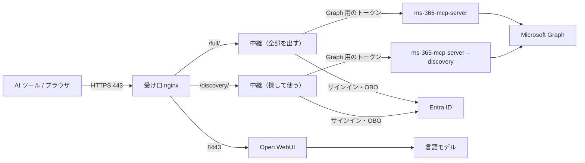

# graph-mcp-gateway

社内共有 M365 MCP サーバー（PoC）。既製の [ms-365-mcp-server](https://github.com/Softeria/ms-365-mcp-server) を社内ネットワークの中に置き、前に FastMCP の OAuth プロキシと中継を置いて、Claude Code・Codex・OpenCode・Open WebUI から鍵なしで（Entra ID のサインインで）使えるようにする。

- 要件：`docs/requirements.md`
- 設計：`docs/detail_design.md`（設計 ID とコードの対応は `docs/trace_map.md`）
- AI ツールからの接続：`docs/connect/`
- 運用：`docs/operations/`



## 起動方法

前提：Docker（compose v2）が入った社内サーバー。外へ出るのに社内のプロキシが要る場合は `.env` の `HTTPS_PROXY`・`NO_PROXY` を書く。

1. 設定を書く。見本をコピーして、ダミーの値を受け取った値に置き換える。

   ```bash
   cp .env.sample .env
   ```

   最低限書くもの：

   | 名前 | 内容 |
   |---|---|
   | `PUBLIC_HOSTNAME` | 公開のホスト名（サーバー証明書と Entra ID の戻り先と同じ名前） |
   | `APP_CLIENT_ID`・`APP_CLIENT_SECRET`・`APP_TENANT_ID` | Entra ID のアプリの値（テナント ID に `common` などは使えない） |
   | `APP_REQUIRED_SCOPES` | Entra ID の「API の公開」で作ったスコープ名（`api://` を付けない） |
   | `WEBUI_SECRET_KEY`・`WEBUI_ADMIN_EMAIL`・`WEBUI_ADMIN_PASSWORD`・`WEBUI_ADMIN_NAME` | Open WebUI の鍵と管理者 |
   | `OPENWEBUI_LLM_BASE_URL`・`OPENWEBUI_LLM_API_KEY`・`OPENWEBUI_LLM_MODEL` | Open WebUI がつなぐ言語モデル（OpenAI 互換） |

2. 証明書を置く。社内の認証局が発行したサーバー証明書（公開のホスト名を含むもの）を `./certs/server.crt`（中間証明書まで）と `./certs/server.key` に置く。Open WebUI 用に、社内の認証局と公開の認証局をまとめた束を `./certs/ca-bundle.pem` に置く。

   ```bash
   cat company-ca.pem /etc/ssl/certs/ca-certificates.crt > certs/ca-bundle.pem
   ```

3. Entra ID のアプリの戻り先に、次の 2 件が登録されていることを確かめる（別部署に依頼する）。

   - `https://<公開のホスト名>/full/auth/callback`
   - `https://<公開のホスト名>/discovery/auth/callback`

4. 起動する。

   ```bash
   docker compose up -d --build
   ```

   受け口の 443 番（MCP）と 8443 番（Open WebUI）だけがホストに公開される。初回の Open WebUI の起動は 2〜3 分かかる。`docker compose ps` で全サービスが起動したことを確かめる。

5. Open WebUI の初期設定を行う（初回だけ。何度実行してもよい）。

   ```bash
   docker compose --profile setup run --rm openwebui-setup configure
   ```

6. 確かめる。次の URL が 200 を返せば受け口が動いている。

   - `https://<公開のホスト名>/.well-known/oauth-protected-resource/full/mcp`
   - `https://<公開のホスト名>/.well-known/oauth-protected-resource/discovery/mcp`
   - `https://<公開のホスト名>:8443/health`

停止は `docker compose down`（認証の状態と Open WebUI のデータのボリュームは残る）。更新は `git pull` の後に `docker compose up -d --build`。

台数を増やす構成への切り替えは `.env.sample` の「台数を増やす構成」の値を書いて `docker compose up -d` し、`docker compose restart gateway` を実行する（設計書 9-1）。

## 初期ユーザー

- **MCP の受け口（Claude Code・Codex・OpenCode）**：初期ユーザーは無い。Entra ID のアプリに PoC 参加者として割り当てられた社員が、社内アカウントでサインインして使う。割り当ての無い社員は Entra ID が拒否する。接続の手順は `docs/connect/`。
- **Open WebUI の管理者**：Open WebUI に利用者が 1 人もいないときの初回の起動で、`.env` の `WEBUI_ADMIN_EMAIL`・`WEBUI_ADMIN_PASSWORD`・`WEBUI_ADMIN_NAME` から自動で作られる。`https://<公開のホスト名>:8443` でこのメールアドレスとパスワードでログインする。
- **Open WebUI の参加者**：利用者自身の登録は止めてある。管理者が CSV（`name,email,password`）から作る。

  ```bash
  docker compose --profile setup run --rm -v <CSV のあるディレクトリ>:/input:ro openwebui-setup add-users /input/<ファイル名>
  ```

  詳しくは `docs/operations/open-webui.md`。

## テスト

| 種類 | コマンド | 内容 |
|---|---|---|
| 単体・結合 | `docker compose --profile test run --rm unit` | ネットワークを切ったコンテナで実行する。手元なら `uv run pytest tests` |
| E2E（mock モード） | `bash e2e/run.sh mock` | Entra ID・Graph（Dev Proxy）・言語モデルを模擬にして、全シナリオを自動で実行する（処理量の測定を含めて約 30 分）。報告は `e2e/.work/capacity-report.md` |
| E2E（real モード） | `bash e2e/run.sh real`、`bash e2e/run.sh real-offsite` | 手動。手順は `e2e/real-checklist.md` |

## ライセンスと表示

ms-365-mcp-server（MIT）と Open WebUI の公式イメージをそのまま使う。Open WebUI の名前とロゴの表示は変えない。
