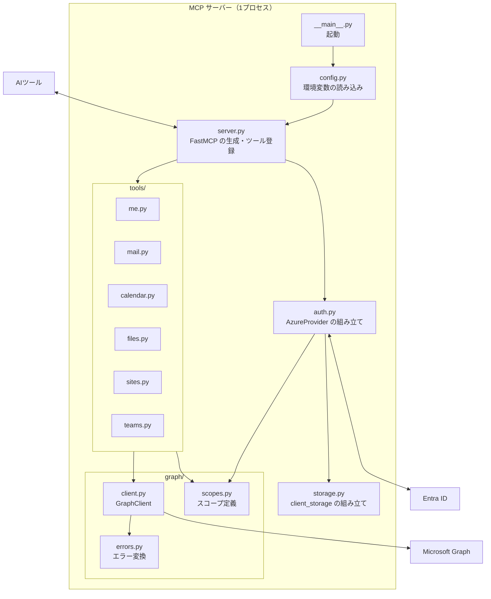
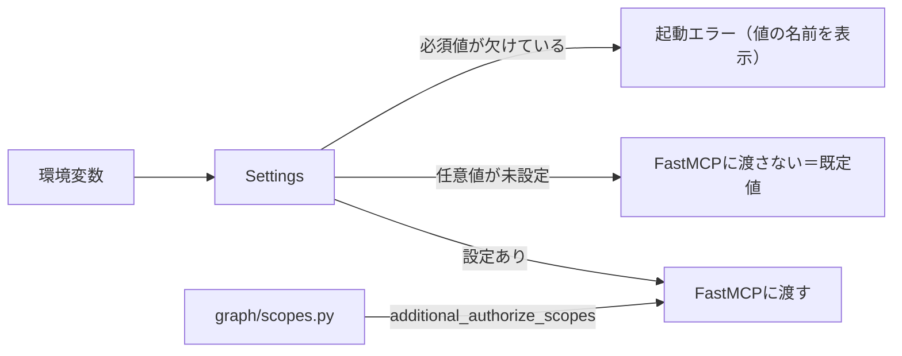
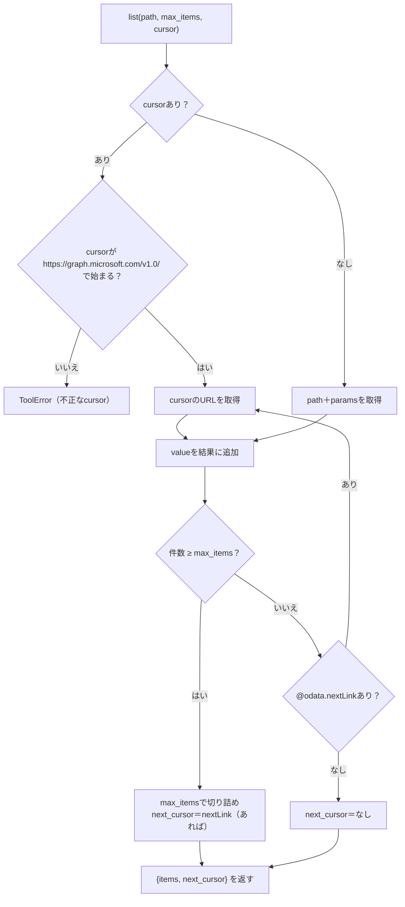
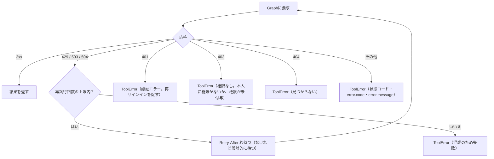
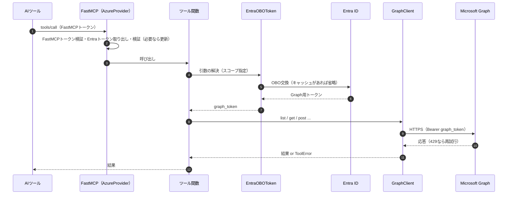
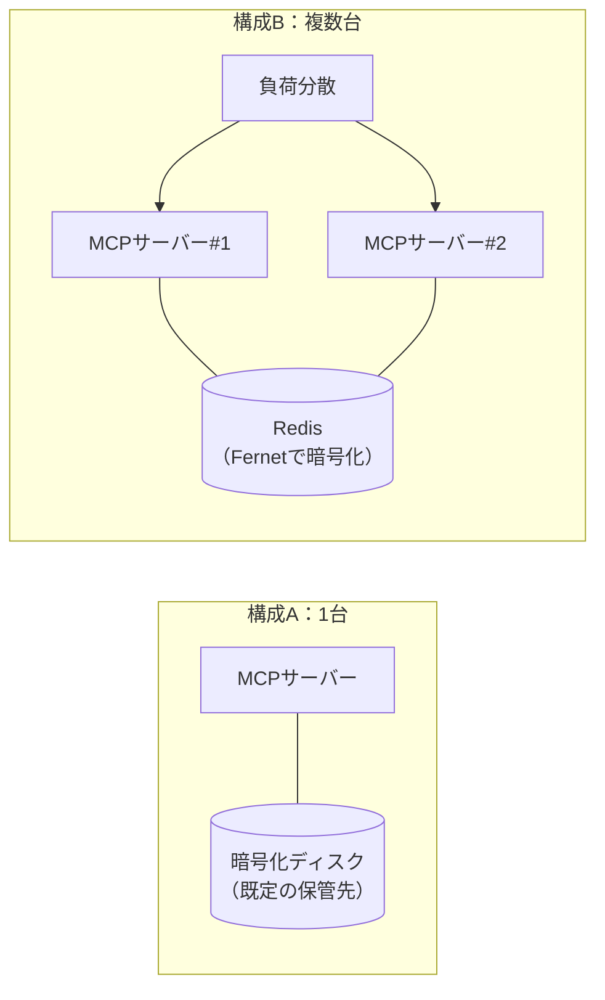

# 設計書：社内共有 M365 MCP サーバー（FastMCP / PoC）

- 作成日：2026-10-31
- 対象読者：実装を担当する AI エージェントと開発者
- 前提資料：「要件仕様書」（RQ / NF / CN の ID はこれを参照）、「OAuth プロキシ仕様」
- プロジェクト名：**未決**（本書ではパッケージ名を仮に `app`、環境変数の接頭辞を仮に `APP_` と書く）

> 本書の設計は実装方針の **案** です。要件仕様書の「未決」の値はここでも決めていません。 「実装時確認」と書いた箇所は、ライブラリの API を実装時にドキュメントまたはソースコードで確かめてください。

---

## 1. 技術スタック


| 区分          | 採用                                                       | 根拠・備考                                                                        |
| ----------- | -------------------------------------------------------- | ---------------------------------------------------------------------------- |
| 言語          | Python 3.10 以上                                           | FastMCP の要件（`requires-python >= 3.10`）                                       |
| MCP フレームワーク | FastMCP 4.1.x（`fastmcp[azure]`）                          | 2026-10-31 時点の最新安定版は 4.1.4。`[azure]` で `azure-identity`・`PyJWT` が入る（OBO に必要） |
| HTTP クライアント | `httpx2`                                                 | FastMCP が依存している HTTP クライアント。別のライブラリを増やさない（実装時確認）                             |
| 保管先（任意）     | `py-key-value-aio` の Redis ストア＋`FernetEncryptionWrapper` | 共有の保管先を使う場合のみ（U-3）。FastMCP の本番構成例に従う（実装時確認）                                  |
| テスト         | `pytest`、`pytest-asyncio`、`httpx2` のモックトランスポート           | NF-008（ネットワークなしで実行）                                                          |
| パッケージ管理     | `uv`                                                     | FastMCP 本体も `uv` を使用。依存のバージョンをロックファイルで固定（NF-007）                             |


---

## 2. 全体構成



---

## 3. ディレクトリ構成

```text
（プロジェクト名）/
├── pyproject.toml
├── uv.lock
├── README.md
├── .env.example            # 環境変数の一覧（値は空）
├── src/app/
│   ├── __init__.py
│   ├── __main__.py         # 起動（python -m app）
│   ├── config.py           # Settings（環境変数 → 設定値）
│   ├── auth.py             # build_auth(settings) -> AzureProvider
│   ├── storage.py          # build_client_storage(settings) -> AsyncKeyValue | None
│   ├── server.py           # create_server(settings) -> FastMCP
│   ├── graph/
│   │   ├── client.py       # GraphClient（要求・ページング・再試行）
│   │   ├── scopes.py       # Graph のスコープ定数と一覧
│   │   └── errors.py       # Graph エラー → ToolError
│   └── tools/
│       ├── me.py           # RQ-101
│       ├── mail.py         # RQ-111〜116
│       ├── calendar.py     # RQ-121〜124
│       ├── files.py        # RQ-131〜135
│       ├── sites.py        # RQ-136
│       └── teams.py        # RQ-141〜145
├── tests/
│   ├── unit/               # Graph をモックした単体テスト
│   └── poc/                # PoC での手動確認手順（AC-001〜006）
└── docs/
    ├── connect-claude-code.md
    ├── connect-codex.md
    └── connect-opencode.md

```

---

## 4. 設定（環境変数）

[`config.py`](http://config.py) で環境変数を読み込み、`Settings` にまとめる。**未設定の場合は FastMCP に値を渡さず、FastMCP の既定値を使う**（NF-003）。


| 環境変数（仮）                            | FastMCP のパラメータ                        | 必須          | 値の出どころ                                                 |
| ---------------------------------- | ------------------------------------- | ----------- | ------------------------------------------------------ |
| `APP_CLIENT_ID`                    | `client_id`                           | ○           | 依頼資料 P-8                                               |
| `APP_CLIENT_SECRET`                | `client_secret`                       | ○           | 依頼資料 P-8                                               |
| `APP_TENANT_ID`                    | `tenant_id`                           | ○           | 依頼資料 P-8（`common` は起動時に拒否：CN-004）                      |
| `APP_BASE_URL`                     | `base_url`                            | ○           | **未決 U-1**                                             |
| `APP_REQUIRED_SCOPES`              | `required_scopes`                     | ○           | **未決 U-2**（カンマ区切り）                                     |
| `APP_JWT_SIGNING_KEY`              | `jwt_signing_key`                     | —           | **未決 U-4**                                             |
| `APP_STORAGE_REDIS_URL`            | `client_storage`（Redis）               | —           | **未決 U-3**（設定時は暗号化キーも必須）                               |
| `APP_STORAGE_ENCRYPTION_KEY`       | `FernetEncryptionWrapper` の鍵          | Redis 利用時 ○ | **未決 U-3**                                             |
| `APP_REQUIRE_CONSENT`              | `require_authorization_consent`       | —           | **未決 U-5**（`true` / `remember` / `false` / `external`） |
| `APP_ALLOWED_CLIENT_REDIRECT_URIS` | `allowed_client_redirect_uris`        | —           | **未決 U-6**（カンマ区切り）                                     |
| `APP_ENABLE_CIMD`                  | `enable_cimd`                         | —           | **未決 U-7**                                             |
| `APP_ACCESS_TOKEN_EXPIRY_SECONDS`  | `fastmcp_access_token_expiry_seconds` | —           | **未決 U-8**                                             |
| `APP_HOST` / `APP_PORT`            | 起動時の待ち受け                              | —           | 構築時に決定                                                 |


`additional_authorize_scopes` は環境変数にせず、`graph/[scopes.py](http://scopes.py)` の一覧から組み立てる（6章）。



---

## 5. 認証（[`auth.py`](http://auth.py)・[`storage.py`](http://storage.py)）

```python
# 概略（引数名は FastMCP 4.1.x の AzureProvider に合わせる。実装時確認）
from fastmcp.server.auth.providers.azure import AzureProvider
from app.graph.scopes import ALL_GRAPH_SCOPES

def build_auth(s: Settings) -> AzureProvider:
    kwargs = dict(
        client_id=s.client_id,
        client_secret=s.client_secret,
        tenant_id=s.tenant_id,
        base_url=s.base_url,
        required_scopes=s.required_scopes,
        additional_authorize_scopes=ALL_GRAPH_SCOPES,   # RQ-008
    )
    # 未決の値は「設定されたときだけ」渡す（NF-003）
    for name in ("jwt_signing_key", "require_authorization_consent",
                 "allowed_client_redirect_uris", "enable_cimd",
                 "fastmcp_access_token_expiry_seconds"):
        v = getattr(s, name)
        if v is not None:
            kwargs[name] = v
    storage = build_client_storage(s)                    # None なら既定（暗号化ディスク）
    if storage is not None:
        kwargs["client_storage"] = storage
    return AzureProvider(**kwargs)

```

- `build_client_storage` は、`APP_STORAGE_REDIS_URL` が設定されたときだけ Redis ストアを `FernetEncryptionWrapper` で包んで返す（NF-004）。暗号化キーがなければ起動エラーにする。
- 複数台構成（U-9）では、`APP_JWT_SIGNING_KEY` と Redis の両方が必要。片方だけのときは起動時に警告する（NF-005）。

---

## 6. Graph のスコープ（`graph/[scopes.py](http://scopes.py)`）

スコープを1か所で定義し、`additional_authorize_scopes` と各ツールの `EntraOBOToken` の両方がここを参照する。これにより「ツールが使うスコープが `additional_authorize_scopes` に含まれない」誤りを防ぐ（RQ-008）。

```python
G = "https://graph.microsoft.com/"
USER_READ          = G + "User.Read"
MAIL_RW            = G + "Mail.ReadWrite"
MAIL_SEND          = G + "Mail.Send"
CAL_RW             = G + "Calendars.ReadWrite"
FILES_RW_ALL       = G + "Files.ReadWrite.All"
SITES_RW_ALL       = G + "Sites.ReadWrite.All"
CHAT_RW            = G + "Chat.ReadWrite"
CHAT_MSG_SEND      = G + "ChatMessage.Send"
TEAM_READ_BASIC    = G + "Team.ReadBasic.All"
CHANNEL_READ_BASIC = G + "Channel.ReadBasic.All"
CHANNEL_MSG_READ   = G + "ChannelMessage.Read.All"
CHANNEL_MSG_SEND   = G + "ChannelMessage.Send"

ALL_GRAPH_SCOPES = [USER_READ, MAIL_RW, MAIL_SEND, CAL_RW, FILES_RW_ALL, SITES_RW_ALL,
                    CHAT_RW, CHAT_MSG_SEND, TEAM_READ_BASIC, CHANNEL_READ_BASIC,
                    CHANNEL_MSG_READ, CHANNEL_MSG_SEND]

```

単体テストで「全ツールの `EntraOBOToken` のスコープ ⊆ `ALL_GRAPH_SCOPES`」を検査する。

---

## 7. ツール一覧

すべてのツールは `graph_token: str = EntraOBOToken([...])` を引数に持ち、`GraphClient(graph_token)` で Graph を呼ぶ。ツール名は `対象_操作` の形にする（案）。

### 7.1 共通・メール


| ツール名（案）                                          | 要件     | Graph API                                                                          | スコープ                            |
| ------------------------------------------------ | ------ | ---------------------------------------------------------------------------------- | ------------------------------- |
| `me_get_profile`                                 | RQ-101 | `GET /me`                                                                          | [`User.Read`](http://User.Read) |
| `mail_list_folders`                              | RQ-111 | `GET /me/mailFolders`                                                              | `Mail.ReadWrite`                |
| `mail_list_messages`                             | RQ-112 | `GET /me/messages` または `/me/mailFolders/{id}/messages`（`$top`・`$filter`・`$search`） | `Mail.ReadWrite`                |
| `mail_get_message`                               | RQ-113 | `GET /me/messages/{id}`、`GET /me/messages/{id}/attachments`                        | `Mail.ReadWrite`                |
| `mail_create_draft` / `mail_update_draft`        | RQ-114 | `POST /me/messages`、`PATCH /me/messages/{id}`                                      | `Mail.ReadWrite`                |
| `mail_send`                                      | RQ-115 | `POST /me/sendMail`                                                                | `Mail.Send`                     |
| `mail_send_draft`                                | RQ-115 | `POST /me/messages/{id}/send`                                                      | `Mail.Send`                     |
| `mail_reply` / `mail_reply_all` / `mail_forward` | RQ-115 | `POST /me/messages/{id}/reply` ・`/replyAll`・`/forward`                             | `Mail.Send`                     |
| `mail_move`                                      | RQ-116 | `POST /me/messages/{id}/move`                                                      | `Mail.ReadWrite`                |
| `mail_update_flags`                              | RQ-116 | `PATCH /me/messages/{id}`（`isRead`・`flag`）                                         | `Mail.ReadWrite`                |
| `mail_delete`                                    | RQ-116 | `DELETE /me/messages/{id}`                                                         | `Mail.ReadWrite`                |


### 7.2 予定表


| ツール名（案）                  | 要件     | Graph API                                                     | スコープ                  |
| ------------------------ | ------ | ------------------------------------------------------------- | --------------------- |
| `calendar_list_events`   | RQ-121 | `GET /me/calendarView?startDateTime=&endDateTime=`            | `Calendars.ReadWrite` |
| `calendar_get_event`     | RQ-122 | `GET /me/events/{id}`                                         | `Calendars.ReadWrite` |
| `calendar_create_event`  | RQ-123 | `POST /me/events`                                             | `Calendars.ReadWrite` |
| `calendar_update_event`  | RQ-123 | `PATCH /me/events/{id}`                                       | `Calendars.ReadWrite` |
| `calendar_delete_event`  | RQ-123 | `DELETE /me/events/{id}`                                      | `Calendars.ReadWrite` |
| `calendar_respond_event` | RQ-124 | `POST /me/events/{id}/accept`・`/tentativelyAccept`・`/decline` | `Calendars.ReadWrite` |


- タイムゾーンは引数で受け取り、指定時は `Prefer: outlook.timezone="..."` ヘッダーを付ける。既定は Graph の既定（UTC）のまま。

### 7.3 ファイル・SharePoint


| ツール名（案）                | 要件     | Graph API                                                                                                                          | スコープ                  |
| ---------------------- | ------ | ---------------------------------------------------------------------------------------------------------------------------------- | --------------------- |
| `files_list_children`  | RQ-131 | `GET /me/drive/root/children`、`GET /drives/{drive-id}/items/{item-id}/children`                                                    | `Files.ReadWrite.All` |
| `files_search`         | RQ-132 | `GET /me/drive/root/search(q='...')`、`GET /drives/{drive-id}/root/search(q='...')`                                                 | `Files.ReadWrite.All` |
| `files_get_item`       | RQ-133 | `GET /drives/{drive-id}/items/{item-id}`                                                                                           | `Files.ReadWrite.All` |
| `files_get_content`    | RQ-133 | `GET /drives/{drive-id}/items/{item-id}/content`                                                                                   | `Files.ReadWrite.All` |
| `files_upload`         | RQ-134 | 小さいファイル：`PUT /drives/{drive-id}/items/{parent-id}:/{name}:/content`。大きいファイル：`POST .../createUploadSession` で分割アップロード（境目のサイズは実装時確認） | `Files.ReadWrite.All` |
| `files_create_folder`  | RQ-135 | `POST /drives/{drive-id}/items/{parent-id}/children`（`folder: {}`）                                                                 | `Files.ReadWrite.All` |
| `files_move_or_rename` | RQ-135 | `PATCH /drives/{drive-id}/items/{item-id}`（`name`・`parentReference`）                                                               | `Files.ReadWrite.All` |
| `files_delete`         | RQ-135 | `DELETE /drives/{drive-id}/items/{item-id}`                                                                                        | `Files.ReadWrite.All` |
| `sites_search`         | RQ-136 | `GET /sites?search=...`                                                                                                            | `Sites.ReadWrite.All` |
| `sites_list_drives`    | RQ-136 | `GET /sites/{site-id}/drives`                                                                                                      | `Sites.ReadWrite.All` |


- `files_get_content` は、テキストとして読める種類はテキストで、それ以外は種類とサイズの情報を返す。返すサイズの上限は提案 PP-002（未承認）。

### 7.4 Teams


| ツール名（案）                       | 要件     | Graph API                                                                  | スコープ                                                    |
| ----------------------------- | ------ | -------------------------------------------------------------------------- | ------------------------------------------------------- |
| `teams_list_chats`            | RQ-141 | `GET /me/chats`                                                            | `Chat.ReadWrite`                                        |
| `teams_list_chat_messages`    | RQ-141 | `GET /chats/{chat-id}/messages`                                            | `Chat.ReadWrite`                                        |
| `teams_send_chat_message`     | RQ-142 | `POST /chats/{chat-id}/messages`                                           | `ChatMessage.Send`                                      |
| `teams_list_joined_teams`     | RQ-143 | `GET /me/joinedTeams`                                                      | `Team.ReadBasic.All`                                    |
| `teams_list_channels`         | RQ-143 | `GET /teams/{team-id}/channels`                                            | `Channel.ReadBasic.All`                                 |
| `teams_list_channel_messages` | RQ-144 | `GET /teams/{team-id}/channels/{channel-id}/messages`                      | `[ChannelMessage.Read](http://ChannelMessage.Read).All` |
| `teams_list_message_replies`  | RQ-144 | `GET /teams/{team-id}/channels/{channel-id}/messages/{message-id}/replies` | `[ChannelMessage.Read](http://ChannelMessage.Read).All` |
| `teams_send_channel_message`  | RQ-145 | `POST /teams/{team-id}/channels/{channel-id}/messages`                     | `ChannelMessage.Send`                                   |
| `teams_reply_channel_message` | RQ-145 | `POST .../messages/{message-id}/replies`                                   | `ChannelMessage.Send`                                   |


- Teams のメッセージ本文は HTML で返ることがある。本文の種類（`contentType`）をそのまま返し、変換はしない（案）。

### 7.5 ツールの実装例

```python
from fastmcp import FastMCP
from fastmcp.server.auth.providers.azure import EntraOBOToken
from app.graph.client import GraphClient
from app.graph import scopes

def register(mcp: FastMCP) -> None:
    @mcp.tool
    async def mail_list_messages(
        folder_id: str | None = None,
        search: str | None = None,
        max_items: int = 25,
        cursor: str | None = None,
        graph_token: str = EntraOBOToken([scopes.MAIL_RW]),   # RQ-007
    ) -> dict:
        """メールを一覧・検索する（RQ-112）"""
        path = f"/me/mailFolders/{folder_id}/messages" if folder_id else "/me/messages"
        params = {"$search": f'"{search}"'} if search else {}
        async with GraphClient(graph_token) as g:
            return await g.list(path, params=params, max_items=max_items, cursor=cursor)

```

---

## 8. Graph クライアント（`graph/[client.py](http://client.py)`）

### 8.1 責務


| 責務     | 内容                                                                                                                                   | 要件     |
| ------ | ------------------------------------------------------------------------------------------------------------------------------------ | ------ |
| 要求     | ベース URL [`https://graph.microsoft.com/v1.0`、`Authorization`](https://graph.microsoft.com/v1.0、Authorization)`: Bearer {graph_token}` | RQ-190 |
| ページング  | `@odata.nextLink` をたどり、`max_items` に達したら止める。続きがあれば `next_cursor` を返す                                                                 | RQ-191 |
| 再試行    | 429・503・504 で `Retry-After` に従って待って再試行                                                                                               | NF-006 |
| エラー変換  | Graph のエラー（`error.code`・`error.message`）を `ToolError` に変換                                                                            | RQ-192 |
| テスト容易性 | HTTP トランスポートを差し替えられる（モックを注入）                                                                                                         | NF-008 |


### 8.2 ページング



- `cursor` は AI ツールから渡ってくる値なので、**Graph の URL 以外を受け付けない**。他の URL を許すと、利用者の Graph トークンを付けて任意の宛先に要求を送れてしまうため。

### 8.3 再試行とエラー



- エラーメッセージには、トークン・要求ヘッダーを含めない（CN-001）。
- 再試行回数の上限は設定で変更可能にする。既定値は提案 PP-003（未承認）。

---

## 9. 処理シーケンス（ツール呼び出し）



- 利用者のトークンがない状態では `EntraOBOToken` の解決が失敗し、ツールは実行されない。サーバー自身のアカウントで Graph を呼ぶ代替経路は作らない（CN-003）。

---

## 10. 配置

台数は未決（U-9）。どちらの構成にも、設定の変更だけで対応できるようにする（NF-005）。




| 項目                | 構成A                | 構成B                             |
| ----------------- | ------------------ | ------------------------------- |
| `client_storage`  | 既定（暗号化ディスク）        | Redis＋`FernetEncryptionWrapper` |
| `jwt_signing_key` | 未設定でも可（シークレットから導出） | 全台で同じ値を明示                       |
| 再起動後のサインイン状態      | ディスクが残れば保たれる       | 保たれる                            |


- 公開 URL（`base_url`）は HTTPS であること（Entra ID のリダイレクト URI の要件）。TLS の終端場所は構築時に決める。

---

## 11. テスト設計


| 区分             | 内容                                                                 | 要件・基準                       |
| -------------- | ------------------------------------------------------------------ | --------------------------- |
| 単体：設定          | 必須値の欠落で起動エラー、`common` の拒否、未設定の値を FastMCP に渡さないこと                   | NF-002、NF-003、CN-004        |
| 単体：スコープ        | 全ツールのスコープが `ALL_GRAPH_SCOPES` に含まれること                              | RQ-008                      |
| 単体：GraphClient | ページング、`max_items`、不正な `cursor` の拒否、429 の再試行、エラー変換、エラーにトークンが含まれないこと | RQ-191、RQ-192、NF-006、CN-001 |
| 単体：ツール         | 各ツールが正しい Graph API・メソッド・本文を組み立てること（モック）                            | RQ-101〜145                  |
| PoC：接続         | Claude Code・Codex・OpenCode から鍵なしで接続                                | AC-001                      |
| PoC：分離         | 利用者 A・B で互いのデータが見えない                                               | AC-002                      |
| PoC：割り当て       | 割り当てのない利用者がサインインできない                                               | AC-003                      |
| PoC：機能         | 各ツールの実データでの動作                                                      | AC-004                      |
| PoC：更新         | 期限切れ後の自動更新                                                         | AC-005                      |
| PoC：トークン       | AI ツール側にEntra・Graphのトークンが現れない                                      | AC-006                      |


---

## 12. 未決事項・提案事項

- 未決事項は要件仕様書 11章（U-1〜U-10）を参照。
- 提案事項（**未承認。承認まで実装しない**）：


| ID     | 提案                                                               |
| ------ | ---------------------------------------------------------------- |
| PP-001 | ツールに MCP のツール注釈（`readOnlyHint`・`destructiveHint`）を付ける（要件仕様書 12章） |
| PP-002 | `files_get_content` で返すサイズに上限を設ける（要件仕様書 12章）                     |
| PP-003 | Graph の再試行回数の既定値を決める（例：3回）                                       |
| PP-004 | ツール名を本書 7章の `対象_操作` 形式で確定する                                      |
