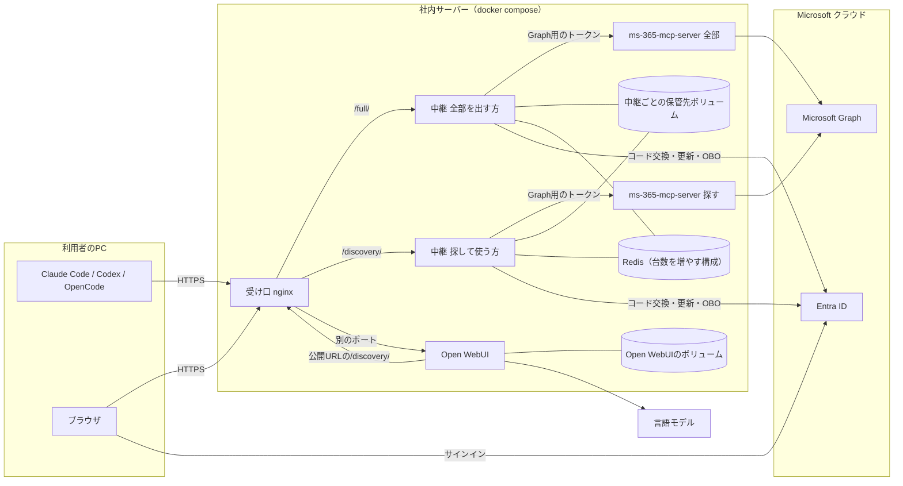
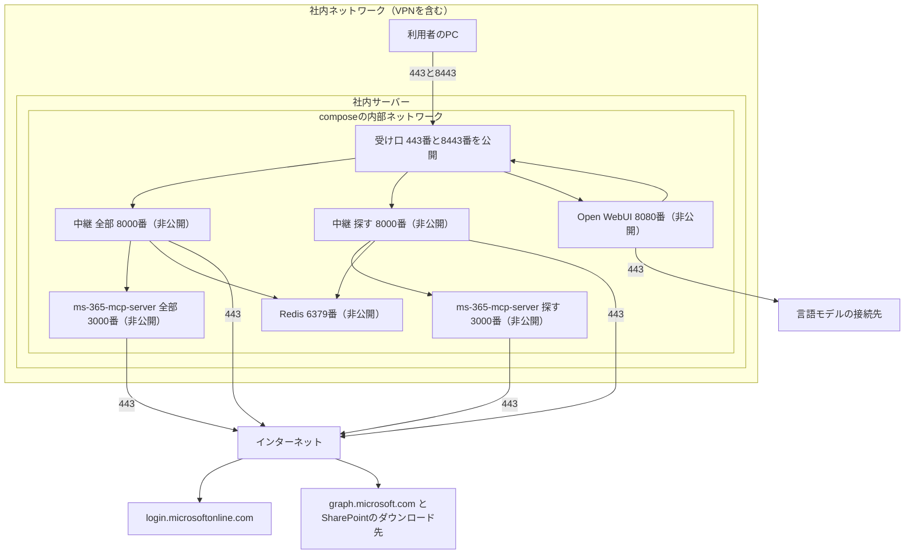
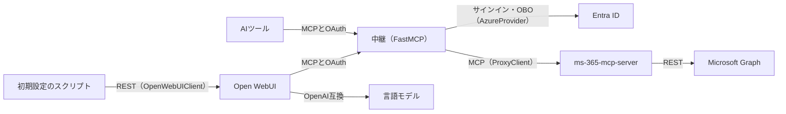
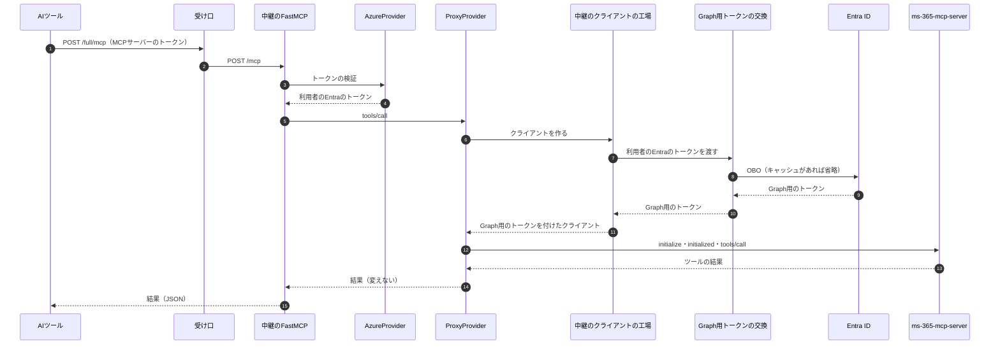
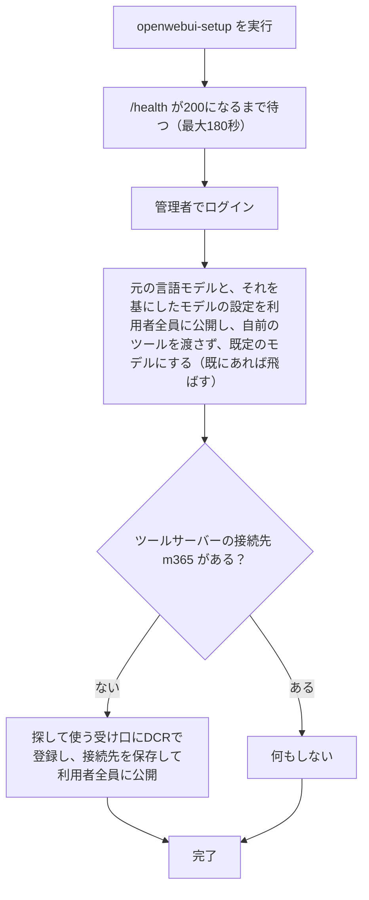
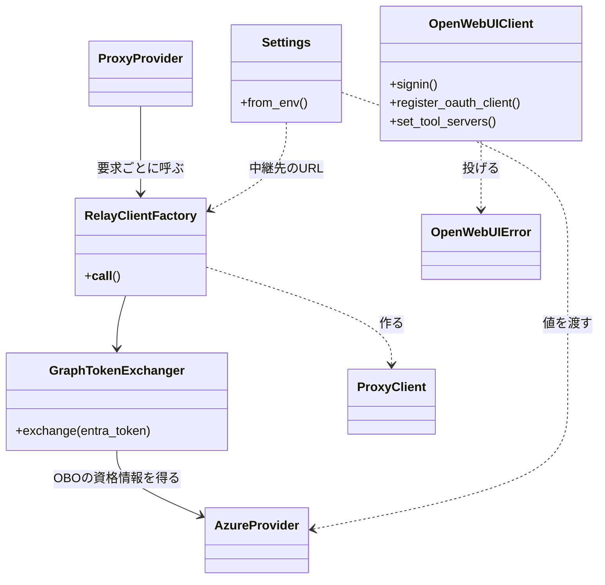
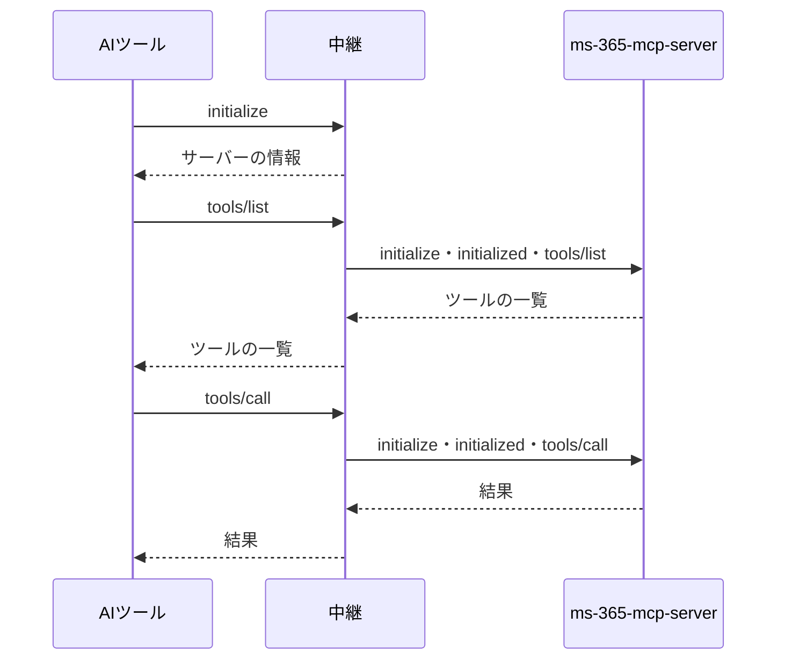
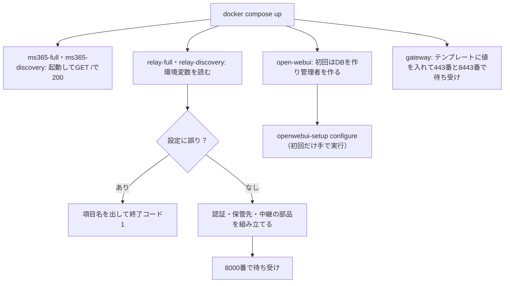

# 詳細設計書：社内共有 M365 MCP サーバー（FastMCP ＋ ms-365-mcp-server / PoC）

- 作成日：2026-11-01（ms-365-mcp-server を中継する方針で作り直し）
- 入力：要件定義書 `docs/requirements.md`（2026-11-01 改訂）、外部連携の調査 `external/entra-id/docs/`・`external/microsoft-graph/`・`external/ms-365-mcp-server/docs/`・`external/open-webui/docs/`・`external/language-model/docs/`
- 対象読者：実装を担当する AI エージェントと開発者
- 設計 ID とコードの対応は、実装時に `docs/trace_map.md`（対応表）へ記録する。コード（コメントを含む）には要件 ID も設計 ID も書かない。

---

## 1. 言語・フレームワーク・アーキテクチャの選定

### 1-1. 判定日時と技術制約の要約

- 判定日時：2026-11-01
- 技術制約（要件定義書 1-1）：既存コードは無い。FastMCP（Python）は OAuth プロキシ（`AzureProvider`）と ms-365-mcp-server への中継だけを受け持ち、ツールは自作しない。中継のたびに OBO で得た Graph 用のトークンを付ける（aiohttp を別に依存へ足す）。ms-365-mcp-server と Open WebUI は公式イメージをそのまま使う。社内の共有 HTTP サーバーにコンテナで置き、docker compose で 1 台のサーバー上で起動する。無料の OSS を使い、社外での確認だけ Claude の API を使ってよい。PoC では 1 万人の負荷はかけないが、1 台あたりの処理量は測る。Entra ID の戻り先は 2 件（固定）。サーバー証明書は社内の認証局が発行する。言語モデルは OpenAI 互換の API でつなぐ。

### 1-2. 判断軸ごとの該当

| 判断軸 | 該当 | 理由 |
|---|---|---|
| 既存資産との整合 | あり | アプリのコードは無い。外部連携の調査で、Open WebUI の連携ライブラリ（httpx2）、Entra ID の模擬（Starlette）、言語モデルの模擬（標準ライブラリ）、Graph の模擬（Dev Proxy）を作った |
| チームの技術 | あり | Python が扱えればよい。Node.js（ms-365-mcp-server）と Open WebUI は公式イメージをそのまま使い、改造しない |
| 配備先 | あり | docker compose で 1 台のサーバー。HTTPS 必須。受け口ごとに台数を増やせること |
| 認証と認可の境界 | あり | 認証は Entra ID の SSO を OAuth プロキシ（FastMCP）で中継する。受け口ごとに OAuth プロキシを持つ。ロールは無く、データ単位の権限は M365 に従う。インターネットには公開しない |
| 画面の規模 | なし | 本システムで作る画面は無い。接続の確認画面は FastMCP の、会話の画面は Open WebUI のものを使う |
| データの規模と構造 | なし | 本システムが作る部分は DB を持たない。Open WebUI は自分の DB（既定の SQLite）を持つ |
| 外部連携 | あり | Entra ID、ms-365-mcp-server（MCP）、Microsoft Graph（ms-365-mcp-server が呼ぶ）、言語モデル（Open WebUI が呼ぶ） |
| ライセンスとコスト | あり | 無料の OSS。ライセンスの種類は問わない。Open WebUI の表示は消さない |
| 保守性 | あり | 版を固定する。ms-365-mcp-server と Open WebUI は版の上がる間隔が短い |

### 1-3. 候補の比較

**Python の版**（FastMCP 4.1.4 は Python 3.10 以上）

| 候補 | 最新版 | 保守・サポート期限 | 評価 | 出典 | 確認日 |
|---|---|---|---|---|---|
| 3.14 | 3.14.10（2026-10-25） | バグ修正中、2030-10 まで | 期限が最も長い。外部連携の調査で使った版と同じ。公式イメージ `python:3.14-slim` あり | https://devguide.python.org/versions/ 、https://hub.docker.com/_/python | 2026-11-01 |
| 3.13 | 3.13.18（2026-10-25） | セキュリティ修正のみ、2029-10 まで | 使えるが、修正の段階が進んでいる | 同上 | 2026-11-01 |
| 3.12 | 3.12.16（2026-10-25） | セキュリティ修正のみ、2028-10 まで | 期限が短い | 同上 | 2026-11-01 |

**パッケージ管理（版の固定）**

| 候補 | 最新版 | ライセンス | 評価 | 出典 | 確認日 |
|---|---|---|---|---|---|
| uv | 0.13.6（2026-10-27） | MIT / Apache-2.0 | ロックファイルで依存を固定でき、公式イメージ `ghcr.io/astral-sh/uv` がある | https://pypi.org/project/uv/ | 2026-11-01 |
| Poetry | 2.5.1（2026-09-20） | MIT | 使えるが、コンテナでの導入手順が増える | https://pypi.org/project/poetry/ | 2026-11-01 |
| pip-tools | 7.6.2（2026-10-07） | BSD-3-Clause | 仮想環境の管理を別に行う必要がある | https://pypi.org/project/pip-tools/ | 2026-11-01 |

**HTTPS の受け口と振り分け**

| 候補 | 最新版 | ライセンス | 社内 CA の証明書 | Streamable HTTP（SSE）の通過 | 複数台への振り分け | 出典 | 確認日 |
|---|---|---|---|---|---|---|---|
| nginx | 1.30.6 stable（2026-10-14） | BSD-2-Clause | `ssl_certificate` で指定 | `proxy_buffering off` と読み取りのタイムアウトの延長が要る | upstream の既定が順番の振り分け。サービス名が複数の IP を返すと全部に振り分ける | https://nginx.org/en/docs/http/ngx_http_proxy_module.html 、https://gofastmcp.com/deployment/http | 2026-11-01 |
| Caddy | 2.11.7（2026-10-03） | Apache-2.0 | `tls` で指定 | 設定なしで即時に流す | `lb_policy` の指定が要る | https://caddyserver.com/docs/caddyfile/directives/reverse_proxy | 2026-11-01 |
| Traefik | 3.7.17（2026-10-30） | MIT | 動的設定のファイルが別に要る | ストリームと判定すれば即時に流す | 既定が重み付きの順番 | https://doc.traefik.io/traefik/ | 2026-11-01 |

**共有の保管先（台数を増やすときだけ使う）**

| 候補 | 最新版 | ライセンス | 評価 | 出典 | 確認日 |
|---|---|---|---|---|---|
| Redis | 8.10.3（2026-10-26） | RSALv2 / SSPLv1 / AGPLv3 から選択 | 要件の「共有の保管先（Redis）」と一致する。py-key-value-aio 0.4.6 の Redis ストアで使える | https://github.com/redis/redis/releases 、https://pypi.org/project/py-key-value-aio/ | 2026-11-01 |
| Valkey | 9.1.3（2026-10-26） | BSD-3-Clause | 互換だが、要件の文言と違う | https://github.com/valkey-io/valkey/releases | 2026-11-01 |

**2 つの OAuth プロキシの置き方**

| 候補 | 台数の増やし方 | nginx の設定 | 評価 | 出典 | 確認日 |
|---|---|---|---|---|---|
| 受け口ごとにコンテナを分ける（`base_url` にパスを含める） | 受け口ごとに別々に増やせる | パスの振り分けと、認可サーバーのメタデータ（パスを挿入した形）の書き換え | 公式ドキュメントの「パスの前置きの下に置く」の範囲。ASGI で実測済み（`external/ms-365-mcp-server/docs/research.md` 2 章） | https://gofastmcp.com/deployment/http | 2026-11-01 |
| 1 つのコンテナに 2 つを載せる（`Mount`） | まとめてしか増やせない | パスの振り分けだけ | 2 つを載せる例は公式に無い | 同上 | 2026-11-01 |

**1 台あたりの処理量を測る道具**

| 候補 | 最新版 | ライセンス | MCP への対応 | 評価 | 出典 | 確認日 |
|---|---|---|---|---|---|---|
| 自作の測定スクリプト（FastMCP のクライアントと asyncio） | — | — | FastMCP のクライアントでそのまま話せる | 依存が増えず、E2E のテスト用の MCP クライアントと部品を共有できる | — | 2026-11-01 |
| Locust | 2.47.0（2026-10-21） | MIT | MCP の作法を自分で書く | 集計の画面が付くが、依存が増える | https://pypi.org/project/locust/ | 2026-11-01 |
| k6 | 2.3.0（2026-09-21） | AGPL-3.0 | JavaScript で MCP の作法を書く | 言語が増える | https://github.com/grafana/k6/releases | 2026-11-01 |

**テスト**

| 候補 | 最新版 | ライセンス | 評価 | 出典 | 確認日 |
|---|---|---|---|---|---|
| pytest | 9.2.0（2026-10-27） | MIT | 単体・結合・E2E を同じ道具で書ける | https://pypi.org/project/pytest/ | 2026-11-01 |
| pytest-asyncio | 1.4.1（2026-10-25） | Apache-2.0 | 非同期の処理を試せる | https://pypi.org/project/pytest-asyncio/ | 2026-11-01 |

### 1-4. 選定結果

| 区分 | 選定 | 理由（要件との対応） |
|---|---|---|
| 言語 | Python 3.14（コンテナのイメージは `python:3.14.10-slim`） | 技術制約の FastMCP。サポート期限が最も長い |
| フレームワーク | FastMCP 4.1.4（`fastmcp[azure]`。OAuth プロキシ `AzureProvider` と中継の部品 `ProxyProvider`）、aiohttp、py-key-value-aio の Redis ストア | 技術制約。中継の部品は外部連携の調査でユーザーが採用（2026-11-01） |
| HTTP クライアント | httpx2（FastMCP の依存。Open WebUI の連携ライブラリと E2E が使う） | 外部連携の調査での決定 |
| MCP のツール | ms-365-mcp-server 0.178.0 の公式イメージ（`ghcr.io/softeria/ms-365-mcp-server:0.178.0`、Node.js 24） | 要件。受け口ごとに 1 つ（全部を出す方、探して使う方） |
| 会話の画面 | Open WebUI v0.12.5 の公式イメージ（`ghcr.io/open-webui/open-webui:v0.12.5`） | 要件 |
| DB | 本システムが作る部分は使わない。Open WebUI は既定の SQLite を名前付きボリュームに置く | 要件の「中継の部分は DB を持たない」 |
| 実行形態 | コンテナ（docker compose）。前段に nginx 1.30.6 を置いて HTTPS を受け、2 つの受け口（OAuth プロキシと中継のコンテナを受け口ごとに分ける）と Open WebUI へ振り分ける | 技術制約の配備先、HTTPS 必須、受け口ごとに台数を増やせること |
| 共有の保管先 | 台数を増やすときだけ Redis 8.10.3。受け口ごとに名前空間を分ける | 要件の「台数を増やせる」 |
| パッケージ管理 | uv 0.13.6 と `uv.lock` | 要件の「版を固定する」 |
| テスト | pytest 9.2.0、pytest-asyncio 1.4.1 | 要件の「単体テストは接続なしで動く」と E2E |
| 1 台あたりの処理量の測定 | 自作の測定スクリプト（FastMCP のクライアントと asyncio） | 要件の「1 台あたりの処理できる量を測る」 |
| E2E の模擬 | Entra ID の模擬（自作）、Microsoft Dev Proxy 4.0.0（Graph と CIMD の文書）、言語モデルの模擬（自作） | 外部連携の調査での決定 |

フロントエンドとバックエンドを分ける構成ではない（本システムで作る画面は無い）。

### 1-5. ユーザー承認の記録

| 項目 | 承認内容 | 承認日 |
|---|---|---|
| Python の版 | 3.14 | 2026-11-01 |
| HTTPS の受け口と振り分け | nginx | 2026-11-01 |
| 共有の保管先 | Redis | 2026-11-01 |
| mock モードでの「AI ツールが鍵なしで接続」の確かめ方 | AI ツールの代わりにテスト用の MCP クライアントで、DCR と CIMD の登録から呼び出しまでを確かめる。Claude Code・Codex・OpenCode そのものは real モードで手で確かめる | 2026-11-01 |
| パッケージ管理・テスト | uv、pytest、pytest-asyncio | 2026-11-01 |
| 中継の部品・Open WebUI のクライアント・言語モデルの模擬 | FastMCP の `ProxyProvider`、自作の薄いクライアント（httpx2、ブラウザの自動操作なし）、自作の最小の模擬（外部連携の調査での採否の確認） | 2026-11-01 |
| 2 つの OAuth プロキシの置き方 | 受け口ごとにコンテナを分ける | 2026-11-01 |
| 1 台あたりの処理量を測る道具 | 自作の測定スクリプト | 2026-11-01 |

---

## 2. システム構成

### 2-1. コンポーネント一覧

| コンポーネント | 役割 | 起動する構成 | 根拠 |
|---|---|---|---|
| 受け口（nginx、サービス `gateway`） | HTTPS を受けて社内の認証局の証明書で TLS を終端し、パスで 2 つの受け口へ、別のポートで Open WebUI へ振り分ける | 常に | HTTPS だけで受ける、Open WebUI も HTTPS、受け口ごとの OAuth の受け口 |
| 全部を出す受け口の中継（サービス `relay-full`） | アプリ（本システムで作る Python のプログラム）。OAuth プロキシと中継。`base_url` は `https://<公開のホスト名>/full` | 常に（台数は設定で増やす） | 全部を出す受け口、OAuth の受け口、中継、OBO |
| 探して使う受け口の中継（サービス `relay-discovery`） | 同じアプリ。`base_url` は `https://<公開のホスト名>/discovery` | 常に（台数は設定で増やす） | 探して使う受け口、OAuth の受け口、中継、OBO |
| 全部を出す方の ms-365-mcp-server（サービス `ms365-full`） | 公式イメージ。`--http 3000 --org-mode` | 常に（台数は設定で増やす） | ms-365-mcp-server のツールを出す |
| 探して使う方の ms-365-mcp-server（サービス `ms365-discovery`） | 公式イメージ。`--http 3000 --org-mode --discovery` | 常に（台数は設定で増やす） | 直接出すツールの指定 |
| PoC 専用の Open WebUI（サービス `open-webui`） | 公式イメージ。探して使う受け口をツールサーバーとして使う | 常に | PoC 専用の Open WebUI の提供 |
| Open WebUI の初期設定（サービス `openwebui-setup`） | アプリのイメージで初期設定のスクリプトを動かす | 手で実行するとき（プロファイル `setup`） | Open WebUI の初期設定 |
| 認証の状態の保管先（ディスク） | FastMCP の既定の保管先。暗号化したファイルを、中継ごとの名前付きボリュームに置く | 1 台構成 | 認証の状態の保管 |
| 認証の状態の保管先（Redis、サービス `redis`） | 複数台で共有する保管先。中身はアプリが暗号化し、受け口ごとに名前空間を分ける | 台数を増やす構成（プロファイル `multi`） | 台数を増やせる、保管先を暗号化する |
| Microsoft Entra ID | サインイン、トークンの発行・更新、OBO（外部） | — | Entra ID でのサインイン、OBO |
| Microsoft Graph | M365 のデータの読み書き（外部。ms-365-mcp-server が呼ぶ） | — | Graph の呼び出し |
| 言語モデル | Open WebUI の応答とツールの選択（外部。社内の接続先、社外では Claude の API） | — | 言語モデルとの連携 |
| Entra ID の模擬（サービス `mock-entra`） | E2E の mock モードで Entra ID の代わりをする | E2E の mock モードだけ | ローカル HTTP サーバー方式の模擬 |
| Dev Proxy（サービス `devproxy`） | E2E の mock モードで Graph と CIMD の文書の応答を返す | E2E の mock モードだけ | 既存モックサーバーツール方式の模擬 |
| 言語モデルの模擬（サービス `mock-llm`） | E2E の mock モードで言語モデルの代わりをする | E2E の mock モードだけ | 言語モデルの模擬 |
| E2E の実行役（サービス `e2e`） | テスト用の MCP クライアント、Open WebUI のクライアント、測定スクリプトで E2E を実行する | E2E だけ | テスト用利用シナリオ |
| 単体テストの実行役（サービス `unit`） | ネットワークを切ったコンテナで単体・結合テストを実行する | テストだけ | 単体テストは接続なしで動く |

### 2-2. 全体構成図



### 2-3. 各コンポーネントの機能

- 受け口：443 番で 2 つの受け口（パス `/full/` と `/discovery/`）と、そのメタデータを受ける。別の番号（既定 8443）で Open WebUI を受ける。応答をためずに流し（SSE と Open WebUI の WebSocket のため）、読み取りのタイムアウトを 1 時間にする。受け口の中継のサービス名を upstream にし、台数を増やしたときは Docker の名前解決が返す全部のコンテナに順に振り分ける。compose の中では公開のホスト名の別名を持ち、Open WebUI のコンテナが公開 URL で本システムに届くようにする。
- 中継：コンテナの中で 8000 番の HTTP を待ち受ける（ホストには公開しない）。FastMCP の `AzureProvider` が OAuth の受け口と、MCP の受け口のトークン検証を行う。MCP の要求は FastMCP の中継の部品が ms-365-mcp-server へ渡す。渡すたびに、利用者の Entra のトークンを OBO で Graph 用のトークンに替えて付ける。
- ms-365-mcp-server：コンテナの中で 3000 番の HTTP を待ち受ける（ホストにも受け口にも公開しない）。渡された Graph 用のトークンで Graph を呼ぶ。設定は 9-3 の表。
- Open WebUI：コンテナの中で 8080 番を待ち受ける（受け口だけが届く）。言語モデルに発言とツールの一覧を渡し、言語モデルが選んだツールを探して使う受け口に呼ぶ。
- 保管先：AI ツールの登録情報、認可の途中の状態、利用者の Entra のトークンを、FastMCP が中継ごとに保管する。

### 2-4. コンポーネント間のインターフェースとデータフロー

| 送り元 | 送り先 | プロトコル | 運ぶもの |
|---|---|---|---|
| AI ツール | 受け口 | HTTPS（Streamable HTTP、OAuth 2.1） | MCP の要求、MCP サーバーのトークン、登録と認可の要求 |
| ブラウザ | 受け口 | HTTPS | 認可の開始、接続の確認画面、Entra ID からの戻り（`/full/auth/callback`、`/discovery/auth/callback`）、Open WebUI の画面と API |
| 受け口 | 中継 | HTTP（内部ネットワーク） | 上の要求（パスの前置きを外す） |
| 受け口 | Open WebUI | HTTP・WebSocket（内部ネットワーク） | Open WebUI の画面と API |
| Open WebUI | 受け口 | HTTPS（公開 URL） | 探して使う受け口への MCP の要求と、OAuth 2.1 の登録・トークンの要求 |
| Open WebUI | 言語モデル | HTTPS（OpenAI 互換） | 発言、ツールの一覧、ツールの結果 |
| 中継 | Entra ID | HTTPS | コードの交換、トークンの更新、公開鍵の取得、OBO |
| 中継 | ms-365-mcp-server | HTTP（内部ネットワーク、Streamable HTTP） | MCP の要求（`initialize`、`tools/list`、`tools/call`）と、利用者の Graph 用のトークン |
| ms-365-mcp-server | Graph | HTTPS | Graph 用のトークンを付けた読み書きの要求 |
| 中継 | Redis | Redis プロトコル（内部ネットワーク） | 暗号化した認証の状態 |

### 2-5. ネットワーク構成図



- 受け口の 443 番と 8443 番だけをホストに公開する。ms-365-mcp-server、中継、Open WebUI、Redis の番号は公開しない。
- サーバーから外へ出るのに社内のプロキシが要る場合は、中継と Open WebUI に `HTTPS_PROXY` と `NO_PROXY` を設定する。ms-365-mcp-server には、加えて `NODE_USE_ENV_PROXY=1` を設定する（Node は `HTTPS_PROXY` だけでは従わない）。

---

## 3. データ設計

### 3-1. データモデル

DB は必須ではないため、DB 設計は行わない（本システムが作る部分は DB を持たない。Open WebUI は自分の DB を持つが、構造は Open WebUI のものをそのまま使う）。扱うデータの構造は次のとおり。

| DS-ID | 対応要件ID | データ | 構造と扱い |
|---|---|---|---|
| `DS-SC-NO-DATABASE-DT-NO-DATABASE-IN-RELAY` | `RQ-DT-NO-DATABASE-IN-RELAY` | 本システムが作る部分の永続データ | 持たない。中継が保管するのは FastMCP の認証の状態だけ（下の行）。ms-365-mcp-server はデータを保管しない |
| `DS-SC-RELAY-MEMORY-ONLY-DT-NO-M365-DATA-RETENTION-IN-RELAY` | `RQ-DT-NO-M365-DATA-RETENTION-IN-RELAY` | 中継を通る M365 のデータと Graph 用のトークン | 中継は ms-365-mcp-server の応答を、要求の処理中にメモリの上で AI ツールへ渡すだけで、ファイル・Redis・ログに書かない。Graph 用のトークンは azure-identity のメモリの上のキャッシュにだけ置く（プロセスが止まると消える）。ms-365-mcp-server も保管しない（ログは 10-1 のとおり本文を書かない設定にする） |
| `DS-SC-OAUTH-PROXY-STATE-DT-AUTH-STATE-STORAGE` | `RQ-DT-AUTH-STATE-STORAGE`、`RQ-DT-AI-TOOL-REGISTRATION`、`RQ-DT-USER-TOKEN-SET`、`RQ-NF-ENCRYPTED-STORAGE` | AI ツールの登録情報、認可の途中の状態、利用者のトークンの組 | FastMCP の OAuth プロキシの保管先の形のまま使う（FastMCP のコレクション：クライアント、トランザクション、認可コード、上流のトークン、リフレッシュトークンなど）。1 台構成は FastMCP の既定（暗号化したファイル、中継ごとの名前付きボリューム）。台数を増やす構成は Redis に Fernet で暗号化して置き、受け口ごとの前置き（`full`、`discovery`）でコレクションを分ける。項目（クライアント ID、戻り先、Entra のアクセストークン・リフレッシュトークン・期限）の検査は FastMCP が行う。戻り先の制約（危険なスキームの拒否、ループバック以外は `https://`）も FastMCP が検査する |
| `DS-SC-OPEN-WEBUI-DATA-DT-OPEN-WEBUI-CHAT-RETENTION` | `RQ-DT-OPEN-WEBUI-CHAT-RETENTION`、`RQ-DT-OPEN-WEBUI-ACCOUNT`、`RQ-DT-OPEN-WEBUI-MCP-TOKEN`、`RQ-DT-OPEN-WEBUI-CHAT-HISTORY` | Open WebUI のアカウント、利用者ごとの MCP サーバーのトークン、チャットの記録 | Open WebUI の既定の DB（SQLite、`/app/backend/data/webui.db`）を名前付きボリューム `openwebui-data` に置く。チャットの記録（ツールの結果を含む）は暗号化されない。MCP サーバーのトークンは Open WebUI が Fernet で暗号化する（鍵は固定の `WEBUI_SECRET_KEY`）。アカウントの項目（メールアドレス、パスワード、役割）の検査は Open WebUI が行う |
| `DS-SC-OPEN-WEBUI-CONNECTION-DT-OPEN-WEBUI-TOOL-SERVER` | `RQ-DT-OPEN-WEBUI-TOOL-SERVER` | Open WebUI のツールサーバーの接続先 | 初期設定のスクリプトが保存する 1 件の JSON。項目は、種類 `mcp`、URL（`https://<公開のホスト名>/discovery/mcp`）、パス（空）、認証の種類 `oauth_2.1`、`config.enable`（true）、`config.access_grants`（利用者全員に read）、`info.id`（`m365`）、`info.name`、`info.oauth_client_info`（DCR の結果の暗号文）。URL が `https://` であることは初期設定のスクリプトが確かめる |
| `DS-SC-M365-RESOURCES-DT-M365-USER-PROFILE` | `RQ-DT-M365-USER-PROFILE`、`RQ-DT-MAIL-FOLDER`、`RQ-DT-MAIL-MESSAGE`、`RQ-DT-MAIL-ATTACHMENT`、`RQ-DT-FOCUSED-INBOX-OVERRIDE`、`RQ-DT-CALENDAR`、`RQ-DT-CALENDAR-PERMISSION`、`RQ-DT-CALENDAR-EVENT`、`RQ-DT-DRIVE-ITEM`、`RQ-DT-DRIVE-ITEM-PERMISSION`、`RQ-DT-DRIVE-ITEM-VERSION`、`RQ-DT-EXCEL-WORKBOOK-CONTENT`、`RQ-DT-SHAREPOINT-SITE`、`RQ-DT-SHAREPOINT-LIST`、`RQ-DT-TEAMS-CHAT`、`RQ-DT-TEAMS-TEAM-CHANNEL`、`RQ-DT-TEAMS-MESSAGE`、`RQ-DT-GRAPH-SUBSCRIPTION`、`RQ-DT-M365-REFERENCE-INFO` | M365 の外部データ | Graph のリソースの JSON。ms-365-mcp-server のツールが Graph の応答をそのまま（字下げした JSON の文字列で）返し、中継はそれを変えずに AI ツールへ渡す。項目と入力の検査は Graph と ms-365-mcp-server が行い、本システムは定義しない。エンティティとツールの対応は `external/ms-365-mcp-server/docs/research.md` 3・4 章 |

エンティティとインターフェース・クラスの対応：外部データのエンティティは、2 つの MCP の受け口（4-1）を通して、ms-365-mcp-server のツールで扱う。内部データのうち、認証の状態は認証の組み立て（5 章）が、Open WebUI のデータは Open WebUI と初期設定のスクリプト（5 章）が扱う。

### 3-2. トランザクションと排他制御

トランザクション・排他制御が要る操作は無い。各ツールの操作は Graph の 1 回の要求で完結する（任意の Graph の要求をまとめて送るツールも、Graph の側で 1 つずつ処理される）。同じ利用者のトークンの同時の更新は、FastMCP の排他（プロセスの中のロック）に任せる。

### 3-3. 状態遷移

状態を持つエンティティは無い。

---

## 4. アーキテクチャ設計

### 4-1. 外部設計

#### 利用者向けインターフェース（Web API）

| DS-ID | 対応要件ID | パス（公開 URL からの） | メソッド | 用途 |
|---|---|---|---|---|
| `DS-IF-MCP-FULL-ENDPOINT-UI-MCP-FULL-ENDPOINT` | `RQ-UI-MCP-FULL-ENDPOINT`、`RQ-FT-EXPOSE-MS365-MCP-TOOLS` | `/full/mcp` | POST（GET は SSE を使わないので 405、DELETE はセッションを持たないので 405） | 全部を出す受け口。ツールの一覧（全部）と呼び出し |
| `DS-IF-MCP-DISCOVERY-ENDPOINT-UI-MCP-DISCOVERY-ENDPOINT` | `RQ-UI-MCP-DISCOVERY-ENDPOINT`、`RQ-FT-PUBLISH-EAGER-TOOLS` | `/discovery/mcp` | POST | 探して使う受け口。3 つのツールと直接出すツールの一覧と呼び出し |
| `DS-IF-OAUTH-ENDPOINTS-UI-OAUTH-ENDPOINTS-BY-MCP-ENDPOINT` | `RQ-UI-OAUTH-ENDPOINTS-BY-MCP-ENDPOINT`、`RQ-FT-REGISTER-AI-TOOL`、`RQ-FT-ISSUE-PROXY-TOKEN`、`RQ-FT-REFRESH-TOKEN` | 受け口ごとに `/{full,discovery}/register`、`/{…}/authorize`、`/{…}/consent`、`/{…}/auth/callback`、`/{…}/token`、`/.well-known/oauth-protected-resource/{…}/mcp`、`/.well-known/oauth-authorization-server/{…}`、`/.well-known/openid-configuration/{…}` | FastMCP のとおり | 受け口ごとの OAuth の受け口とメタデータ |

**インターフェース仕様**

| 項目 | 全部を出す受け口・探して使う受け口 | OAuth の受け口 |
|---|---|---|
| 入力 | MCP の要求（JSON-RPC）と、その受け口用の MCP サーバーのアクセストークン（`Authorization: Bearer`）。ツールの引数は ms-365-mcp-server のツールの定義どおり | OAuth 2.1 の要求（DCR、認可コード＋PKCE、CIMD のクライアント ID） |
| バリデーション | トークンの署名・発行者・宛先（その受け口の URL）を FastMCP が確かめる。ツールの引数は ms-365-mcp-server と Graph が確かめる（本システムは確かめない） | FastMCP が行う（戻り先の検査、PKCE、確認画面のクッキーと CSRF の検査、`resource` の一致） |
| 出力 | ツールの一覧、ツールの結果。ms-365-mcp-server の応答を変えずに返す。応答は JSON（SSE ではなく）で返す。全部を出す受け口は、ツールの引数の定義を展開しない（約 950 KB のまま返す） | メタデータ、クライアント ID、MCP サーバーのトークン |
| エラー仕様 | トークンが無い・無効：401（`WWW-Authenticate` に保護リソースのメタデータの URL）。ツールの失敗：ms-365-mcp-server の結果（`isError: true`、`{"error": "Microsoft Graph API error: <状態> <理由> - <Graph の本文>"}`）をそのまま返す。403 で ms-365-mcp-server が付ける「`--org-mode` で再起動」の案内も既知の制限としてそのまま返る。中継先に届かない・OBO の失敗：ツールの呼び出しは失敗（`isError: true`、詳細は伏せて「Error calling tool」）、ツールの一覧の取得は JSON-RPC のエラー（ツールが 0 個の一覧にしない）。中継の部品の一覧のキャッシュが無いとき（起動直後など）は、ツールの呼び出しも名前を引くための一覧の取得で失敗し、JSON-RPC のエラーになる。応答の大きさの上限を超えた一覧は、続きがあること（`_meta.result_has_more`）を結果に示す。ファイルの中身が上限を超えたときはツールの失敗 | OAuth のエラー応答（FastMCP のとおり）。割り当ての無い利用者は Entra ID がサインインを拒否する |

業務ルール「ツールの応答の大きさの上限」は、ms-365-mcp-server の設定（9-3）で実現し、上の出力とエラー仕様のとおりに現れる。

#### 外部システム連携

| DS-ID | 対応要件ID | 連携先 | インターフェース | 呼び方 |
|---|---|---|---|---|
| `DS-IF-ENTRA-ID-EX-SIGN-IN-WITH-ENTRA-ID` | `RQ-EX-SIGN-IN-WITH-ENTRA-ID` | Entra ID | OAuth 2.0 / OIDC v2（認可、トークン、公開鍵） | FastMCP の `AzureProvider`（独自の連携ライブラリは置かない。`external/entra-id/src/README.md`）。接続先のホストは設定で模擬に替えられる |
| `DS-IF-ENTRA-OBO-EX-EXCHANGE-TOKEN-WITH-ENTRA-OBO` | `RQ-EX-EXCHANGE-TOKEN-WITH-ENTRA-OBO` | Entra ID | OBO（`grant_type=urn:ietf:params:oauth:grant-type:jwt-bearer`） | `AzureProvider.get_obo_credential` が返す azure-identity の `OnBehalfOfCredential`。要求する権限は依頼資料 P-5 の 12 権限を `https://graph.microsoft.com/<権限>` で並べる（同意の無い権限があれば AADSTS65001 で失敗して気づける。`.default` は使わない） |
| `DS-IF-MS365-MCP-SERVER-EX-RELAY-TO-MS365-MCP-SERVER` | `RQ-EX-RELAY-TO-MS365-MCP-SERVER`、`RQ-NF-STREAMABLE-HTTP-FOR-ALL-HOPS` | ms-365-mcp-server | MCP（Streamable HTTP、`POST http://<サービス名>:3000/mcp`、`Accept: application/json, text/event-stream`、`Authorization: Bearer <Graph 用のトークン>`） | FastMCP の `ProxyClient`（独自の連携ライブラリは置かない。`external/ms-365-mcp-server/src/README.md`）。要求ごとに新しいクライアントで接続する（`initialize` → `notifications/initialized` → 本体） |
| `DS-IF-MS365-GRAPH-EX-CALL-GRAPH-FROM-MS365-MCP-SERVER` | `RQ-EX-CALL-GRAPH-FROM-MS365-MCP-SERVER` | Microsoft Graph | REST（v1.0。ツールにより beta） | ms-365-mcp-server が呼ぶ。本システムは呼ばない。mock モードでは ms-365-mcp-server の要求を Dev Proxy に通す |
| `DS-IF-LANGUAGE-MODEL-EX-CALL-LANGUAGE-MODEL` | `RQ-EX-CALL-LANGUAGE-MODEL` | 言語モデル | OpenAI 互換のチャットの API（`/models`、`/chat/completions`） | Open WebUI が呼ぶ。本システムは呼ばない（`external/language-model/src/README.md`）。接続先は環境変数で替える |
| `DS-IF-OPEN-WEBUI-API-FT-PROVIDE-POC-OPEN-WEBUI` | `RQ-FT-PROVIDE-POC-OPEN-WEBUI`、`RQ-OP-OPEN-WEBUI-SETUP` | Open WebUI | REST（`external/open-webui/docs/research.md` 3 章） | 連携ライブラリ `external/open-webui/src/openwebui_api/` の `OpenWebUIClient` を通して呼ぶ（初期設定のスクリプトと E2E） |



### 4-2. 内部設計

#### ツールの呼び出しの処理フロー



#### 各処理の役割

| 処理 | 役割 |
|---|---|
| トークンの検証 | FastMCP の `AzureProvider` が、MCP サーバーのトークンを検証し、保管先から利用者の Entra のトークンを取り出す。中継のクライアントの工場からは `get_access_token()` で取れる |
| 中継のクライアントの工場 | 要求ごとに呼ばれ、Graph 用のトークンを付けた中継のクライアントを返す。受信したヘッダーの転送は止める（AI ツールのトークンと独自のヘッダーを ms-365-mcp-server に渡さない） |
| Graph 用のトークンの交換 | 利用者の Entra のトークンを OBO で Graph 用のトークンに替える。キャッシュは azure-identity と FastMCP のメモリの上だけ |
| 中継の部品 | `tools/list` は毎回 ms-365-mcp-server から取り直し、`tools/call` はプロセスの中の一覧のキャッシュ（3600 秒）から名前を引いて ms-365-mcp-server に渡す。ms-365-mcp-server のツールは起動時に決まるので、長いキャッシュでよい |
| 一覧の取得の失敗 | サーバーの部品の失敗の扱いを「raise」にし、一覧が取れないとき（OBO の失敗、中継先の停止）はツールが 0 個の一覧ではなくエラーを返す |

#### Open WebUI の初期設定の処理フロー



バッチは無い。

---

## 5. クラス設計

### 5-1. クラス一覧

| DS-ID | 対応要件ID | クラス | 責務 | 主要属性 | 主要メソッド |
|---|---|---|---|---|---|
| `DS-CL-SETTINGS-NF-CONFIGURABLE-SETTINGS-WITH-RELAY` | `RQ-NF-CONFIGURABLE-SETTINGS-WITH-RELAY`、`RQ-NF-SECRETS-FROM-ENV`、`RQ-NF-SINGLE-TENANT`、`RQ-NF-HTTPS-ONLY` | `Settings` | 中継の環境変数の値を型付きで持つ（変更不可） | 9-3 の中継の各設定。未設定の任意の値は None | `from_env` |
| `DS-CL-GRAPH-TOKEN-EXCHANGER-FT-EXCHANGE-GRAPH-TOKEN-FOR-RELAY` | `RQ-FT-EXCHANGE-GRAPH-TOKEN-FOR-RELAY`、`RQ-NF-DELEGATED-ACCESS-ONLY`、`RQ-EX-EXCHANGE-TOKEN-WITH-ENTRA-OBO` | `GraphTokenExchanger` | 利用者の Entra のトークンを OBO で Graph 用のトークンに替える | `AzureProvider`、要求する Graph の権限の一覧 | `exchange` |
| `DS-CL-RELAY-CLIENT-FACTORY-FT-RELAY-MCP-REQUESTS` | `RQ-FT-RELAY-MCP-REQUESTS`、`RQ-NF-NO-TOKEN-EXPOSURE`、`RQ-EX-RELAY-TO-MS365-MCP-SERVER` | `RelayClientFactory` | 要求ごとに、Graph 用のトークンを付けた中継のクライアントを作る（`ProxyProvider` に渡す） | ms-365-mcp-server の URL、`GraphTokenExchanger`、トランスポートを作る関数（テストで差し替える） | `__call__` |
| `DS-CL-OPEN-WEBUI-CLIENT-FT-PROVIDE-POC-OPEN-WEBUI` | `RQ-FT-PROVIDE-POC-OPEN-WEBUI`、`RQ-OP-OPEN-WEBUI-SETUP` | `OpenWebUIClient`（連携ライブラリ、作成済み） | Open WebUI の API に 1 対 1 で要求を送る。1 人のログインの状態（トークンと Cookie）を持つ | 公開 URL、HTTP クライアント、トークン | `external/open-webui/docs/research.md` 3 章のメソッド |
| `DS-CL-OPEN-WEBUI-ERROR-FT-PROVIDE-POC-OPEN-WEBUI` | `RQ-FT-PROVIDE-POC-OPEN-WEBUI` | `OpenWebUIError`（連携ライブラリ、作成済み） | Open WebUI のエラー応答を表す例外 | 状態コード、`detail` | — |

### 5-2. 関数・メソッド一覧

| DS-ID | 対応要件ID | 置き場所 | 名前 | 処理 |
|---|---|---|---|---|
| `DS-FN-MAIN-OP-DOCKER-COMPOSE-STARTUP` | `RQ-OP-DOCKER-COMPOSE-STARTUP`、`RQ-NF-STREAMABLE-HTTP-FOR-ALL-HOPS`、`RQ-NF-SCALE-OUT-RELAY-AND-MS365` | 起動 | `main` | 設定を読み、誤りがあれば項目名を標準エラーに出して終了コード 1。サーバーを組み立て、Streamable HTTP で 0.0.0.0 の 8000 番、パス `/mcp` で待ち受ける。応答は JSON にする。MCP のセッションを持たない動作は、設定されたときだけ有効にする。起動時の案内の表示（外部への版の確認を伴う）は出さない |
| `DS-FN-SETTINGS-FROM-ENV-NF-CONFIGURABLE-SETTINGS-WITH-RELAY` | `RQ-NF-CONFIGURABLE-SETTINGS-WITH-RELAY`、`RQ-NF-SECRETS-FROM-ENV`、`RQ-NF-SINGLE-TENANT`、`RQ-NF-HTTPS-ONLY` | 設定 | `Settings.from_env` | 環境変数の対応表（引数で受け取る。既定は OS の環境変数）から 9-3 の規則で値を読み、誤りを全部集めて 1 つの例外にする。例外の文言には値を含めない |
| `DS-FN-BUILD-AUTH-PROVIDER-FT-RELAY-SIGN-IN` | `RQ-FT-RELAY-SIGN-IN`、`RQ-FT-REGISTER-AI-TOOL`、`RQ-FT-ISSUE-PROXY-TOKEN`、`RQ-FT-REFRESH-TOKEN`、`RQ-NF-TOKEN-VALIDATION`、`RQ-NF-TWO-FIXED-REDIRECT-URIS`、`RQ-NF-NO-KEY-DISTRIBUTION-TO-AI-TOOLS`、`RQ-EX-SIGN-IN-WITH-ENTRA-ID` | 認証 | `build_auth_provider` | `AzureProvider` を組み立てる。常に渡すのはクライアント ID、シークレット、テナント ID、公開 URL（受け口ごとの `https://<ホスト>/full` など）、API のスコープ名、サインイン時に要求する追加のスコープ（Graph の権限の一覧と同じ）。Entra ID の接続先、署名鍵、保管先、接続の確認画面の出し方、AI ツールの戻り先の制限、CIMD の受け付け、トークンの有効期限は、設定されたときだけ渡す。戻り先のパスは渡さない（既定の `/auth/callback`。公開 URL と合わせて `https://<ホスト>/full/auth/callback` などになり、Entra ID の 2 件の戻り先と一致する） |
| `DS-FN-BUILD-CLIENT-STORAGE-DT-AUTH-STATE-STORAGE` | `RQ-DT-AUTH-STATE-STORAGE`、`RQ-NF-ENCRYPTED-STORAGE`、`RQ-NF-SCALE-OUT-RELAY-AND-MS365` | 認証 | `build_client_storage` | Redis の URL が設定されていれば、py-key-value-aio の Redis ストアを、受け口ごとの前置き（設定の保管の前置き）で名前空間を分ける包みと Fernet の暗号化の包みで包んで返す。設定されていなければ None を返し、FastMCP の既定の保管先を使わせる |
| `DS-FN-EXCHANGE-GRAPH-TOKEN-FT-EXCHANGE-GRAPH-TOKEN-FOR-RELAY` | `RQ-FT-EXCHANGE-GRAPH-TOKEN-FOR-RELAY`、`RQ-NF-DELEGATED-ACCESS-ONLY` | 中継 | `GraphTokenExchanger.exchange` | 利用者の Entra のトークンを受け取り、`AzureProvider.get_obo_credential` で資格情報を得て、Graph の権限の一覧（`https://graph.microsoft.com/<権限>` の形）でトークンを取る。利用者のトークンが無ければ例外にする（サーバー自身の権限で呼ぶ経路を作らない）。OBO が失敗したら、例外の種類と Entra のエラーコードだけをログに出し、詳細（Entra のエラーの文言）を含まない例外にする（ツールの一覧の取得のエラーは `mask_error_details` で伏せられないため） |
| `DS-FN-CREATE-RELAY-CLIENT-FT-RELAY-MCP-REQUESTS` | `RQ-FT-RELAY-MCP-REQUESTS`、`RQ-NF-NO-TOKEN-EXPOSURE` | 中継 | `RelayClientFactory.__call__` | `get_access_token()` で利用者の Entra のトークンを取り、`exchange` で Graph 用のトークンを得て、`Authorization: Bearer <Graph 用>` をヘッダーに設定したトランスポート（ms-365-mcp-server の URL への Streamable HTTP）を作り、受信したヘッダーを転送しない設定の `ProxyClient` で包んで返す。トークンは `auth` の引数ではなくヘッダーで渡す。`__call__` はダンダーメソッドで対応表に書けないので、対応表ではクラス `RelayClientFactory` に対応付ける |
| `DS-FN-CREATE-SERVER-UI-MCP-FULL-ENDPOINT` | `RQ-UI-MCP-FULL-ENDPOINT`、`RQ-UI-MCP-DISCOVERY-ENDPOINT`、`RQ-UI-OAUTH-ENDPOINTS-BY-MCP-ENDPOINT`、`RQ-FT-RELAY-MCP-REQUESTS` | サーバー | `create_server` | 設定（と、テスト用のトランスポートを作る関数）から FastMCP を組み立てる。名前は `graph-mcp-gateway`、認証は `build_auth_provider` の結果、`mask_error_details` は有効、ツールの引数の定義は展開しない（`dereference_schemas` を無効）、サーバーの部品の失敗の扱いは「raise」。`ProxyProvider(RelayClientFactory, 一覧のキャッシュ 3600 秒)` を載せる。受け口の違い（全部か探すか）は、中継先の ms-365-mcp-server の URL と公開 URL の設定だけで決まる |
| `DS-FN-CONFIGURE-OPEN-WEBUI-OP-OPEN-WEBUI-SETUP` | `RQ-OP-OPEN-WEBUI-SETUP`、`RQ-FT-PROVIDE-POC-OPEN-WEBUI` | Open WebUI の初期設定 | `configure_open_webui` | 4-2 の初期設定の処理フロー。管理者でログインし、言語モデル（設定のモデル名）を基にしたモデルの設定（ID `poc-assistant`）を利用者全員に read で公開する。Open WebUI は設定の無い元のモデルを管理者だけに見せ、公開したモデルの元としても一般の利用者に使わせないので、元のモデルの設定（ID は設定のモデル名、元のモデルなし）も無ければ作って利用者全員に read で公開する。元のモデルと `poc-assistant` のどちらにも、Open WebUI の自前のツール（カレンダー・メモなど）を渡さない設定（`meta.capabilities.builtin_tools` を false）を入れる（自前のツールがあると、言語モデルが M365 のツールの代わりに自前のカレンダーを選ぶ。元のモデルも参加者の一覧に出て選べるので両方に入れる。2026-11-01 の社外の確認で実測）。モデルの設定の有無は `get_model` で確かめ、既にある設定がこの値と違えば、その値だけを `update_model` で直す。新しいチャットの既定のモデルは `poc-assistant` にする（モデルの全体の設定 `DEFAULT_MODELS` を `get_models_config` で読み、違えばその値だけを変えて `set_models_config` で書く）。最後にモデルの一覧を取って Open WebUI のサーバーのモデルの一覧を新しくする。ツールサーバーの接続先 `m365` が無ければ、探して使う受け口の URL に DCR で登録し、3-1 の接続先の構造で保存する（既存の接続先の一覧に足す形で保存する）。何度実行しても同じ状態になる |
| `DS-FN-ADD-OPEN-WEBUI-USERS-FT-MANAGE-OPEN-WEBUI-ACCOUNTS` | `RQ-FT-MANAGE-OPEN-WEBUI-ACCOUNTS`、`RQ-OP-OPEN-WEBUI-SETUP` | Open WebUI の初期設定 | `add_open_webui_users` | 名前・メールアドレス・初期のパスワードの CSV（ヘッダー行あり、Git 管理外のファイル）を読み、管理者のログインで 1 人ずつ役割 `user` のアカウントを作る。同じメールアドレスが既にあれば飛ばして、その旨を表示する。パスワードは表示しない |
| `DS-FN-SETUP-MAIN-OP-OPEN-WEBUI-SETUP` | `RQ-OP-OPEN-WEBUI-SETUP` | Open WebUI の初期設定 | `main` | 引数の `configure` か `add-users <CSV のパス>` で、上の 2 つを呼ぶ。設定は環境変数（9-3 の Open WebUI の初期設定の行）から読む。失敗は理由（状態コードと `detail`）を標準エラーに出して終了コード 1 |
| `DS-FN-OPEN-WEBUI-API-METHODS-FT-PROVIDE-POC-OPEN-WEBUI` | `RQ-FT-PROVIDE-POC-OPEN-WEBUI`、`RQ-OP-OPEN-WEBUI-SETUP` | 連携ライブラリ（作成済み） | `OpenWebUIClient` の各メソッド（`health` から `chat_completions` まで）、`request` | Open WebUI のエンドポイントに 1 対 1 で要求を送る。ログイン済みならトークンを付ける。400 以上は `OpenWebUIError`、3xx は返す |

### 5-3. SOLID 原則への適合

| 原則 | 適合状況 |
|---|---|
| 単一責任 | 設定、認証の組み立て、Graph 用のトークンの交換、中継のクライアントの作成、サーバーの組み立て、Open WebUI の初期設定、Open WebUI への送受信を別のクラス・モジュールに分けた |
| 開放閉鎖 | 受け口を足すときは、同じアプリを別の設定（公開 URL と中継先）で起動するだけで、コードは変えない |
| リスコフの置換 | 継承を使わない（FastMCP の部品に、呼び出せるオブジェクトとして工場を渡す） |
| インターフェース分離 | 中継のクライアントの工場が使うのは `GraphTokenExchanger.exchange` だけで、`AzureProvider` の全体には触れない |
| 依存性逆転 | トランスポートを作る関数を工場に差し込むので、中継は通信の実体に依存しない（単体・結合テストで差し替える）。Open WebUI のクライアントも HTTP のトランスポートを差し込める |

### 5-4. クラス図



### 5-5. システム内のメッセージ

システム内のイベントは無い（イベントの設計要素は無い）。やり取りは、AI ツールからの MCP の要求と、中継から ms-365-mcp-server への MCP の要求だけ。

| メッセージ | 送り元 → 送り先 | 役割 |
|---|---|---|
| `initialize` | AI ツール → 中継 | MCP の接続の開始（FastMCP が処理する。中継先には送らない） |
| `tools/list` | AI ツール → 中継 → ms-365-mcp-server | ツールの一覧。中継は毎回中継先から取り直す |
| `tools/call` | AI ツール → 中継 → ms-365-mcp-server | ツールの実行 |
| `initialize`・`notifications/initialized` | 中継 → ms-365-mcp-server | 中継のたびの接続の開始 |



---

## 6. エラーハンドリングとセキュリティ設計

### 6-1. エラーハンドリング

ツールの結果とエラーは ms-365-mcp-server が返したものを変えずに返す（業務ルールとしてのエラーの種類は持たない）。中継の側で起きるエラーは次のとおり。

| 原因 | 利用者（AI ツール）への見え方 | ログ | 続行・中止 |
|---|---|---|---|
| MCP サーバーのトークンが無い・期限切れ・無効 | 401（FastMCP）。AI ツールはトークンを更新するか、サインインし直す | FastMCP の標準のログ | その要求だけ失敗 |
| Graph のエラー（401・403・404・429・503 など） | ms-365-mcp-server の結果（`isError: true`、状態コードと Graph の本文） | ms-365-mcp-server は警告以上だけ | その呼び出しだけ失敗 |
| OBO の失敗（AADSTS65001 など）、利用者の Entra のトークンが無い | ツールの呼び出し：`isError: true` で「Error calling tool」（詳細は伏せる）。ツールの一覧：JSON-RPC のエラー（文言は「Graph 用のトークンを取得できませんでした」だけで、Entra のエラーの文言は含めない） | 例外の種類と Entra のエラーコードを中継のログに出す（トークンは出さない） | その要求だけ失敗 |
| ms-365-mcp-server に届かない（停止・名前解決の失敗） | ツールの呼び出し：`isError: true` で「Error calling tool」。ツールの一覧：JSON-RPC のエラー | 接続の失敗を中継のログに出す | その要求だけ失敗 |
| 設定の誤り | 起動しない | 項目名だけを標準エラーに出す（値は出さない） | 中継のコンテナが終了コード 1 で止まる |
| Open WebUI の初期設定の失敗 | スクリプトが状態コードと `detail` を出して終了コード 1 | 標準エラー | スクリプトだけ止まる |

### 6-2. 認証

- 方式：Entra ID の SSO（OAuth 2.0 / OpenID Connect、v2）。受け口ごとの中継が、OAuth の認可サーバーとして振る舞う OAuth プロキシ（FastMCP の `AzureProvider`）。利用者に鍵は配らない。
- 流れ：要件定義書 3 章のユーザー利用フローのとおり。AI ツールは DCR か CIMD で受け口ごとに登録し、認可コード＋PKCE でその受け口用の MCP サーバーのトークンを得る。Entra ID の戻り先は `https://<ホスト>/full/auth/callback` と `https://<ホスト>/discovery/auth/callback` の 2 件。Open WebUI は DCR で登録し、その戻り先（`https://<ホスト>:8443/oauth/clients/mcp:m365/callback`）は OAuth プロキシにだけ登録され、Entra ID には増えない。
- トークンの検証：MCP サーバーのトークンは FastMCP が検証する（宛先はその受け口の URL なので、もう一方の受け口のトークンは使えない）。Entra のトークンは、FastMCP が署名・発行者・宛先・スコープを検証する。
- テナント：設定のテナント ID が `common`、`organizations`、`consumers`（大文字小文字を区別しない）なら起動しない。
- ms-365-mcp-server への認証：Graph 用のトークンだけ。ms-365-mcp-server 自身の OAuth の受け口は止められないので、内部ネットワークだけに置いて届かないようにし、動的な登録は止める（6-5）。
- Open WebUI へのログイン：Open WebUI の中のアカウント（管理者が作る。利用者自身の登録は止める）。

### 6-3. 認可

ロールは無い（認可の機能は無い）。データ単位の権限は、Graph を利用者本人の委任アクセスで呼ぶことで M365 の権限判定に従う。アプリケーション権限で呼ぶ経路も、サーバー自身のアカウントで呼ぶ経路も作らない。利用者のトークンが無ければ OBO をせず、ms-365-mcp-server を呼ばない。Open WebUI の管理者と利用者の区別は Open WebUI の機能に従う。

| 操作 | PoC 参加者（割り当て済み） | 割り当ての無い社員 | Open WebUI の管理者 |
|---|---|---|---|
| 受け口へのサインイン | できる | Entra ID が拒否する | 参加者と同じ（Entra ID の割り当てに従う） |
| ツールの呼び出し | 本人に権限のあるデータだけ | トークンが得られないためできない | 参加者と同じ |
| Open WebUI へのログイン | 管理者が作ったアカウントでできる | アカウントが無いのでできない | できる |
| Open WebUI の設定・アカウントの作成 | できない | できない | できる |

### 6-4. 監査ログ

監査ログは持たない（要件定義書 6 章。利用の記録は M365 側の監査ログに残る）。ms-365-mcp-server の監査のログは止める（10-1）。

### 6-5. その他のセキュリティ対策

| 対策 | 内容 |
|---|---|
| HTTPS だけで受ける | 受け口は 443 番と 8443 番の HTTPS だけを公開する（TLS 1.2 と 1.3）。中継の公開 URL が `https://` で始まらなければ起動しない。Open WebUI の公開 URL も `https://`（mock モードでも同じ） |
| ms-365-mcp-server を内部にだけ置く | ms-365-mcp-server のサービスは compose の内部ネットワークにだけ置き、ホストの番号も受け口の経路も持たない。`MS365_MCP_DISABLE_DCR=true` で動的な登録を止める。`MS365_MCP_CLIENT_ID` などの Entra ID のアプリの設定は渡さない |
| 秘密情報 | クライアントシークレット、署名鍵、保管先の暗号化キー、Open WebUI の鍵と管理者のパスワード、言語モデルの API キーは環境変数（`.env`、Git 管理外）から読む。コード・テスト・リポジトリに書かない。テストの値は模擬用の固定値だけ |
| トークンを外に出さない | AI ツールには MCP サーバーのトークンだけを返す。中継は受信したヘッダーを ms-365-mcp-server に転送しない（AI ツールのトークンを渡さない）。中継のエラーは詳細を伏せる。ログにトークンを書く処理を作らない |
| 認証なしの URL | ファイルを認証なしで取れる URL を返すツールは出さない（ms-365-mcp-server のツール名の絞り込み、9-3） |
| AI ツールの戻り先 | FastMCP の検査（危険なスキームの拒否、ループバック以外は `https://`）をそのまま使う。制限の値は設定で渡せる（未設定なら FastMCP の既定） |
| CIMD の取得先 | FastMCP の既定の SSRF 対策をそのまま使う。プロキシを信頼する設定（`FASTMCP_SSRF_TRUST_PROXY`）は E2E の mock モードの環境ファイルにだけ書く |
| コンテナ | 中継は root でない利用者で動かす。ms-365-mcp-server の公式イメージも root でない利用者で動く |

---

## 7. コード設計

### 7-1. ディレクトリ構成

| ディレクトリ | 役割 |
|---|---|
| `src/graph_mcp_gateway/` | アプリのパッケージ（中継と Open WebUI の初期設定） |
| `external/open-webui/src/openwebui_api/` | Open WebUI の連携ライブラリ（外部連携の調査で作成済み。アプリのパッケージと一緒に配布物に含める） |
| `tests/unit/` | 単体テスト |
| `tests/integration/` | 結合テスト |
| `e2e/` | E2E のテスト、実行スクリプト、compose の追加ファイル、mock モードの設定 |
| `e2e/support/` | テスト用の MCP クライアントなど E2E の補助の部品 |
| `e2e/capacity/` | 1 台あたりの処理量の測定スクリプト |
| `e2e/mocks/` | `external/*/mock/` へのシンボリックリンク |
| `deploy/nginx/` | 受け口の設定のテンプレート |
| `docs/connect/` | AI ツールごとの接続手順書 |
| `docs/operations/` | 運用の手順書（Open WebUI の初期設定と PoC の終わりの消去） |

### 7-2. ファイル一覧

ソースファイル（テストを除く）は次のとおり。`DS-MD-*` の行に、そのファイルが実現する設計 ID を並べる。

| DS-ID | 対応要件ID | ファイル | 役割 | 含むクラス | このファイルが実現する設計 ID |
|---|---|---|---|---|---|
| `DS-MD-PACKAGE-OP-DOCKER-COMPOSE-STARTUP` | `RQ-OP-DOCKER-COMPOSE-STARTUP` | `src/graph_mcp_gateway/__init__.py` | パッケージの目印（中身はパッケージの説明の docstring だけ。対応表チェッカーは空のファイルを数えないため） | — | — |
| `DS-MD-MAIN-OP-DOCKER-COMPOSE-STARTUP` | `RQ-OP-DOCKER-COMPOSE-STARTUP` | `src/graph_mcp_gateway/__main__.py` | 起動（`python -m graph_mcp_gateway`） | — | `DS-FN-MAIN-OP-DOCKER-COMPOSE-STARTUP` |
| `DS-MD-CONFIG-NF-CONFIGURABLE-SETTINGS-WITH-RELAY` | `RQ-NF-CONFIGURABLE-SETTINGS-WITH-RELAY` | `src/graph_mcp_gateway/config.py` | 設定 | `Settings` | `DS-CL-SETTINGS-NF-CONFIGURABLE-SETTINGS-WITH-RELAY`、`DS-FN-SETTINGS-FROM-ENV-NF-CONFIGURABLE-SETTINGS-WITH-RELAY` |
| `DS-MD-AUTH-FT-RELAY-SIGN-IN` | `RQ-FT-RELAY-SIGN-IN`、`RQ-DT-AUTH-STATE-STORAGE` | `src/graph_mcp_gateway/auth.py` | 認証と保管先の組み立て | — | `DS-FN-BUILD-AUTH-PROVIDER-FT-RELAY-SIGN-IN`、`DS-FN-BUILD-CLIENT-STORAGE-DT-AUTH-STATE-STORAGE` |
| `DS-MD-RELAY-FT-RELAY-MCP-REQUESTS` | `RQ-FT-RELAY-MCP-REQUESTS`、`RQ-FT-EXCHANGE-GRAPH-TOKEN-FOR-RELAY` | `src/graph_mcp_gateway/relay.py` | Graph 用のトークンの交換と中継のクライアントの作成 | `GraphTokenExchanger`、`RelayClientFactory` | `DS-CL-GRAPH-TOKEN-EXCHANGER-FT-EXCHANGE-GRAPH-TOKEN-FOR-RELAY`、`DS-CL-RELAY-CLIENT-FACTORY-FT-RELAY-MCP-REQUESTS`、`DS-FN-EXCHANGE-GRAPH-TOKEN-FT-EXCHANGE-GRAPH-TOKEN-FOR-RELAY`、`DS-FN-CREATE-RELAY-CLIENT-FT-RELAY-MCP-REQUESTS` |
| `DS-MD-SERVER-UI-MCP-FULL-ENDPOINT` | `RQ-UI-MCP-FULL-ENDPOINT`、`RQ-UI-MCP-DISCOVERY-ENDPOINT` | `src/graph_mcp_gateway/server.py` | サーバーの組み立て | — | `DS-FN-CREATE-SERVER-UI-MCP-FULL-ENDPOINT` |
| `DS-MD-OPEN-WEBUI-SETUP-OP-OPEN-WEBUI-SETUP` | `RQ-OP-OPEN-WEBUI-SETUP`、`RQ-FT-MANAGE-OPEN-WEBUI-ACCOUNTS` | `src/graph_mcp_gateway/openwebui_setup.py` | Open WebUI の初期設定と利用者の作成（`python -m graph_mcp_gateway.openwebui_setup`） | — | `DS-FN-CONFIGURE-OPEN-WEBUI-OP-OPEN-WEBUI-SETUP`、`DS-FN-ADD-OPEN-WEBUI-USERS-FT-MANAGE-OPEN-WEBUI-ACCOUNTS`、`DS-FN-SETUP-MAIN-OP-OPEN-WEBUI-SETUP` |
| `DS-MD-OPEN-WEBUI-API-PACKAGE-FT-PROVIDE-POC-OPEN-WEBUI` | `RQ-FT-PROVIDE-POC-OPEN-WEBUI` | `external/open-webui/src/openwebui_api/__init__.py` | 連携ライブラリの公開インターフェース（作成済み） | — | — |
| `DS-MD-OPEN-WEBUI-API-CLIENT-FT-PROVIDE-POC-OPEN-WEBUI` | `RQ-FT-PROVIDE-POC-OPEN-WEBUI` | `external/open-webui/src/openwebui_api/client.py` | 連携ライブラリの本体（作成済み） | `OpenWebUIClient`、`OpenWebUIError` | `DS-CL-OPEN-WEBUI-CLIENT-FT-PROVIDE-POC-OPEN-WEBUI`、`DS-CL-OPEN-WEBUI-ERROR-FT-PROVIDE-POC-OPEN-WEBUI`、`DS-FN-OPEN-WEBUI-API-METHODS-FT-PROVIDE-POC-OPEN-WEBUI` |

ソースではないファイル（設定・手順書・テストの資産。設計 ID は第 8・9 章の設計 ID で持つ）：`pyproject.toml`、`uv.lock`、`Dockerfile`、`compose.yaml`、`deploy/nginx/default.conf.template`、`.env.sample`、`README.md`、`docs/connect/*.md`、`docs/operations/*.md`、`e2e/` の下のファイル、`external/*/mock/` の下の模擬。

### 7-3. 再利用の方針

- ms-365-mcp-server への要求はすべて `RelayClientFactory` が作るクライアントを通す。Graph 用のトークンの取得は `GraphTokenExchanger` だけで行う。
- 2 つの受け口は同じアプリ・同じイメージを使い、設定（公開 URL、中継先、保管の前置き）だけを変える。
- Graph の権限の一覧（依頼資料 P-5 の 12 権限）は compose の 1 か所に書き、中継（サインイン時の追加のスコープと OBO）と ms-365-mcp-server（ツールの絞り込み）の両方に同じ値を渡す。
- Open WebUI の API はすべて `OpenWebUIClient` を通す。初期設定のスクリプトと E2E は同じ初期設定の関数を使う。
- テスト用の MCP クライアント（OAuth の流れ）は、E2E と処理量の測定で共有する。

### 7-4. 削った設計要素

| 削ったもの | 理由 |
|---|---|
| 自作のツール群、一覧の件数とカーソル、エラーの種類の変換、入力の変換、Graph の連携ライブラリ | 要件の方針変更（ツールは ms-365-mcp-server のもの）。連携ライブラリは消した |
| 受け口ごとのアプリ | 同じアプリを設定で 2 つ起動する |
| 中継のエラーを書き換えるミドルウェア | ms-365-mcp-server の結果を変えずに返す要件。中継の失敗は FastMCP の伏せる機能と、失敗の扱いの「raise」で足りる |
| ツールの一覧の結果のキャッシュの自作 | 要件に無い。FastMCP の中継の部品のキャッシュ（名前の参照用）だけを使う |
| Open WebUI の初期設定の別のイメージ | アプリのイメージに入れて、プロファイル `setup` のサービスで実行する |
| 処理量の測定の別の道具 | E2E の実行役のイメージとテスト用の MCP クライアントを使う |
| 受け口の構成ごとの別の設定ファイル | 振り分け先をサービス名にし、台数は compose の設定で変えるので、受け口の設定のテンプレートは 1 つ |

### 7-5. コーディング規約

| 項目 | 規約 |
|---|---|
| 書式 | PEP 8 に従う。1 行は 120 文字まで |
| 型 | すべての関数の引数と戻り値に型ヒントを付ける |
| 非同期 | 中継の処理（工場、交換）は async で書く。ブロックする処理を呼ばない |
| ドキュメントコメント | 公開のクラス・関数に、日本語で処理・引数・戻り値を書く |
| 例外 | 例外を握りつぶさない。中継の工場の例外は FastMCP に任せる（伏せる設定で利用者に詳細を見せない） |
| 秘密情報 | トークン・シークレット・パスワードをログ・例外の文言・戻り値に入れない |
| 設計 ID | コード（コメントを含む）に要件 ID も設計 ID も書かない。対応は実装時に `docs/trace_map.md` に記録する（書式は対応表のルール） |

---

## 8. テスト設計

### 8-1. テストの種類と方針

| 種類 | 目的 | 方法 |
|---|---|---|
| 単体 | 各モジュールの処理が設計どおりか | pytest。FastMCP の部品を組み立てる関数は、組み立てた引数を確かめる。OBO の資格情報、HTTP のトランスポートは差し替え、通信しない |
| 結合 | 中継が、FastMCP の中で設計どおりに成り立つか | pytest。中継のサーバーをプロセスの中で組み立て（認証は試験用の検証器）、中継先を、プロセスの中の試験用の MCP サーバー（受けたヘッダーを記録し、決まったツールを返す）にする。FastMCP のメモリ内のクライアントで呼ぶ |
| 総合（E2E） | テスト用利用シナリオが、実際の構成（受け口、中継、ms-365-mcp-server、Open WebUI）で成り立つか | 8-2〜8-4 |

**単体テスト（全モジュール）**

| 対象 | 確かめること |
|---|---|
| 設定 | 必須の値の欠落で、項目名だけを含み値を含まないエラーになる。`common`・`organizations`・`consumers` の拒否。`https://` でない公開 URL の拒否。`http://` でない中継先の URL の拒否。空文字は未設定として扱う。真偽・整数・選択肢の読み取りと誤りの検出。Redis の URL と暗号化キーと保管の前置きの組み合わせの検査。Graph の権限の一覧の読み取り（空白区切り） |
| 認証 | 未設定の任意の値を `AzureProvider` に渡さない。設定した値は渡す。サインイン時の追加のスコープが Graph の権限の一覧と一致する。Redis の URL があるときだけ、前置きと暗号化の包みで包んだ保管先を作る |
| 中継 | 工場が、交換したトークンを `Authorization` に設定し、受信したヘッダーを転送しない設定のクライアントを返す。トークンを `auth` で渡さない。利用者のトークンが無いときは例外。交換が、Graph の権限の一覧で資格情報からトークンを取る |
| サーバー・起動 | 失敗の扱いが「raise」、引数の定義を展開しない、詳細を伏せる、中継の部品が 1 つ載る。設定の誤りで終了コード 1。応答を JSON にする。MCP のセッションを持たない動作を、設定されたときだけ渡す |
| Open WebUI の初期設定 | 接続先が無いときだけ DCR と保存を行う。既存の接続先の一覧に足して保存する。元のモデルとモデルの設定を利用者全員に公開し、既にあれば作らない。両方のモデルを自前のツールを渡さない設定にし、既存の設定が違えばその値だけ直す。既定のモデルを `poc-assistant` にする。CSV から利用者を作り、既存のメールアドレスは飛ばす。パスワードを表示しない。失敗で終了コード 1 |
| Open WebUI の連携ライブラリ | 各メソッドの要求（メソッド、パス、引数、本文）。ログインのトークンの保持と付与。400 以上の例外への変換。3xx を返す |

**結合テスト（全機能要件）**

| 機能要件 | 確かめること |
|---|---|
| 中継 | 試験用の中継先が受けた `Authorization` が交換したトークンで、AI ツールのトークンでも独自のヘッダーでもない。ツールの結果（`isError` を含む）が変わらずに返る。一覧が取れないとき（中継先の停止、交換の失敗）にツールが 0 個の一覧ではなくエラーになる |
| 中継のためのトークンの取得 | 交換が中継のたびに呼ばれる。利用者のトークンが無いと中継先を呼ばない |
| 2 つの受け口 | 同じアプリを 2 つの設定で組み立てると、保護リソースのメタデータの `resource` がそれぞれの公開 URL（`…/full/mcp`、`…/discovery/mcp`）になり、戻り先がそれぞれの `/auth/callback` になる |
| Open WebUI の初期設定 | 模擬のトランスポートの Open WebUI に対して、`configure` を 2 回実行しても同じ状態になる |

**単体テストと結合テストの実行コマンド**（ネットワークを切ったコンテナで実行する）：

```bash
docker compose --profile test run --rm unit
```

**非機能要件の検証**：実現する設計要素が無い非機能要件（社内ネットワークからだけ使う）は、8-2 の表で確かめるテストを持つ。応答時間・可用性・移行の要件は無いので、テストも無い。

### 8-2. E2E テストのシナリオ

- 外部連携があるので、mock モードと real モードの 2 つを設ける。すべてのシナリオを両方のモードで実行対象にする。
- mock モードは自動で実行する。AI ツールの代わりに、テスト用の MCP クライアント（`e2e/support/`）が DCR か CIMD で受け口に登録し、接続の確認画面のフォームを送り、Entra ID の模擬の利用者でサインインする（認可の URL に `login_hint` を付ける）。Open WebUI は、連携ライブラリと初期設定の関数で動かす（ブラウザの自動操作なし。手順は `external/open-webui/docs/research.md` 6 章）。
- real モードは手動で実行する。社内では PoC 用テナントと社内の言語モデルの接続先、社外では Entra ID・Graph の模擬と Claude の API を使う。テスト用の MCP クライアントは、手元のブラウザで認可の URL を開き、手元の戻り先（127.0.0.1）で戻りを受ける。人の操作が要る手順と、AI ツールそのものでの確認は、`e2e/real-checklist.md` の手順で行う。故意のエラー（429・503 など）を起こせない手順は、理由を付けて飛ばす。
- 中継と認証のシナリオは、2 つの受け口のそれぞれで行う（下の表の「両方の受け口」）。

| DS-ID | 対応要件ID | 目的 | 前提条件 | 手順 | 期待結果 |
|---|---|---|---|---|---|
| `DS-TS-KEYLESS-CONNECTION-E2E-TS-VERIFY-KEYLESS-CONNECTION-FROM-ALL-AI-TOOLS` | `RQ-TS-VERIFY-KEYLESS-CONNECTION-FROM-ALL-AI-TOOLS`、`RQ-NF-NO-KEY-DISTRIBUTION-TO-AI-TOOLS`、`RQ-NF-HTTPS-ONLY`、`RQ-NF-TWO-FIXED-REDIRECT-URIS`、`RQ-NF-STREAMABLE-HTTP-FOR-ALL-HOPS` | 鍵なしで登録・サインインし、ツールを使える | mock：全サービスが HTTPS で起動している。CIMD の文書を Dev Proxy が返す。real（社内）：PoC 用テナントの値で起動している | mock：両方の受け口で、テスト用クライアントが DCR で登録→認可→確認画面で許可→alice でサインイン→プロフィールを取得するツール（探して使う受け口では探す→引数を調べる→実行する）を呼ぶ。同じことを CIMD のクライアント ID で行う。real：Claude Code・Codex・OpenCode のそれぞれで両方の受け口に、Open WebUI で探して使う受け口に、接続手順書のとおりにつないでプロフィールを取る | 本人のプロフィールが返る。どの登録方式を使ったかを結果に記録する。Entra ID の戻り先の設定（2 件）を変えずに、どの AI ツールもつながる |
| `DS-TS-USER-DATA-ISOLATION-E2E-TS-VERIFY-USER-DATA-ISOLATION` | `RQ-TS-VERIFY-USER-DATA-ISOLATION`、`RQ-NF-DELEGATED-ACCESS-ONLY` | 利用者ごとにデータが分かれる | 利用者 A（mock は alice）と B（mock は bob）がサインインしている | 両方の受け口で、A のトークンで B のメール・予定・チャット・ドライブを ID 指定で取る（mock は決まった ID `mock-other-user`、real は `.env` に書いた B の ID） | 取れず、403 か 404 の Graph のエラーが返る |
| `DS-TS-UNASSIGNED-USER-REJECTED-E2E-TS-VERIFY-UNASSIGNED-USER-REJECTED` | `RQ-TS-VERIFY-UNASSIGNED-USER-REJECTED` | 割り当ての無い利用者がサインインできない | 割り当ての無いアカウント（mock は carol）がある | そのアカウントで登録とサインインを行う | Entra ID で拒否され（mock は AADSTS50105）、MCP サーバーのトークンが発行されない |
| `DS-TS-TOOL-CATALOG-E2E-TS-VERIFY-TOOL-CATALOG-ON-BOTH-ENDPOINTS` | `RQ-TS-VERIFY-TOOL-CATALOG-ON-BOTH-ENDPOINTS`、`RQ-FT-EXPOSE-MS365-MCP-TOOLS`、`RQ-FT-PUBLISH-EAGER-TOOLS`、`RQ-UI-MCP-FULL-ENDPOINT`、`RQ-UI-MCP-DISCOVERY-ENDPOINT` | 2 つの受け口が決めたとおりにツールを見せる | サインインしている | 全部を出す受け口の一覧を取る。探して使う受け口の一覧を取り、各領域の語で探す。直接出すツールの設定（`e2e/compose.eager.yaml`）を重ねて探して使う方の ms-365-mcp-server を作り直し、もう一度一覧を取る | 全部を出す受け口は 173 個（0.178.0）で、外した 2 つを含まず、一覧は 1 MiB 未満。探して使う受け口は 3 つで、探すと全部を出す受け口と同じ範囲から見つかる。直接出すツールを設定するとそのツールも一覧に出る |
| `DS-TS-REPRESENTATIVE-TOOLS-E2E-TS-VERIFY-REPRESENTATIVE-TOOLS-BY-DOMAIN` | `RQ-TS-VERIFY-REPRESENTATIVE-TOOLS-BY-DOMAIN`、`RQ-FT-RELAY-MCP-REQUESTS`、`RQ-FT-EXCHANGE-GRAPH-TOKEN-FOR-RELAY` | 本人の権限での中継が全領域で通る | サインインしている。mock は模擬の ID がつながっている（`external/microsoft-graph/mock/README.md`） | 両方の受け口で、プロフィール、メール（一覧・送信）、予定表（期間の一覧・作成）、OneDrive（ドライブ→フォルダーの一覧・アップロード）、SharePoint（サイトの検索→リストの項目の一覧・作成）、Teams（チャットの一覧・投稿）、Excel（範囲の取得・更新）を呼ぶ | 各操作が成功する（real では M365 に反映されたことを確かめる） |
| `DS-TS-RESPONSE-SIZE-LIMITS-E2E-TS-VERIFY-RESPONSE-SIZE-LIMITS` | `RQ-TS-VERIFY-RESPONSE-SIZE-LIMITS`、`RQ-FT-LIMIT-TOOL-RESPONSE-SIZE` | 応答の大きさの上限が働く | mock：既定の上限で起動している。終わらない一覧と大きなファイルの模擬がある | 上限より大きい件数で一覧を取る。全ページをまとめて取る。上限の設定を小さくした追加ファイル（`e2e/compose.limits.yaml`）を重ねて ms-365-mcp-server を作り直し、同じことと、大きなファイルの中身の取得を行う | 件数とページの上限までで、続きがあることが示される。上限を超えるファイルの中身は失敗になる。設定を変えると、その値で判定される |
| `DS-TS-GRAPH-ERRORS-AND-RETRY-E2E-TS-VERIFY-GRAPH-ERRORS-AND-RETRY` | `RQ-TS-VERIFY-GRAPH-ERRORS-AND-RETRY`、`RQ-NF-GRAPH-RETRY-BY-MS365`、`RQ-NF-NO-CROSS-USER-GRAPH-BLOCKING` | Graph のエラーが伝わり、一時的なエラーで再試行する | mock：決まった ID で 401・403・404・429・503 を返す。dave の OBO は AADSTS65001 で失敗する | それぞれの ID でツールを呼ぶ。429 は 1 回目だけのものと毎回のもの。503 は読み取りと送信。503 の直後に bob でツールを呼ぶ。dave でツールを呼ぶ | 状態コードと Graph の本文が返り、トークンを含まない。1 回目だけの 429 は待ってから成功する。毎回の 429 は回数を使い切って失敗する。503 は読み取りでは再試行し（Dev Proxy に 4 回届く）、送信では再試行しない（1 回）。bob の呼び出しは止められない。dave は失敗し、詳細は伏せられる |
| `DS-TS-INVALID-TOKEN-REJECTED-E2E-TS-VERIFY-INVALID-TOKEN-REJECTED` | `RQ-TS-VERIFY-INVALID-TOKEN-REJECTED`、`RQ-NF-TOKEN-VALIDATION` | 無効なトークンが拒否される | 起動している | 両方の受け口で、トークンなし、期限切れ、署名が不正なトークン、もう一方の受け口のトークンで呼ぶ | すべて 401 で、ツールは実行されない |
| `DS-TS-MS365-NOT-REACHABLE-E2E-TS-VERIFY-MS365-NOT-REACHABLE` | `RQ-TS-VERIFY-MS365-NOT-REACHABLE`、`RQ-NF-MS365-INTERNAL-ONLY` | ms-365-mcp-server に外から届かない | 起動している | ホストから、ms-365-mcp-server の 3000 番（全部・探す）と、受け口の経由で `/register`・`/authorize`・`/token` を中継のパス以外で試す | どれも届かない（接続の拒否か 404） |
| `DS-TS-TOKEN-REFRESH-E2E-TS-VERIFY-TOKEN-REFRESH` | `RQ-TS-VERIFY-TOKEN-REFRESH`、`RQ-FT-REFRESH-TOKEN` | 期限切れの後も使い続けられる | サインインしている。mock は Entra ID の模擬のアクセストークンの期限を 60 秒にしている | 期限が切れるまで待ち、古いトークンで呼ぶ（401）→リフレッシュトークンで更新→ツールを呼ぶ | ブラウザでのサインイン無しに結果が返る |
| `DS-TS-NO-TOKEN-EXPOSURE-E2E-TS-VERIFY-NO-TOKEN-EXPOSURE` | `RQ-TS-VERIFY-NO-TOKEN-EXPOSURE`、`RQ-NF-NO-TOKEN-EXPOSURE`、`RQ-FT-ISSUE-PROXY-TOKEN` | Entra・Graph のトークンが外に出ない | 上のシナリオを実行した後 | テスト用クライアントが受け取った応答とトークンの保存先、全サービスのログ（`docker compose logs`）、ms-365-mcp-server のログのファイル、エラーメッセージから、JWT の形の文字列を探して中身を読む。ms-365-mcp-server に届く `Authorization` が交換した Graph 用のトークンだけであることは、結合テスト（中継）で確かめる（Dev Proxy の記録には要求のヘッダーが出ないため）。real では AI ツールの設定ファイルも調べる | 発行者が Entra ID（mock は模擬）の JWT と、宛先が Graph の JWT が、AI ツールの側とログに 1 つも無い |
| `DS-TS-NO-PERSONAL-DATA-IN-LOGS-E2E-TS-VERIFY-NO-PERSONAL-DATA-IN-LOGS` | `RQ-TS-VERIFY-NO-PERSONAL-DATA-IN-LOGS`、`RQ-OP-NO-PERSONAL-DATA-IN-LOGS` | ログに個人のデータが残らない | 上のシナリオ（メールの送信、検索を含む）を実行した後 | 全サービスのログと ms-365-mcp-server のログのファイルを、送ったメールの本文、検索の語、利用者名で検索する | どれも見つからない |
| `DS-TS-SCALE-OUT-E2E-TS-VERIFY-SCALE-OUT` | `RQ-TS-VERIFY-SCALE-OUT`、`RQ-NF-SCALE-OUT-RELAY-AND-MS365` | 台数を増やした構成で動く | 台数を増やす構成の設定（`e2e/compose.multi.yaml`：署名鍵、Redis、セッションを持たない動作、中継と ms-365-mcp-server を受け口ごとに 2 台）で起動している | 両方の受け口で、登録・サインイン・ツールの呼び出し（20 回）・トークンの更新を行う | すべて成功する。4 つの中継と 4 つの ms-365-mcp-server のすべてのログ（または Dev Proxy の記録）に要求がある |
| `DS-TS-MEASURE-CAPACITY-E2E-TS-MEASURE-INSTANCE-CAPACITY` | `RQ-TS-MEASURE-INSTANCE-CAPACITY`、`RQ-NF-MEASURE-INSTANCE-CAPACITY`、`RQ-NF-NO-MS365-RATE-LIMIT` | 1 台あたりの処理量を測る | mock モードの 1 台構成。中継・ms-365-mcp-server は CPU 1 個に制限する（`e2e/compose.capacity.yaml`） | `e2e/capacity/measure.py` が、中継（両方の受け口）と ms-365-mcp-server（両方、期限内の偽の JWT で直接）のそれぞれについて、同時の呼び出しを 1・2・4・8・16・32・64 と増やし、各段 30 秒、プロフィールのツールを呼び続ける。複数の利用者（alice と bob）のトークンを混ぜる | 段ごとの毎秒の回数・エラーの割合・応答時間（中央値と 95%）と、エラーが 0 件のまま毎秒の回数が前の段より 5% 以上増えた最後の段の値（1 台の処理量）が `e2e/.work/capacity-report.md` に出る。報告には、台数 ＝ 切り上げ（利用者数 × 同時に使う人の割合 × 1 人の毎秒の呼び出し × 受け口の使い分けの比率 ÷ 1 台の処理量）の式と、仮定を入れる欄を書く。ms-365-mcp-server は毎分 120 回を超えても 429 を返さない |
| `DS-TS-RESTART-KEEPS-SIGN-IN-E2E-TS-VERIFY-RESTART-KEEPS-SIGN-IN` | `RQ-TS-VERIFY-RESTART-KEEPS-SIGN-IN`、`RQ-DT-AUTH-STATE-STORAGE` | 再起動してもサインインが保たれる | 両方の受け口でサインインしている。保管先のボリュームがある | 中継のコンテナを作り直し、同じトークンでツールを呼ぶ | サインインし直さずに結果が返る |
| `DS-TS-OPEN-WEBUI-AUTOMATED-E2E-TS-VERIFY-OPEN-WEBUI-AUTOMATED` | `RQ-TS-VERIFY-OPEN-WEBUI-AUTOMATED`、`RQ-FT-PROVIDE-POC-OPEN-WEBUI`、`RQ-FT-MANAGE-OPEN-WEBUI-ACCOUNTS`、`RQ-OP-OPEN-WEBUI-SETUP`、`RQ-NF-OPEN-WEBUI-HTTPS` | Open WebUI からの利用を自動で確かめる | mock モード（言語モデルの模擬）。Open WebUI が `https://gateway:8443` で起動している | 初期設定の関数を実行する（2 回目も実行して変わらないことを確かめる）。参加者のアカウントを作る。利用者自身の登録が 403 になることを確かめる。参加者でログインし、未認可を確かめ、認可を HTTP の要求で進める（確認画面の許可、alice で自動サインイン）。チャットを作り、`CALL search-tools {"query": "calendar"}` と、`CALL execute-tool {"tool_name": "get-current-user"}` の発言を送る | チャットの記録で、ツールの呼び出しが完了し、模擬の言語モデルの記録の 2 回目の要求にツールの結果（alice のプロフィールを含む）が入っている |
| `DS-TS-OPEN-WEBUI-REAL-LLM-E2E-TS-VERIFY-OPEN-WEBUI-WITH-REAL-LANGUAGE-MODEL` | `RQ-TS-VERIFY-OPEN-WEBUI-WITH-REAL-LANGUAGE-MODEL`、`RQ-EX-CALL-LANGUAGE-MODEL` | 本物の言語モデルがツールを探して呼べる | 社外：Entra ID・Graph の模擬と Claude の API（`.env`）。社内：PoC 用テナントと社内の接続先 | real モードの手順（`e2e/real-checklist.md`）で、Open WebUI の画面から「来週の予定を一覧にして」「明日 10 時に打ち合わせを入れて」などを依頼する | 言語モデルがツールを探してから呼び、依頼どおりの結果が返る。mock モードでは、模擬の言語モデルでこのシナリオの流れ（上の自動の確認）を代わりに通す |
| `DS-TS-OFFLINE-UNIT-TESTS-E2E-TS-VERIFY-OFFLINE-UNIT-TESTS` | `RQ-TS-VERIFY-OFFLINE-UNIT-TESTS`、`RQ-NF-OFFLINE-UNIT-TEST` | 単体テストが接続なしで通る | ネットワークの無いコンテナ（compose の `unit` サービス） | 8-1 の単体・結合テストのコマンドを実行する | 全件が通る |
| `DS-TS-INTERNAL-NETWORK-ACCESS-NF-INTERNAL-NETWORK-ACCESS` | `RQ-NF-INTERNAL-NETWORK-ACCESS` | 社内ネットワークからつながる | real：社内サーバーに配備している。mock：compose の内部ネットワークで起動している | real：社内ネットワーク（と VPN）の PC から、両方の受け口の保護リソースのメタデータと Open WebUI の `/health` を取る。mock：実行役のコンテナから同じ URL を取る | 200 が返る |
| `DS-TS-MOCK-ENTRA-ENV-EX-USE-LOCAL-HTTP-MOCK` | `RQ-EX-USE-LOCAL-HTTP-MOCK` | Entra ID の模擬で E2E を回せる | mock モードの設定 | E2E の実行スクリプトが Entra ID の模擬を起動し、中継の Entra ID の接続先をそこへ向ける | 上のシナリオが mock モードで実行できる |
| `DS-TS-MOCK-GRAPH-ENV-EX-USE-MOCK-SERVER-TOOL` | `RQ-EX-USE-MOCK-SERVER-TOOL` | Dev Proxy で E2E を回せる | mock モードの設定 | E2E の実行スクリプトが Dev Proxy を起動し、ms-365-mcp-server の Graph への要求と、中継の CIMD の文書の取得を Dev Proxy に通す | 上のシナリオが mock モードで実行できる |
| `DS-TS-MOCK-LLM-ENV-EX-USE-LOCAL-LANGUAGE-MODEL-MOCK` | `RQ-EX-USE-LOCAL-LANGUAGE-MODEL-MOCK` | 言語モデルの模擬で E2E を回せる | mock モードの設定 | E2E の実行スクリプトが言語モデルの模擬を起動し、Open WebUI の言語モデルの接続先をそこへ向ける | Open WebUI のシナリオが mock モードで実行できる |

### 8-3. E2E の実行手段

システムの形態が Web API なので、実際に HTTPS の API を呼んで応答を確かめるテストを pytest で書く。

- テスト用の MCP クライアント：httpx2 で OAuth の流れ（登録、認可、確認画面のフォームの送信、戻りの受け取り、トークンの取得と更新）を行い、FastMCP のクライアント（Streamable HTTP、ベアラートークン）でツールを呼ぶ。HTML のフォームは Python 標準の HTML パーサーで読む。受け取った応答とトークンの保存先は、トークンが外に出ないことの確認のためにファイルに残す。
- Open WebUI：連携ライブラリ `OpenWebUIClient` と初期設定の関数を使う。認可は Cookie を持ち回す同じクライアントで転送を 1 つずつ追う。
- 処理量の測定：`e2e/capacity/measure.py`（asyncio で同時の呼び出しを作り、FastMCP のクライアントで呼ぶ）。
- 実行形態がコンテナなので、E2E の実行役 `e2e` と単体テストの実行役 `unit` を compose に足す。どちらも通常の起動では起動しないプロファイルにし、テストのコード（`tests/`、`e2e/`）をマウントして変更をすぐ反映する。
- mock と real の切り替え：mock モードは、compose の追加ファイル `e2e/compose.mock.yaml` を重ねる（模擬 3 つをプロファイル `mock` で足し、中継・ms-365-mcp-server・Open WebUI の環境ファイルを mock 用に差し替える）。real モードは、配備済みの本システムに手元から接続する（社外の確認は、手元の PC で mock 用の Entra ID・Graph の模擬と本物の言語モデルを組み合わせた構成を `bash e2e/run.sh real-offsite` で起動する）。

compose のサービス：

| サービス | ファイル | プロファイル | 内容 |
|---|---|---|---|
| `gateway` | `compose.yaml` | なし（常に起動） | `nginx:1.30.6`。443 番と 8443 番を公開。証明書のディレクトリと設定のテンプレートをマウント。内部ネットワークで公開のホスト名の別名を持つ |
| `relay-full` | `compose.yaml` | なし | アプリのイメージ。環境ファイル `.env` と受け口ごとの値（公開 URL `https://${PUBLIC_HOSTNAME}/full`、中継先 `http://ms365-full:3000/mcp`、保管の前置き `full`）。保管先のボリューム `relay-full-home` を `/data` に。台数は `RELAY_FULL_REPLICAS` |
| `relay-discovery` | `compose.yaml` | なし | 同じアプリ。公開 URL `…/discovery`、中継先 `http://ms365-discovery:3000/mcp`、前置き `discovery`、ボリューム `relay-discovery-home`。台数は `RELAY_DISCOVERY_REPLICAS` |
| `ms365-full` | `compose.yaml` | なし | `ghcr.io/softeria/ms-365-mcp-server:0.178.0`、`command: --http 3000 --org-mode`。9-3 の ms-365-mcp-server の環境変数。台数は `MS365_FULL_REPLICAS`。ポートは公開しない |
| `ms365-discovery` | `compose.yaml` | なし | 同じイメージ、`command: --http 3000 --org-mode --discovery`。直接出すツールの環境変数を足す。台数は `MS365_DISCOVERY_REPLICAS` |
| `open-webui` | `compose.yaml` | なし | `ghcr.io/open-webui/open-webui:v0.12.5`。9-3 の Open WebUI の環境変数。ボリューム `openwebui-data` を `/app/backend/data` に。認証局の証明書の束をマウント |
| `openwebui-setup` | `compose.yaml` | `setup` | アプリのイメージで `python -m graph_mcp_gateway.openwebui_setup` |
| `redis` | `compose.yaml` | `multi` | `redis:8.10.3`。追記ログを有効にし、ボリューム `redis-data` に置く |
| `unit` | `compose.yaml` | `test` | アプリのイメージの test 段。ネットワークなし（`network_mode: none`）。`tests/` をマウントして `pytest tests` |
| `mock-entra` | `e2e/compose.mock.yaml` | `mock` | アプリのイメージの test 段で `external/entra-id/mock/mock_entra.py` を起動。手元の認証局の証明書で 8443 番の HTTPS |
| `devproxy` | `e2e/compose.mock.yaml` | `mock` | `ghcr.io/dotnet/dev-proxy:4.0.0`。`external/microsoft-graph/mock/` を `/config` に。ルート証明書の置き場所を `e2e/.work/devproxy-cert` にマウント。API のトークンを固定の値にする |
| `mock-llm` | `e2e/compose.mock.yaml` | `mock` | `python:3.14.10-slim` で `external/language-model/mock/mock_llm.py --port 8080 --log /work/llm-requests.jsonl` |
| `e2e` | `e2e/compose.mock.yaml` | `e2e` | アプリのイメージの test 段。`e2e/` をマウントして pytest |

mock モードで信頼させる証明書：

| 使う側 | 渡し方 | 中身 |
|---|---|---|
| 中継、E2E の実行役 | コンテナの OS の証明書ファイル（`/etc/ssl/certs/ca-certificates.crt`）の場所にマウント（httpx2 と aiohttp が読む） | 手元の認証局（Entra ID の模擬と受け口の証明書の発行元）＋ Dev Proxy のルート証明書 ＋ 公開の認証局 |
| ms-365-mcp-server | `NODE_EXTRA_CA_CERTS`（`external/ms-365-mcp-server/e2e/mock.env`） | Dev Proxy のルート証明書 |
| Open WebUI | `AIOHTTP_CLIENT_SSL_CERT_FILE` と `SSL_CERT_FILE`（`external/open-webui/e2e/mock.env`） | 手元の認証局 ＋ 公開の認証局 |

### 8-4. E2E の実行コマンドと運用

```bash
bash e2e/run.sh mock
```

```bash
bash e2e/run.sh real
```

```bash
bash e2e/run.sh real-offsite
```

`e2e/run.sh mock` の手順：

1. `e2e/.work/` を作り直す。`external/entra-id/e2e/make-certs.sh` で、手元の認証局と `mock-entra`・`gateway` の証明書を作る。受け口の証明書を受け口の証明書のディレクトリに置く。
2. Dev Proxy を起動し、ルート証明書を API（固定のトークン）で PEM として取り出し、8-3 の 3 つの証明書の束を作る。
3. 1 台構成（`gateway`、`relay-full`、`relay-discovery`、`ms365-full`、`ms365-discovery`、`open-webui`、`mock-entra`、`devproxy`、`mock-llm`）を起動し、すべての起動を待つ（Open WebUI は最大 3 分）。
4. 再起動・上限・直接出すツール・台数・処理量以外のシナリオを実行する。Open WebUI のシナリオもここで実行する。
5. 全サービスのログを保存してから、`e2e/compose.limits.yaml` と `e2e/compose.eager.yaml` を重ねて ms-365-mcp-server を作り直し、上限と直接出すツールのシナリオを実行する。中継を作り直して、再起動後のサインインの維持を確かめる。
6. ログを保存していったん止め、`e2e/compose.capacity.yaml` を重ねて処理量を測る（約 15 分）。
7. ログを保存していったん止め、`e2e/compose.multi.yaml` を重ねて台数を増やした構成で起動し、台数のシナリオを実行する。
8. `unit` サービスで単体・結合テストを実行する。
9. 残りのログも保存し、保存したすべてのログとテスト用クライアントの記録から、トークンと個人のデータが外に出ないことを確かめる。
10. すべて止めてボリュームを消す。1 つでも失敗があれば終了コード 1。

ログは `e2e/.work/logs/` に保存する（コンテナを作り直すと前のログが消えるため、作り直す前に保存する。ms-365-mcp-server のログのファイルは `docker compose cp` で取り出す）。

`e2e/run.sh real` は、`.env` の値（公開 URL、社内の認証局の証明書、利用者 B の ID など）を読み、手元で `uv run pytest e2e` を real モードで実行する。続けて `e2e/real-checklist.md` の手作業の手順（3 つの AI ツールと Open WebUI での確認、社内の言語モデルでの確認）を行う。`e2e/run.sh real-offsite` は、mock モードの構成のうち言語モデルの模擬の代わりに `.env` の言語モデル（Claude の API）を使って起動し、Open WebUI での本物の言語モデルの確認を `e2e/real-checklist.md` の手順で行う。人が手元のブラウザと AI ツールで接続の確認画面と Entra ID の模擬のサインイン画面まで操作できるよう、公開のホスト名を `gateway.localhost`、Entra ID の模擬を `entra.localhost:9443`（ホストに公開する）にする（`e2e/compose.offsite.yaml`。macOS とブラウザは `*.localhost` を手元に向け、ブラウザはプロキシに通さない。コンテナの中では Open WebUI の名前解決が `*.localhost` を自分自身に向けるので、受け口と Entra ID の模擬に固定の IP を付けて、呼ぶ側のコンテナの hosts に書く）。

- テストの資産はプロジェクト直下の `e2e/` に置く。外部の模擬は `external/*/mock/` が正本で、`e2e/mocks/` からシンボリックリンクで参照する（リンクも Git で管理する）。
- テスト環境を作るスクリプトは bash で書き、HTML の解析、トークンの探索、処理量の集計などは Python で書く。
- コンテナの中の URL は compose のサービス名で書く（公開 URL は `https://gateway/full/mcp`・`https://gateway/discovery/mcp`、Open WebUI は `https://gateway:8443`、Entra ID の模擬は `mock-entra:8443`）。mock モードでは `PUBLIC_HOSTNAME=gateway` にする。
- 実装時・CI の必須ゴールは mock モードの全件通過。real モードは手動実行だけを必須にする。
- テストが失敗したら、直して再実行を繰り返し、全件通過まで続ける。

mock モードのために、外部の模擬に次を足す（正本は `external/` の下）：

| 足すもの | 場所 | 理由 |
|---|---|---|
| CIMD の文書（`https://ai-tool.example.com/e2e/client-metadata.json`）の応答と、その URL の監視 | `external/microsoft-graph/mock/mocks.json`、`devproxyrc.json` | CIMD の登録を mock モードで確かめるため。戻り先は E2E の実行役のループバック |
| mock モードの共通の設定 | `e2e/mock.env` | 公開のホスト名、API のスコープ名、Entra ID の模擬のアクセストークンの期限（60 秒）、`FASTMCP_SSRF_TRUST_PROXY=true`、中継の `HTTPS_PROXY=http://devproxy:8000` と `NO_PROXY=mock-entra,ms365-full,ms365-discovery,redis` |

---

## 9. 運用設計

### 9-1. 運用の設計要素

| DS-ID | 対応要件ID | 要素 | 内容 |
|---|---|---|---|
| `DS-OP-COMPOSE-STARTUP-OP-DOCKER-COMPOSE-STARTUP` | `RQ-OP-DOCKER-COMPOSE-STARTUP`、`RQ-NF-STREAMABLE-HTTP-FOR-ALL-HOPS` | 起動 | 本番も開発も `docker compose up -d --build`。サービス構成は 8-3 の表の `compose.yaml` の行。停止は `docker compose down`（ボリュームは消さない）。起動方法と操作の説明は `README.md` に書く |
| `DS-OP-CONTAINER-IMAGES-NF-PINNED-VERSIONS-WITH-MS365-AND-OPEN-WEBUI` | `RQ-NF-PINNED-VERSIONS-WITH-MS365-AND-OPEN-WEBUI` | イメージと依存の固定 | `Dockerfile` は `python:3.14.10-slim` を元に、`ghcr.io/astral-sh/uv:0.13.6` から uv を取り込み、`uv sync --frozen` で `uv.lock` どおりに入れる。runtime 段は開発用の依存を入れず、root でない利用者で `python -m graph_mcp_gateway` を実行し、`FASTMCP_HOME=/data` にする。`external/open-webui/src/openwebui_api` もパッケージとして入れる。test 段は開発用の依存も入れる。`pyproject.toml` は Python を 3.14 に、FastMCP を 4.1.4 に固定し、aiohttp と py-key-value-aio の Redis の追加分を依存に入れる。外部のイメージ（nginx、Redis、ms-365-mcp-server、Open WebUI、Dev Proxy）は版のタグまで書く |
| `DS-OP-INITIALIZATION-OP-DOCKER-COMPOSE-STARTUP` | `RQ-OP-DOCKER-COMPOSE-STARTUP`、`RQ-DT-AUTH-STATE-STORAGE` | 初期化 | DB のスキーマの初期化は無い（Open WebUI は自分で初回に DB を作る）。保管先のディレクトリと Redis のキーは FastMCP が初回に作る。受け口の利用者は Entra ID の割り当てで決まるため、初期ユーザーは無い。Open WebUI の管理者は、利用者が 0 人のときに環境変数から自動で作られる。Open WebUI の初期設定は 9-1 の Open WebUI の初期設定の手順で行う |
| `DS-OP-ENV-SETTINGS-NF-CONFIGURABLE-SETTINGS-WITH-RELAY` | `RQ-NF-CONFIGURABLE-SETTINGS-WITH-RELAY`、`RQ-NF-SECRETS-FROM-ENV` | 設定値・環境変数 | 9-3 の表。値は `.env` に書く（`.gitignore` 済み）。プロジェクト直下の見本 `.env.sample`（作成済み。言語モデルの 3 つが入っている）に、残りの名前と説明をダミーの値で足す |
| `DS-OP-GATEWAY-TLS-OP-SERVER-CERTIFICATE` | `RQ-OP-SERVER-CERTIFICATE`、`RQ-NF-HTTPS-ONLY`、`RQ-NF-OPEN-WEBUI-HTTPS`、`RQ-NF-INTERNAL-NETWORK-ACCESS` | サーバー証明書と受け口 | 社内の認証局が発行した証明書と秘密鍵を、ホストの証明書のディレクトリに `server.crt`（中間証明書を含む）・`server.key` の名前で置く（公開のホスト名を含むもの）。受け口の設定は `deploy/nginx/default.conf.template` で、nginx の公式イメージのテンプレート機能が起動時に環境変数を埋め込む。443 番と 8443 番の HTTPS、TLS 1.2 と 1.3、応答をためない、読み取りと送信のタイムアウト 1 時間、HTTP/1.1 で転送、`Host`・`X-Forwarded-Proto`・`X-Forwarded-For` を付ける、8443 番は WebSocket の切り替え（`Upgrade`・`Connection`）も転送する、要求の本文の上限は環境変数。更新のときは証明書のファイルを差し替えて `docker compose restart gateway` |
| `DS-OP-GATEWAY-ROUTING-UI-OAUTH-ENDPOINTS-BY-MCP-ENDPOINT` | `RQ-UI-OAUTH-ENDPOINTS-BY-MCP-ENDPOINT`、`RQ-NF-TWO-FIXED-REDIRECT-URIS`、`RQ-UI-MCP-FULL-ENDPOINT`、`RQ-UI-MCP-DISCOVERY-ENDPOINT` | 受け口の振り分け | 443 番：`/full/` は前置きを外して `relay-full:8000` へ。`/discovery/` は前置きを外して `relay-discovery:8000` へ。`/.well-known/oauth-protected-resource/full/` は前置きを外さずに `relay-full` へ（`discovery` も同じ）。`/.well-known/oauth-authorization-server/full` と `/.well-known/openid-configuration/full` は、`relay-full` の `/.well-known/oauth-authorization-server` と `/.well-known/openid-configuration` に書き換えて転送（`discovery` も同じ。`AzureProvider` は OpenID の設定の経路を持たないので、`openid-configuration` は中継が 404 を返す。MCP クライアントは RFC 8414 のメタデータを使うので困らない）。それ以外は 404。8443 番：すべて `open-webui:8080` へ。upstream はサービス名で書き、台数を増やすと名前解決の全部の IP に順に振り分ける（台数を変えたら `docker compose restart gateway`）。Entra ID に登録する戻り先は `https://<公開のホスト名>/full/auth/callback` と `https://<公開のホスト名>/discovery/auth/callback` の 2 件 |
| `DS-OP-MS365-CONTAINERS-FT-EXPOSE-MS365-MCP-TOOLS` | `RQ-FT-EXPOSE-MS365-MCP-TOOLS`、`RQ-FT-PUBLISH-EAGER-TOOLS`、`RQ-FT-LIMIT-TOOL-RESPONSE-SIZE`、`RQ-NF-MS365-INTERNAL-ONLY`、`RQ-NF-NO-MS365-RATE-LIMIT`、`RQ-NF-NO-CROSS-USER-GRAPH-BLOCKING`、`RQ-NF-GRAPH-RETRY-BY-MS365`、`RQ-EX-CALL-GRAPH-FROM-MS365-MCP-SERVER` | ms-365-mcp-server の設定 | 9-3 の ms-365-mcp-server の表の値を、compose の共通の定義（YAML のアンカー）で 2 つのサービスに渡す。ポートは公開せず、受け口の経路も作らない。ヘルスチェックは `wget -q -O- http://127.0.0.1:3000/`（30 秒ごと） |
| `DS-OP-SCALE-OUT-NF-SCALE-OUT-RELAY-AND-MS365` | `RQ-NF-SCALE-OUT-RELAY-AND-MS365` | 台数を増やす構成への切り替え | `.env` に次を書いて `docker compose up -d` するだけで切り替わる：`COMPOSE_PROFILES=multi`、`APP_JWT_SIGNING_KEY`、`APP_STORAGE_REDIS_URL=redis://redis:6379/0`、`APP_STORAGE_ENCRYPTION_KEY`、`APP_STATELESS_HTTP=true`、台数（`RELAY_FULL_REPLICAS`、`RELAY_DISCOVERY_REPLICAS`、`MS365_FULL_REPLICAS`、`MS365_DISCOVERY_REPLICAS`）。受け口ごとの保管の前置きは compose が渡すので、2 つの受け口は同じ Redis を名前空間を分けて使う。台数を変えたら `docker compose restart gateway`。1 台構成に戻すときはこれらを消す。切り替えのときは保管先が変わるので、利用者は 1 回サインインし直す |
| `DS-OP-OPEN-WEBUI-CONTAINER-FT-PROVIDE-POC-OPEN-WEBUI` | `RQ-FT-PROVIDE-POC-OPEN-WEBUI`、`RQ-FT-MANAGE-OPEN-WEBUI-ACCOUNTS`、`RQ-NF-OPEN-WEBUI-HTTPS`、`RQ-EX-CALL-LANGUAGE-MODEL` | Open WebUI の設定 | 9-3 の Open WebUI の表の値を渡す。`WEBUI_URL` は `https://${PUBLIC_HOSTNAME}:${GATEWAY_OPENWEBUI_HTTPS_PORT}`。利用者自身の登録は止める（`ENABLE_SIGNUP=false`、`DEFAULT_USER_ROLE=user`）。言語モデルは `.env` の `OPENWEBUI_LLM_*` を `OPENAI_API_BASE_URL`・`OPENAI_API_KEY` に渡し、Ollama を使わない。`OFFLINE_MODE=true`。認証局の証明書の束（社内の認証局 ＋ 公開の認証局、ホストの `OPENWEBUI_CA_BUNDLE` のファイル）を `/certs/ca-bundle.pem` にマウントし、`AIOHTTP_CLIENT_SSL_CERT_FILE` と `SSL_CERT_FILE` の両方に渡す。`WEBUI_SECRET_KEY` は固定の値を `.env` から渡す。Open WebUI の名前とロゴの表示は変えない |
| `DS-OP-OPEN-WEBUI-SETUP-PROCEDURE-OP-OPEN-WEBUI-SETUP` | `RQ-OP-OPEN-WEBUI-SETUP` | Open WebUI の初期設定の手順 | `docs/operations/open-webui.md` に書く。①`docker compose up -d` の後、`docker compose --profile setup run --rm openwebui-setup configure`（何度実行してもよい）。②参加者の CSV（名前、メールアドレス、初期のパスワード。Git 管理外の場所）を作り、`docker compose --profile setup run --rm -v <CSV のあるディレクトリ>:/input:ro openwebui-setup add-users /input/<ファイル名>`。③初期のパスワードを参加者に別の経路で伝え、ログイン後に変えてもらう |
| `DS-OP-CONNECTION-GUIDES-OP-CONNECTION-GUIDE-FOR-ALL-AI-TOOLS` | `RQ-OP-CONNECTION-GUIDE-FOR-ALL-AI-TOOLS` | 接続手順書 | `docs/connect/claude-code.md`、`docs/connect/codex.md`、`docs/connect/opencode.md`、`docs/connect/open-webui.md`。共通に、2 つの受け口の違いと選び方（ツールを直接呼びたいなら全部を出す受け口、一覧が大きくて入力に収まらないなら探して使う受け口）を書く。Claude Code・Codex・OpenCode は、受け口（`https://<ホスト>/full/mcp` か `…/discovery/mcp`）の登録、認証の開始、確認画面での許可、サインイン、プロフィールでの確認、社内の認証局を信頼させる設定（Claude Code と OpenCode は `NODE_EXTRA_CA_CERTS`、Codex は `CODEX_CA_CERTIFICATE`）を書く。Open WebUI は、ログイン、チャットでツール（M365）を有効にして認可とサインインを進める手順、探してから使う動きの説明を書く |
| `DS-OP-DELETE-OPEN-WEBUI-DATA-OP-DELETE-OPEN-WEBUI-DATA-AT-POC-END` | `RQ-OP-DELETE-OPEN-WEBUI-DATA-AT-POC-END`、`RQ-DT-OPEN-WEBUI-CHAT-RETENTION` | PoC の終わりの消去 | `docs/operations/open-webui.md` に書く。`docker compose stop open-webui` の後、`docker compose rm -f open-webui` と `docker volume rm <プロジェクト名>_openwebui-data` で、アカウント・MCP サーバーのトークン・チャットの記録を消す。消した後に `docker volume ls` で無いことを確かめる |

### 9-2. 起動の流れ



### 9-3. 設定値・環境変数

秘密情報の値は書かない。「既定」が「FastMCP の既定」のものは、未設定なら FastMCP に渡さない。空文字は未設定として扱う。

**中継（`relay-full`・`relay-discovery`。受け口ごとの値は compose が渡す）**

| 名前 | 用途 | 既定 | 必須 | 読み取りの規則 |
|---|---|---|---|---|
| `APP_CLIENT_ID` | アプリ（クライアント）ID | — | ○ | — |
| `APP_CLIENT_SECRET` | クライアントシークレット（秘密） | — | ○ | — |
| `APP_TENANT_ID` | テナント ID | — | ○ | `common`・`organizations`・`consumers` は誤り |
| `APP_BASE_URL` | その受け口の公開 URL（`https://${PUBLIC_HOSTNAME}/full` など。compose が渡す） | — | ○ | `https://` で始まらなければ誤り |
| `APP_UPSTREAM_MCP_URL` | 中継先の ms-365-mcp-server の URL（compose が渡す） | — | ○ | `http://` で始まらなければ誤り |
| `APP_REQUIRED_SCOPES` | API の公開で作るスコープ名（`api://` を付けない名前、カンマ区切り） | — | ○ | 空の要素は除く。1 つも無ければ誤り |
| `APP_GRAPH_SCOPES` | Graph の権限の一覧（依頼資料 P-5 の 12 権限、空白区切り。compose の共通の値） | — | ○ | 空の要素は除く。1 つも無ければ誤り |
| `APP_ENTRA_BASE_AUTHORITY` | Entra ID の接続先のホスト（mock モードで模擬に向ける） | FastMCP の既定（`login.microsoftonline.com`） | — | ホスト名とポートだけ |
| `APP_JWT_SIGNING_KEY` | MCP サーバーのトークンの署名鍵（秘密） | FastMCP の既定（シークレットから導く） | 台数を増やす構成で ○ | — |
| `APP_STORAGE_REDIS_URL` | 共有の保管先の Redis の URL | FastMCP の既定（暗号化ディスク） | 台数を増やす構成で ○ | `redis://` か `rediss://` で始まらなければ誤り |
| `APP_STORAGE_ENCRYPTION_KEY` | Redis に書く中身の暗号化キー（Fernet の鍵、秘密） | — | Redis を使うとき ○ | Fernet の鍵として読めなければ誤り。Redis の URL が無いのに設定されていたら誤り |
| `APP_STORAGE_PREFIX` | Redis の名前空間の前置き（`full`・`discovery`。compose が渡す） | — | Redis を使うとき ○ | 英小文字だけ |
| `APP_REQUIRE_CONSENT` | 接続の確認画面の出し方 | FastMCP の既定（毎回出す） | — | `true`・`false`・`remember`・`external` のどれか |
| `APP_ALLOWED_CLIENT_REDIRECT_URIS` | AI ツールの戻り先の制限（カンマ区切り） | FastMCP の既定 | — | 空の要素は除く |
| `APP_ENABLE_CIMD` | CIMD の受け付け | FastMCP の既定（受け付ける） | — | `true`・`false` |
| `APP_ACCESS_TOKEN_EXPIRY_SECONDS` | MCP サーバーのアクセストークンの有効期限（秒） | FastMCP の既定 | — | 1 以上の整数 |
| `APP_STATELESS_HTTP` | MCP のセッションを持たない動作 | FastMCP の既定（持つ） | 台数を増やす構成で `true` | `true`・`false`。`true` なのに署名鍵か Redis の URL が無ければ、起動時に警告をログに出す |
| `HTTPS_PROXY`、`NO_PROXY` | 外へ出るときのプロキシ（社内のプロキシが要る場合。mock モードでは Dev Proxy） | 無し | — | httpx2 と aiohttp が読む |

**ms-365-mcp-server（`ms365-full`・`ms365-discovery`。compose の共通の定義）**

| 名前 | 用途 | 値（既定） | 設定で変えるか |
|---|---|---|---|
| `MS365_MCP_ORG_MODE` | 組織用のモード | `true` | 固定 |
| `MS365_MCP_ALLOWED_SCOPES` | 出すツールを P-5 の 12 権限で絞る | Graph の権限の一覧（中継と同じ値） | 固定 |
| `ENABLED_TOOLS` | 出さない 2 ツールを外す正規表現 | `^(?!(get-download-url\|get-upload-url)$)` | 固定 |
| `MS365_MCP_RATE_LIMIT_DISABLED` | 要求元ごとの回数の制限を外す | `true` | 固定 |
| `MS365_MCP_GRAPH_CIRCUIT_DISABLED` | 回路遮断器を無効にする | `true` | 固定 |
| `MS365_MCP_DISABLE_DCR` | 動的な登録を止める | `true` | 固定 |
| `LOG_LEVEL` | ログの水準 | `warn` | 固定 |
| `MS365_MCP_AUDIT_LOG` | 監査のログ | `false` | 固定 |
| `MS365_MCP_LOG_DIR` | ログのファイルの置き場所 | `/tmp/ms365-logs`（コンテナの中。作り直すと消える） | 固定 |
| `MS365_MCP_MAX_TOP` | 1 回に取る件数の上限 | `${MS365_MAX_TOP:-50}` | ○ |
| `MS365_MCP_MAX_PAGES` | 全ページの取得のページ数の上限 | `${MS365_MAX_PAGES:-5}` | ○ |
| `MS365_MCP_MAX_ITEMS` | 全ページの取得の件数の上限 | `${MS365_MAX_ITEMS:-250}` | ○ |
| `MS365_MCP_BLOB_OUTPUT` | ファイルの中身の上限を効かせる | `true` | 固定 |
| `MS365_MCP_BLOB_MAX_BYTES` | ファイルの中身の上限（バイト） | `${MS365_BLOB_MAX_BYTES:-1048576}` | ○ |
| `MS365_MCP_GRAPH_MAX_RETRIES` | Graph の再試行の回数 | `${MS365_GRAPH_MAX_RETRIES:-3}` | ○ |
| `MS365_MCP_EAGER_TOOLS` | 直接出すツール（探して使う方だけ。カンマ区切り、完全一致） | `${MS365_EAGER_TOOLS:-}`（空） | ○ |
| `NODE_USE_ENV_PROXY`、`HTTPS_PROXY`、`NO_PROXY` | 外へ出るときのプロキシ（mock モードでは Dev Proxy） | 無し | — |
| `NODE_EXTRA_CA_CERTS` | 追加の認証局（mock モードの Dev Proxy） | 無し | — |

**Open WebUI（`open-webui`）**

| 名前 | 用途 | 値（既定） | 必須 |
|---|---|---|---|
| `WEBUI_URL` | 公開 URL | `https://${PUBLIC_HOSTNAME}:${GATEWAY_OPENWEBUI_HTTPS_PORT}` | ○（compose が作る） |
| `WEBUI_SECRET_KEY` | ログインのトークンと保管する OAuth の情報の暗号化の鍵（秘密、固定） | — | ○ |
| `WEBUI_ADMIN_EMAIL`、`WEBUI_ADMIN_PASSWORD`、`WEBUI_ADMIN_NAME` | 起動時に作る管理者（パスワードは秘密） | — | ○ |
| `ENABLE_SIGNUP`、`DEFAULT_USER_ROLE` | 利用者自身の登録を止める、作る利用者の役割 | `false`、`user` | 固定 |
| `OPENAI_API_BASE_URL`、`OPENAI_API_KEY` | 言語モデルの接続先と鍵 | `.env` の `OPENWEBUI_LLM_BASE_URL`・`OPENWEBUI_LLM_API_KEY` | ○ |
| `ENABLE_OLLAMA_API`、`OFFLINE_MODE` | Ollama を使わない、外へ取りに行かない | `false`、`true` | 固定 |
| `AIOHTTP_CLIENT_SSL_CERT_FILE`、`SSL_CERT_FILE` | 認証局の証明書の束 | `/certs/ca-bundle.pem` | 固定 |

**Open WebUI の初期設定（`openwebui-setup`）**

| 名前 | 用途 | 必須 |
|---|---|---|
| `OPENWEBUI_URL` | Open WebUI の公開 URL（compose が `WEBUI_URL` と同じ値を渡す） | ○ |
| `WEBUI_ADMIN_EMAIL`、`WEBUI_ADMIN_PASSWORD` | 管理者のログイン（Open WebUI と同じ値） | ○ |
| `OPENWEBUI_LLM_MODEL` | 公開するモデルの元のモデル名 | ○ |
| `OPENWEBUI_MCP_URL` | 探して使う受け口の URL（compose が `https://${PUBLIC_HOSTNAME}/discovery/mcp` を渡す） | ○ |
| `OPENWEBUI_CA_BUNDLE_PATH` | Open WebUI の証明書を確かめる認証局の束（コンテナの中のパス） | ○ |

**compose（受け口と構成）**

| 名前 | 用途 | 既定 | 必須 |
|---|---|---|---|
| `PUBLIC_HOSTNAME` | 公開のホスト名（証明書と Entra ID の戻り先と一致させる） | — | ○ |
| `COMPOSE_PROFILES` | 起動するプロファイル（台数を増やす構成は `multi`） | 無し | — |
| `GATEWAY_HTTPS_PORT` | 受け口の HTTPS の番号 | 443 | — |
| `GATEWAY_OPENWEBUI_HTTPS_PORT` | Open WebUI の HTTPS の番号 | 8443 | — |
| `GATEWAY_CERT_DIR` | 証明書のディレクトリ（`server.crt`・`server.key`） | `./certs` | — |
| `GATEWAY_CLIENT_MAX_BODY_SIZE` | 要求の本文の上限 | `16m` | — |
| `OPENWEBUI_CA_BUNDLE` | Open WebUI と初期設定のスクリプトに渡す認証局の証明書の束（ホストのファイル） | `./certs/ca-bundle.pem` | — |
| `RELAY_FULL_REPLICAS`、`RELAY_DISCOVERY_REPLICAS`、`MS365_FULL_REPLICAS`、`MS365_DISCOVERY_REPLICAS` | 各部分の台数 | 1 | — |
| `MS365_MAX_TOP`、`MS365_MAX_PAGES`、`MS365_MAX_ITEMS`、`MS365_BLOB_MAX_BYTES`、`MS365_GRAPH_MAX_RETRIES`、`MS365_EAGER_TOOLS` | ms-365-mcp-server の変えられる値 | 上の表 | — |
| `OPENWEBUI_LLM_BASE_URL`、`OPENWEBUI_LLM_API_KEY`、`OPENWEBUI_LLM_MODEL` | 言語モデル（秘密を含む。`external/language-model/.env.example`） | — | ○ |

**E2E だけ**（`e2e/mock.env`、`external/*/e2e/mock.env`、real モードでは `.env`）

| 名前 | 用途 |
|---|---|
| `FASTMCP_SSRF_TRUST_PROXY` | mock モードで CIMD の文書を Dev Proxy 経由で取る（`true`） |
| `MOCK_ACCESS_TOKEN_LIFETIME`、`MOCK_TLS_CERT`、`MOCK_TLS_KEY` | Entra ID の模擬の設定 |
| `DEV_PROXY_API_TOKEN` | Dev Proxy の API のトークン（mock 用の固定値） |
| `E2E_BASE_HOST` | 試す本システムの公開のホスト名 |
| `E2E_CA_BUNDLE` | 公開 URL の証明書を確かめる認証局の証明書 |
| `E2E_REAL_OTHER_USER_MESSAGE_ID`、`E2E_REAL_OTHER_USER_EVENT_ID`、`E2E_REAL_OTHER_USER_CHAT_ID`、`E2E_REAL_OTHER_USER_DRIVE_ITEM_ID` | real モードで、利用者 B のデータの ID |

### 9-4. バックアップ・データ移行・可用性

- バックアップと復旧は無い（要件定義書 6 章：保管先が消えても、利用者がサインインし直すだけで済む。Open WebUI のデータ領域も同じ）。
- データ移行は無い（新規のシステム）。
- 可用性の要求は無い（PoC 中は止まってもよい）。更新の手順は、`git pull` の後に `docker compose up -d --build`。ms-365-mcp-server・Open WebUI の版を上げるときは、compose の版のタグを変え、mock モードの E2E を全件通してから配備する。

---

## 10. ログ・監視・アラート・障害対応設計

### 10-1. ログ

| DS-ID | 対応要件ID | 内容 |
|---|---|---|
| `DS-OP-LOGGING-OP-NO-PERSONAL-DATA-IN-LOGS` | `RQ-OP-NO-PERSONAL-DATA-IN-LOGS`、`RQ-NF-NO-TOKEN-EXPOSURE` | ログは一般的な動作ログ・エラーログだけで、`docker compose logs` で見る。中継：FastMCP と uvicorn の標準のログを標準出力に出す。トークン・ツールの引数・ツールの結果を書く処理を作らない。ms-365-mcp-server：`LOG_LEVEL=warn`（ツールの引数と Graph の URL を書かない）、監査のログを止める（`MS365_MCP_AUDIT_LOG=false`）、ファイルのログはコンテナの中の一時の場所（作り直すと消える）、画面のログの引数 `-v` は付けない。Open WebUI：標準のログ（チャットの中身は書かない）。nginx：アクセスログはパスまでで、要求の本文と `Authorization` は書かない（既定の形式） |

### 10-2. 監視・アラート

監視・アラートの設計は必須ではないため、監視・アラートの内容と対応方法の記述は行わない。

### 10-3. 障害対応

| DS-ID | 対応要件ID | 障害 | 検知の方法 | 対応手順 | 復旧の確認 |
|---|---|---|---|---|---|
| `DS-OP-INCIDENT-RESPONSE-OP-DOCKER-COMPOSE-STARTUP` | `RQ-OP-DOCKER-COMPOSE-STARTUP`、`RQ-OP-SERVER-CERTIFICATE` | 下の表のすべて | 利用者からの連絡と、`docker compose ps`・`docker compose logs` | 下の表 | 下の表 |

| 障害 | 検知 | 対応 | 復旧の確認 |
|---|---|---|---|
| 中継が起動しない | `docker compose ps` で止まっている。ログに設定の誤りの項目名 | `.env` を直して `docker compose up -d` | 両方の受け口のメタデータの URL が 200 |
| ms-365-mcp-server が止まる | ヘルスチェックの失敗。ツールの一覧の取得がエラーになる | `docker compose up -d ms365-full ms365-discovery`。続くなら `docker compose logs` を見る | ツールの一覧が取れる |
| Open WebUI が起動しない・ツールが使えない | 画面が開かない。チャットで「Failed to connect to MCP server」 | `docker compose logs open-webui` を見る。証明書の束（2 系統）と `WEBUI_SECRET_KEY` を確かめる。接続先が壊れたら `openwebui-setup configure` を実行し直す | 画面が開き、チャットでツールが使える |
| サーバー証明書の期限切れ | AI ツール・ブラウザで証明書のエラー | 新しい証明書を置き、`docker compose restart gateway` | ブラウザで公開 URL の証明書の期限を見る |
| クライアントシークレットの期限切れ | サインインと OBO が失敗する | 別部署から新しいシークレットを受け取り、`.env` を直して `docker compose up -d`。署名鍵を明示していない場合は全員がサインインし直す | プロフィールのツールが返る |
| Entra ID・Graph・言語モデルの停止、外へ出られない | ツールが Graph のエラーか接続の失敗を返す。Open WebUI が応答しない | Microsoft・言語モデルの提供元の状態のページと社内のネットワークを確かめ、回復を待つ | プロフィールのツールが返る。Open WebUI が応答する |
| ディスク不足 | ログに書き込みの失敗。サインインが失敗する | 不要なイメージ・ログを消す（`docker system prune` は人が中身を確かめてから） | サインインが通る |
| Open WebUI の初期設定が 429（API rate limit exceeded）で止まる | 初期設定のスクリプトが 429 を表示する | Open WebUI はログインをメールアドレスごとに 3 分で 15 回までに制限するので、3 分待ってから実行し直す | 初期設定のスクリプトが終了コード 0 で終わる |
| Redis の停止（台数を増やす構成） | サインインとツールの呼び出しが失敗する。`docker compose ps` で止まっている | `docker compose up -d redis` | サインインが通る |

---

## 11. 要件と設計の対応表

| DS-ID | 対応要件ID |
|---|---|
| `DS-SC-NO-DATABASE-DT-NO-DATABASE-IN-RELAY` | `RQ-DT-NO-DATABASE-IN-RELAY` |
| `DS-SC-RELAY-MEMORY-ONLY-DT-NO-M365-DATA-RETENTION-IN-RELAY` | `RQ-DT-NO-M365-DATA-RETENTION-IN-RELAY` |
| `DS-SC-OAUTH-PROXY-STATE-DT-AUTH-STATE-STORAGE` | `RQ-DT-AUTH-STATE-STORAGE`、`RQ-DT-AI-TOOL-REGISTRATION`、`RQ-DT-USER-TOKEN-SET`、`RQ-NF-ENCRYPTED-STORAGE` |
| `DS-SC-OPEN-WEBUI-DATA-DT-OPEN-WEBUI-CHAT-RETENTION` | `RQ-DT-OPEN-WEBUI-CHAT-RETENTION`、`RQ-DT-OPEN-WEBUI-ACCOUNT`、`RQ-DT-OPEN-WEBUI-MCP-TOKEN`、`RQ-DT-OPEN-WEBUI-CHAT-HISTORY` |
| `DS-SC-OPEN-WEBUI-CONNECTION-DT-OPEN-WEBUI-TOOL-SERVER` | `RQ-DT-OPEN-WEBUI-TOOL-SERVER` |
| `DS-SC-M365-RESOURCES-DT-M365-USER-PROFILE` | `RQ-DT-M365-USER-PROFILE`、`RQ-DT-MAIL-FOLDER`、`RQ-DT-MAIL-MESSAGE`、`RQ-DT-MAIL-ATTACHMENT`、`RQ-DT-FOCUSED-INBOX-OVERRIDE`、`RQ-DT-CALENDAR`、`RQ-DT-CALENDAR-PERMISSION`、`RQ-DT-CALENDAR-EVENT`、`RQ-DT-DRIVE-ITEM`、`RQ-DT-DRIVE-ITEM-PERMISSION`、`RQ-DT-DRIVE-ITEM-VERSION`、`RQ-DT-EXCEL-WORKBOOK-CONTENT`、`RQ-DT-SHAREPOINT-SITE`、`RQ-DT-SHAREPOINT-LIST`、`RQ-DT-TEAMS-CHAT`、`RQ-DT-TEAMS-TEAM-CHANNEL`、`RQ-DT-TEAMS-MESSAGE`、`RQ-DT-GRAPH-SUBSCRIPTION`、`RQ-DT-M365-REFERENCE-INFO` |
| `DS-IF-MCP-FULL-ENDPOINT-UI-MCP-FULL-ENDPOINT` | `RQ-UI-MCP-FULL-ENDPOINT`、`RQ-FT-EXPOSE-MS365-MCP-TOOLS` |
| `DS-IF-MCP-DISCOVERY-ENDPOINT-UI-MCP-DISCOVERY-ENDPOINT` | `RQ-UI-MCP-DISCOVERY-ENDPOINT`、`RQ-FT-PUBLISH-EAGER-TOOLS` |
| `DS-IF-OAUTH-ENDPOINTS-UI-OAUTH-ENDPOINTS-BY-MCP-ENDPOINT` | `RQ-UI-OAUTH-ENDPOINTS-BY-MCP-ENDPOINT`、`RQ-FT-REGISTER-AI-TOOL`、`RQ-FT-ISSUE-PROXY-TOKEN`、`RQ-FT-REFRESH-TOKEN` |
| `DS-IF-ENTRA-ID-EX-SIGN-IN-WITH-ENTRA-ID` | `RQ-EX-SIGN-IN-WITH-ENTRA-ID` |
| `DS-IF-ENTRA-OBO-EX-EXCHANGE-TOKEN-WITH-ENTRA-OBO` | `RQ-EX-EXCHANGE-TOKEN-WITH-ENTRA-OBO` |
| `DS-IF-MS365-MCP-SERVER-EX-RELAY-TO-MS365-MCP-SERVER` | `RQ-EX-RELAY-TO-MS365-MCP-SERVER`、`RQ-NF-STREAMABLE-HTTP-FOR-ALL-HOPS` |
| `DS-IF-MS365-GRAPH-EX-CALL-GRAPH-FROM-MS365-MCP-SERVER` | `RQ-EX-CALL-GRAPH-FROM-MS365-MCP-SERVER` |
| `DS-IF-LANGUAGE-MODEL-EX-CALL-LANGUAGE-MODEL` | `RQ-EX-CALL-LANGUAGE-MODEL` |
| `DS-IF-OPEN-WEBUI-API-FT-PROVIDE-POC-OPEN-WEBUI` | `RQ-FT-PROVIDE-POC-OPEN-WEBUI`、`RQ-OP-OPEN-WEBUI-SETUP` |
| `DS-CL-SETTINGS-NF-CONFIGURABLE-SETTINGS-WITH-RELAY` | `RQ-NF-CONFIGURABLE-SETTINGS-WITH-RELAY`、`RQ-NF-SECRETS-FROM-ENV`、`RQ-NF-SINGLE-TENANT`、`RQ-NF-HTTPS-ONLY` |
| `DS-CL-GRAPH-TOKEN-EXCHANGER-FT-EXCHANGE-GRAPH-TOKEN-FOR-RELAY` | `RQ-FT-EXCHANGE-GRAPH-TOKEN-FOR-RELAY`、`RQ-NF-DELEGATED-ACCESS-ONLY`、`RQ-EX-EXCHANGE-TOKEN-WITH-ENTRA-OBO` |
| `DS-CL-RELAY-CLIENT-FACTORY-FT-RELAY-MCP-REQUESTS` | `RQ-FT-RELAY-MCP-REQUESTS`、`RQ-NF-NO-TOKEN-EXPOSURE`、`RQ-EX-RELAY-TO-MS365-MCP-SERVER` |
| `DS-CL-OPEN-WEBUI-CLIENT-FT-PROVIDE-POC-OPEN-WEBUI` | `RQ-FT-PROVIDE-POC-OPEN-WEBUI`、`RQ-OP-OPEN-WEBUI-SETUP` |
| `DS-CL-OPEN-WEBUI-ERROR-FT-PROVIDE-POC-OPEN-WEBUI` | `RQ-FT-PROVIDE-POC-OPEN-WEBUI` |
| `DS-FN-MAIN-OP-DOCKER-COMPOSE-STARTUP` | `RQ-OP-DOCKER-COMPOSE-STARTUP`、`RQ-NF-STREAMABLE-HTTP-FOR-ALL-HOPS`、`RQ-NF-SCALE-OUT-RELAY-AND-MS365` |
| `DS-FN-SETTINGS-FROM-ENV-NF-CONFIGURABLE-SETTINGS-WITH-RELAY` | `RQ-NF-CONFIGURABLE-SETTINGS-WITH-RELAY`、`RQ-NF-SECRETS-FROM-ENV`、`RQ-NF-SINGLE-TENANT`、`RQ-NF-HTTPS-ONLY` |
| `DS-FN-BUILD-AUTH-PROVIDER-FT-RELAY-SIGN-IN` | `RQ-FT-RELAY-SIGN-IN`、`RQ-FT-REGISTER-AI-TOOL`、`RQ-FT-ISSUE-PROXY-TOKEN`、`RQ-FT-REFRESH-TOKEN`、`RQ-NF-TOKEN-VALIDATION`、`RQ-NF-TWO-FIXED-REDIRECT-URIS`、`RQ-NF-NO-KEY-DISTRIBUTION-TO-AI-TOOLS`、`RQ-EX-SIGN-IN-WITH-ENTRA-ID` |
| `DS-FN-BUILD-CLIENT-STORAGE-DT-AUTH-STATE-STORAGE` | `RQ-DT-AUTH-STATE-STORAGE`、`RQ-NF-ENCRYPTED-STORAGE`、`RQ-NF-SCALE-OUT-RELAY-AND-MS365` |
| `DS-FN-EXCHANGE-GRAPH-TOKEN-FT-EXCHANGE-GRAPH-TOKEN-FOR-RELAY` | `RQ-FT-EXCHANGE-GRAPH-TOKEN-FOR-RELAY`、`RQ-NF-DELEGATED-ACCESS-ONLY` |
| `DS-FN-CREATE-RELAY-CLIENT-FT-RELAY-MCP-REQUESTS` | `RQ-FT-RELAY-MCP-REQUESTS`、`RQ-NF-NO-TOKEN-EXPOSURE` |
| `DS-FN-CREATE-SERVER-UI-MCP-FULL-ENDPOINT` | `RQ-UI-MCP-FULL-ENDPOINT`、`RQ-UI-MCP-DISCOVERY-ENDPOINT`、`RQ-UI-OAUTH-ENDPOINTS-BY-MCP-ENDPOINT`、`RQ-FT-RELAY-MCP-REQUESTS` |
| `DS-FN-CONFIGURE-OPEN-WEBUI-OP-OPEN-WEBUI-SETUP` | `RQ-OP-OPEN-WEBUI-SETUP`、`RQ-FT-PROVIDE-POC-OPEN-WEBUI` |
| `DS-FN-ADD-OPEN-WEBUI-USERS-FT-MANAGE-OPEN-WEBUI-ACCOUNTS` | `RQ-FT-MANAGE-OPEN-WEBUI-ACCOUNTS`、`RQ-OP-OPEN-WEBUI-SETUP` |
| `DS-FN-SETUP-MAIN-OP-OPEN-WEBUI-SETUP` | `RQ-OP-OPEN-WEBUI-SETUP` |
| `DS-FN-OPEN-WEBUI-API-METHODS-FT-PROVIDE-POC-OPEN-WEBUI` | `RQ-FT-PROVIDE-POC-OPEN-WEBUI`、`RQ-OP-OPEN-WEBUI-SETUP` |
| `DS-MD-PACKAGE-OP-DOCKER-COMPOSE-STARTUP` | `RQ-OP-DOCKER-COMPOSE-STARTUP` |
| `DS-MD-MAIN-OP-DOCKER-COMPOSE-STARTUP` | `RQ-OP-DOCKER-COMPOSE-STARTUP` |
| `DS-MD-CONFIG-NF-CONFIGURABLE-SETTINGS-WITH-RELAY` | `RQ-NF-CONFIGURABLE-SETTINGS-WITH-RELAY` |
| `DS-MD-AUTH-FT-RELAY-SIGN-IN` | `RQ-FT-RELAY-SIGN-IN`、`RQ-DT-AUTH-STATE-STORAGE` |
| `DS-MD-RELAY-FT-RELAY-MCP-REQUESTS` | `RQ-FT-RELAY-MCP-REQUESTS`、`RQ-FT-EXCHANGE-GRAPH-TOKEN-FOR-RELAY` |
| `DS-MD-SERVER-UI-MCP-FULL-ENDPOINT` | `RQ-UI-MCP-FULL-ENDPOINT`、`RQ-UI-MCP-DISCOVERY-ENDPOINT` |
| `DS-MD-OPEN-WEBUI-SETUP-OP-OPEN-WEBUI-SETUP` | `RQ-OP-OPEN-WEBUI-SETUP`、`RQ-FT-MANAGE-OPEN-WEBUI-ACCOUNTS` |
| `DS-MD-OPEN-WEBUI-API-PACKAGE-FT-PROVIDE-POC-OPEN-WEBUI` | `RQ-FT-PROVIDE-POC-OPEN-WEBUI` |
| `DS-MD-OPEN-WEBUI-API-CLIENT-FT-PROVIDE-POC-OPEN-WEBUI` | `RQ-FT-PROVIDE-POC-OPEN-WEBUI` |
| `DS-TS-KEYLESS-CONNECTION-E2E-TS-VERIFY-KEYLESS-CONNECTION-FROM-ALL-AI-TOOLS` | `RQ-TS-VERIFY-KEYLESS-CONNECTION-FROM-ALL-AI-TOOLS`、`RQ-NF-NO-KEY-DISTRIBUTION-TO-AI-TOOLS`、`RQ-NF-HTTPS-ONLY`、`RQ-NF-TWO-FIXED-REDIRECT-URIS`、`RQ-NF-STREAMABLE-HTTP-FOR-ALL-HOPS` |
| `DS-TS-USER-DATA-ISOLATION-E2E-TS-VERIFY-USER-DATA-ISOLATION` | `RQ-TS-VERIFY-USER-DATA-ISOLATION`、`RQ-NF-DELEGATED-ACCESS-ONLY` |
| `DS-TS-UNASSIGNED-USER-REJECTED-E2E-TS-VERIFY-UNASSIGNED-USER-REJECTED` | `RQ-TS-VERIFY-UNASSIGNED-USER-REJECTED` |
| `DS-TS-TOOL-CATALOG-E2E-TS-VERIFY-TOOL-CATALOG-ON-BOTH-ENDPOINTS` | `RQ-TS-VERIFY-TOOL-CATALOG-ON-BOTH-ENDPOINTS`、`RQ-FT-EXPOSE-MS365-MCP-TOOLS`、`RQ-FT-PUBLISH-EAGER-TOOLS`、`RQ-UI-MCP-FULL-ENDPOINT`、`RQ-UI-MCP-DISCOVERY-ENDPOINT` |
| `DS-TS-REPRESENTATIVE-TOOLS-E2E-TS-VERIFY-REPRESENTATIVE-TOOLS-BY-DOMAIN` | `RQ-TS-VERIFY-REPRESENTATIVE-TOOLS-BY-DOMAIN`、`RQ-FT-RELAY-MCP-REQUESTS`、`RQ-FT-EXCHANGE-GRAPH-TOKEN-FOR-RELAY` |
| `DS-TS-RESPONSE-SIZE-LIMITS-E2E-TS-VERIFY-RESPONSE-SIZE-LIMITS` | `RQ-TS-VERIFY-RESPONSE-SIZE-LIMITS`、`RQ-FT-LIMIT-TOOL-RESPONSE-SIZE` |
| `DS-TS-GRAPH-ERRORS-AND-RETRY-E2E-TS-VERIFY-GRAPH-ERRORS-AND-RETRY` | `RQ-TS-VERIFY-GRAPH-ERRORS-AND-RETRY`、`RQ-NF-GRAPH-RETRY-BY-MS365`、`RQ-NF-NO-CROSS-USER-GRAPH-BLOCKING` |
| `DS-TS-INVALID-TOKEN-REJECTED-E2E-TS-VERIFY-INVALID-TOKEN-REJECTED` | `RQ-TS-VERIFY-INVALID-TOKEN-REJECTED`、`RQ-NF-TOKEN-VALIDATION` |
| `DS-TS-MS365-NOT-REACHABLE-E2E-TS-VERIFY-MS365-NOT-REACHABLE` | `RQ-TS-VERIFY-MS365-NOT-REACHABLE`、`RQ-NF-MS365-INTERNAL-ONLY` |
| `DS-TS-TOKEN-REFRESH-E2E-TS-VERIFY-TOKEN-REFRESH` | `RQ-TS-VERIFY-TOKEN-REFRESH`、`RQ-FT-REFRESH-TOKEN` |
| `DS-TS-NO-TOKEN-EXPOSURE-E2E-TS-VERIFY-NO-TOKEN-EXPOSURE` | `RQ-TS-VERIFY-NO-TOKEN-EXPOSURE`、`RQ-NF-NO-TOKEN-EXPOSURE`、`RQ-FT-ISSUE-PROXY-TOKEN` |
| `DS-TS-NO-PERSONAL-DATA-IN-LOGS-E2E-TS-VERIFY-NO-PERSONAL-DATA-IN-LOGS` | `RQ-TS-VERIFY-NO-PERSONAL-DATA-IN-LOGS`、`RQ-OP-NO-PERSONAL-DATA-IN-LOGS` |
| `DS-TS-SCALE-OUT-E2E-TS-VERIFY-SCALE-OUT` | `RQ-TS-VERIFY-SCALE-OUT`、`RQ-NF-SCALE-OUT-RELAY-AND-MS365` |
| `DS-TS-MEASURE-CAPACITY-E2E-TS-MEASURE-INSTANCE-CAPACITY` | `RQ-TS-MEASURE-INSTANCE-CAPACITY`、`RQ-NF-MEASURE-INSTANCE-CAPACITY`、`RQ-NF-NO-MS365-RATE-LIMIT` |
| `DS-TS-RESTART-KEEPS-SIGN-IN-E2E-TS-VERIFY-RESTART-KEEPS-SIGN-IN` | `RQ-TS-VERIFY-RESTART-KEEPS-SIGN-IN`、`RQ-DT-AUTH-STATE-STORAGE` |
| `DS-TS-OPEN-WEBUI-AUTOMATED-E2E-TS-VERIFY-OPEN-WEBUI-AUTOMATED` | `RQ-TS-VERIFY-OPEN-WEBUI-AUTOMATED`、`RQ-FT-PROVIDE-POC-OPEN-WEBUI`、`RQ-FT-MANAGE-OPEN-WEBUI-ACCOUNTS`、`RQ-OP-OPEN-WEBUI-SETUP`、`RQ-NF-OPEN-WEBUI-HTTPS` |
| `DS-TS-OPEN-WEBUI-REAL-LLM-E2E-TS-VERIFY-OPEN-WEBUI-WITH-REAL-LANGUAGE-MODEL` | `RQ-TS-VERIFY-OPEN-WEBUI-WITH-REAL-LANGUAGE-MODEL`、`RQ-EX-CALL-LANGUAGE-MODEL` |
| `DS-TS-OFFLINE-UNIT-TESTS-E2E-TS-VERIFY-OFFLINE-UNIT-TESTS` | `RQ-TS-VERIFY-OFFLINE-UNIT-TESTS`、`RQ-NF-OFFLINE-UNIT-TEST` |
| `DS-TS-INTERNAL-NETWORK-ACCESS-NF-INTERNAL-NETWORK-ACCESS` | `RQ-NF-INTERNAL-NETWORK-ACCESS` |
| `DS-TS-MOCK-ENTRA-ENV-EX-USE-LOCAL-HTTP-MOCK` | `RQ-EX-USE-LOCAL-HTTP-MOCK` |
| `DS-TS-MOCK-GRAPH-ENV-EX-USE-MOCK-SERVER-TOOL` | `RQ-EX-USE-MOCK-SERVER-TOOL` |
| `DS-TS-MOCK-LLM-ENV-EX-USE-LOCAL-LANGUAGE-MODEL-MOCK` | `RQ-EX-USE-LOCAL-LANGUAGE-MODEL-MOCK` |
| `DS-OP-COMPOSE-STARTUP-OP-DOCKER-COMPOSE-STARTUP` | `RQ-OP-DOCKER-COMPOSE-STARTUP`、`RQ-NF-STREAMABLE-HTTP-FOR-ALL-HOPS` |
| `DS-OP-CONTAINER-IMAGES-NF-PINNED-VERSIONS-WITH-MS365-AND-OPEN-WEBUI` | `RQ-NF-PINNED-VERSIONS-WITH-MS365-AND-OPEN-WEBUI` |
| `DS-OP-INITIALIZATION-OP-DOCKER-COMPOSE-STARTUP` | `RQ-OP-DOCKER-COMPOSE-STARTUP`、`RQ-DT-AUTH-STATE-STORAGE` |
| `DS-OP-ENV-SETTINGS-NF-CONFIGURABLE-SETTINGS-WITH-RELAY` | `RQ-NF-CONFIGURABLE-SETTINGS-WITH-RELAY`、`RQ-NF-SECRETS-FROM-ENV` |
| `DS-OP-GATEWAY-TLS-OP-SERVER-CERTIFICATE` | `RQ-OP-SERVER-CERTIFICATE`、`RQ-NF-HTTPS-ONLY`、`RQ-NF-OPEN-WEBUI-HTTPS`、`RQ-NF-INTERNAL-NETWORK-ACCESS` |
| `DS-OP-GATEWAY-ROUTING-UI-OAUTH-ENDPOINTS-BY-MCP-ENDPOINT` | `RQ-UI-OAUTH-ENDPOINTS-BY-MCP-ENDPOINT`、`RQ-NF-TWO-FIXED-REDIRECT-URIS`、`RQ-UI-MCP-FULL-ENDPOINT`、`RQ-UI-MCP-DISCOVERY-ENDPOINT` |
| `DS-OP-MS365-CONTAINERS-FT-EXPOSE-MS365-MCP-TOOLS` | `RQ-FT-EXPOSE-MS365-MCP-TOOLS`、`RQ-FT-PUBLISH-EAGER-TOOLS`、`RQ-FT-LIMIT-TOOL-RESPONSE-SIZE`、`RQ-NF-MS365-INTERNAL-ONLY`、`RQ-NF-NO-MS365-RATE-LIMIT`、`RQ-NF-NO-CROSS-USER-GRAPH-BLOCKING`、`RQ-NF-GRAPH-RETRY-BY-MS365`、`RQ-EX-CALL-GRAPH-FROM-MS365-MCP-SERVER` |
| `DS-OP-SCALE-OUT-NF-SCALE-OUT-RELAY-AND-MS365` | `RQ-NF-SCALE-OUT-RELAY-AND-MS365` |
| `DS-OP-OPEN-WEBUI-CONTAINER-FT-PROVIDE-POC-OPEN-WEBUI` | `RQ-FT-PROVIDE-POC-OPEN-WEBUI`、`RQ-FT-MANAGE-OPEN-WEBUI-ACCOUNTS`、`RQ-NF-OPEN-WEBUI-HTTPS`、`RQ-EX-CALL-LANGUAGE-MODEL` |
| `DS-OP-OPEN-WEBUI-SETUP-PROCEDURE-OP-OPEN-WEBUI-SETUP` | `RQ-OP-OPEN-WEBUI-SETUP` |
| `DS-OP-CONNECTION-GUIDES-OP-CONNECTION-GUIDE-FOR-ALL-AI-TOOLS` | `RQ-OP-CONNECTION-GUIDE-FOR-ALL-AI-TOOLS` |
| `DS-OP-DELETE-OPEN-WEBUI-DATA-OP-DELETE-OPEN-WEBUI-DATA-AT-POC-END` | `RQ-OP-DELETE-OPEN-WEBUI-DATA-AT-POC-END`、`RQ-DT-OPEN-WEBUI-CHAT-RETENTION` |
| `DS-OP-LOGGING-OP-NO-PERSONAL-DATA-IN-LOGS` | `RQ-OP-NO-PERSONAL-DATA-IN-LOGS`、`RQ-NF-NO-TOKEN-EXPOSURE` |
| `DS-OP-INCIDENT-RESPONSE-OP-DOCKER-COMPOSE-STARTUP` | `RQ-OP-DOCKER-COMPOSE-STARTUP`、`RQ-OP-SERVER-CERTIFICATE` |

### 11-1. 除外要件

除外要件は無い。
