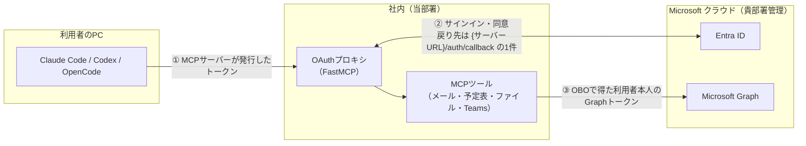
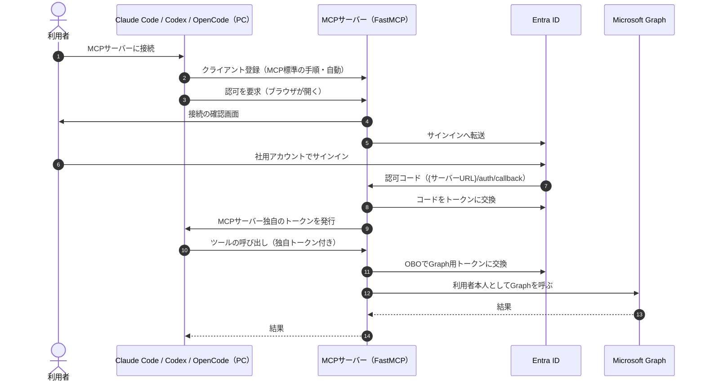
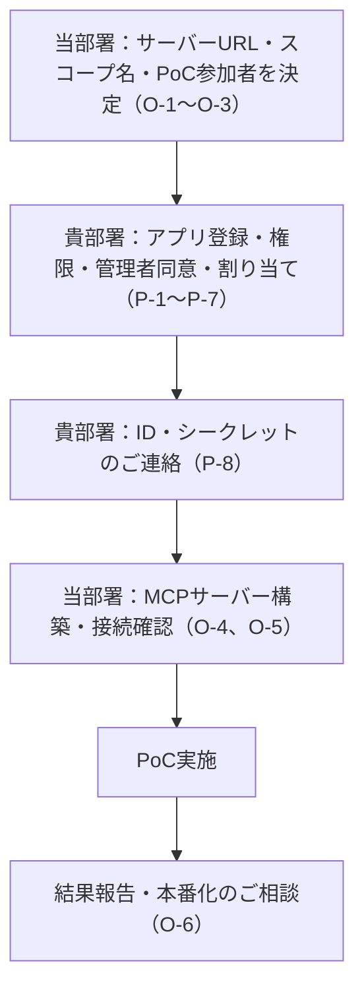
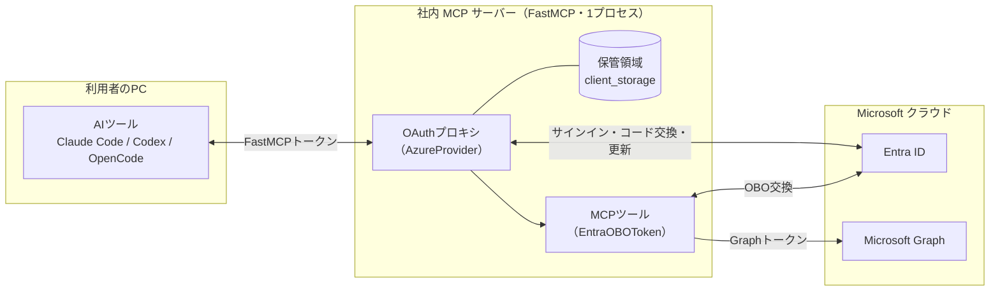
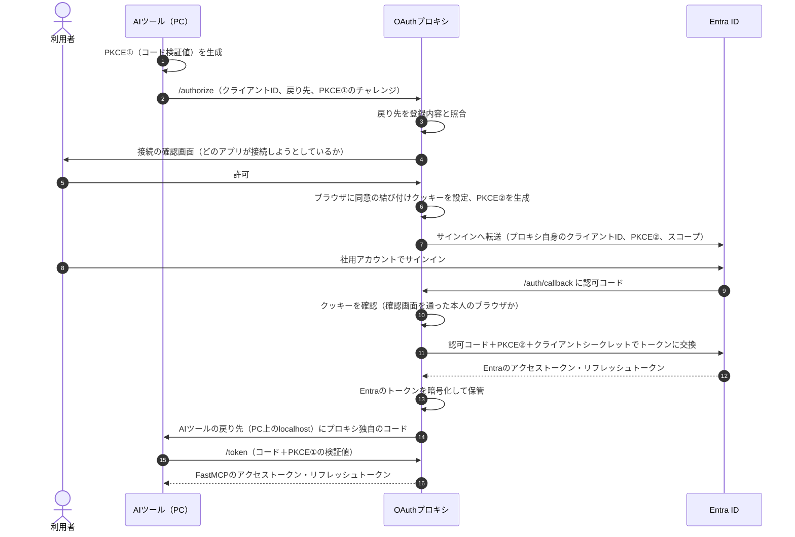
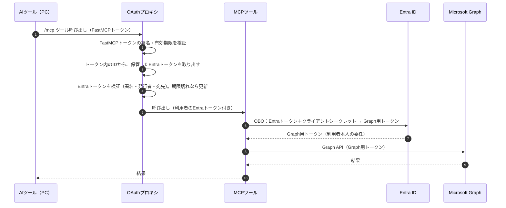

# 社内共有 M365 MCP サーバー 関連資料（依頼資料・OAuth プロキシ仕様）

- 作成日：2026-10-31

本書は、要件仕様書・設計書で参照している次の2つの資料を1つにまとめたものです。

| 部 | 資料 | 要件仕様書・設計書での呼び方 | 主な読者 |
|---|---|---|---|
| 第1部 | 社内共有MCPサーバーから Microsoft Graph（M365データ）を利用する PoC のご説明と Entra ID 設定のご依頼 | 依頼資料 | Entra ID ご担当部署、当部署 |
| 第2部 | 社内共有 M365 MCP サーバー OAuth プロキシ仕様（FastMCP / PoC） | プロキシ仕様 | 当部署、実装担当（AI エージェントを含む） |

第2部の中の「依頼資料 P-1〜P-8、C-1〜C-6」は、第1部7章・8章の番号を指します。

---

## 第1部　依頼資料：社内共有MCPサーバーから Microsoft Graph（M365データ）を利用する PoC のご説明と Entra ID 設定のご依頼

- 作成日：2026-10-31
- 対象：Microsoft Entra ID（Azure AD）ご担当部署 様

---

### 1. 目的

社内に共有の MCP サーバーを1台置き、社員が **Claude Code・Codex・OpenCode** から自分のメール・予定表・SharePoint/OneDrive・Teams の情報を読み書きできるかを PoC で確認します。

- 各利用者は **自分の Entra ID でサインイン**し、**本人の権限の範囲のデータだけ**を扱います（委任アクセス）。
- 利用者に鍵（APIキーなど）は配布しません。
- 本書は PoC 段階のご依頼です。本番化のご依頼は、PoC の結果を踏まえて改めてご相談します。

---

### 2. 役割分担

| 範囲 | 担当 |
|---|---|
| Entra ID のアプリ登録、API 権限、管理者同意、利用者の割り当て | **貴部署**（本書でご依頼する範囲） |
| 共有 MCP サーバー（FastMCP で自作）の構築・運用、Claude Code・Codex・OpenCode の利用手順 | 当部署 |

---

### 3. 用語

| 用語 | 説明 |
|---|---|
| MCP（Model Context Protocol） | AI ツールが外部のシステムやデータを呼び出すための共通の接続方式 |
| Claude Code / Codex / OpenCode | 各利用者の PC で動く AI ツール（それぞれ Anthropic、OpenAI、オープンソースの製品）。MCP サーバーに接続して機能を使う |
| MCP サーバー | AI ツールに機能（例：メールを検索する）を提供するサーバー。今回は社内に1台置いて全員で共有する |
| FastMCP | MCP サーバーを作るためのオープンソースのライブラリ（Python、Apache 2.0 ライセンス）。Entra ID と連携するための部品（`AzureProvider`）を持つ |
| OAuth プロキシ | MCP サーバーの入口で、Entra ID へのサインインを仲介する仕組み。FastMCP に組み込まれている |
| 委任アクセス | アプリが「サインインした利用者本人として」データにアクセスする方式。本人に権限のないデータは見えない |
| OBO（On-Behalf-Of） | サーバーが、利用者のトークンを Entra ID に提示して、Graph 用のトークンに交換する仕組み。利用者本人としてのアクセスのまま |
| 管理者同意 | 組織全体として、アプリに権限を与えることを管理者が承認する操作 |
| エンタープライズアプリの「割り当てが必要」 | 指定したユーザー・グループ以外がアプリにサインインできないようにする設定 |

---

### 4. 構成



**ポイント**

- Entra ID に登録する戻り先（リダイレクト URI）は、**MCP サーバーの URL 1件だけ**です。利用者の PC 側の戻り先（Claude Code・Codex・OpenCode がそれぞれ使う localhost / 127.0.0.1 のアドレス）は MCP サーバーとの間だけで使われるため、Entra ID への登録は不要です。利用する AI ツールを追加しても、Entra ID 側のリダイレクト URI の変更は発生しません。
- Graph 用のトークンは MCP サーバーの中で取得・使用し、**利用者の PC には渡りません**。各ツールが持つのは、MCP サーバーが発行したトークンだけです。
- Graph へのアクセスは利用者本人としての委任アクセスです。本人に権限のないデータは取得できません。

---

### 5. 認証の流れ



---

### 6. 利用者から見た初回の流れ（Claude Code・Codex・OpenCode 共通）

1. 使うツールに MCP サーバーを登録する（ツールごとの手順は当部署が案内します）。
2. ツールで認証を開始すると、ブラウザが開きます。
3. MCP サーバーの確認画面で接続を許可します。
4. Entra ID のサインイン画面で社用アカウントでサインインします。
5. 以降はそのツールからメール・予定表などの機能を使えます。

---

### 7. ご依頼事項（PoC）

#### 7.0 作業の全体像

作業はすべて **Microsoft Entra 管理センター（https://entra.microsoft.com）** で行います。所要の作業と場所は以下のとおりです。

| No. | 作業 | 場所（管理センターのメニュー） | 目的 |
|---|---|---|---|
| P-1 | アプリ登録の作成 | Entra ID ＞ アプリの登録 ＞ 新規登録 | MCP サーバーを Entra ID に「アプリ」として登録し、サインインの窓口にする |
| P-2 | API の公開 | （作成したアプリ）＞ API の公開 | MCP サーバー自身に対するアクセス用のスコープを作る |
| P-3 | トークンのバージョン設定 | （作成したアプリ）＞ マニフェスト | FastMCP が前提とする v2 形式のトークンを発行させる |
| P-4 | クライアントシークレットの発行 | （作成したアプリ）＞ 証明書とシークレット | MCP サーバーが Entra ID とやり取りするための合言葉 |
| P-5 | API のアクセス許可の追加 | （作成したアプリ）＞ API のアクセス許可 | メール・予定表などを利用者本人として扱う権限を付ける |
| P-6 | 管理者の同意 | （作成したアプリ）＞ API のアクセス許可 | 組織として P-5 の権限を承認する |
| P-7 | 利用者の割り当て | Entra ID ＞ エンタープライズ アプリケーション ＞ （作成したアプリ） | サインインできる人を PoC 参加者だけに限定する |
| P-8 | 当部署へのご連絡 | （作成したアプリ）＞ 概要 | MCP サーバーの設定に必要な値をお知らせいただく |

**必要な管理者ロール**

- P-1〜P-5、P-7：アプリケーション管理者、またはクラウド アプリケーション管理者
- P-6（管理者の同意）：クラウド アプリケーション管理者、アプリケーション管理者、または特権ロール管理者
  - 今回は委任された権限だけを使うため、Microsoft のドキュメント上、クラウド アプリケーション管理者・アプリケーション管理者でも同意できます。

> メニュー名は管理センターの表示言語や画面の更新によって多少異なる場合があります。

---

#### P-1. アプリ登録の作成

**場所**：Entra ID ＞ アプリの登録 ＞ ［新規登録］

**操作と設定値**

| 画面の項目 | 設定値 |
|---|---|
| 名前 | 任意（例：社内 M365 MCP サーバー（PoC））※名前は貴部署の命名規則に合わせてください |
| サポートされているアカウントの種類 | この組織ディレクトリのみに含まれるアカウント（シングル テナント） |
| リダイレクト URI ＞ プラットフォームの選択 | Web |
| リダイレクト URI ＞ 値 | `https://{サーバーURL}/auth/callback` |

［登録］を押すと、アプリが作成されます。同時に、同じ名前のエンタープライズ アプリケーションも自動で作成されます（P-7 で使います）。

**補足**

- サーバー URL は未定です。決まり次第ご連絡しますので、リダイレクト URI はその時点で設定いただいても構いません（後から「認証」メニューで追加できます）。
- リダイレクト URI は、この **1件だけ** です。利用者の PC の AI ツール（Claude Code・Codex・OpenCode）の分は登録不要です（4章のとおり）。

---

#### P-2. API の公開

**場所**：（P-1 で作成したアプリ）＞ 管理 ＞ API の公開

**操作と設定値**

1. 「アプリケーション ID の URI」の［追加］（または［設定］）を押し、既定値の `api://{クライアントID}` のまま保存します。
2. ［Scope の追加］を押し、以下を入力して保存します。

| 画面の項目 | 設定値 |
|---|---|
| スコープ名 | 当部署からご提示します |
| 同意できるのはだれですか？ | 貴部署の規程に合わせてご選択ください（P-6 で管理者の同意を行うため、どちらでも動作します） |
| 管理者の同意の表示名・説明 | 例：「社内 M365 MCP サーバーへのアクセス」 |
| 状態 | 有効 |

**目的**：利用者がサインインしたときに、Entra ID が「この MCP サーバー宛て」のトークンを発行するようにするためです。MCP サーバーはこのトークンを受け取って本人確認をし、P-5 の権限で Graph 用のトークンに交換（OBO）します。

---

#### P-3. トークンのバージョン設定

**場所**：（作成したアプリ）＞ 管理 ＞ マニフェスト

**操作**：マニフェストの `api` の中にある `requestedAccessTokenVersion` を `2` に変更し、［保存］を押します。

```json
"api": {
  "requestedAccessTokenVersion": 2,
  ...
}
```

**目的**：FastMCP は v2 形式のアクセストークンを前提としています。既定値（null）のままだと、認証エラーになる場合があります。

---

#### P-4. クライアントシークレットの発行

**場所**：（作成したアプリ）＞ 管理 ＞ 証明書とシークレット ＞ クライアント シークレット ＞ ［新しいクライアント シークレット］

**操作**：説明と有効期限を入力して［追加］を押します。表示された **「値」** を控えてください（画面を離れると二度と表示されません）。

- 有効期限と受け渡し方法は、8章（C-1、C-2）でご相談させてください。

**目的**：MCP サーバーが Entra ID に対して「登録されたアプリ本人である」ことを示すために使います。サインイン後のトークン取得と、OBO での交換に必要です。

---

#### P-5. API のアクセス許可の追加

**場所**：（作成したアプリ）＞ 管理 ＞ API のアクセス許可 ＞ ［アクセス許可の追加］

**操作①：Microsoft Graph の権限**

［Microsoft Graph］＞［委任されたアクセス許可］を選び、以下を検索してチェックし、［アクセス許可の追加］を押します。**アプリケーションの許可は使いません。**

| 対象 | 権限 | 用途 | Microsoft の既定で管理者の同意が必要か |
|---|---|---|---|
| 共通 | `User.Read` | サインインした利用者の基本情報 | 不要 |
| メール | `Mail.ReadWrite` | メールの読み取り・下書き作成・移動など | 不要 |
| メール | `Mail.Send` | メールの送信 | 不要 |
| 予定表 | `Calendars.ReadWrite` | 予定の読み取り・作成・変更 | 不要 |
| OneDrive・ファイル | `Files.ReadWrite.All` | 利用者がアクセスできるファイルの読み取り・作成・更新 | 不要 |
| SharePoint | `Sites.ReadWrite.All` | 利用者がアクセスできるサイトの読み取り・作成・更新 | 不要 |
| Teams チャット | `Chat.ReadWrite` | チャットの読み取り | 不要 |
| Teams チャット | `ChatMessage.Send` | チャットへの投稿 | 不要 |
| Teams チャネル | `Team.ReadBasic.All` / `Channel.ReadBasic.All` | 参加しているチーム・チャネルの一覧 | 不要 |
| Teams チャネル | `ChannelMessage.Read.All` | チャネルのメッセージの読み取り | **必要** |
| Teams チャネル | `ChannelMessage.Send` | チャネルへの投稿 | 不要 |

**操作②：P-2 で作ったスコープ**

もう一度［アクセス許可の追加］を押し、［自分の API］＞（作成したアプリ）＞ P-2 のスコープ を選んで追加します。

- 目的：P-6 の管理者の同意の対象にこのスコープも含め、利用者ごとの同意画面を出さないためです。

**補足**

- 委任された権限なので、各利用者は **本人に権限のあるデータだけ** を扱えます。他人のメールボックスや、本人が参加していないチーム・サイトにはアクセスできません。
- PoC 中に対象のデータを増やす場合は、権限の追加を改めてご依頼します。

---

#### P-6. 管理者の同意

**場所**：（作成したアプリ）＞ 管理 ＞ API のアクセス許可

**操作**：P-5 の権限が一覧に並んでいることを確認し、［{テナント名} に管理者の同意を与えます］を押して［はい］を選びます。各権限の「状態」欄が「付与済み」になれば完了です。

**目的**：

- MCP サーバーは OBO で Graph 用のトークンに交換するため、管理者の同意がないと交換が失敗します（エラー AADSTS65001）。
- `ChannelMessage.Read.All` は、Microsoft の既定で管理者の同意が必須です。
- 組織として同意しておくことで、利用者がサインインするたびに権限の同意画面が出ることもなくなります。

---

#### P-7. 利用者の割り当て（PoC 参加者に限定）

**場所**：Entra ID ＞ エンタープライズ アプリケーション ＞ すべてのアプリケーション ＞（P-1 と同じ名前のアプリ）

**操作①：割り当てを必須にする**

管理 ＞ プロパティ で「割り当てが必要ですか?」を **はい** にして［保存］を押します。

**操作②：PoC 参加者を割り当てる**

管理 ＞ ユーザーとグループ ＞ ［ユーザーまたはグループの追加］で、PoC 参加者（ユーザー、またはグループ）を選んで［割り当て］を押します。

- PoC 参加者の一覧は当部署からご提示します。
- グループで割り当てる場合、Microsoft の仕様で Entra ID P1 以上のライセンスが必要です（8章 C-4 でご確認ください）。

**目的**：割り当てられていない人は、この MCP サーバーにサインインできなくなります。PoC 期間中の利用者を限定するためです。

---

#### P-8. 当部署へのご連絡

**場所**：（作成したアプリ）＞ 概要

以下の値をお知らせください。

| 項目 | 画面での表示名 |
|---|---|
| クライアント ID | アプリケーション (クライアント) ID |
| テナント ID | ディレクトリ (テナント) ID |
| クライアントシークレット | P-4 で控えた「値」（受け渡し方法は C-2 でご相談） |

---

### 8. ご確認事項

| No. | 内容 |
|---|---|
| C-1 | クライアントシークレットの有効期限と、更新時の連絡方法 |
| C-2 | クライアントシークレットの安全な受け渡し方法 |
| C-3 | P-5 の権限のうち、社内の規程で追加の申請や審査が必要なものがあるか |
| C-4 | P-7 でグループによる割り当てが可能か（Entra ID P1 以上のライセンスの有無）。不可の場合はユーザー単位で割り当てをお願いします |
| C-5 | 条件付きアクセスなど、このアプリへのサインインに適用される社内ポリシーがあるか（PoC の動作確認に影響するため） |
| C-6 | 作業の所要期間 |

---

### 9. 当部署の作業

| No. | 内容 |
|---|---|
| O-1 | MCP サーバーの URL を決め、リダイレクト URI としてご連絡する |
| O-2 | API の公開で使うスコープ名をご提示する |
| O-3 | PoC 参加者の一覧をご提示する |
| O-4 | FastMCP で MCP サーバーとツール（メール・予定表・SharePoint/OneDrive・Teams の読み書き）を構築する |
| O-5 | Claude Code・Codex・OpenCode からの接続手順を作成し、PoC 参加者に案内する |
| O-6 | PoC の結果をまとめ、本番化の要否とご依頼内容を改めてご相談する |

---

### 10. ライセンス・費用

| 項目 | 内容 |
|---|---|
| Microsoft Graph API | 追加費用なし（今回使う API は従量課金の対象外） |
| Microsoft 365 Copilot ライセンス | 不要（Copilot の機能は使わない） |
| FastMCP | オープンソース（Apache 2.0）。ライセンス費用なし |
| サーバーの構築・運用 | 当部署で対応 |

---

### 11. 進め方



---

## 第2部　プロキシ仕様：社内共有 M365 MCP サーバー OAuth プロキシ仕様（FastMCP / PoC）

- 作成日：2026-10-31
- 版：PoC 向け初版
- 関連資料：「社内共有MCPサーバーから Microsoft Graph（M365データ）を利用する PoC のご説明と Entra ID 設定のご依頼」（以下、依頼資料）

> 本書は FastMCP の OAuth プロキシ（`AzureProvider`）の動作を、公式ドキュメントとソースコード（PrefectHQ/fastmcp、2026-10-31 時点の main）で確認した内容に基づいて記述しています。
> **まだ決めていない設定は「未決」と明記し、値を記載していません。**

---

### 1. 目的と位置づけ

OAuth プロキシは、社内共有 MCP サーバーの入口で次の役割を担います。

1. AI ツール（Claude Code・Codex・OpenCode）に対して **OAuth の認可サーバー** として振る舞い、利用者に鍵を配らずに接続させる。
2. 利用者のサインインを **Entra ID に中継** する（Entra ID に登録する戻り先は MCP サーバーの1件だけ）。
3. **独自のトークン** を AI ツールに発行し、Entra ID や Graph のトークンは AI ツールに渡さない。
4. ツールの呼び出し時に、利用者の Entra トークンを **OBO で Graph 用トークンに交換** し、利用者本人として Graph を呼ぶ。

FastMCP では、OAuth プロキシと MCP ツールは **同じプロセスの中** で動きます（別製品・別サーバーではありません）。

---

### 2. 前提（決定事項）

| 項目 | 内容 |
|---|---|
| 方式 | 社内に共有の HTTP MCP サーバーを置き、全員で使う |
| 実装 | FastMCP（Python、Apache 2.0）で自作。認証は `AzureProvider`、Graph 呼び出しは `EntraOBOToken` |
| 認証 | Entra ID の委任アクセス（利用者本人として Graph を呼ぶ） |
| 利用者への鍵配布 | しない |
| 対象の AI ツール | Claude Code・Codex・OpenCode |
| 対象データ | メール、予定表、SharePoint/OneDrive、Teams（読み取り・書き込み）。他は PoC で追加を検討 |
| PoC の利用者 | Entra ID の「割り当てが必要」で指定者に限定 |
| Entra ID のアプリ | シングルテナント、Web プラットフォーム、リダイレクト URI は `{サーバーURL}/auth/callback` の1件 |

---

### 3. 構成要素



| 要素 | 役割 |
|---|---|
| OAuth プロキシ（`AzureProvider`） | AI ツールの登録受付、認可、FastMCP トークンの発行・検証、Entra ID との中継 |
| 保管領域（`client_storage`） | 登録された AI ツールの情報、認可途中の状態、Entra ID のトークン（暗号化）を保管 |
| MCP ツール | Graph を呼ぶ関数群。引数の `EntraOBOToken([...])` で Graph 用トークンを受け取る |

---

### 4. 公開するエンドポイント

| パス | 用途 | 呼び出し元 |
|---|---|---|
| `/.well-known/oauth-authorization-server` ほか | 認可サーバーのメタデータ（AI ツールが接続先の仕組みを自動で調べる） | AI ツール |
| `/.well-known/oauth-protected-resource` ほか | MCP サーバー（保護リソース）のメタデータ | AI ツール |
| `/register` | 動的クライアント登録（DCR） | AI ツール |
| `/authorize` | 認可の開始。接続の確認画面を表示し、Entra ID に転送 | 利用者のブラウザ |
| `/auth/callback`（`redirect_path` の既定値） | Entra ID からの戻り先。**Entra ID に登録するのはこの1件** | Entra ID（ブラウザ経由） |
| `/token` | FastMCP トークンの発行・更新 | AI ツール |
| `/mcp`（MCP の受け口） | ツールの呼び出し。FastMCP トークンが必要 | AI ツール |

> メタデータのパスは `base_url` / `issuer_url` にパスが含まれる場合、RFC 8414 に従ってパス付きになります。

---

### 5. 処理の流れ

#### 5.1 AI ツールの登録

AI ツールは次のどちらかの方法で、自動で OAuth プロキシに登録されます。利用者や管理者の作業は不要です。

| 方式 | 動作 | 既定 |
|---|---|---|
| DCR（動的クライアント登録） | AI ツールが `/register` に自分の戻り先（PC 上の localhost / 127.0.0.1）を送り、プロキシが **クライアント ID を払い出す**。AI ツールは **公開クライアント**（シークレットなし、`token_endpoint_auth_method: none`）として登録される | 有効 |
| CIMD（クライアント ID メタデータ文書） | AI ツールが自分の情報を置いた HTTPS の URL をクライアント ID として使う。プロキシがその文書を取得し、戻り先を確認する | 有効（`enable_cimd=True`） |

- AI ツールには、Entra ID のクライアント ID・シークレットは **渡りません**（ソースコードで確認：登録応答のシークレットは `None` に正規化される）。
- CIMD の文書取得では、localhost・プライベートアドレスへの取得は拒否されます。
- どの AI ツールが DCR / CIMD のどちらで接続するかは、PoC で確認します（12章）。

#### 5.2 認可（初回サインイン）



**要点**

- PKCE は **2区間で別々** です（AI ツール⇔プロキシ、プロキシ⇔Entra ID）。`forward_pkce` の既定値 `True` で、プロキシ⇔Entra ID 側にもプロキシ自身が生成した PKCE を使います。
- Entra ID に要求するスコープは、`required_scopes`（API の公開で作るスコープ）と `additional_authorize_scopes`（Graph の委任権限）です。
- 接続の確認画面と結び付けクッキーは、**混乱した代理人（confused deputy）攻撃** の対策です（8章）。

#### 5.3 ツールの呼び出しと OBO



- Entra トークンの検証：署名（RS256、テナントの公開鍵 `https://login.microsoftonline.com/{tenant_id}/discovery/v2.0/keys`）、発行者、宛先（`client_id` または `api://{client_id}`）を確認します。
- OBO で要求するスコープは、ツールごとに `EntraOBOToken([...])` で指定します。**`additional_authorize_scopes` に含まれていないスコープは交換に失敗** します。
- OBO の資格情報は利用者ごとにメモリ上にキャッシュされ、Azure SDK のトークンキャッシュにより同じ利用者の交換の繰り返しが抑えられます。Graph 用トークンは保管領域には保存されません。

#### 5.4 トークンの更新

- AI ツールは FastMCP のリフレッシュトークンで `/token` を呼びます。
- プロキシは、対応する Entra ID のリフレッシュトークンで Entra トークンを更新し、新しい FastMCP アクセストークンを発行します。

---

### 6. トークン一覧

| トークン | 発行者 | 宛先 | 持つ場所 | 内容・形式 | 有効期限 |
|---|---|---|---|---|---|
| FastMCP アクセストークン | OAuth プロキシ | MCP サーバー | AI ツール（PC） | JWT、HS256 署名。発行者・宛先・クライアント ID・スコープ・期限・JTI（保管した Entra トークンへの参照） | 既定では Entra トークンと同じ（`fastmcp_access_token_expiry_seconds` で変更可） |
| FastMCP リフレッシュトークン | OAuth プロキシ | OAuth プロキシ | AI ツール（PC） | Entra のリフレッシュトークンに対応付け | Entra が期限（`refresh_expires_in`）を返せばそれに従う。返さない場合は `fallback_refresh_token_expiry_seconds`（既定 1年） |
| Entra アクセストークン | Entra ID | MCP サーバー（`api://{client_id}`） | 保管領域（暗号化） | JWT（v2）、RS256 | Entra ID の設定に依存 |
| Entra リフレッシュトークン | Entra ID | Entra ID | 保管領域（暗号化） | — | Entra ID の設定に依存 |
| Graph アクセストークン | Entra ID（OBO） | Microsoft Graph | MCP サーバーのメモリ上のみ | — | Entra ID の設定に依存 |

**AI ツール（PC）が持つのは FastMCP のトークンだけ** で、Entra・Graph のトークンは PC に渡りません（トークンの素通しをしない）。

---

### 7. 保管領域（`client_storage`）

| 項目 | 内容 |
|---|---|
| 保管するもの | 登録された AI ツールの情報、認可途中の状態、Entra のトークン |
| 既定の保管先 | サーバーのディスク（プラットフォームのデータディレクトリ）。暗号化あり（鍵は JWT 署名鍵から導出） |
| 暗号化 | Fernet（AES-128-CBC＋HMAC-SHA256）。独自の保管先を使う場合は `FernetEncryptionWrapper` で包む必要があり、**包まないと平文** になる |
| 複数台で動かす場合 | `jwt_signing_key` の明示と、全台から使える共有の保管先（Redis など）が必須。既定値は開発向け |

---

### 8. セキュリティ上の仕組み

| 脅威・要件 | FastMCP の仕組み | 既定 |
|---|---|---|
| 混乱した代理人（悪意のあるクライアントが、共有の Entra アプリの承認済み状態を悪用） | 接続の確認画面＋ブラウザへの結び付けクッキー。戻り先で同じブラウザかを確認 | 有効（`require_authorization_consent=True`、毎回表示） |
| 認可コードの横取り | PKCE を2区間で別々に検証 | 有効（`forward_pkce=True`） |
| 不正な戻り先 | 登録時に戻り先を確認。`javascript:` `data:` `file:` `vbscript:` は常に拒否。`application_type` が `web` の場合は https・非ループバックのみ | `allowed_client_redirect_uris=None`（危険なスキーム以外は許可。ループバックはポート違いを許容） |
| トークンの素通し | AI ツールには FastMCP トークンだけを渡す。Graph へは OBO で交換したトークンを使う | 仕様上常に |
| なりすましトークン | Entra トークンの署名・発行者・宛先を検証 | 常に |
| 対象者の限定 | Entra ID の「割り当てが必要」で、割り当てられていない人はサインインできない | Entra 側の設定（依頼資料 P-7） |

---

### 9. Entra ID の設定との対応

| 依頼資料 | Entra ID の設定 | FastMCP の設定 |
|---|---|---|
| P-1 | テナント ID | `tenant_id`（特定のテナント ID を指定。`common` は新規アプリで不可） |
| P-1 | リダイレクト URI `{サーバーURL}/auth/callback` | `base_url`＋`redirect_path`（既定 `/auth/callback`）。**完全一致が必要** |
| P-2 | アプリケーション ID の URI `api://{client_id}` | `identifier_uri`（既定 `api://{client_id}`） |
| P-2 | スコープ | `required_scopes`（接頭辞なしの名前で指定） |
| P-3 | `requestedAccessTokenVersion: 2` | 前提条件（v2 トークンを検証） |
| P-4 | クライアントシークレット | `client_secret` |
| P-5 | Graph の委任権限 | `additional_authorize_scopes`、各ツールの `EntraOBOToken([...])` |
| P-6 | 管理者の同意 | 前提条件（ないと OBO が AADSTS65001 で失敗） |
| P-8 | クライアント ID | `client_id` |

---

### 10. 設定パラメータ

| パラメータ | 内容 | 既定値 | PoC での値 |
|---|---|---|---|
| `client_id` | Entra アプリのクライアント ID | — | 依頼資料 P-8 で受領 |
| `client_secret` | Entra アプリのシークレット | — | 依頼資料 P-8 で受領 |
| `tenant_id` | テナント ID | —（必須） | 依頼資料 P-8 で受領 |
| `base_url` | MCP サーバーの公開 URL | — | **未決**（サーバー URL 未定） |
| `redirect_path` | Entra からの戻り先のパス | `/auth/callback` | 既定値（依頼資料で `/auth/callback` として依頼済み） |
| `required_scopes` | API の公開で作るスコープ | —（必須） | **未決**（スコープ名未定） |
| `identifier_uri` | アプリケーション ID の URI | `api://{client_id}` | 既定値（依頼資料 P-2 で既定値として依頼済み） |
| `additional_authorize_scopes` | Graph の委任権限 | なし | 依頼資料 P-5 の権限 |
| `client_storage` | 保管先 | 暗号化ディスク | **未決** |
| `jwt_signing_key` | FastMCP トークンの署名鍵 | クライアントシークレットから導出 | **未決** |
| `require_authorization_consent` | 接続の確認画面 | `True`（毎回表示） | **未決**（`True` / `"remember"` / `False` / `"external"`） |
| `allowed_client_redirect_uris` | AI ツールの戻り先の制限 | `None`（危険なスキーム以外許可） | **未決** |
| `enable_cimd` | CIMD の受け付け | `True` | **未決** |
| `fastmcp_access_token_expiry_seconds` | FastMCP アクセストークンの有効期限 | Entra トークンと同じ | **未決** |
| `fallback_refresh_token_expiry_seconds` | Entra が期限を返さないときの FastMCP リフレッシュトークンの期限 | 1年 | **未決** |
| `forward_pkce` | Entra 側の PKCE | `True` | **未決** |

---

### 11. 未決事項

| No. | 内容 | 関係するパラメータ |
|---|---|---|
| U-1 | MCP サーバーの URL | `base_url` |
| U-2 | API の公開で作るスコープ名 | `required_scopes` |
| U-3 | 保管先（既定の暗号化ディスク／共有の保管先） | `client_storage` |
| U-4 | 署名鍵の管理（明示するか、シークレットから導出するか） | `jwt_signing_key` |
| U-5 | 接続の確認画面の出し方（毎回／記憶する／出さない） | `require_authorization_consent` |
| U-6 | AI ツールの戻り先を制限するか | `allowed_client_redirect_uris` |
| U-7 | CIMD を受け付けるか | `enable_cimd` |
| U-8 | トークンの有効期限 | `fastmcp_access_token_expiry_seconds` ほか |
| U-9 | 台数（1台／複数台）。複数台の場合は U-3・U-4 が必須条件になる | — |

---

### 12. PoC で確認すること

| No. | 確認内容 |
|---|---|
| T-1 | Claude Code・Codex・OpenCode が、それぞれ DCR または CIMD で鍵なしに接続できるか |
| T-2 | 初回のサインイン（接続の確認画面 → Entra ID）が完了し、ツールが使えるか |
| T-3 | 利用者ごとにデータが分かれるか（他人のメール等が見えないこと） |
| T-4 | 「割り当てが必要」で、割り当てのない人がサインインできないこと |
| T-5 | OBO で各権限（メール・予定表・ファイル・Teams の読み書き）の Graph 用トークンが取れるか |
| T-6 | トークンの期限切れ後に、再サインインなしで更新されるか |
| T-7 | サーバー再起動後もサインイン状態が保たれるか（保管先の設定による） |
| T-8 | 条件付きアクセスなど社内ポリシーの影響（依頼資料 C-5 の回答による） |

---

### 13. 参照

- FastMCP: Azure (Entra ID) Integration — https://gofastmcp.com/integrations/azure
- FastMCP: OAuth Proxy — https://gofastmcp.com/servers/auth/oauth-proxy
- FastMCP ソースコード（`fastmcp/server/auth/providers/azure.py`、`oauth_proxy/proxy.py`、`redirect_validation.py`）— https://github.com/PrefectHQ/fastmcp
- Microsoft Learn: Grant tenant-wide admin consent to an application — https://learn.microsoft.com/en-us/entra/identity/enterprise-apps/grant-admin-consent
