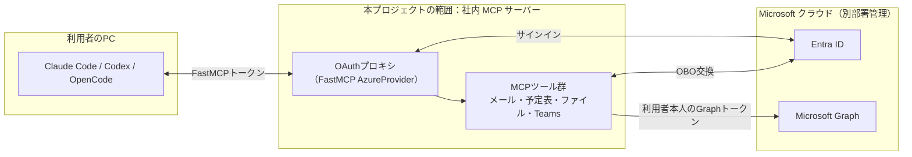
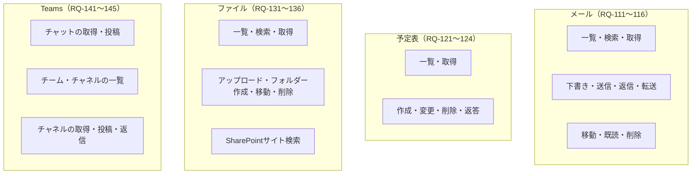

# 要件仕様書：社内共有 M365 MCP サーバー（FastMCP / PoC）

- 作成日：2026-10-31
- 対象読者：実装を担当する AI エージェント（Claude Code など）と開発者
- プロジェクト名：**未決**（候補は「プロジェクト名の案」を参照）
- 関連資料：
  - 「社内共有MCPサーバーから Microsoft Graph（M365データ）を利用する PoC のご説明と Entra ID 設定のご依頼」（以下、依頼資料。`docs/related_materials.md` 第1部）
  - 「社内共有 M365 MCP サーバー OAuth プロキシ仕様」（以下、プロキシ仕様。`docs/related_materials.md` 第2部）
  - 「設計書：社内共有 M365 MCP サーバー」（以下、設計書。`docs/design.md`）

---

## 0. AI エージェントへの作業ルール

| ID     | ルール                                                                                         |
| ------ | ------------------------------------------------------------------------------------------- |
| AI-001 | 本書の **「未決」と書かれた項目の値を勝手に決めない**。設定で変更できるようにし、値は FastMCP の既定値に任せる。どうしても決めないと進めない場合は、作業を止めて質問する |
| AI-002 | 本書に書かれていない機能・制限・方針（例：読み取り専用モード、ツールの絞り込み、データの保存期間）を追加しない。必要だと思った場合は「提案」として報告する               |
| AI-003 | FastMCP・Microsoft Graph の仕様は、推測せず公式ドキュメントまたはソースコードで確認してから実装する                               |
| AI-004 | 各要件 ID（RQ-xxx、NF-xxx、CN-xxx）を、コードのコメント・テスト名・コミットメッセージから参照できるようにする                           |
| AI-005 | シークレット（クライアントシークレット、署名鍵など）をコード・テスト・リポジトリに書かない                                               |

---

## 1. 目的

社内に共有の MCP サーバーを1つ置き、社員が Claude Code・Codex・OpenCode から、**利用者本人の権限で** Microsoft 365 のデータ（メール、予定表、SharePoint/OneDrive、Teams）を読み書きできることを PoC で確認する。

---

## 2. 全体像

---

## 3. 前提（決定事項）

| ID     | 内容                                                                         |
| ------ | -------------------------------------------------------------------------- |
| PR-001 | 共有の HTTP MCP サーバーとして社内に置き、全員で使う（各自の PC で動かす方式は対象外）                         |
| PR-002 | 実装は FastMCP（Python）。認証は `AzureProvider`、Graph 用トークンは `EntraOBOToken` で取得する |
| PR-003 | Entra ID の委任アクセスのみを使う。アプリケーション権限は使わない                                      |
| PR-004 | 利用者に鍵（API キーなど）を配布しない                                                      |
| PR-005 | 対象の AI ツールは Claude Code・Codex・OpenCode                                     |
| PR-006 | Entra ID のアプリ登録・権限・管理者同意・利用者の割り当ては別部署が行う（依頼資料 P-1〜P-8）。本プロジェクトはその値を設定で受け取る |
| PR-007 | PoC 中のサインインは、Entra ID の「割り当てが必要」で指定者に限定される（サーバー側の実装は不要）                    |
| PR-008 | 利用者規模は約1万人（本番を想定した場合）。PoC は指定者のみ                                           |

---

## 4. スコープ

| 区分  | 内容                                                            |
| --- | ------------------------------------------------------------- |
| 対象  | OAuth プロキシの設定、Graph を呼ぶ MCP ツール群、設定の読み込み、テスト、各 AI ツールからの接続手順書 |
| 対象  | メール、予定表、SharePoint/OneDrive、Teams の読み取りと書き込み（依頼資料 P-5 の権限の範囲） |
| 対象外 | Entra ID の設定作業（別部署）                                           |
| 対象外 | Open WebUI からの利用（今回は扱わない）                                     |
| 対象外 | 依頼資料 P-5 にない権限を必要とする機能（必要になった場合は権限の追加依頼から行う）                  |

---

## 5. 機能要件

### 5.1 認証・認可（OAuth プロキシ）

| ID     | 要件                                                                                      |
| ------ | --------------------------------------------------------------------------------------- |
| RQ-001 | MCP クライアント（AI ツール）に対して OAuth の認可サーバーとして振る舞い、鍵の配布なしに接続できること                              |
| RQ-002 | AI ツールの登録は DCR に対応すること。CIMD の受け付けは設定で切り替えられること（値は未決 U-7）                                |
| RQ-003 | 利用者のサインインを Entra ID に中継し、Entra ID からの戻り先は `{base_url}/auth/callback` の1件であること           |
| RQ-004 | AI ツールには FastMCP が発行したトークンだけを渡し、Entra・Graph のトークンを渡さないこと                                |
| RQ-005 | MCP の受け口（ツール呼び出し）は、有効な FastMCP トークンがない要求を拒否すること                                         |
| RQ-006 | Entra のトークンは署名・発行者・宛先を検証すること（FastMCP の `AzureProvider` の機能を使う）                          |
| RQ-007 | 各ツールは `EntraOBOToken` で、そのツールに必要な Graph の委任スコープだけを指定して Graph 用トークンを取得すること。※指定しても権限は絞られない。Entra ID は、同じ Graph あてに同意済みのスコープをすべて入れたトークンを返す。この指定は最小権限を保証するものではなく、ツールがどの権限を使うかを明示するためのもの |
| RQ-008 | `EntraOBOToken` に指定するスコープは、すべて `additional_authorize_scopes` に含まれていること（サインイン時にそのスコープの同意を取るため。管理者同意（依頼資料 P-6）が無く、利用者の同意も取れていないスコープは、OBO の交換が AADSTS65001 で失敗する） |
| RQ-009 | トークンの更新（リフレッシュ）により、期限切れ後も再サインインなしで使えること（Entra がリフレッシュトークンを返す場合）                         |

### 5.2 MCP ツール

依頼資料 P-5 で申請した権限で実現できる操作を、ツールとして提供する。ツール名・引数の詳細は設計書 7章を参照。

| ID     | 対象         | 操作                                 | 使う権限                                                    |
| ------ | ---------- | ---------------------------------- | ------------------------------------------------------- |
| RQ-101 | 共通         | サインインした利用者のプロフィールを取得する             | `User.Read`                                             |
| RQ-111 | メール        | フォルダーの一覧を取得する                      | `Mail.ReadWrite`                                        |
| RQ-112 | メール        | メールを一覧・検索する                        | `Mail.ReadWrite`                                        |
| RQ-113 | メール        | メールの本文・添付ファイルの一覧を取得する              | `Mail.ReadWrite`                                        |
| RQ-114 | メール        | 下書きを作成・更新する                        | `Mail.ReadWrite`                                        |
| RQ-115 | メール        | メールを送信する（新規・返信・全員に返信・転送、下書きの送信）    | `Mail.Send`                                             |
| RQ-116 | メール        | メールを移動する、既読・フラグを変更する、削除する          | `Mail.ReadWrite`                                        |
| RQ-121 | 予定表        | 期間を指定して予定を一覧する                     | `Calendars.ReadWrite`                                   |
| RQ-122 | 予定表        | 予定の詳細を取得する                         | `Calendars.ReadWrite`                                   |
| RQ-123 | 予定表        | 予定を作成・変更・削除する                      | `Calendars.ReadWrite`                                   |
| RQ-124 | 予定表        | 会議の招待に返答する（承諾・仮承諾・辞退）              | `Calendars.ReadWrite`                                   |
| RQ-131 | ファイル       | OneDrive・ドキュメントライブラリのフォルダーの中身を一覧する | `Files.ReadWrite.All`                                   |
| RQ-132 | ファイル       | ファイルを検索する                          | `Files.ReadWrite.All`                                   |
| RQ-133 | ファイル       | ファイルの情報と内容を取得する                    | `Files.ReadWrite.All`                                   |
| RQ-134 | ファイル       | ファイルをアップロード（作成・上書き）する。内容はテキスト、または base64 で符号化したバイナリとして受け取る。受け取るサイズには上限を設ける（上限値は提案 PP-005） | `Files.ReadWrite.All`                                   |
| RQ-135 | ファイル       | フォルダーを作成する、名前の変更・移動・削除をする          | `Files.ReadWrite.All`                                   |
| RQ-136 | SharePoint | サイトを検索する、サイトのドキュメントライブラリを一覧する      | `Sites.ReadWrite.All`                                   |
| RQ-141 | Teams      | 参加しているチャットを一覧し、メッセージを取得する          | `Chat.ReadWrite`                                        |
| RQ-142 | Teams      | チャットにメッセージを投稿する                    | `ChatMessage.Send`                                      |
| RQ-143 | Teams      | 参加しているチーム・チャネルを一覧する                | `Team.ReadBasic.All` / `Channel.ReadBasic.All`          |
| RQ-144 | Teams      | チャネルのメッセージと返信を取得する                 | `ChannelMessage.Read.All`                               |
| RQ-145 | Teams      | チャネルにメッセージを投稿する、返信する               | `ChannelMessage.Send`                                   |

| ID     | 共通の要件                                                              |
| ------ | ------------------------------------------------------------------ |
| RQ-190 | すべてのツールは利用者本人の委任アクセスで Graph を呼び、本人に権限のないデータを返さないこと（Graph の権限判定に従う） |
| RQ-191 | 一覧系のツールは件数の上限を引数で指定でき、続きがある場合はそれを示すこと。続きを取得したとき、取りこぼし・重複がないこと |
| RQ-192 | Graph のエラーと、Graph 用トークンの取得（OBO）の失敗は、AI ツールが理解できるメッセージとして返すこと（トークンなどの秘密情報を含めない） |

---

## 6. 非機能要件

| ID     | 要件                                                                                                  |
| ------ | --------------------------------------------------------------------------------------------------- |
| NF-001 | MCP のトランスポートは HTTP（Streamable HTTP）であること                                                            |
| NF-002 | 設定値（クライアント ID、テナント ID、シークレットなど）は環境変数から読み込み、コードに埋め込まないこと                                             |
| NF-003 | 未決事項（11章）の設定は、環境変数で変更できること。未設定のときは FastMCP の既定値を使うこと                                                |
| NF-004 | 保管先（`client_storage`）を差し替えられる構造にすること。独自の保管先を使う場合は `FernetEncryptionWrapper` で暗号化すること（未暗号化では平文になるため） |
| NF-005 | 複数台構成にも対応できる構造にすること（署名鍵の明示と共有の保管先を設定で与えられること。MCP のセッションをサーバーに持たない動作（FastMCP の `stateless_http`）を設定で選べること）。台数は未決（U-9） |
| NF-006 | Graph の一時的なエラー（429・503）に対して、`Retry-After` に従った再試行を行うこと                                              |
| NF-007 | Python と FastMCP のバージョンを固定すること（FastMCP は 4.1.4 が 2026-10-31 時点の最新安定版。実装開始時に再確認する）                   |
| NF-008 | 単体テストは Graph・Entra ID に接続せずに実行できること                                                                 |

---

## 7. 制約

| ID     | 制約                                                                                                  |
| ------ | --------------------------------------------------------------------------------------------------- |
| CN-001 | Graph のトークンを AI ツールに返さない、ログにもエラーメッセージにも含めない                                                         |
| CN-002 | アプリケーション権限（利用者を介さない権限）を使う実装をしない                                                                     |
| CN-003 | サーバー自身のアカウントで Graph を呼ぶ経路を作らない（利用者のトークンがない場合は失敗させる）                                                 |
| CN-004 | `tenant_id` に `common` を使わない（シングルテナントのアプリのため、特定のテナント ID を使う）                                        |
| CN-005 | Entra ID のリダイレクト URI は `{base_url}/auth/callback` の1件のみを前提とする。AI ツールごとの戻り先を Entra ID に登録する前提の実装をしない |

---

## 8. 外部インターフェース

| 相手              | 内容                                                                                    |
| --------------- | ------------------------------------------------------------------------------------- |
| AI ツール          | MCP（Streamable HTTP）、OAuth 2.1（認可コード＋PKCE、DCR / CIMD）                                 |
| Entra ID        | OAuth 2.0 / OpenID Connect（v2 エンドポイント）、OBO                                            |
| Microsoft Graph | REST API v1.0（[`https://graph.microsoft.com/v1.0`](https://graph.microsoft.com/v1.0)） |

---

## 9. 依頼資料の値との対応

| 依頼資料 | 受け取る値                          | 使い道                                                       |
| ---- | ------------------------------ | --------------------------------------------------------- |
| P-8  | クライアント ID、テナント ID、クライアントシークレット | `AzureProvider` の `client_id`・`tenant_id`・`client_secret` |
| P-2  | スコープ名（当部署が決めて提示、未決 U-2）        | `required_scopes`                                         |
| P-5  | Graph の委任権限                    | `additional_authorize_scopes` と各ツールの `EntraOBOToken`      |

---

## 10. 受け入れ基準

| ID     | 基準                                                      | 関係する要件            |
| ------ | ------------------------------------------------------- | ----------------- |
| AC-001 | Claude Code・Codex・OpenCode のそれぞれが、鍵なしで接続・サインインし、ツールを使える | RQ-001〜005、PR-005 |
| AC-002 | 利用者 A のトークンで、利用者 B のメール・予定・チャットが取得できない                  | RQ-190            |
| AC-003 | 「割り当て」のない利用者がサインインできない                                  | PR-007            |
| AC-004 | 5.2 の各ツールが、PoC 参加者の実データで期待どおり動く                         | RQ-101〜145        |
| AC-005 | トークンの期限切れ後に、再サインインなしで使い続けられる                            | RQ-009            |
| AC-006 | AI ツール側の通信・設定ファイルに Entra・Graph のトークンが現れない               | RQ-004、CN-001     |
| AC-007 | 単体テストがネットワーク接続なしで通る                                     | NF-008            |

---

## 11. 未決事項

プロキシ仕様 11章と同じ。実装では値を決めず、設定で変更できるようにする（AI-001、NF-003）。

| ID   | 内容               | 関係するパラメータ                                |
| ---- | ---------------- | ---------------------------------------- |
| U-1  | MCP サーバーの URL    | `base_url`                               |
| U-2  | API の公開で作るスコープ名  | `required_scopes`                        |
| U-3  | 保管先              | `client_storage`                         |
| U-4  | 署名鍵の管理           | `jwt_signing_key`                        |
| U-5  | 接続の確認画面の出し方      | `require_authorization_consent`          |
| U-6  | AI ツールの戻り先を制限するか | `allowed_client_redirect_uris`           |
| U-7  | CIMD を受け付けるか     | `enable_cimd`                            |
| U-8  | トークンの有効期限        | `fastmcp_access_token_expiry_seconds` ほか |
| U-9  | 台数               | —                                        |
| U-10 | プロジェクト名          | —                                        |

未設定のときの FastMCP 4.1.4 の既定値と、判断の材料（FastMCP のソースで確認）：

| ID  | 未設定のときの動作 | 判断の材料 |
| --- | --- | --- |
| U-3 | `FASTMCP_HOME`（既定はプラットフォームのデータディレクトリ）の下に、Fernet で暗号化したファイルとして保管する | コンテナで動かす場合、このディレクトリを永続化しないと、再起動のたびに全員が再サインインになる |
| U-4 | クライアントシークレットから導出する。保管先の暗号鍵と保存ディレクトリも、この署名鍵から導出される | Entra のシークレットを更新する（依頼資料 C-1）と、保管済みの登録とトークンが読めなくなり、全員が再サインインになる |
| U-5 | `True`（毎回、接続の確認画面を出す） | — |
| U-6 | `None`（危険なスキーム以外はすべて許可） | 制限する場合は、Claude Code の `http://localhost/callback` と `http://127.0.0.1/callback`（ポートは任意）、OpenCode の `http://127.0.0.1:19876/mcp/oauth/callback`、Codex の戻り先を許可する必要がある。FastMCP は `http://localhost:*/...` のようにポートの任意指定ができる |
| U-7 | `True`（CIMD を受け付ける） | Claude Code は、サーバーが CIMD に対応していれば DCR ではなく CIMD を使う。そのため既定のままでは、Claude Code で DCR の経路を確かめられない |
| U-8 | FastMCP のアクセストークンの期限は、Entra のアクセストークンの期限に合わせる | — |

---

## 12. 提案事項（未承認）

作成者（Claude）からの提案です。**承認されるまで実装しない**こと。

| ID     | 提案                                                        | 理由                                           |
| ------ | --------------------------------------------------------- | -------------------------------------------- |
| PP-001 | 各ツールに MCP のツール注釈（`readOnlyHint`・`destructiveHint` など）を付ける | AI ツール側で、書き込み・削除の前に確認を出す判断材料になる。ツールの絞り込みではない |
| PP-002 | ファイル内容の取得で返すサイズに上限を設ける                                    | 大きなファイルで AI ツールの入力があふれるのを防ぐ。上限値は要決定          |
| PP-003 | Graph の再試行回数の既定値を決める（例：3回）                                  | 再試行回数は設定で変更できるが、未設定のときの値が決まっていない |
| PP-004 | ツール名を設計書 7章の `対象_操作` 形式で確定する                               | ツール名は AI ツールが選ぶときの手がかりになるため |
| PP-005 | ファイルのアップロード（RQ-134）で受け取るサイズの上限値を決める               | ツールの引数は JSON で渡るため、大きなファイルは現実的に渡せない。上限があれば、Graph の簡易アップロード（1回の PUT。公式の上限は 250 MB）だけで足り、分割アップロードを作らずに済む |
| PP-006 | 再試行の対象に 504 を加える                                                    | Graph の一時的なエラーとして 504 も返ることがある。NF-006 は 429・503 だけを対象にしている |
