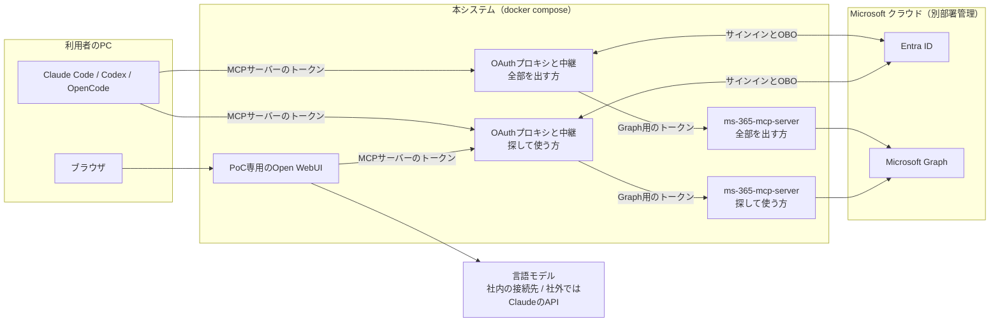
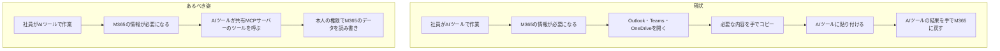
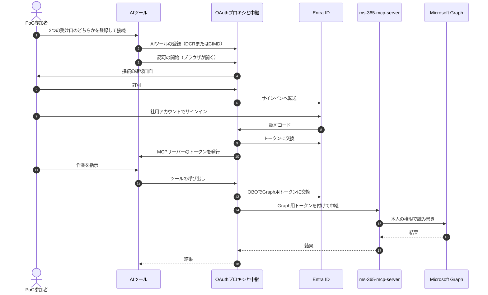
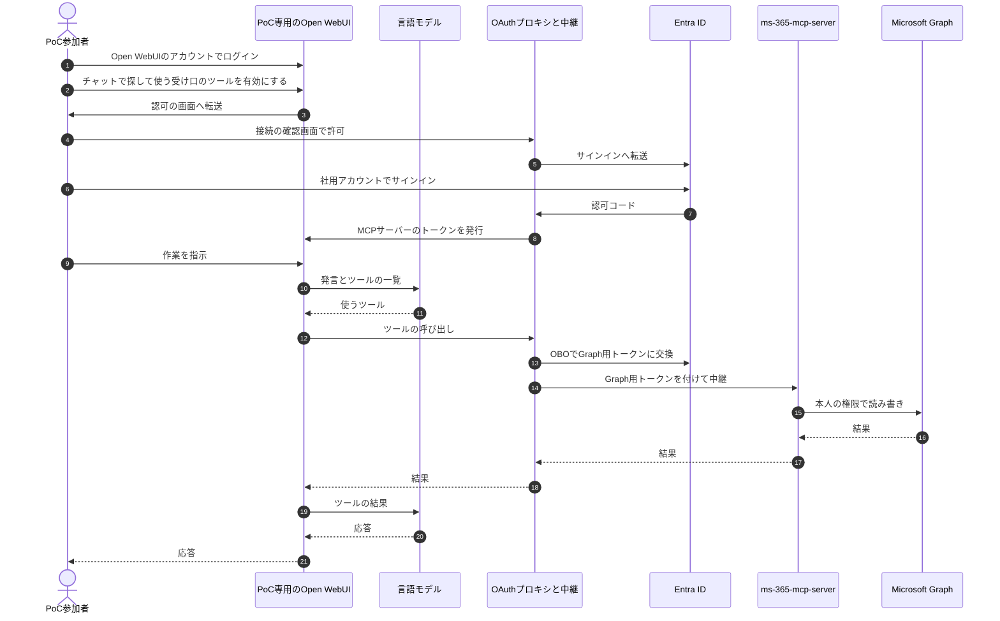

# 要件定義書：社内共有 M365 MCP サーバー（FastMCP ＋ ms-365-mcp-server / PoC）

- 作成日：2026-10-31（isdd 形式で作り直し）
- 改訂：2026-11-01（ツールを自作する方針から、ms-365-mcp-server を中継する方針へ変更。変更の内容と理由は `.history/20261101-relay-ms365-mcp-server/change_requirements.md`）
- 対象読者：実装を担当する AI エージェント（Claude Code など）と開発者
- 関連資料：
  - 依頼資料・OAuth プロキシ仕様：`docs/related_materials.md`（第1部が依頼資料、第2部がプロキシ仕様）
  - 外部連携の事前確認と詳細調査：`external/entra-id/docs/`、`external/microsoft-graph/docs/`、`external/ms-365-mcp-server/docs/`、`external/open-webui/docs/`、`external/language-model/docs/`
  - 詳細設計書：`docs/detail_design.md`
- 旧版からの移行：各表の「旧 ID」列に、作り直す前の要件仕様書の番号（`RQ-001`、`NF-001` など）を書いた。2026-11-01 の方針変更で足した要件は「（新規。方針変更）」と書いた

---

## 1. 目的・前提

### システムの目的

社内に共有の MCP サーバーを置き、社員が Claude Code・Codex・OpenCode・Open WebUI から、利用者本人の権限で Microsoft 365 のデータ（メール、予定表、SharePoint/OneDrive、Excel、Teams など）を読み書きできることを PoC で確かめる。MCP のツールは既製の ms-365-mcp-server のものを使い、本システムはサインインの中継と、ツールの呼び出しの中継を受け持つ。

### 経緯

- 当初は ms-365-mcp-server をそのまま使いたかった。しかし ms-365-mcp-server をそのまま使うと、OAuth の後の戻り先の URL を、AI ツールごとに Entra ID に登録する必要がある。AI ツールごとに戻り先が変わるので、AI ツールを足すたびに別部署への依頼が要る。また、AI ツールに Entra のトークンが渡る。
- そのため、ms-365-mcp-server の前に FastMCP の薄いラッパー（OAuth プロキシと中継）を置くために、このプロジェクトを立ち上げた。
- 2026-10-31 版の要件定義書は、この経緯が抜けたまま、ツールを自作する方針で書かれていた。2026-11-01 に方針を戻し、ツールは ms-365-mcp-server のものをそのまま出し、自作の業務ルール（一覧の件数とカーソル、内容とアップロードの上限、一覧の項目の絞り込み、エラーの種類）は外した。
- 中継は HTTP で行う。ms-365-mcp-server を利用者ごとのプロセスとして stdio で動かす方式は、トークンをプロセスの起動時にしか渡せず、更新もできないため採らない。

### 範囲

| 区分 | 内容 |
|---|---|
| 対象 | OAuth プロキシと中継の設定（2 つの MCP の受け口）、ms-365-mcp-server の配置と設定、PoC 専用の Open WebUI の配置と設定、テスト、各 AI ツールからの接続手順書 |
| 対象 | ms-365-mcp-server のツールのうち、依頼資料 P-5 の権限で使えるもの（認証なしの URL を返すツールと、HTTP モードで使えないツールを除く） |
| 対象外 | Entra ID の設定作業（別部署が行う。依頼資料 P-1〜P-8） |
| 対象外 | ツールの自作 |
| 対象外 | 社内で本番運用している Open WebUI への接続（PoC で確かめた後に別に行う） |
| 対象外 | 依頼資料 P-5 に無い権限を必要とする機能（必要になった場合は、権限の追加依頼から行う） |

### 全体像

### 用語集

| 用語 | 業務上の意味 | 本案件での使用範囲 | 同義語/類義語 |
|---|---|---|---|
| AI ツール | MCP サーバーに接続して機能を使うツール | Claude Code・Codex・OpenCode（利用者の PC で動く）と、PoC 専用の Open WebUI（本システムのサーバーで動く）の 4 つ | MCP クライアント |
| MCP（Model Context Protocol） | AI ツールが外部のシステムやデータを呼び出すための共通の接続方式 | Streamable HTTP で使う | — |
| MCP サーバー | AI ツールに機能（ツール）を提供するサーバー | 本システム。社内に置き、全員で共有する | 共有 MCP サーバー |
| ツール | MCP サーバーが AI ツールに提供する、1 つの操作（例：メールを一覧する） | ms-365-mcp-server が提供するもの | MCP ツール |
| ms-365-mcp-server | Microsoft Graph を呼ぶ MCP のツールを提供する、既製の MCP サーバー（Softeria、Node.js、MIT ライセンス） | 本システムの内部ネットワークにだけ置き、OAuth プロキシから中継を受ける | — |
| 中継 | AI ツールからの MCP の要求を ms-365-mcp-server に渡し、その応答を AI ツールに返すこと。渡すときに利用者本人の Graph 用のトークンを付ける | OAuth プロキシが行う | プロキシ |
| 全部を出す受け口 | 出す範囲のツールを、AI ツールにそのまま全部見せる MCP の受け口 | 2 つの MCP の受け口の 1 つ。Claude Code・Codex・OpenCode が使う | — |
| 探して使う受け口 | AI ツールには「ツールを探す」「ツールの引数を調べる」「ツールを実行する」の 3 つと、直接出すツールだけを見せ、それ以外は探してから呼ばせる MCP の受け口 | 2 つの MCP の受け口の 1 つ。4 つの AI ツールすべてが使える | 必要なときに読み込む方式 |
| 直接出すツール | 探して使う受け口で、探さずにすぐ呼べるように見せるツール | 設定で指定する。最初は無し | — |
| PoC 参加者 | Entra ID のエンタープライズ アプリで、本システムに割り当てられた社員 | 本システムを使える人 | 利用者 |
| 委任アクセス | アプリが「サインインした利用者本人として」データにアクセスする方式。本人に権限の無いデータは見えない | Graph の呼び出しはすべてこの方式 | 委任された権限 |
| OAuth プロキシ | MCP の受け口の入口で、Entra ID へのサインインを仲介し、MCP サーバー独自のトークンを AI ツールに発行する仕組み | FastMCP の `AzureProvider`。MCP の受け口ごとに 1 つ | — |
| MCP サーバーのトークン | OAuth プロキシが AI ツールに発行するアクセストークンとリフレッシュトークン | AI ツールが持つのはこれだけ。受け口ごとに別 | FastMCP トークン |
| OBO（On-Behalf-Of） | 利用者の Entra のトークンを Entra ID に示して、Graph 用のトークンに交換する仕組み | 中継のたびに使う（キャッシュがあれば省略） | — |
| DCR（動的クライアント登録） | AI ツールが MCP サーバーに自分を自動で登録する方式 | — | — |
| CIMD（クライアント ID メタデータ文書） | AI ツールが、自分の情報を置いた HTTPS の URL をクライアント ID として使う方式 | — | — |
| 割り当て | Entra ID で、指定したユーザー・グループ以外がアプリにサインインできないようにする設定 | PoC 参加者の限定に使う | 割り当てが必要 |
| 管理者同意 | 組織全体として、アプリに権限を与えることを管理者が承認する操作 | 依頼資料 P-6 | — |
| Open WebUI | 会話の画面と言語モデルへの接続を持つ Web アプリ。言語モデルが選んだツールを MCP で呼ぶ | PoC 専用のものを本システムに入れる | — |
| 言語モデル | 利用者の発言から応答を作り、使うツールを選ぶ AI のモデル | Open WebUI がつなぐ。社内では社内の接続先、社外では Claude の API、mock モードでは模擬の言語モデル | LLM |
| 模擬の言語モデル | 決まった応答（ツールの呼び出しなど）を返す、テスト用の言語モデルの代わり | mock モードの E2E で使う | — |

### システムの形態

Web API（MCP の Streamable HTTP で、AI ツールにツールを提供する）。本システムで作る画面は無い。サインインの途中で利用者のブラウザに出す接続の確認画面は FastMCP が提供するものを、Open WebUI の画面は Open WebUI のものを、そのまま使う。

### 実装を担当する AI エージェントへのルール

- 設定で変えられるとした値（5 章「未確定の値を設定で変えられる」）は、実装で値を決めない。未設定のときは各ソフトの既定値に任せる。
- 本書に無い機能・制限・方針を足さない。必要だと思った場合は、提案として報告する。
- FastMCP・ms-365-mcp-server・Open WebUI・Microsoft Graph・Entra ID の仕様は、推測せず、公式ドキュメントかソースコードで確かめてから実装する。
- 要件 ID・設計 ID とコードの対応は、対応表 `docs/trace_map.md` に記録する。コード（コメントを含む）には ID を書かない。

### 1-1. 技術制約

| 制約項目 | 内容 | 出どころ（誰がいつ答えたか） |
|---|---|---|
| 既存コードベース | 無い | リポジトリの中身（2026-10-31 確認） |
| 実装の方式 | FastMCP（Python）は、OAuth プロキシ（`AzureProvider`）と、ms-365-mcp-server への中継だけを受け持ち、ツールを自作しない。中継のたびに、OBO で得た利用者本人の Graph 用のトークンを付ける。OBO に使う azure-identity の非同期版のために aiohttp が要る（`fastmcp[azure]` に含まれない）。ツールは ms-365-mcp-server を HTTP モードで内部ネットワークに置いて使う。Entra ID の委任アクセスだけを使い、アプリケーション権限は使わない | 旧要件仕様書の前提 PR-002・PR-003（ユーザー作成）、ユーザー回答（2026-11-01） |
| 配備先 | 社内に置く共有の HTTP サーバー（各自の PC では動かさない）。コンテナで動かし、本番も docker compose で 1 台のサーバー上で起動する。起動するのは、OAuth プロキシと中継（2 つの受け口の分）、ms-365-mcp-server（2 つの受け口の分）、PoC 専用の Open WebUI | 旧要件仕様書 PR-001、ユーザー回答（2026-10-31、2026-11-01） |
| チームの技術 | 特に無い（Python が扱えればよく、禁止されている技術も無い）。ms-365-mcp-server（Node.js）と Open WebUI は、公式のコンテナイメージをそのまま使い、本システムでは改造しない | ユーザー回答（2026-10-31）、方針（2026-11-01） |
| ライセンスとコスト | 無料の OSS を使う。ライセンスの種類は問わない（ms-365-mcp-server は MIT、Open WebUI は Open WebUI License。Open WebUI の名前とロゴの表示は消さない）。社内の言語モデルの接続先が使えない社外での確認には、Claude の API（使った分だけ払う）を使ってよい | ユーザー回答（2026-10-31、2026-11-01）。Claude の API は、ユーザーの選択（理由: 社外でもPoCを出来るだけ確認できるようにしたい） |
| 性能と規模の目安 | 本番を想定すると約 1 万人。PoC は PoC 参加者のみ。PoC では 1 万人の負荷はかけない。1 台あたりの処理できる量は測り、1 万人に要る台数を見積もれるようにする | 旧要件仕様書 PR-008、ユーザー回答（2026-10-31、2026-11-01）。測定は、ユーザーの選択（理由: 本番の稟議に、サーバーの台数と費用の根拠が要る） |
| Entra ID の設定 | アプリ登録・権限・管理者同意・割り当ては別部署が行い、本システムはその値を設定で受け取る（依頼資料 P-1〜P-8）。Entra ID に登録する戻り先は、2 つの受け口の分の 2 件（固定）になるので、2 件目の追加を別部署に依頼する | 旧要件仕様書 PR-006、ユーザー回答（2026-11-01） |
| サーバー証明書 | 社内の認証局（または担当部署）が発行した証明書を使う。社用 PC は社内の認証局を信頼している前提 | ユーザー回答（2026-10-31） |
| 言語モデル | Open WebUI は、OpenAI 互換の API で言語モデルにつなぐ。社内では、本番の Open WebUI と同じ社内の接続先を使う。社外では Claude の API（OpenAI 互換の受け口）を使う | ユーザー回答（2026-11-01） |

---

## 2. 業務

### 対象業務一覧

| RQ-BZ-ID | 業務名 | 業務の範囲 | 担当者 |
|---|---|---|---|
| `RQ-BZ-M365-DATA-WORK` | M365 のデータを AI ツールで扱う日常業務 | 社員が、メール・予定表・ファイル（OneDrive・SharePoint）・Excel・Teams の情報を、AI ツール（Claude Code・Codex・OpenCode・Open WebUI）で読み書きする作業 | 社員（PoC では PoC 参加者） |

### 業務フロー

### 2-1. 業務の問題（あるべき姿と現状のギャップ）

| 問題 | 対象業務（RQ-BZ） | あるべき姿 | 現状 | ギャップ（KPI） | 業務影響 |
|---|---|---|---|---|---|
| AI ツールから M365 のデータを直接扱えない | `RQ-BZ-M365-DATA-WORK` | AI ツールが、利用者本人の権限のまま M365 のデータを直接読み書きでき、手でのコピーが要らない | 手段が無く、必要な内容を手でコピーして AI ツールに貼っている。または AI ツールで扱っていない | 未測定 | コピーと貼り付けの手間がかかる。M365 のデータを使う作業に AI ツールを使えていない |

### 2-2. 業務課題一覧

| RQ-BK-ID | 業務課題（取り組むこと） | 解決する問題（2-1） | 解決後の状態（KPI の目標値） | 対象業務（RQ-BZ） |
|---|---|---|---|---|
| `RQ-BK-SHARED-M365-MCP-POC` | 共有 MCP サーバーを置き、PoC 参加者が AI ツールから、本人の権限で M365 のデータを手でコピーせずに読み書きできるかを確かめる | AI ツールから M365 のデータを直接扱えない | PoC 参加者が、手でコピーせずに AI ツールから M365 のデータを扱える。7 章のテスト用利用シナリオをすべて満たす | `RQ-BZ-M365-DATA-WORK` |

### 2-3. 見込み経営効果

見込み経営効果は算定しない（業務の問題の大きさが未測定のため）。

---

## 3. 機能要件

### 入力データと出力データ

| 区分 | 内容 |
|---|---|
| 入力（AI ツールから） | MCP の要求（ツールの一覧の取得、ツールの呼び出しと引数） |
| 入力（Open WebUI の利用者から） | 会話の発言 |
| 入力（外部連携） | Entra ID のトークン、ms-365-mcp-server の応答（その中身は Microsoft Graph の応答）、言語モデルの応答 |
| 出力（AI ツールへ） | ツールの一覧、ツールの結果、エラーのメッセージ（ms-365-mcp-server が返すもの） |
| 出力（外部連携） | ms-365-mcp-server への中継の要求（Graph 用のトークン付き）、言語モデルへの要求 |

### ユーザー利用フロー

Claude Code・Codex・OpenCode からの流れ：

Open WebUI からの流れ：

業務フローとの対応：Claude Code などの流れの 11〜18、Open WebUI の流れの 9〜21 が、業務フローの「AI ツールが共有 MCP サーバーのツールを呼ぶ」「本人の権限で M365 のデータを読み書き」に当たる。それより前は、初回と、トークンの更新ができなくなったときだけ行う。

### 3-0. Web API

| RQ-ID | API | 用途 | 入力 | 出力 | 利用者 | 対応業務課題ID（RQ-BK-*） | この要件が無いと何が困るか | 旧 ID |
|---|---|---|---|---|---|---|---|---|
| `RQ-UI-MCP-FULL-ENDPOINT` | 全部を出す MCP の受け口（Streamable HTTP） | 出す範囲のツール（機能一覧の「ms-365-mcp-server のツールを出す」）を、AI ツールにそのまま全部見せて呼ばせる | MCP の要求と、この受け口用の MCP サーバーのアクセストークン | ツールの一覧（全部）とツールの結果。エラーは ms-365-mcp-server が返すもの | Claude Code・Codex・OpenCode（Open WebUI は、ツールの定義を発言のたびに全部言語モデルに送り、約 945 KB になって使えないため、つながない） | `RQ-BK-SHARED-M365-MCP-POC` | AI ツールがツールを探さずに直接呼べない。ユーザーの選択（理由: PoCなので、どちらも使えるようにして評価したい。BとC切り替えられるようにしたい） | （新規。方針変更） |
| `RQ-UI-MCP-DISCOVERY-ENDPOINT` | 探して使う MCP の受け口（Streamable HTTP） | AI ツールに「ツールを探す」「ツールの引数を調べる」「ツールを実行する」と直接出すツールだけを見せ、それ以外のツールは探してから呼ばせる。探せる範囲は全部を出す受け口と同じ | MCP の要求と、この受け口用の MCP サーバーのアクセストークン | 3 つのツールと直接出すツールの一覧、ツールの結果。エラーは ms-365-mcp-server が返すもの | AI ツール（4 つすべて） | `RQ-BK-SHARED-M365-MCP-POC` | ツールの一覧が大きく（約 950 KB）入力に収まらない AI ツールで、ツールを使えない。ユーザーの選択（理由: PoCなので、どちらも使えるようにして評価したい。BとC切り替えられるようにしたい） | （新規。方針変更） |
| `RQ-UI-OAUTH-ENDPOINTS-BY-MCP-ENDPOINT` | OAuth の受け口（MCP の受け口ごと） | 2 つの MCP の受け口のそれぞれについて、認可サーバー・保護リソースのメタデータ、AI ツールの登録（DCR）、認可の開始と接続の確認画面、Entra ID からの戻り先（`{その受け口の base_url}/auth/callback`）、トークンの発行と更新 | OAuth 2.1（認可コード＋PKCE、DCR、CIMD）の要求 | メタデータ、クライアント ID、その受け口用の MCP サーバーのトークン。エラーは OAuth のエラー応答 | AI ツール、利用者のブラウザ、Entra ID | `RQ-BK-SHARED-M365-MCP-POC` | 2 つの MCP の受け口のそれぞれに、鍵なしでつなげない。受け口を 2 つにするのは、ユーザーの選択（理由: PoCで評価したい。ツールの使い方によって合う方をユーザーに選択させたい） | RQ-001〜RQ-003（受け口ごとに持つ形に変更） |

### 機能一覧

| RQ-ID | カテゴリ | 機能名 | 対応業務課題ID（RQ-BK-*） | この機能が無いと何が困るか | 旧 ID |
|---|---|---|---|---|---|
| `RQ-FT-REGISTER-AI-TOOL` | 共通（認証） | AI ツールの登録。DCR に対応し、CIMD の受け付けは設定で切り替えられる | `RQ-BK-SHARED-M365-MCP-POC` | AI ツールが、鍵の設定なしに MCP サーバーへつなげない | RQ-001、RQ-002 |
| `RQ-FT-RELAY-SIGN-IN` | 共通（認証） | 利用者のサインインを Entra ID に中継する。Entra ID からの戻り先は `{base_url}/auth/callback` | `RQ-BK-SHARED-M365-MCP-POC` | 本人であることを確かめられず、本人の権限で Graph を呼べない | RQ-003 |
| `RQ-FT-ISSUE-PROXY-TOKEN` | 共通（認証） | AI ツールに MCP サーバーのトークンだけを発行する。Entra・Graph のトークンは渡さない | `RQ-BK-SHARED-M365-MCP-POC` | Entra のトークンが PC に渡り、漏れたときに M365 を直接使われる | RQ-004 |
| `RQ-FT-REFRESH-TOKEN` | 共通（認証） | トークンを更新し、期限切れの後も再サインインなしで使い続けられる（Entra ID がリフレッシュトークンを返す場合） | `RQ-BK-SHARED-M365-MCP-POC` | 1 時間ほどごとに、ブラウザでサインインし直すことになる | RQ-009 |
| `RQ-FT-EXCHANGE-GRAPH-TOKEN-FOR-RELAY` | 共通（認証） | 中継のための Graph 用のトークンの取得。ツールの呼び出しを中継するたびに、利用者の Entra のトークンを OBO で Graph 用のトークンに交換する（キャッシュがあれば使う）。得られる権限は依頼資料 P-5 の Graph の委任権限の範囲（Entra ID の管理者の同意で決まる）。要求のしかた（権限を並べるか `.default` か）は設計で決める | `RQ-BK-SHARED-M365-MCP-POC` | ms-365-mcp-server に本人の権限の Graph 用のトークンを渡せず、Graph を本人の権限で呼べない | RQ-007、RQ-008（中継のための取得に変更） |
| `RQ-FT-RELAY-MCP-REQUESTS` | 共通（認証） | MCP の要求の中継。AI ツールからの MCP の要求（ツールの一覧の取得とツールの呼び出し）を、受けた受け口に対応する ms-365-mcp-server に渡し、その応答を AI ツールに返す。渡すときは、AI ツールの MCP サーバーのトークンの代わりに、利用者本人の Graph 用のトークンを付ける。ツールの結果とエラーは ms-365-mcp-server が返したものをそのまま返す（403 のときに ms-365-mcp-server が付ける「`--org-mode` で再起動」という案内も、既知の制限としてそのまま返る）。ツールの一覧が取れないとき（OBO の失敗、ms-365-mcp-server の停止）は、ツールが 0 個の一覧ではなくエラーとして返す | `RQ-BK-SHARED-M365-MCP-POC` | AI ツールから ms-365-mcp-server のツールを、本人の権限で使えない。一覧が取れないときに 0 個に見えると、利用者に原因が分からない | （新規。方針変更） |
| `RQ-FT-EXPOSE-MS365-MCP-TOOLS` | 業務機能 | ms-365-mcp-server のツールを出す。組織用のモードで、依頼資料 P-5 の権限で使えるツールを出す。ただし、ファイルを認証なしで取れる短期の URL を返すツール（`get-download-url`）と、HTTP モードでは必ずエラーになるツール（`get-upload-url`）は外す（2026-11-01 時点の 0.178.0 で 173 個。メール、メールフォルダー、添付、予定表、OneDrive、Excel、SharePoint のサイトとリスト、Teams のチャット・チーム・チャネル、変更の通知、任意の Graph の要求をまとめて送る `graph-batch` などを含む）。変更の通知のツールは、通知を受ける口が無いので動かないが、出す範囲からは外さない | `RQ-BK-SHARED-M365-MCP-POC` | AI ツールから M365 のデータを読み書きできない。範囲を P-5 の権限のすべてにするのは、ユーザーの選択（理由: Claude Codeや他のツールでツール開発などの業務を行う際に社内情報にアクセスしたり書き込みをしたりしたい。チャットで社内情報にアクセスしたり予定を入れたりしたい） | RQ-101〜RQ-145（自作の 39 ツールを置き換え） |
| `RQ-FT-PUBLISH-EAGER-TOOLS` | 業務機能 | 直接出すツールの指定。探して使う受け口で、探さずにすぐ呼べるように見せるツールを、ツールの名前の一覧で設定できる。最初は無し（指定しない） | `RQ-BK-SHARED-M365-MCP-POC` | 探して使う受け口で、よく使うツールも毎回探すことになり、組み合わせの評価ができない。ユーザーの選択（理由: PoCなので、どちらも使えるようにして評価したい。BとC切り替えられるようにしたい） | （新規。方針変更） |
| `RQ-FT-PROVIDE-POC-OPEN-WEBUI` | 業務機能 | PoC 専用の Open WebUI の提供。Open WebUI を本システムと一緒に起動し、探して使う受け口をツールサーバーとして使えるようにする（全部を出す受け口はつながない）。利用者はチャットでツールを有効にしたときに、本人として MCP サーバーにサインインする | `RQ-BK-SHARED-M365-MCP-POC` | 開発をしない社員が M365 のデータを AI で扱えない。ユーザーの選択（理由: 開発をしない社員にもOpen WebUIから使わせたい）。本システムに入れるのは、ユーザーの選択（理由: 社内で本番運用しているOpenwebuiはあるが、PoCでは専用のOpenWebuiで動作を確認したい。自由に切り替えられる認識だが、PoCとして確認ができないと本番には繋げられない。） | （新規。方針変更） |
| `RQ-FT-MANAGE-OPEN-WEBUI-ACCOUNTS` | 共通（認証） | Open WebUI のアカウントの管理。利用者は Open WebUI の中のアカウント（メールアドレスとパスワード）でログインする。PoC 参加者のアカウントは Open WebUI の管理者が作る。利用者自身による登録は受け付けない | `RQ-BK-SHARED-M365-MCP-POC` | PoC 参加者以外が PoC 専用の Open WebUI を使える。Entra ID のログインにしないのは、本番の Open WebUI も Entra ID のログインを使っていないため（ユーザー回答、2026-11-01） | （新規。方針変更） |

- マスタ管理の機能は無い（本システムはマスタを持たない）。
- 認可（ロールごとの権限）の機能は無い。データ単位の権限は M365 側の権限に従う（5 章「本人の委任アクセスだけ」）。Open WebUI の管理者と利用者の区別は Open WebUI の機能に従う。
- ログの機能は、一般的な動作ログ・エラーログだけ（6 章）。

### 3-1. 帳票・出力ファイル

帳票・出力ファイルは無い。

### 3-2. 業務ルール

| RQ-ID | ルール名 | 内容（条件と結果） | 違反時・エラー時の業務上の扱い | 対応業務課題ID（RQ-BK-*） | この要件が無いと何が困るか | 旧 ID |
|---|---|---|---|---|---|---|
| `RQ-FT-LIMIT-TOOL-RESPONSE-SIZE` | ツールの応答の大きさの上限 | ツールの応答の大きさに、ms-365-mcp-server の設定で上限を設ける。対象は、1 回に取る件数の上限、全ページをまとめて取るときのページ数と件数の上限、ファイルの中身を取るときの大きさの上限。値は設計で決め、設定で変えられる | 件数やページの上限を超えた分は返さず、続きがあることを結果に示す（ms-365-mcp-server の動き）。ファイルの中身が上限を超えたときは、エラーとして返す | `RQ-BK-SHARED-M365-MCP-POC` | 大きな一覧やファイルで AI ツールの入力があふれ、そのツールの結果を使えない（ms-365-mcp-server の既定は、件数の上限なし、全ページの取得は 100 ページ・1 万件、ファイルの中身は上限なし） | RQ-191、PP-002（ms-365-mcp-server の設定に置き換え） |

### 3-3. 外部連携

| RQ-ID | 連携先 | 方向（取得 / 送信 / 受信） | やり取りするデータ | タイミング | 対応業務課題ID（RQ-BK-*） |
|---|---|---|---|---|---|
| `RQ-EX-SIGN-IN-WITH-ENTRA-ID` | Microsoft Entra ID | 送信・受信 | サインインの要求、認可コード、アクセストークン・リフレッシュトークン（v2 形式）、公開鍵 | 初回のサインイン、トークンの更新、トークンの検証 | `RQ-BK-SHARED-M365-MCP-POC` |
| `RQ-EX-EXCHANGE-TOKEN-WITH-ENTRA-OBO` | Microsoft Entra ID | 送信・受信 | 利用者の Entra のトークン、Graph 用のトークン | 中継のたび（キャッシュがあれば省略） | `RQ-BK-SHARED-M365-MCP-POC` |
| `RQ-EX-RELAY-TO-MS365-MCP-SERVER` | ms-365-mcp-server | 送信・受信 | MCP の要求と応答（Streamable HTTP）。要求には利用者本人の Graph 用のトークンを付ける | ツールの一覧の取得と、ツールの呼び出しのたび | `RQ-BK-SHARED-M365-MCP-POC` |
| `RQ-EX-CALL-GRAPH-FROM-MS365-MCP-SERVER` | Microsoft Graph | 取得・送信 | ms-365-mcp-server のツールが扱う、依頼資料 P-5 の権限の範囲のデータ（メール、予定表、ファイル、Excel、SharePoint のサイトとリスト、Teams など） | ツールの呼び出しのたび | `RQ-BK-SHARED-M365-MCP-POC` |
| `RQ-EX-CALL-LANGUAGE-MODEL` | 言語モデル（社内の接続先、社外では Claude の API） | 送信・受信 | 会話の発言、ツールの一覧、ツールの結果、言語モデルの応答（OpenAI 互換のチャットの API） | Open WebUI での発言のたび | `RQ-BK-SHARED-M365-MCP-POC` |
| `RQ-EX-USE-LOCAL-HTTP-MOCK` | Microsoft Entra ID の模擬 | — | サインイン、トークンの発行・更新、公開鍵、OBO を手元の HTTPS サーバーで再現する（E2E の日常の実行に使う） | E2E テストの実行時 | `RQ-BK-SHARED-M365-MCP-POC` |
| `RQ-EX-USE-MOCK-SERVER-TOOL` | Microsoft Graph の模擬 | — | 既存の模擬ツール（Microsoft Dev Proxy）で、ms-365-mcp-server が呼ぶ Graph の応答を差し替える（E2E の日常の実行に使う） | E2E テストの実行時 | `RQ-BK-SHARED-M365-MCP-POC` |
| `RQ-EX-USE-LOCAL-LANGUAGE-MODEL-MOCK` | 言語モデルの模擬 | — | 決まった応答（ツールの呼び出しと、ツールの結果を受けた応答）を、手元の HTTP サーバーで返す（mock モードの E2E に使う） | E2E テストの実行時 | `RQ-BK-SHARED-M365-MCP-POC` |

- 本物の Entra ID と Graph での確認は、依頼済みの PoC 用テナントで行う（7 章）。
- 言語モデルの模擬は、ユーザーの選択（理由: 本番に繋いだ後も、変更のたびにOpen WebUI から使えることを自動で確かめたい）。

---

## 4. データ

### 4-1. データ要件一覧

| RQ-ID | 種別 | 内容 | 対応業務課題ID（RQ-BK-*） | この要件が無いと何が困るか |
|---|---|---|---|---|
| `RQ-DT-NO-DATABASE-IN-RELAY` | DB の必要性 | OAuth プロキシと中継、ms-365-mcp-server は DB を持たない。業務のデータは M365 側にある。Open WebUI は自分の DB（Open WebUI の既定のもの）に、アカウント、ツールサーバーの接続先、利用者ごとの MCP サーバーのトークン、チャットの記録を持つ | `RQ-BK-SHARED-M365-MCP-POC` | 不要な DB の設計・運用が生まれる |
| `RQ-DT-NO-M365-DATA-RETENTION-IN-RELAY` | 外部データの保持 | OAuth プロキシと中継、ms-365-mcp-server は、Graph のデータと Graph 用のトークンを、要求の処理中にメモリ上で扱うだけで保管しない（Graph 用のトークンは、メモリ上のキャッシュにだけ置いてよい） | `RQ-BK-SHARED-M365-MCP-POC` | M365 のデータの複製が中継の部分に残り、漏洩の範囲が広がる |
| `RQ-DT-OPEN-WEBUI-CHAT-RETENTION` | 外部データの保持 | PoC 専用の Open WebUI は、チャットの記録（発言、応答、ツールの呼び出しと結果。M365 のデータを含む）を、Open WebUI の DB に暗号化せずに保管する。本番の Open WebUI と同じ扱いにし、利用者は自分の記録を消せる。PoC の終わりに Open WebUI のデータ領域ごと消す | `RQ-BK-SHARED-M365-MCP-POC` | 記録の扱いが決まらず、PoC の後に M365 のデータの写しが残る |
| `RQ-DT-AUTH-STATE-STORAGE` | 内部データ | AI ツールの登録情報、認可の途中の状態、利用者の Entra のトークンは、FastMCP の保管先に暗号化して保管する。保持期間は FastMCP と Entra ID の有効期限に従う。保管先は既定の暗号化ディスクで、設定で共有の保管先（Redis）に差し替えられる | `RQ-BK-SHARED-M365-MCP-POC` | 再起動のたびに全員がサインインし直すことになる。複数台で状態を共有できない |

### 4-2. 業務エンティティとデータ項目

| RQ-ID | カテゴリ | 業務エンティティ名 | 対応業務課題ID（RQ-BK-*） | この業務エンティティが無いと何が困るか |
|---|---|---|---|---|
| `RQ-DT-AI-TOOL-REGISTRATION` | 内部データ | AI ツールの登録情報 | `RQ-BK-SHARED-M365-MCP-POC` | AI ツールの戻り先を確かめられず、認可を進められない |
| `RQ-DT-USER-TOKEN-SET` | 内部データ | 利用者のトークンの組 | `RQ-BK-SHARED-M365-MCP-POC` | 中継のたびに、利用者の Entra のトークンを取り出せない |
| `RQ-DT-OPEN-WEBUI-ACCOUNT` | 内部データ | Open WebUI のアカウント | `RQ-BK-SHARED-M365-MCP-POC` | PoC 参加者が Open WebUI にログインできない |
| `RQ-DT-OPEN-WEBUI-TOOL-SERVER` | 内部データ | Open WebUI のツールサーバーの接続先（探して使う受け口） | `RQ-BK-SHARED-M365-MCP-POC` | Open WebUI から本システムのツールを使えない |
| `RQ-DT-OPEN-WEBUI-MCP-TOKEN` | 内部データ | Open WebUI が利用者ごとに持つ MCP サーバーのトークン | `RQ-BK-SHARED-M365-MCP-POC` | Open WebUI から本人の権限でツールを呼べない |
| `RQ-DT-OPEN-WEBUI-CHAT-HISTORY` | 内部データ | Open WebUI のチャットの記録 | `RQ-BK-SHARED-M365-MCP-POC` | Open WebUI がツールを実行できない（チャットの記録がある要求でだけツールを実行する） |
| `RQ-DT-M365-USER-PROFILE` | 外部データ | 利用者のプロフィール | `RQ-BK-SHARED-M365-MCP-POC` | 誰として操作しているかを確かめられない |
| `RQ-DT-MAIL-FOLDER` | 外部データ | メールフォルダー | `RQ-BK-SHARED-M365-MCP-POC` | フォルダーを指定した操作ができない |
| `RQ-DT-MAIL-MESSAGE` | 外部データ | メール（下書きを含む） | `RQ-BK-SHARED-M365-MCP-POC` | メールを扱えない |
| `RQ-DT-MAIL-ATTACHMENT` | 外部データ | メールの添付ファイル | `RQ-BK-SHARED-M365-MCP-POC` | 添付ファイルの追加・取得・削除ができない |
| `RQ-DT-FOCUSED-INBOX-OVERRIDE` | 外部データ | フォーカス受信トレイの振り分けの設定 | `RQ-BK-SHARED-M365-MCP-POC` | 振り分けの設定を AI ツールで扱えない |
| `RQ-DT-CALENDAR` | 外部データ | 予定表（予定を入れる器。複数持てる） | `RQ-BK-SHARED-M365-MCP-POC` | 既定以外の予定表を扱えない |
| `RQ-DT-CALENDAR-PERMISSION` | 外部データ | 予定表の共有の権限 | `RQ-BK-SHARED-M365-MCP-POC` | 予定表の共有を AI ツールで扱えない |
| `RQ-DT-CALENDAR-EVENT` | 外部データ | 予定 | `RQ-BK-SHARED-M365-MCP-POC` | 予定を扱えない |
| `RQ-DT-DRIVE-ITEM` | 外部データ | ファイル・フォルダー（ドライブの項目） | `RQ-BK-SHARED-M365-MCP-POC` | ファイルを扱えない |
| `RQ-DT-DRIVE-ITEM-PERMISSION` | 外部データ | ファイル・フォルダーの共有の権限と共有リンク | `RQ-BK-SHARED-M365-MCP-POC` | ファイルの共有を AI ツールで扱えない |
| `RQ-DT-DRIVE-ITEM-VERSION` | 外部データ | ファイルの版 | `RQ-BK-SHARED-M365-MCP-POC` | ファイルの版を確かめられない |
| `RQ-DT-EXCEL-WORKBOOK-CONTENT` | 外部データ | Excel のブックの中身（ワークシート、範囲、表とその行、グラフ） | `RQ-BK-SHARED-M365-MCP-POC` | Excel の中身を AI ツールで読み書きできない |
| `RQ-DT-SHAREPOINT-SITE` | 外部データ | SharePoint サイトと、そのドキュメントライブラリ | `RQ-BK-SHARED-M365-MCP-POC` | SharePoint のドライブを特定できない |
| `RQ-DT-SHAREPOINT-LIST` | 外部データ | SharePoint のリスト（列、項目、項目の版） | `RQ-BK-SHARED-M365-MCP-POC` | SharePoint のリストを AI ツールで読み書きできない |
| `RQ-DT-TEAMS-CHAT` | 外部データ | Teams のチャット | `RQ-BK-SHARED-M365-MCP-POC` | チャットを特定できない |
| `RQ-DT-TEAMS-TEAM-CHANNEL` | 外部データ | Teams のチームとチャネル | `RQ-BK-SHARED-M365-MCP-POC` | チャネルを特定できない |
| `RQ-DT-TEAMS-MESSAGE` | 外部データ | Teams のメッセージ（チャット・チャネルのメッセージと返信） | `RQ-BK-SHARED-M365-MCP-POC` | Teams のメッセージを扱えない |
| `RQ-DT-GRAPH-SUBSCRIPTION` | 外部データ | 変更の通知の購読 | `RQ-BK-SHARED-M365-MCP-POC` | 変更の通知のツールの対象が定まらない（通知を受ける口が無いので、作成は Graph がエラーにする） |
| `RQ-DT-M365-REFERENCE-INFO` | 外部データ | 参照用の情報（メールの送信前の注意、空き時間、よく使うファイル、使える言語とタイムゾーン、Copilot による社内情報の検索結果） | `RQ-BK-SHARED-M365-MCP-POC` | 予定の調整や情報の検索に使う参照情報を扱えない |

- 外部データのエンティティの項目は、Graph のリソースの定義と ms-365-mcp-server のツールの引数に従う。本システムでは項目を定義せず、入力のチェックもしない（Graph と ms-365-mcp-server がチェックする）。本システムでは保管しない。
- 下の表は、内部データのうち本システムで使う項目だけを書く。

| エンティティ名 | 項目名 | 業務上の意味 | 必須 | 形式・桁 | 値の範囲・制約 | 例 |
|---|---|---|---|---|---|---|
| AI ツールの登録情報 | クライアント ID | AI ツールを識別する値 | ○ | 文字列（DCR は MCP サーバーが払い出す。CIMD は HTTPS の URL） | — | `https://claude.ai/oauth/claude-code-client-metadata` |
| AI ツールの登録情報 | 戻り先 | 認可の後に戻る URL（利用者の PC 上、または Open WebUI の下） | ○ | URL | 危険なスキーム（`javascript:` など）は不可。ループバック以外は `https://` だけ。戻り先を制限する設定があればそれに従う | `http://127.0.0.1:19876/mcp/oauth/callback` |
| 利用者のトークンの組 | Entra のアクセストークン | 利用者本人を表すトークン | ○ | v2 形式の JWT | 署名・発行者・宛先が正しいこと | — |
| 利用者のトークンの組 | Entra のリフレッシュトークン | アクセストークンの更新に使う | — | 文字列 | Entra ID が返した場合だけ | — |
| 利用者のトークンの組 | 有効期限 | アクセストークンの期限 | ○ | 日時 | Entra ID が返す値 | — |
| Open WebUI のアカウント | メールアドレス | ログインに使う名前 | ○ | メールアドレスの形式 | PoC 参加者の社用のアドレス | `user@example.com` |
| Open WebUI のアカウント | パスワード | ログインに使う合言葉 | ○ | 文字列 | Open WebUI の規則に従う | — |
| Open WebUI のアカウント | 役割 | 管理者か利用者か | ○ | 選択 | 管理者 / 利用者 | 利用者 |
| Open WebUI のツールサーバーの接続先 | URL | MCP の受け口の URL | ○ | `https://` の URL | 探して使う受け口 | — |
| Open WebUI のツールサーバーの接続先 | 認証の種類 | 受け口への認証のしかた | ○ | 選択 | OAuth 2.1（DCR） | OAuth 2.1 |
| Open WebUI のツールサーバーの接続先 | クライアントの情報 | DCR で受け口から得たクライアント ID など | ○ | Open WebUI が暗号化して保管 | — | — |

### 4-3. CRUD テーブル

| エンティティ名 | Create | Read（一覧） | Read（詳細） | 検索 | Update | Delete | 備考 |
|---|---|---|---|---|---|---|---|
| AI ツールの登録情報 | ○ | × | ○ | × | × | × | DCR の登録時に作成し、認可のときに読む（FastMCP が行う）。OAuth プロキシごとに持つ |
| 利用者のトークンの組 | ○ | × | ○ | × | ○ | × | サインイン時に作成し、中継で読み、更新時に書き換える（FastMCP が行う）。OAuth プロキシごとに持つ。同じ利用者の同時の更新は FastMCP の排他に任せる |
| Open WebUI のアカウント | ○ | ○ | ○ | × | ○ | ○ | Open WebUI の管理者が行う（Open WebUI の機能） |
| Open WebUI のツールサーバーの接続先 | ○ | ○ | ○ | × | ○ | ○ | Open WebUI の管理者が行う。作成時に DCR でクライアントを登録する |
| Open WebUI の MCP サーバーのトークン | ○ | × | ○ | × | ○ | ○ | 利用者がツールを有効にしたときに作成し、ツールの呼び出しで読み、更新時に書き換える（Open WebUI が行う） |
| Open WebUI のチャットの記録 | ○ | ○ | ○ | ○ | ○ | ○ | 利用者が行う（Open WebUI の機能）。PoC の終わりにデータ領域ごと消す |
| 利用者のプロフィール | × | × | ○ | × | × | × | — |
| メールフォルダー | ○ | ○ | × | × | ○ | ○ | 下の階層の作成・一覧を含む |
| メール | ○ | ○ | ○ | ○ | ○ | ○ | 作成は下書き（新規・返信・全員に返信・転送の下書きを含む）。検索は検索語と絞り込み条件で。更新は下書きの変更・移動・コピー・既読・フラグ。送信（新規・返信・転送・下書きの送信）も含む。差分の取得を含む |
| メールの添付ファイル | ○ | ○ | ○ | × | × | ○ | 大きな添付はアップロードのセッションで作成する |
| フォーカス受信トレイの振り分けの設定 | ○ | ○ | × | × | ○ | ○ | — |
| 予定表 | ○ | ○ | × | × | ○ | ○ | — |
| 予定表の共有の権限 | ○ | ○ | × | × | ○ | ○ | — |
| 予定 | ○ | ○ | ○ | × | ○ | ○ | 一覧は期間の指定、繰り返しの予定の回、差分の取得を含む。更新には招待への返答、取り消し、転送、アラームの延期と消去、添付の追加を含む。既定以外の予定表の予定も扱う |
| ファイル・フォルダー | ○ | ○ | ○ | ○ | ○ | ○ | 作成はアップロードとフォルダーの作成。更新は上書き・名前の変更・移動・コピー。内容の取得（ダウンロード）、プレビュー、サムネイル、秘密度ラベル、差分の取得を含む |
| ファイル・フォルダーの共有の権限と共有リンク | ○ | ○ | × | × | × | ○ | 作成は共有と共有リンクの作成 |
| ファイルの版 | × | ○ | × | × | × | × | — |
| Excel のブックの中身 | ○ | ○ | ○ | × | ○ | ○ | 作成は表・表の行・グラフ。更新は範囲の値と書式、挿入・結合・解除・並べ替え、表の行。削除は範囲・表の行。範囲の消去を含む |
| SharePoint サイト | × | ○ | ○ | ○ | × | × | 一覧はサイトのドキュメントライブラリと項目を含む。検索は検索語で。パスでの取得と差分の取得を含む |
| SharePoint のリスト | ○ | ○ | ○ | × | ○ | ○ | 作成・更新・削除はリストの項目。リストと列は一覧と取得だけ。項目の版の一覧と取得、差分の取得を含む |
| Teams のチャット | × | ○ | ○ | × | × | × | — |
| Teams のチームとチャネル | × | ○ | ○ | × | × | × | — |
| Teams のメッセージ | ○ | ○ | ○ | × | ○ | × | 作成はチャット・チャネルへの投稿と返信。更新はチャットのメッセージの変更、ピン留めとその解除、リアクションの付け外し。添付の中身の一覧を含む |
| 変更の通知の購読 | ○ | ○ | ○ | × | ○ | ○ | 通知を受ける口が無いので、作成は Graph がエラーにする |
| 参照用の情報 | × | ○ | ○ | ○ | × | × | 検索は Copilot による社内情報の検索 |

- 任意の Graph の要求をまとめて送るツール（`graph-batch`）は、上のどのエンティティの操作にもなりうる（本人の権限の範囲で）。
- トランザクション（複数操作の一体完了）が要る操作は無い。

### 4-4. 状態遷移

本システムが状態を管理するエンティティは無い。メールの下書き・送信済み、招待への返答の状態は M365 側が持ち、本システムは操作を中継するだけ。Open WebUI のアカウントは管理者が作るので、承認待ちの状態は使わない。

### 4-5. 画面一覧

画面は無い（システムの形態が Web API のため）。Open WebUI の画面と、サインインの途中の接続の確認画面（FastMCP が提供）はそのまま使い、本システムでは作らない。

---

## 5. 非機能要件

| RQ-ID | カテゴリ | 非機能要件名 | 内容・目標値・確かめ方 | 対応業務課題ID（RQ-BK-*） | この非機能要件が無いと何が困るか | 旧 ID |
|---|---|---|---|---|---|---|
| `RQ-NF-INTERNAL-NETWORK-ACCESS` | 利用者とアクセス経路 | 社内ネットワークからだけ使う | 利用者は Entra ID で割り当てられた PoC 参加者（社員）。経路は社内ネットワーク（VPN を含む）からだけ。社内ネットワークからつながることで確かめる | `RQ-BK-SHARED-M365-MCP-POC` | 公開を前提とした対策の要否が決まらない | PR-007 |
| `RQ-NF-SCALE-OUT-RELAY-AND-MS365` | 利用人数 | 台数を増やせる | OAuth プロキシと中継、ms-365-mcp-server のどちらも、2 つの受け口のそれぞれについて、設定の変更だけで台数を増やせる（OAuth プロキシは署名鍵の明示・共有の保管先・MCP のセッションを持たない動作、ms-365-mcp-server はセッションを持たない動作）。それぞれ 2 台にして振り分けた構成で、サインインとツールの呼び出しが通ることで確かめる | `RQ-BK-SHARED-M365-MCP-POC` | 本番想定の約 1 万人に向けて台数を増やすとき、作り直しになる。ms-365-mcp-server は要求のたびにツールを登録し直すので、1 台では足りない見込み | NF-005（ms-365-mcp-server を対象に追加） |
| `RQ-NF-MEASURE-INSTANCE-CAPACITY` | 性能 | 1 台あたりの処理できる量を測る | 模擬の Entra ID と Graph を使い、OAuth プロキシと中継、ms-365-mcp-server のそれぞれについて、2 つの受け口ごとに、1 台がエラーを出さずに処理できる毎秒のツールの呼び出しの回数を測る。結果と、利用のしかたの仮定（同時に使う人の割合、1 人の呼び出しの頻度、2 つの受け口の使い分けの比率）から台数を出す計算式を、報告にまとめる。仮定の値は報告を使う人が入れる。1 万人の負荷はかけない | `RQ-BK-SHARED-M365-MCP-POC` | ユーザーの選択（理由: 本番の稟議に、サーバーの台数と費用の根拠が要る） | （新規。方針変更） |
| `RQ-NF-HTTPS-ONLY` | セキュリティ | HTTPS だけで受ける | AI ツールと利用者のブラウザから MCP サーバーへの通信は、すべて HTTPS にする。公開 URL は `https://` で始まる。`https://` の公開 URL で、サインインからツールの呼び出しまでが通ることで確かめる | `RQ-BK-SHARED-M365-MCP-POC` | Entra ID に戻り先を登録できない。トークンとクッキーが平文で流れる | （新規） |
| `RQ-NF-OPEN-WEBUI-HTTPS` | セキュリティ | Open WebUI も HTTPS で受ける | 利用者のブラウザから PoC 専用の Open WebUI への通信は HTTPS にする（mock モードでも同じ）。Open WebUI から MCP の受け口へは、`https://` の公開 URL で接続し、社内の認証局（mock モードでは手元の認証局）の証明書を確かめる | `RQ-BK-SHARED-M365-MCP-POC` | パスワードとチャットの中身が平文で流れる。Open WebUI の戻り先が `https://` でないと、OAuth の登録が拒否される（実測） | （新規。方針変更） |
| `RQ-NF-NO-KEY-DISTRIBUTION-TO-AI-TOOLS` | セキュリティ（認証方式） | 鍵を配らない | 利用者に MCP サーバーの鍵（API キーなど）を配らない。認証は Entra ID の SSO（OAuth 2.0 / OpenID Connect、v2）で、OAuth プロキシが OAuth の認可サーバーとして振る舞う。Claude Code・Codex・OpenCode は 2 つの受け口に、Open WebUI は探して使う受け口に、MCP サーバーの鍵の設定なしで接続できることで確かめる | `RQ-BK-SHARED-M365-MCP-POC` | 鍵の配布と失効の管理が要り、漏れたときに本人以外が使える | PR-004、RQ-001 |
| `RQ-NF-DELEGATED-ACCESS-ONLY` | セキュリティ（権限） | 本人の委任アクセスだけ | Graph は利用者本人の委任アクセスでだけ呼び、本人に権限の無いデータを返さない（Graph の権限判定に従う）。アプリケーション権限も、サーバー自身のアカウントで呼ぶ経路も作らない。利用者のトークンが無い場合は失敗させる。ロールは無い。利用者 A のトークンで利用者 B のデータが取れないことで確かめる | `RQ-BK-SHARED-M365-MCP-POC` | 本人に権限の無いデータが見えてしまう | PR-003、CN-002、CN-003、RQ-190 |
| `RQ-NF-NO-TOKEN-EXPOSURE` | セキュリティ | トークンを外に出さない | Entra・Graph のトークンを、AI ツール・ログ・エラーメッセージに出さない。AI ツール側の通信と設定ファイル、サーバーのログにトークンが現れないことで確かめる | `RQ-BK-SHARED-M365-MCP-POC` | トークンが漏れると、本人になりすまして M365 を使われる | RQ-004、CN-001 |
| `RQ-NF-TOKEN-VALIDATION` | セキュリティ | トークンを検証する | MCP の受け口は、有効な MCP サーバーのトークンが無い要求を拒む。Entra のトークンは、署名・発行者・宛先を確かめる。無効・偽造のトークンが拒否されることで確かめる | `RQ-BK-SHARED-M365-MCP-POC` | なりすました要求が通る | RQ-005、RQ-006 |
| `RQ-NF-MS365-INTERNAL-ONLY` | セキュリティ | ms-365-mcp-server を内部にだけ置く | ms-365-mcp-server は、OAuth プロキシと中継からだけ届く内部ネットワークに置き、ホストや社内ネットワークには公開しない。ms-365-mcp-server 自身の OAuth の受け口（認可、トークン、メタデータなど）は止める設定が無いので、外から届かないことで使わせない。動的なクライアント登録の受け口は止める。ms-365-mcp-server に Entra ID のアプリの設定は渡さない。社内ネットワークから ms-365-mcp-server に届かないことで確かめる | `RQ-BK-SHARED-M365-MCP-POC` | ms-365-mcp-server はトークンの期限だけを確かめて受け付けるので、外から届くと、OAuth プロキシの検証を通らずに Graph を呼ばれる | （新規。方針変更） |
| `RQ-NF-SINGLE-TENANT` | セキュリティ | 特定のテナントだけ | 特定のテナント ID だけを受け付ける。`common` を設定すると起動しない | `RQ-BK-SHARED-M365-MCP-POC` | 他の組織のアカウントでサインインされる | CN-004 |
| `RQ-NF-TWO-FIXED-REDIRECT-URIS` | セキュリティ | Entra ID の戻り先は 2 件（固定） | Entra ID に登録する戻り先は、2 つの受け口の `{base_url}/auth/callback` の 2 件だけ。AI ツールごとの戻り先を Entra ID に登録する前提の作りにしない。AI ツール（Open WebUI を含む）を足しても、Entra ID の設定を変えずに接続できることで確かめる | `RQ-BK-SHARED-M365-MCP-POC` | AI ツールを足すたびに別部署への依頼が要る。2 件にするのは、ユーザーの選択（理由: PoCで評価したい。ツールの使い方によって合う方をユーザーに選択させたい） | RQ-003、CN-005（1 件から 2 件に変更） |
| `RQ-NF-ENCRYPTED-STORAGE` | セキュリティ | 保管先を暗号化する | 保管先を差し替えられる作りにし、独自の保管先を使う場合は暗号化して使う。保管先の中身が平文で読めないことで確かめる | `RQ-BK-SHARED-M365-MCP-POC` | サーバーのディスクや Redis から、Entra のトークンが盗まれる | NF-004 |
| `RQ-NF-SECRETS-FROM-ENV` | セキュリティ | 秘密情報を環境変数から読む | クライアントシークレット、言語モデルの API キー、Open WebUI の鍵などの設定値は環境変数から読み、コード・テスト・リポジトリに書かない。リポジトリに秘密情報が無いことで確かめる（公開リポジトリのため必須） | `RQ-BK-SHARED-M365-MCP-POC` | 公開リポジトリからシークレットが漏れる | NF-002、AI-005 |
| `RQ-NF-STREAMABLE-HTTP-FOR-ALL-HOPS` | 接続方式 | Streamable HTTP | AI ツールから OAuth プロキシへ、OAuth プロキシから ms-365-mcp-server への MCP のトランスポートは、どちらも Streamable HTTP。4 つの AI ツールから接続でき、中継が通ることで確かめる | `RQ-BK-SHARED-M365-MCP-POC` | 共有サーバーとして置けない。ms-365-mcp-server を利用者ごとのプロセスにすることになる | NF-001 |
| `RQ-NF-CONFIGURABLE-SETTINGS-WITH-RELAY` | 保守性 | 未確定の値を設定で変えられる | まだ決まっていない値は環境変数で変えられ、未設定なら各ソフトの既定値を使う。対象は、既存の値（MCP サーバーの URL、API の公開で作るスコープ名、保管先、署名鍵、接続の確認画面の出し方、AI ツールの戻り先の制限、CIMD の受け付け、トークンの有効期限、MCP のセッションを持たない動作）を 2 つの受け口のそれぞれについて持つものと、追加の値（直接出すツール、Graph の再試行の回数、ツールの応答の大きさの上限、Open WebUI の公開 URL、言語モデルの接続先・鍵・モデル名、各部分の台数）。未設定の値が各ソフトに渡らないことで確かめる | `RQ-BK-SHARED-M365-MCP-POC` | 値が決まるたびにコードの修正が要る | NF-003、U-1〜U-9 |
| `RQ-NF-GRAPH-RETRY-BY-MS365` | 可用性 | Graph の一時的なエラーで再試行する | ms-365-mcp-server が、Graph の 429 ではすべての要求を `Retry-After` に従って待って再試行し、503・504 では読み取りなど何度送っても結果の変わらない要求だけを ms-365-mcp-server の間隔で再試行する（503・504 は `Retry-After` を待たない。2026-11-01 の実装時の実測）。送信など（POST・PATCH）の 503・504 は、二重の送信を避けるため再試行しない。回数は既定 3 回で、設定で変えられる。中継の側では再試行しない（二重にしない）。429 の後に待ってから再試行すること、送信の 503 を再試行しないことで確かめる | `RQ-BK-SHARED-M365-MCP-POC` | 一時的な混雑で、すぐ失敗になる | NF-006、PP-003、PP-006 |
| `RQ-NF-NO-CROSS-USER-GRAPH-BLOCKING` | 可用性 | 1 人のエラーで他の利用者を止めない | ある利用者の Graph の呼び出しで一時的なエラーが続いても、他の利用者の Graph の呼び出しを止めない。ms-365-mcp-server の回路遮断器（一時的なエラーが 5 回続くと、30 秒のあいだ全員の Graph の呼び出しを止める仕組み）を無効にする。ある利用者で 503 を続けて起こした直後に、別の利用者のツールの呼び出しが通ることで確かめる | `RQ-BK-SHARED-M365-MCP-POC` | 1 人の利用者の混雑の制限（Graph の利用者ごとの 429）で、全員が 30 秒使えなくなる | （新規。方針変更） |
| `RQ-NF-NO-MS365-RATE-LIMIT` | 利用人数 | ms-365-mcp-server の回数の制限を外す | ms-365-mcp-server の要求元ごとの回数の制限（毎分 120 回）を外す。混雑の制限は Graph の利用者ごとの制限に任せる。毎分 120 回を超える呼び出しで、ms-365-mcp-server が 429 を返さないことで確かめる | `RQ-BK-SHARED-M365-MCP-POC` | すべての要求が OAuth プロキシから届くので、全利用者を合わせて毎分 120 回で止まる | （新規。方針変更） |
| `RQ-NF-PINNED-VERSIONS-WITH-MS365-AND-OPEN-WEBUI` | 保守性 | 版を固定する | Python、FastMCP、ms-365-mcp-server、Open WebUI の版を固定する（2026-11-01 時点の最新は、FastMCP 4.1.4、ms-365-mcp-server 0.178.0、Open WebUI v0.12.5。実装開始時に再確認する）。ロックファイルとイメージの版のタグがあることで確かめる | `RQ-BK-SHARED-M365-MCP-POC` | 依存の更新で、知らないうちに動作が変わる。ms-365-mcp-server と Open WebUI は版の上がる間隔が短い | NF-007 |
| `RQ-NF-OFFLINE-UNIT-TEST` | 保守性 | 単体テストは接続なしで動く | 単体テストは、Graph と Entra ID に接続せずに実行できる。ネットワークを切っても単体テストが通ることで確かめる | `RQ-BK-SHARED-M365-MCP-POC` | テナントが無いと、テストが回せない | NF-008 |

- 応答時間の目標は設けない（Graph の応答に従う）。
- 可用性の要求は無い（PoC 中は止まってもよい）。
- 移行は無い（新規のシステム）。
- 監査証跡の改ざん防止は要らない（監査ログを持たないため。6 章）。

---

## 6. 運用要件

| RQ-ID | 種別 | 内容 | 対応業務課題ID（RQ-BK-*） | この要件が無いと何が困るか | 旧 ID |
|---|---|---|---|---|---|
| `RQ-OP-DOCKER-COMPOSE-STARTUP` | 起動 | 本番も開発も docker compose で、1 台のサーバー上で起動する | `RQ-BK-SHARED-M365-MCP-POC` | 起動の手順が環境ごとに違い、テストと本番で動作が変わる | （新規。技術制約の回答） |
| `RQ-OP-SERVER-CERTIFICATE` | 設定 | 社内の認証局が発行したサーバー証明書を、設定で渡して使う（Open WebUI の HTTPS にも使う）。更新のときは証明書を差し替えて再起動する | `RQ-BK-SHARED-M365-MCP-POC` | HTTPS で受けられない。証明書の期限が切れたときに差し替えられない | （新規。HTTPS の回答） |
| `RQ-OP-CONNECTION-GUIDE-FOR-ALL-AI-TOOLS` | 手順書 | Claude Code・Codex・OpenCode・Open WebUI のそれぞれについて、MCP サーバーの登録からサインインまでの接続手順書を用意する。2 つの受け口の違いと選び方を載せる。Claude Code と OpenCode は `NODE_EXTRA_CA_CERTS`、Codex は `CODEX_CA_CERTIFICATE` で社内の認証局を信頼させる設定を載せる。Open WebUI は、チャットで探して使う受け口のツールを有効にしてサインインする手順を載せる | `RQ-BK-SHARED-M365-MCP-POC` | PoC 参加者が接続できない。どちらの受け口を使えばよいか分からない | 旧 4 章「スコープ」 |
| `RQ-OP-OPEN-WEBUI-SETUP` | 設定 | PoC 専用の Open WebUI の初期設定（管理者のアカウント、探して使う受け口のツールサーバーとしての登録と利用者への公開、言語モデルの接続先と利用者への公開）と、PoC 参加者のアカウントの作成を、手順書どおりに行える | `RQ-BK-SHARED-M365-MCP-POC` | Open WebUI を起動しても、本システムのツールを使えない | （新規。方針変更） |
| `RQ-OP-NO-PERSONAL-DATA-IN-LOGS` | ログ | 本システムの各部分のログに、M365 のデータ（メールの本文、検索の語など）と利用者名を書かない。ms-365-mcp-server は警告以上だけを記録し、監査のログを止める（利用の記録は Microsoft 365 側の監査ログに任せる） | `RQ-BK-SHARED-M365-MCP-POC` | ms-365-mcp-server の既定では、ツールの引数（メールの本文など）がコンテナの中のファイルに消えずに残り、利用者名を含む監査のログが docker のログに出る | （新規。方針変更） |
| `RQ-OP-DELETE-OPEN-WEBUI-DATA-AT-POC-END` | 後片付け | PoC の終わりに、Open WebUI のデータ領域（アカウント、MCP サーバーのトークン、チャットの記録）を消す手順を用意する | `RQ-BK-SHARED-M365-MCP-POC` | M365 のデータの写しと MCP サーバーのトークンが、PoC の後も残る | （新規。方針変更） |

- ログは、一般的な動作ログ・エラーログだけにする（トークンは書かない。5 章「トークンを外に出さない」。個人のデータも書かない。上の「ログに個人のデータを書かない」）。ログは必要ないため、ログの内容と保存期間の記述は行わない。
- 監査ログは持たない（利用の記録は Microsoft 365 側の監査ログに残る）。
- 監視・アラートは必要ないため、監視・アラートの内容と対応方法の記述は行わない。
- バックアップは必要ない（保管先が消えても、利用者がサインインし直すだけで済む。Open WebUI のデータ領域も同じ）。

---

## 7. テスト用利用シナリオ

- E2E は、mock モード（模擬の Entra ID・Graph・言語モデル。自動で全シナリオを実行し、全件通過が必須）と real モード（手で確かめる）で行う。
- real モードは 2 通りある。社内では、PoC 用テナントの本物の Entra ID と Graph、社内の言語モデルの接続先を使う。社外では、模擬の Entra ID と Graph に、本物の言語モデル（Claude の API）を組み合わせる。
- 前提条件の「PoC 参加者」は、模擬では模擬 Entra ID の利用者、PoC 用テナントでは割り当て済みの社員を指す。
- ツールの動きそのものは ms-365-mcp-server が受け持つので、ツールは領域ごとの代表の操作だけを呼ぶ。中継と認証のシナリオは、2 つの受け口のそれぞれで行う。

| RQ-ID | テスト目的 | 前提条件 | テスト手順 | 期待される結果 | 対応業務課題ID（RQ-BK-*） | 旧 ID |
|---|---|---|---|---|---|---|
| `RQ-TS-VERIFY-KEYLESS-CONNECTION-FROM-ALL-AI-TOOLS` | 4 つの AI ツールが、鍵なしで受け口に接続・サインインし、ツールを使えること | 本システムが HTTPS で起動している。AI ツールに MCP サーバーの鍵を設定していない。Open WebUI は初期設定を済ませ、PoC 参加者のアカウントがある | 社内の real モードで、Claude Code・Codex・OpenCode のそれぞれに 2 つの受け口を登録し、認証を始め、確認画面で許可し、Entra ID でサインインし、プロフィールを取得するツールを呼ぶ。Open WebUI ではチャットで探して使う受け口のツールを有効にしてサインインし、プロフィールを尋ねる | Claude Code・Codex・OpenCode と 2 つの受け口のすべての組み合わせ、および Open WebUI と探して使う受け口で、本人のプロフィールが返る。DCR・CIMD のどちらで登録したかが記録される | `RQ-BK-SHARED-M365-MCP-POC` | AC-001 |
| `RQ-TS-VERIFY-USER-DATA-ISOLATION` | 利用者ごとにデータが分かれること | PoC 参加者 A・B がそれぞれサインインしている | A のトークンで、B のメール・予定・チャットを ID 指定で取得しようとする | 取得できず、見つからないか権限が無いことを示すエラーが返る（他人のデータが返らないことを確かめる。Graph が返すのが 403 か 404 かは問わない） | `RQ-BK-SHARED-M365-MCP-POC` | AC-002 |
| `RQ-TS-VERIFY-UNASSIGNED-USER-REJECTED` | 割り当ての無い利用者がサインインできないこと | 割り当てられていない社員のアカウントがある | その社員で接続とサインインを行う | Entra ID でサインインが拒否され、MCP サーバーのトークンが発行されない | `RQ-BK-SHARED-M365-MCP-POC` | AC-003 |
| `RQ-TS-VERIFY-TOOL-CATALOG-ON-BOTH-ENDPOINTS` | 2 つの受け口が、決めたとおりにツールを見せること | PoC 参加者がサインインしている | 全部を出す受け口でツールの一覧を取る。探して使う受け口でツールの一覧を取り、「ツールを探す」で各領域のツールを探す。直接出すツールを設定してから、探して使う受け口の一覧をもう一度取る | 全部を出す受け口は、P-5 の権限で使えるツールから外す 2 つを除いたもの（0.178.0 で 173 個）を返し、外した 2 つは含まない。探して使う受け口は 3 つのツールだけを返し、探すと全部を出す受け口と同じ範囲から見つかる。直接出すツールを設定すると、そのツールも一覧に出る | `RQ-BK-SHARED-M365-MCP-POC` | （新規。方針変更） |
| `RQ-TS-VERIFY-REPRESENTATIVE-TOOLS-BY-DOMAIN` | 本人の権限での中継が、全領域で通ること | PoC 参加者がサインインしている。各領域に操作の対象がある | 2 つの受け口のそれぞれで、プロフィールの取得と、メール・予定表・OneDrive・SharePoint・Teams・Excel のそれぞれで読み取り 1 つと書き込み 1 つのツールを呼ぶ（探して使う受け口では、探す → 引数を調べる → 実行するの順に呼ぶ） | 各操作が M365 に反映され、結果が返る | `RQ-BK-SHARED-M365-MCP-POC` | AC-004 |
| `RQ-TS-VERIFY-RESPONSE-SIZE-LIMITS` | ツールの応答の大きさの上限が働くこと | 模擬の Graph に、上限より多い一覧と、上限より大きいファイルがある。上限の値を既定のまま、および設定で変えた状態で起動できる | 上限より大きい件数を指定して一覧を取る。全ページをまとめて取る。上限より大きいファイルの中身を取る。上限の設定を変えて同じことを行う | 一覧は上限の件数までで、続きがあることが示される。ファイルの中身はエラーになる。設定を変えると、その値で判定される | `RQ-BK-SHARED-M365-MCP-POC` | （新規。業務ルール） |
| `RQ-TS-VERIFY-GRAPH-ERRORS-AND-RETRY` | Graph のエラーが AI ツールに伝わり、一時的なエラーで再試行すること | 模擬で、Graph の 401・403・404・429・503 と、OBO の失敗を起こせる | それぞれのエラーが起きる状態でツールを呼ぶ。429 は、`Retry-After` の後に成功する場合と、再試行の回数を使い切る場合の両方を行う。503 は読み取りと送信（POST）の両方で起こす。ある利用者の呼び出しで 503 を続けて起こした直後に、別の利用者がツールを呼ぶ | ツールの失敗として、状態コードと Graph のエラーの内容（OBO の失敗はその旨）が返り、トークンを含まない。429 は待ってから再試行し、回数を使い切ると失敗が返る。503 は読み取りでは再試行し、送信では再試行しない。別の利用者の呼び出しは止められない | `RQ-BK-SHARED-M365-MCP-POC` | （新規。非機能要件） |
| `RQ-TS-VERIFY-INVALID-TOKEN-REJECTED` | 無効なトークンが拒否されること | MCP サーバーが起動している | トークンなし、期限切れ、署名が不正なトークンで、MCP の受け口を呼ぶ | すべて拒否され、ツールは実行されない | `RQ-BK-SHARED-M365-MCP-POC` | （新規。非機能要件） |
| `RQ-TS-VERIFY-MS365-NOT-REACHABLE` | ms-365-mcp-server に外から届かないこと | 本システムが起動している | 社内ネットワーク（ホスト）から、ms-365-mcp-server の受け口とその OAuth の受け口に接続を試みる | 接続できない | `RQ-BK-SHARED-M365-MCP-POC` | （新規。方針変更） |
| `RQ-TS-VERIFY-TOKEN-REFRESH` | 期限切れの後も、再サインインなしで使い続けられること | PoC 参加者がサインインしている | アクセストークンの期限が切れるまで待ち（模擬では期限を短くする）、ツールを呼ぶ | ブラウザでのサインインなしに、ツールの結果が返る | `RQ-BK-SHARED-M365-MCP-POC` | AC-005 |
| `RQ-TS-VERIFY-NO-TOKEN-EXPOSURE` | Entra・Graph のトークンが外に出ないこと | 上のシナリオを実行した後 | AI ツール側の通信の記録と設定ファイル、サーバーのログ、エラーメッセージを調べる | Entra・Graph のトークンが現れない | `RQ-BK-SHARED-M365-MCP-POC` | AC-006 |
| `RQ-TS-VERIFY-NO-PERSONAL-DATA-IN-LOGS` | ログに個人のデータが残らないこと | 上のシナリオ（メールの送信、検索を含む）を実行した後 | 本システムの各部分のログ（docker のログと、ms-365-mcp-server のコンテナの中のログのファイル）を、送ったメールの本文、検索の語、利用者名で検索する | どれも見つからない | `RQ-BK-SHARED-M365-MCP-POC` | （新規。方針変更） |
| `RQ-TS-VERIFY-SCALE-OUT` | 台数を増やした構成で動くこと | OAuth プロキシと中継、ms-365-mcp-server を、2 つの受け口のそれぞれについて 2 台にした構成を、設定だけで起動できる | その構成で、接続・サインイン・ツールの呼び出し・トークンの更新を行う | 振り分け先の台にかかわらず、すべて成功する | `RQ-BK-SHARED-M365-MCP-POC` | （新規。非機能要件） |
| `RQ-TS-MEASURE-INSTANCE-CAPACITY` | 1 台あたりの処理できる量を測ること | 模擬の Entra ID と Graph で起動できる。負荷をかける道具がある | OAuth プロキシと中継、ms-365-mcp-server のそれぞれ 1 台について、2 つの受け口ごとに、ツールの呼び出しの回数を増やしながら、エラーの割合と応答時間を測る。複数の利用者からの毎分 120 回を超える呼び出しも含める | 1 台がエラーを出さずに処理できる毎秒の回数と、台数を出す計算式が報告にまとまる。ms-365-mcp-server は毎分 120 回を超えても 429 を返さない | `RQ-BK-SHARED-M365-MCP-POC` | （新規。方針変更） |
| `RQ-TS-VERIFY-RESTART-KEEPS-SIGN-IN` | 再起動してもサインインの状態が保たれること | PoC 参加者がサインインしている。保管先を永続化している | MCP サーバーを再起動してから、ツールを呼ぶ | サインインし直さずに、ツールの結果が返る | `RQ-BK-SHARED-M365-MCP-POC` | プロキシ仕様 T-7 |
| `RQ-TS-VERIFY-OPEN-WEBUI-AUTOMATED` | Open WebUI からの利用を自動で確かめること | mock モードで、Open WebUI、模擬の言語モデル、模擬の Entra ID と Graph を起動できる | 管理者のアカウントで探して使う受け口をツールサーバーとして登録し（DCR を含む）、利用者に公開する。PoC 参加者のアカウントでログインし、チャットでツールを有効にして認可とサインインを進める。模擬の言語モデルがツールの呼び出しを返す発言を送る | Open WebUI が本システムのツールを実行し、その結果が模擬の言語モデルに渡り、応答がチャットの記録に残る | `RQ-BK-SHARED-M365-MCP-POC` | （新規。方針変更） |
| `RQ-TS-VERIFY-OPEN-WEBUI-WITH-REAL-LANGUAGE-MODEL` | 本物の言語モデルが、探して使う受け口のツールを探して呼べること | 社外：模擬の Entra ID と Graph、Claude の API。社内：PoC 用テナントと社内の言語モデルの接続先 | 社外と社内のそれぞれで、Open WebUI から探して使う受け口を使い、「来週の予定を一覧にして」「明日 10 時に打ち合わせを入れて」などの依頼をする | 言語モデルが適切なツールを探してから呼び、依頼どおりの結果が返る | `RQ-BK-SHARED-M365-MCP-POC` | （新規。方針変更） |
| `RQ-TS-VERIFY-OFFLINE-UNIT-TESTS` | 単体テストが接続なしで通ること | ネットワークを切った環境 | 単体テストを全件実行する | 全件が通る | `RQ-BK-SHARED-M365-MCP-POC` | AC-007 |

- 自動で確かめる Open WebUI のシナリオは、ユーザーの選択（理由: 本番に繋いだ後も、変更のたびにOpen WebUI から使えることを自動で確かめたい）。
- 1 台あたりの処理できる量の測定は、ユーザーの選択（理由: 本番の稟議に、サーバーの台数と費用の根拠が要る）。
- 社外での本物の言語モデルの確認は、ユーザーの選択（理由: 社外でもPoCを出来るだけ確認できるようにしたい）。

---

## 8. 業務課題と要件の対応表

| RQ-BK-ID | 対応する要件 |
|---|---|
| `RQ-BK-SHARED-M365-MCP-POC` | `RQ-UI-MCP-FULL-ENDPOINT`、`RQ-UI-MCP-DISCOVERY-ENDPOINT`、`RQ-UI-OAUTH-ENDPOINTS-BY-MCP-ENDPOINT`、`RQ-FT-REGISTER-AI-TOOL`、`RQ-FT-RELAY-SIGN-IN`、`RQ-FT-ISSUE-PROXY-TOKEN`、`RQ-FT-REFRESH-TOKEN`、`RQ-FT-EXCHANGE-GRAPH-TOKEN-FOR-RELAY`、`RQ-FT-RELAY-MCP-REQUESTS`、`RQ-FT-EXPOSE-MS365-MCP-TOOLS`、`RQ-FT-PUBLISH-EAGER-TOOLS`、`RQ-FT-PROVIDE-POC-OPEN-WEBUI`、`RQ-FT-MANAGE-OPEN-WEBUI-ACCOUNTS`、`RQ-FT-LIMIT-TOOL-RESPONSE-SIZE`、`RQ-EX-SIGN-IN-WITH-ENTRA-ID`、`RQ-EX-EXCHANGE-TOKEN-WITH-ENTRA-OBO`、`RQ-EX-RELAY-TO-MS365-MCP-SERVER`、`RQ-EX-CALL-GRAPH-FROM-MS365-MCP-SERVER`、`RQ-EX-CALL-LANGUAGE-MODEL`、`RQ-EX-USE-LOCAL-HTTP-MOCK`、`RQ-EX-USE-MOCK-SERVER-TOOL`、`RQ-EX-USE-LOCAL-LANGUAGE-MODEL-MOCK`、`RQ-DT-NO-DATABASE-IN-RELAY`、`RQ-DT-NO-M365-DATA-RETENTION-IN-RELAY`、`RQ-DT-OPEN-WEBUI-CHAT-RETENTION`、`RQ-DT-AUTH-STATE-STORAGE`、`RQ-DT-AI-TOOL-REGISTRATION`、`RQ-DT-USER-TOKEN-SET`、`RQ-DT-OPEN-WEBUI-ACCOUNT`、`RQ-DT-OPEN-WEBUI-TOOL-SERVER`、`RQ-DT-OPEN-WEBUI-MCP-TOKEN`、`RQ-DT-OPEN-WEBUI-CHAT-HISTORY`、`RQ-DT-M365-USER-PROFILE`、`RQ-DT-MAIL-FOLDER`、`RQ-DT-MAIL-MESSAGE`、`RQ-DT-MAIL-ATTACHMENT`、`RQ-DT-FOCUSED-INBOX-OVERRIDE`、`RQ-DT-CALENDAR`、`RQ-DT-CALENDAR-PERMISSION`、`RQ-DT-CALENDAR-EVENT`、`RQ-DT-DRIVE-ITEM`、`RQ-DT-DRIVE-ITEM-PERMISSION`、`RQ-DT-DRIVE-ITEM-VERSION`、`RQ-DT-EXCEL-WORKBOOK-CONTENT`、`RQ-DT-SHAREPOINT-SITE`、`RQ-DT-SHAREPOINT-LIST`、`RQ-DT-TEAMS-CHAT`、`RQ-DT-TEAMS-TEAM-CHANNEL`、`RQ-DT-TEAMS-MESSAGE`、`RQ-DT-GRAPH-SUBSCRIPTION`、`RQ-DT-M365-REFERENCE-INFO`、`RQ-NF-INTERNAL-NETWORK-ACCESS`、`RQ-NF-SCALE-OUT-RELAY-AND-MS365`、`RQ-NF-MEASURE-INSTANCE-CAPACITY`、`RQ-NF-HTTPS-ONLY`、`RQ-NF-OPEN-WEBUI-HTTPS`、`RQ-NF-NO-KEY-DISTRIBUTION-TO-AI-TOOLS`、`RQ-NF-DELEGATED-ACCESS-ONLY`、`RQ-NF-NO-TOKEN-EXPOSURE`、`RQ-NF-TOKEN-VALIDATION`、`RQ-NF-MS365-INTERNAL-ONLY`、`RQ-NF-SINGLE-TENANT`、`RQ-NF-TWO-FIXED-REDIRECT-URIS`、`RQ-NF-ENCRYPTED-STORAGE`、`RQ-NF-SECRETS-FROM-ENV`、`RQ-NF-STREAMABLE-HTTP-FOR-ALL-HOPS`、`RQ-NF-CONFIGURABLE-SETTINGS-WITH-RELAY`、`RQ-NF-GRAPH-RETRY-BY-MS365`、`RQ-NF-NO-CROSS-USER-GRAPH-BLOCKING`、`RQ-NF-NO-MS365-RATE-LIMIT`、`RQ-NF-PINNED-VERSIONS-WITH-MS365-AND-OPEN-WEBUI`、`RQ-NF-OFFLINE-UNIT-TEST`、`RQ-OP-DOCKER-COMPOSE-STARTUP`、`RQ-OP-SERVER-CERTIFICATE`、`RQ-OP-CONNECTION-GUIDE-FOR-ALL-AI-TOOLS`、`RQ-OP-OPEN-WEBUI-SETUP`、`RQ-OP-NO-PERSONAL-DATA-IN-LOGS`、`RQ-OP-DELETE-OPEN-WEBUI-DATA-AT-POC-END`、`RQ-TS-VERIFY-KEYLESS-CONNECTION-FROM-ALL-AI-TOOLS`、`RQ-TS-VERIFY-USER-DATA-ISOLATION`、`RQ-TS-VERIFY-UNASSIGNED-USER-REJECTED`、`RQ-TS-VERIFY-TOOL-CATALOG-ON-BOTH-ENDPOINTS`、`RQ-TS-VERIFY-REPRESENTATIVE-TOOLS-BY-DOMAIN`、`RQ-TS-VERIFY-RESPONSE-SIZE-LIMITS`、`RQ-TS-VERIFY-GRAPH-ERRORS-AND-RETRY`、`RQ-TS-VERIFY-INVALID-TOKEN-REJECTED`、`RQ-TS-VERIFY-MS365-NOT-REACHABLE`、`RQ-TS-VERIFY-TOKEN-REFRESH`、`RQ-TS-VERIFY-NO-TOKEN-EXPOSURE`、`RQ-TS-VERIFY-NO-PERSONAL-DATA-IN-LOGS`、`RQ-TS-VERIFY-SCALE-OUT`、`RQ-TS-MEASURE-INSTANCE-CAPACITY`、`RQ-TS-VERIFY-RESTART-KEEPS-SIGN-IN`、`RQ-TS-VERIFY-OPEN-WEBUI-AUTOMATED`、`RQ-TS-VERIFY-OPEN-WEBUI-WITH-REAL-LANGUAGE-MODEL`、`RQ-TS-VERIFY-OFFLINE-UNIT-TESTS` |
