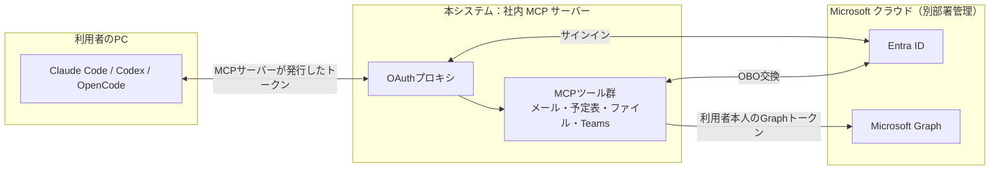
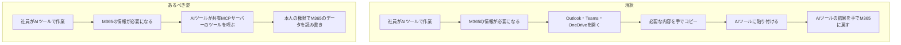
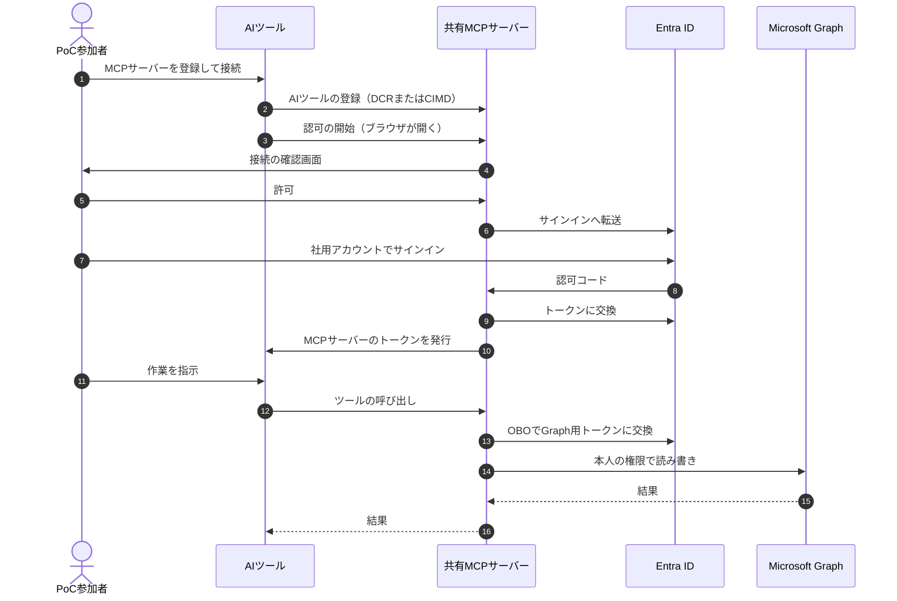

# 要件定義書：社内共有 M365 MCP サーバー（FastMCP / PoC）

- 作成日：2026-10-31（isdd 形式で作り直し）
- 対象読者：実装を担当する AI エージェント（Claude Code など）と開発者
- 関連資料：
  - 依頼資料・OAuth プロキシ仕様：`docs/related_materials.md`（第1部が依頼資料、第2部がプロキシ仕様）
  - 外部連携の事前確認：`external/entra-id/docs/precheck_report.md`、`external/microsoft-graph/docs/precheck_report.md`
  - 詳細設計書：`docs/detail_design.md`
- 旧版からの移行：各表の「旧 ID」列に、作り直す前の要件仕様書の番号（`RQ-001`、`NF-001`、`CN-001`、`AC-001`、`PR-001`、`PP-001` など）を書いた

---

## 1. 目的・前提

### システムの目的

社内に共有の MCP サーバーを 1 つ置き、社員が Claude Code・Codex・OpenCode から、利用者本人の権限で Microsoft 365 のデータ（メール、予定表、SharePoint/OneDrive、Teams）を読み書きできることを PoC で確かめる。

### 範囲

| 区分 | 内容 |
|---|---|
| 対象 | OAuth プロキシの設定、Graph を呼ぶ MCP ツール群、設定の読み込み、テスト、各 AI ツールからの接続手順書 |
| 対象 | メール、予定表、SharePoint/OneDrive、Teams の読み取りと書き込み（依頼資料 P-5 の権限の範囲） |
| 対象外 | Entra ID の設定作業（別部署が行う。依頼資料 P-1〜P-8） |
| 対象外 | Open WebUI からの利用 |
| 対象外 | 依頼資料 P-5 に無い権限を必要とする機能（必要になった場合は、権限の追加依頼から行う） |

### 全体像

### 用語集

| 用語 | 業務上の意味 | 本案件での使用範囲 | 同義語/類義語 |
|---|---|---|---|
| AI ツール | 利用者の PC で動き、MCP サーバーに接続して機能を使うツール | Claude Code・Codex・OpenCode の 3 つ | MCP クライアント |
| MCP（Model Context Protocol） | AI ツールが外部のシステムやデータを呼び出すための共通の接続方式 | Streamable HTTP で使う | — |
| MCP サーバー | AI ツールに機能（ツール）を提供するサーバー | 本システム。社内に置き、全員で共有する | 共有 MCP サーバー |
| ツール | MCP サーバーが AI ツールに提供する、1 つの操作（例：メールを一覧する） | 3-0 のツール一覧のとおり | MCP ツール |
| PoC 参加者 | Entra ID のエンタープライズ アプリで、本システムに割り当てられた社員 | 本システムを使える人 | 利用者 |
| 委任アクセス | アプリが「サインインした利用者本人として」データにアクセスする方式。本人に権限の無いデータは見えない | Graph の呼び出しはすべてこの方式 | 委任された権限 |
| OAuth プロキシ | MCP サーバーの入口で、Entra ID へのサインインを仲介し、MCP サーバー独自のトークンを AI ツールに発行する仕組み | FastMCP の `AzureProvider` | — |
| MCP サーバーのトークン | OAuth プロキシが AI ツールに発行するアクセストークンとリフレッシュトークン | AI ツールが持つのはこれだけ | FastMCP トークン |
| OBO（On-Behalf-Of） | 利用者の Entra のトークンを Entra ID に示して、Graph 用のトークンに交換する仕組み | ツールの呼び出しのたびに使う | — |
| DCR（動的クライアント登録） | AI ツールが MCP サーバーに自分を自動で登録する方式 | — | — |
| CIMD（クライアント ID メタデータ文書） | AI ツールが、自分の情報を置いた HTTPS の URL をクライアント ID として使う方式 | — | — |
| 割り当て | Entra ID で、指定したユーザー・グループ以外がアプリにサインインできないようにする設定 | PoC 参加者の限定に使う | 割り当てが必要 |
| 管理者同意 | 組織全体として、アプリに権限を与えることを管理者が承認する操作 | 依頼資料 P-6 | — |
| カーソル | 一覧の続きを取得するための値。前回の応答で返し、次の要求で渡す | 一覧系のツール | next_cursor |

### システムの形態

Web API（MCP の Streamable HTTP で、AI ツールにツールを提供する）。画面は持たない。サインインの途中で、利用者のブラウザに接続の確認画面を出す（FastMCP が提供する画面をそのまま使う）。

### 実装を担当する AI エージェントへのルール

- 設定で変えられるとした値（5 章「未確定の値を設定で変えられる」）は、実装で値を決めない。未設定のときは FastMCP の既定値に任せる。
- 本書に無い機能・制限・方針を足さない。必要だと思った場合は、提案として報告する。
- FastMCP・Microsoft Graph・Entra ID の仕様は、推測せず、公式ドキュメントかソースコードで確かめてから実装する。
- 要件 ID・設計 ID とコードの対応は、対応表 `docs/trace_map.md` に記録する。コード（コメントを含む）には ID を書かない。

### 1-1. 技術制約

| 制約項目 | 内容 | 出どころ（誰がいつ答えたか） |
|---|---|---|
| 既存コードベース | 無い | リポジトリの中身（2026-10-31 確認） |
| 実装の方式 | FastMCP（Python）。認証は `AzureProvider`、Graph 用のトークンは `EntraOBOToken` で取得する。Entra ID の委任アクセスだけを使い、アプリケーション権限は使わない。`EntraOBOToken` は azure-identity の非同期版を使うため aiohttp が要る（`fastmcp[azure]` には含まれないので、別に依存へ足す） | 旧要件仕様書の前提 PR-002・PR-003（ユーザー作成） |
| 配備先 | 社内に置く共有の HTTP サーバー（各自の PC では動かさない）。コンテナで動かし、本番も docker compose で 1 台のサーバー上で起動する | 旧要件仕様書 PR-001、ユーザー回答（2026-10-31） |
| チームの技術 | 特に無い（Python が扱えればよく、禁止されている技術も無い） | ユーザー回答（2026-10-31） |
| ライセンスとコスト | 無料の OSS だけを使う。ライセンスの種類は問わない。追加費用はなし | ユーザー回答（2026-10-31） |
| 性能と規模の目安 | 本番を想定すると約 1 万人。PoC は PoC 参加者のみ。PoC では 1 万人の負荷は確かめない | 旧要件仕様書 PR-008、ユーザー回答（2026-10-31） |
| Entra ID の設定 | アプリ登録・権限・管理者同意・割り当ては別部署が行い、本システムはその値を設定で受け取る（依頼資料 P-1〜P-8） | 旧要件仕様書 PR-006 |
| サーバー証明書 | 社内の認証局（または担当部署）が発行した証明書を使う。社用 PC は社内の認証局を信頼している前提 | ユーザー回答（2026-10-31） |

---

## 2. 業務

### 対象業務一覧

| RQ-BZ-ID | 業務名 | 業務の範囲 | 担当者 |
|---|---|---|---|
| `RQ-BZ-M365-DATA-WORK` | M365 のデータを AI ツールで扱う日常業務 | 社員が、メール・予定表・ファイル（OneDrive・SharePoint）・Teams の情報を、AI ツール（Claude Code・Codex・OpenCode）で読み書きする作業 | 社員（PoC では PoC 参加者） |

### 業務フロー

### 2-1. 業務の問題（あるべき姿と現状のギャップ）

| 問題 | 対象業務（RQ-BZ） | あるべき姿 | 現状 | ギャップ（KPI） | 業務影響 |
|---|---|---|---|---|---|
| AI ツールから M365 のデータを直接扱えない | `RQ-BZ-M365-DATA-WORK` | AI ツールが、利用者本人の権限のまま M365 のデータを直接読み書きでき、手でのコピーが要らない | 手段が無く、必要な内容を手でコピーして AI ツールに貼っている。または AI ツールで扱っていない | 未測定 | コピーと貼り付けの手間がかかる。M365 のデータを使う作業に AI ツールを使えていない |

### 2-2. 業務課題一覧

| RQ-BK-ID | 業務課題（取り組むこと） | 解決する問題（2-1） | 解決後の状態（KPI の目標値） | 対象業務（RQ-BZ） |
|---|---|---|---|---|
| `RQ-BK-SHARED-M365-MCP-POC` | 共有 MCP サーバーを置き、PoC 参加者が AI ツールから、本人の権限で M365 のデータを手でコピーせずに読み書きできるかを確かめる | AI ツールから M365 のデータを直接扱えない | PoC 参加者が、手でコピーせずに AI ツールから M365 のデータを扱える。7 章のテスト用利用シナリオをすべて満たす | `RQ-BZ-M365-DATA-WORK` |

### 2-3. 見込み経営効果

見込み経営効果は算定しない（業務の問題の大きさが未測定のため）。

---

## 3. 機能要件

### 入力データと出力データ

| 区分 | 内容 |
|---|---|
| 入力（AI ツールから） | ツールの引数（3-0 のツール一覧） |
| 入力（外部連携） | Entra ID のトークン、Microsoft Graph の応答 |
| 出力（AI ツールへ） | ツールの結果（Graph の応答の項目）、一覧の続きを示すカーソル、エラーのメッセージ |
| 出力（外部連携） | Microsoft Graph への読み書きの要求 |

### ユーザー利用フロー

業務フローとの対応：上の 11〜16 が、業務フローの「AI ツールが共有 MCP サーバーのツールを呼ぶ」「本人の権限で M365 のデータを読み書き」に当たる。1〜10 は初回と、トークンの更新ができなくなったときだけ行う。

### 3-0. Web API

| RQ-ID | API | 用途 | 入力 | 出力 | 利用者 | 対応業務課題ID（RQ-BK-*） |
|---|---|---|---|---|---|---|
| `RQ-UI-MCP-ENDPOINT` | MCP の受け口（Streamable HTTP） | ツールの一覧の取得と、ツールの呼び出し | MCP の要求と、MCP サーバーのアクセストークン。ツールごとの引数は下のツール一覧 | ツールの結果。エラー時は、AI ツールが理解できるメッセージ（3-2 のエラーの伝え方） | AI ツール | `RQ-BK-SHARED-M365-MCP-POC` |
| `RQ-UI-OAUTH-ENDPOINTS` | OAuth の受け口 | 認可サーバー・保護リソースのメタデータ、AI ツールの登録（DCR）、認可の開始と接続の確認画面、Entra ID からの戻り先（`/auth/callback`）、トークンの発行と更新 | OAuth 2.1（認可コード＋PKCE、DCR、CIMD）の要求 | メタデータ、クライアント ID、MCP サーバーのトークン。エラー時は OAuth のエラー応答 | AI ツール、利用者のブラウザ、Entra ID | `RQ-BK-SHARED-M365-MCP-POC` |

**ツール一覧**（MCP の受け口で提供するツールの内訳）

- 一覧系のツールは、共通の引数として「件数の上限（既定 25、1 以上。最大 100 で、最大値は設定で変更可）」と「カーソル（任意）」を受け取り、結果と、続きがある場合のカーソルを返す（3-2「一覧の件数と続き」）。
- 一覧の結果は、下の「一覧で返す項目」の表の項目だけを返す。一覧以外の結果は、Graph の応答の項目をそのまま返す。
- ドライブの指定を省略したときは、本人の OneDrive を対象にする。

| ツール名 | 機能 | 主な入力（必須は ○） | 出力 |
|---|---|---|---|
| `me_get_profile` | プロフィールの取得 | なし | 本人のプロフィール |
| `mail_list_folders` | メールフォルダーの一覧 | 親フォルダー（省略時はいちばん上の階層）、共通の引数 | フォルダーの一覧 |
| `mail_list_messages` | メールの一覧・検索 | フォルダー、検索語、絞り込み条件（検索語とは同時に指定できない）、共通の引数 | メールの一覧 |
| `mail_get_message` | メールの取得 | メール ○ | メールの本文と、添付ファイルの一覧（名前・種類・サイズ） |
| `mail_create_draft` | 下書きの作成 | 宛先、CC、BCC、件名、本文、本文の種類（テキスト / HTML） | 作成した下書き |
| `mail_update_draft` | 下書きの更新 | 下書き ○、変更する項目（作成と同じ） | 更新した下書き |
| `mail_send` | メールの新規送信 | 宛先 ○、CC、BCC、件名 ○、本文 ○、本文の種類 | 送信できたかどうか |
| `mail_send_draft` | 下書きの送信 | 下書き ○ | 送信できたかどうか |
| `mail_reply` | 返信 | メール ○、返信の本文 ○ | 送信できたかどうか |
| `mail_reply_all` | 全員に返信 | メール ○、返信の本文 ○ | 送信できたかどうか |
| `mail_forward` | 転送 | メール ○、宛先 ○、添える本文 | 送信できたかどうか |
| `mail_move` | メールの移動 | メール ○、移動先のフォルダー ○ | 移動後のメール |
| `mail_update_flags` | 既読・フラグの変更 | メール ○、既読かどうか、フラグ（付ける / 完了 / 外す）のどちらか 1 つ以上 | 更新後のメール |
| `mail_delete` | メールの削除 | メール ○ | 削除できたかどうか |
| `calendar_list_events` | 期間を指定した予定の一覧 | 開始日時 ○、終了日時 ○、タイムゾーン、共通の引数 | 予定の一覧 |
| `calendar_get_event` | 予定の取得 | 予定 ○、タイムゾーン | 予定の詳細 |
| `calendar_create_event` | 予定の作成 | 件名 ○、開始日時 ○、終了日時 ○、タイムゾーン、場所、参加者、本文 | 作成した予定 |
| `calendar_update_event` | 予定の変更 | 予定 ○、変更する項目（作成と同じ） | 変更後の予定 |
| `calendar_delete_event` | 予定の削除 | 予定 ○ | 削除できたかどうか |
| `calendar_respond_event` | 会議の招待への返答 | 予定 ○、返答（承諾 / 仮承諾 / 辞退）○、コメント、主催者に返答を送るか | 返答できたかどうか |
| `files_list_children` | フォルダーの中身の一覧 | ドライブ、フォルダー（省略時はルート）、共通の引数 | ファイル・フォルダーの一覧 |
| `files_search` | ファイルの検索 | 検索語 ○、ドライブ、共通の引数 | ファイル・フォルダーの一覧 |
| `files_get_item` | ファイルの情報の取得 | ドライブ、ファイル ○ | ファイルの情報 |
| `files_get_content` | ファイルの内容の取得 | ドライブ、ファイル ○ | テキストとして読める種類で上限以下ならその内容、それ以外は種類とサイズ（3-2「ファイルの内容を返す上限」） |
| `files_upload` | ファイルのアップロード（作成・上書き） | ドライブ、親フォルダー ○、ファイル名 ○、内容 ○、内容の符号化（テキスト / base64）○ | 作成・上書きしたファイルの情報 |
| `files_create_folder` | フォルダーの作成 | ドライブ、親フォルダー ○、フォルダー名 ○ | 作成したフォルダーの情報。同じ名前のものがあればエラー |
| `files_move_or_rename` | 名前の変更・移動 | ドライブ、ファイルまたはフォルダー ○、新しい名前、移動先のフォルダーのどちらか 1 つ以上 | 変更後の情報 |
| `files_delete` | ファイル・フォルダーの削除 | ドライブ、ファイルまたはフォルダー ○ | 削除できたかどうか |
| `sites_search` | SharePoint サイトの検索 | 検索語 ○、共通の引数 | サイトの一覧 |
| `sites_list_drives` | サイトのドキュメントライブラリの一覧 | サイト ○、共通の引数 | ドキュメントライブラリ（ドライブ）の一覧 |
| `teams_list_chats` | 参加しているチャットの一覧 | 共通の引数 | チャットの一覧 |
| `teams_list_chat_messages` | チャットのメッセージの取得 | チャット ○、共通の引数 | メッセージの一覧（本文の種類をそのまま返す） |
| `teams_send_chat_message` | チャットへの投稿 | チャット ○、本文 ○、本文の種類（テキスト / HTML） | 投稿したメッセージ |
| `teams_list_joined_teams` | 参加しているチームの一覧 | 共通の引数 | チームの一覧 |
| `teams_list_channels` | チャネルの一覧 | チーム ○、共通の引数 | チャネルの一覧 |
| `teams_list_channel_messages` | チャネルのメッセージの取得 | チーム ○、チャネル ○、共通の引数 | メッセージの一覧 |
| `teams_list_message_replies` | チャネルのメッセージへの返信の取得 | チーム ○、チャネル ○、メッセージ ○、共通の引数 | 返信の一覧 |
| `teams_send_channel_message` | チャネルへの投稿 | チーム ○、チャネル ○、本文 ○、本文の種類 | 投稿したメッセージ |
| `teams_reply_channel_message` | チャネルのメッセージへの返信 | チーム ○、チャネル ○、メッセージ ○、本文 ○、本文の種類 | 投稿した返信 |

エラー時の応答は、全ツール共通で 3-2「エラーの伝え方」に従う。

**一覧で返す項目**

| ツール | 返す項目 |
|---|---|
| `mail_list_folders` | ID、表示名、親フォルダー、下のフォルダーの数、未読の数、全体の数 |
| `mail_list_messages` | ID、件名、差出人、受信日時、既読かどうか、フラグ、添付の有無、本文の冒頭（プレビュー） |
| `calendar_list_events` | ID、件名、開始日時、終了日時、終日かどうか、場所、主催者、自分の返答の状態、取り消されたかどうか、本文の冒頭（プレビュー） |
| `files_list_children`、`files_search` | ID、名前、種類（ファイル / フォルダー、ファイルなら MIME の種類）、サイズ、最終更新日時、Web の URL、親フォルダーとドライブ |
| `sites_search` | ID、表示名、名前、Web の URL、説明 |
| `sites_list_drives` | ID、名前、ドライブの種類、Web の URL |
| `teams_list_chats` | ID、題名、チャットの種類、最終更新日時、Web の URL |
| `teams_list_joined_teams` | ID、表示名、説明 |
| `teams_list_channels` | ID、表示名、説明、チャネルの種類 |
| `teams_list_chat_messages`、`teams_list_channel_messages`、`teams_list_message_replies` | ID、返信先のメッセージ、作成日時、最終更新日時、送信者、本文と本文の種類、メッセージの種類（Teams のメッセージには取得のツールが無いため、本文も返す） |

### 機能一覧

| RQ-ID | カテゴリ | 機能名 | 対応業務課題ID（RQ-BK-*） | この機能が無いと何が困るか | 旧 ID |
|---|---|---|---|---|---|
| `RQ-FT-REGISTER-AI-TOOL` | 共通（認証） | AI ツールの登録。DCR に対応し、CIMD の受け付けは設定で切り替えられる | `RQ-BK-SHARED-M365-MCP-POC` | AI ツールが、鍵の設定なしに MCP サーバーへつなげない | RQ-001、RQ-002 |
| `RQ-FT-RELAY-SIGN-IN` | 共通（認証） | 利用者のサインインを Entra ID に中継する。Entra ID からの戻り先は `{base_url}/auth/callback` | `RQ-BK-SHARED-M365-MCP-POC` | 本人であることを確かめられず、本人の権限で Graph を呼べない | RQ-003 |
| `RQ-FT-ISSUE-PROXY-TOKEN` | 共通（認証） | AI ツールに MCP サーバーのトークンだけを発行する。Entra・Graph のトークンは渡さない | `RQ-BK-SHARED-M365-MCP-POC` | Entra のトークンが PC に渡り、漏れたときに M365 を直接使われる | RQ-004 |
| `RQ-FT-REFRESH-TOKEN` | 共通（認証） | トークンを更新し、期限切れの後も再サインインなしで使い続けられる（Entra ID がリフレッシュトークンを返す場合） | `RQ-BK-SHARED-M365-MCP-POC` | 1 時間ほどごとに、ブラウザでサインインし直すことになる | RQ-009 |
| `RQ-FT-EXCHANGE-GRAPH-TOKEN` | 共通（認証） | ツールごとに必要な Graph の委任スコープを指定し、OBO で Graph 用のトークンを取得する。指定するスコープは、すべてサインイン時に要求するスコープに含める。※指定しても、得られるトークンの権限は絞られない（Entra ID は同意済みの Graph のスコープをすべて入れて返す）。指定は、ツールが使う権限を明示するためのもの | `RQ-BK-SHARED-M365-MCP-POC` | Graph を本人の権限で呼べない。要求していないスコープは同意が無く、交換が失敗する | RQ-007、RQ-008 |
| `RQ-FT-GET-MY-PROFILE` | 業務機能 | サインインした利用者のプロフィールを取得する（`User.Read`） | `RQ-BK-SHARED-M365-MCP-POC` | AI ツールが、誰として操作しているかを確かめられない | RQ-101 |
| `RQ-FT-LIST-MAIL-FOLDERS` | 業務機能 | メールフォルダーの一覧を取得する（`Mail.ReadWrite`） | `RQ-BK-SHARED-M365-MCP-POC` | フォルダーを指定した一覧・移動ができない | RQ-111 |
| `RQ-FT-LIST-MAIL-MESSAGES` | 業務機能 | メールを一覧・検索する（`Mail.ReadWrite`） | `RQ-BK-SHARED-M365-MCP-POC` | 必要なメールを探せず、手でコピーすることになる | RQ-112 |
| `RQ-FT-GET-MAIL-MESSAGE` | 業務機能 | メールの本文と添付ファイルの一覧を取得する（`Mail.ReadWrite`） | `RQ-BK-SHARED-M365-MCP-POC` | メールの中身を AI ツールで扱えない | RQ-113 |
| `RQ-FT-EDIT-MAIL-DRAFT` | 業務機能 | 下書きを作成・更新する（`Mail.ReadWrite`） | `RQ-BK-SHARED-M365-MCP-POC` | AI ツールの書いた文面を、送る前に Outlook で確かめられない | RQ-114 |
| `RQ-FT-SEND-MAIL` | 業務機能 | メールを送信する（新規・返信・全員に返信・転送、下書きの送信）（`Mail.Send`） | `RQ-BK-SHARED-M365-MCP-POC` | AI ツールの結果を、手で Outlook に戻して送ることになる | RQ-115 |
| `RQ-FT-ORGANIZE-MAIL` | 業務機能 | メールを移動する、既読・フラグを変更する、削除する（`Mail.ReadWrite`） | `RQ-BK-SHARED-M365-MCP-POC` | メールの整理を AI ツールから行えない | RQ-116 |
| `RQ-FT-LIST-CALENDAR-EVENTS` | 業務機能 | 期間を指定して予定を一覧する（`Calendars.ReadWrite`） | `RQ-BK-SHARED-M365-MCP-POC` | 予定を AI ツールで扱えず、手でコピーすることになる | RQ-121 |
| `RQ-FT-GET-CALENDAR-EVENT` | 業務機能 | 予定の詳細を取得する（`Calendars.ReadWrite`） | `RQ-BK-SHARED-M365-MCP-POC` | 予定の本文や参加者を AI ツールで扱えない | RQ-122 |
| `RQ-FT-EDIT-CALENDAR-EVENT` | 業務機能 | 予定を作成・変更・削除する（`Calendars.ReadWrite`） | `RQ-BK-SHARED-M365-MCP-POC` | AI ツールの結果を、手で予定表に戻すことになる | RQ-123 |
| `RQ-FT-RESPOND-CALENDAR-INVITE` | 業務機能 | 会議の招待に返答する（承諾・仮承諾・辞退）（`Calendars.ReadWrite`） | `RQ-BK-SHARED-M365-MCP-POC` | 招待への返答を AI ツールから行えない | RQ-124 |
| `RQ-FT-LIST-DRIVE-ITEMS` | 業務機能 | OneDrive・ドキュメントライブラリのフォルダーの中身を一覧する（`Files.ReadWrite.All`） | `RQ-BK-SHARED-M365-MCP-POC` | ファイルを探して AI ツールで扱えない | RQ-131 |
| `RQ-FT-SEARCH-FILES` | 業務機能 | ファイルを検索する（`Files.ReadWrite.All`） | `RQ-BK-SHARED-M365-MCP-POC` | 場所が分からないファイルを AI ツールで探せない | RQ-132 |
| `RQ-FT-GET-FILE` | 業務機能 | ファイルの情報と内容を取得する（`Files.ReadWrite.All`） | `RQ-BK-SHARED-M365-MCP-POC` | ファイルの中身を手でコピーすることになる | RQ-133 |
| `RQ-FT-UPLOAD-FILE` | 業務機能 | ファイルをアップロード（作成・上書き）する。内容はテキスト、または base64 で符号化したバイナリとして受け取る（`Files.ReadWrite.All`） | `RQ-BK-SHARED-M365-MCP-POC` | AI ツールが作ったファイルを、手で OneDrive・SharePoint に置くことになる | RQ-134 |
| `RQ-FT-MANAGE-DRIVE-ITEMS` | 業務機能 | フォルダーを作成する、名前の変更・移動・削除をする（`Files.ReadWrite.All`） | `RQ-BK-SHARED-M365-MCP-POC` | ファイルの整理を AI ツールから行えない | RQ-135 |
| `RQ-FT-FIND-SHAREPOINT-SITES` | 業務機能 | SharePoint のサイトを検索し、サイトのドキュメントライブラリを一覧する（`Sites.ReadWrite.All`） | `RQ-BK-SHARED-M365-MCP-POC` | SharePoint のファイルを扱うときに、対象のドライブを特定できない | RQ-136 |
| `RQ-FT-READ-TEAMS-CHATS` | 業務機能 | 参加しているチャットを一覧し、メッセージを取得する（`Chat.ReadWrite`） | `RQ-BK-SHARED-M365-MCP-POC` | チャットの内容を手でコピーすることになる | RQ-141 |
| `RQ-FT-POST-TEAMS-CHAT-MESSAGE` | 業務機能 | チャットにメッセージを投稿する（`ChatMessage.Send`） | `RQ-BK-SHARED-M365-MCP-POC` | AI ツールの結果を、手でチャットに貼ることになる | RQ-142 |
| `RQ-FT-LIST-TEAMS-CHANNELS` | 業務機能 | 参加しているチーム・チャネルを一覧する（`Team.ReadBasic.All`・`Channel.ReadBasic.All`） | `RQ-BK-SHARED-M365-MCP-POC` | チャネルのメッセージを扱うときに、対象を特定できない | RQ-143 |
| `RQ-FT-READ-CHANNEL-MESSAGES` | 業務機能 | チャネルのメッセージと返信を取得する（`ChannelMessage.Read.All`） | `RQ-BK-SHARED-M365-MCP-POC` | チャネルの内容を手でコピーすることになる | RQ-144 |
| `RQ-FT-POST-CHANNEL-MESSAGE` | 業務機能 | チャネルにメッセージを投稿する、返信する（`ChannelMessage.Send`） | `RQ-BK-SHARED-M365-MCP-POC` | AI ツールの結果を、手でチャネルに貼ることになる | RQ-145 |

- マスタ管理の機能は無い（本システムはマスタを持たない）。
- 認可（ロールごとの権限）の機能は無い。データ単位の権限は M365 側の権限に従う（5 章「本人の委任アクセスだけ」）。
- ログの機能は、一般的な動作ログ・エラーログだけ（6 章）。

### 3-1. 帳票・出力ファイル

帳票・出力ファイルは無い。

### 3-2. 業務ルール

| RQ-ID | ルール名 | 内容（条件と結果） | 違反時・エラー時の業務上の扱い | 対応業務課題ID（RQ-BK-*） | この要件が無いと何が困るか | 旧 ID |
|---|---|---|---|---|---|---|
| `RQ-FT-PAGINATE-LIST-RESULTS` | 一覧の件数と続き | 一覧系のツールは、引数で指定した件数の上限を超えて返さない。件数の上限が最大値（既定 100、設定で変更可）を超える場合は最大値として扱う。続きがある場合はカーソルを返し、取得の途中で M365 側のデータが変わらない限り、そのカーソルで続きを取ると取りこぼしも重複も無い（Graph はページングの一貫性を保証していないため、途中で変わった場合は Graph の動作に従う） | カーソルが不正（本システムが返したものでない）なら、エラーとして返す | `RQ-BK-SHARED-M365-MCP-POC` | 大量の結果で AI ツールの入力があふれる。続きを取れないか、取りこぼしが出る。最大値は、ユーザーの選択（理由: 設定で変えられるようにしてください） | RQ-191 |
| `RQ-FT-REPORT-ERRORS-READABLY` | エラーの伝え方 | Graph のエラーと、Graph 用のトークンの取得（OBO）の失敗は、原因の種類（再サインインが必要、権限が無い、見つからない、混雑、入力が不正、上限を超えた）が AI ツールに分かるメッセージで返す。メッセージにトークンなどの秘密情報を含めない | ツールは失敗として結果を返し、AI ツールが次の行動（再サインイン、入力の修正など）を判断できるようにする | `RQ-BK-SHARED-M365-MCP-POC` | AI ツールが失敗の理由を判断できず、利用者に伝えられない | RQ-192 |
| `RQ-FT-LIMIT-FILE-CONTENT-SIZE` | ファイルの内容を返す上限 | ファイルの内容が上限（既定 100 KB。設定で変更可）を超える場合、内容を返さず、種類とサイズだけを返す | 上限を超えたことを結果に書き、AI ツールに伝える | `RQ-BK-SHARED-M365-MCP-POC` | ユーザーの選択（理由: 値を変えられるようにしておきたい）。上限が無いと、AI ツールの側で黙って切り詰められ、結果が分かりにくくなる | PP-002 |
| `RQ-FT-LIMIT-UPLOAD-SIZE` | アップロードで受け取る上限 | アップロードで受け取る内容（base64 の場合は復号した後）が上限（既定 1 MB。設定で変更可）を超える場合、Graph に送らずエラーにする。base64 として復号できない場合もエラーにする | 上限を超えたこと、または復号できなかったことを、エラーのメッセージで返す | `RQ-BK-SHARED-M365-MCP-POC` | 誤って巨大なデータや壊れたデータを送らせてしまう | PP-005 |

### 3-3. 外部連携

| RQ-ID | 連携先 | 方向（取得 / 送信 / 受信） | やり取りするデータ | タイミング | 対応業務課題ID（RQ-BK-*） |
|---|---|---|---|---|---|
| `RQ-EX-SIGN-IN-WITH-ENTRA-ID` | Microsoft Entra ID | 送信・受信 | サインインの要求、認可コード、アクセストークン・リフレッシュトークン（v2 形式）、公開鍵 | 初回のサインイン、トークンの更新、トークンの検証 | `RQ-BK-SHARED-M365-MCP-POC` |
| `RQ-EX-EXCHANGE-TOKEN-WITH-ENTRA-OBO` | Microsoft Entra ID | 送信・受信 | 利用者の Entra のトークン、Graph 用のトークン | ツールの呼び出しのたび（キャッシュがあれば省略） | `RQ-BK-SHARED-M365-MCP-POC` |
| `RQ-EX-CALL-MICROSOFT-GRAPH` | Microsoft Graph（v1.0） | 取得・送信 | メール、予定表、ファイル、SharePoint サイト、Teams のデータ | ツールの呼び出しのたび | `RQ-BK-SHARED-M365-MCP-POC` |
| `RQ-EX-USE-LOCAL-HTTP-MOCK` | Microsoft Entra ID の模擬 | — | サインイン、トークンの発行・更新、公開鍵、OBO を手元の HTTPS サーバーで再現する（E2E の日常の実行に使う） | E2E テストの実行時 | `RQ-BK-SHARED-M365-MCP-POC` |
| `RQ-EX-USE-MOCK-SERVER-TOOL` | Microsoft Graph の模擬 | — | 既存の模擬ツール（Microsoft Dev Proxy）で、ツールが呼ぶ Graph の応答を差し替える（E2E の日常の実行に使う） | E2E テストの実行時 | `RQ-BK-SHARED-M365-MCP-POC` |

- 本物の Entra ID と Graph での確認は、依頼済みの PoC 用テナントで行う（7 章）。

---

## 4. データ

### 4-1. データ要件一覧

| RQ-ID | 種別 | 内容 | 対応業務課題ID（RQ-BK-*） | この要件が無いと何が困るか |
|---|---|---|---|---|
| `RQ-DT-NO-APP-DATABASE` | DB の必要性 | DB は持たない。業務のデータは M365 側にあり、本システムは Graph を通して読み書きするだけ | `RQ-BK-SHARED-M365-MCP-POC` | 不要な DB の設計・運用が生まれる |
| `RQ-DT-NO-M365-DATA-RETENTION` | 外部データの保持 | Graph から取得したデータと Graph 用のトークンは、要求の処理中にメモリ上で扱うだけで、保管しない | `RQ-BK-SHARED-M365-MCP-POC` | M365 のデータの複製がサーバーに残り、漏洩の範囲が広がる |
| `RQ-DT-AUTH-STATE-STORAGE` | 内部データ | AI ツールの登録情報、認可の途中の状態、利用者の Entra のトークンは、FastMCP の保管先に暗号化して保管する。保持期間は FastMCP と Entra ID の有効期限に従う。保管先は既定の暗号化ディスクで、設定で共有の保管先（Redis）に差し替えられる | `RQ-BK-SHARED-M365-MCP-POC` | 再起動のたびに全員がサインインし直すことになる。複数台で状態を共有できない |

### 4-2. 業務エンティティとデータ項目

| RQ-ID | カテゴリ | 業務エンティティ名 | 対応業務課題ID（RQ-BK-*） | この業務エンティティが無いと何が困るか |
|---|---|---|---|---|
| `RQ-DT-AI-TOOL-REGISTRATION` | 内部データ | AI ツールの登録情報 | `RQ-BK-SHARED-M365-MCP-POC` | AI ツールの戻り先を確かめられず、認可を進められない |
| `RQ-DT-USER-TOKEN-SET` | 内部データ | 利用者のトークンの組 | `RQ-BK-SHARED-M365-MCP-POC` | ツールの呼び出しのたびに、利用者の Entra のトークンを取り出せない |
| `RQ-DT-M365-USER-PROFILE` | 外部データ | 利用者のプロフィール | `RQ-BK-SHARED-M365-MCP-POC` | 誰として操作しているかを確かめられない |
| `RQ-DT-MAIL-FOLDER` | 外部データ | メールフォルダー | `RQ-BK-SHARED-M365-MCP-POC` | フォルダーを指定した操作ができない |
| `RQ-DT-MAIL-MESSAGE` | 外部データ | メール（下書きと添付ファイルの一覧を含む） | `RQ-BK-SHARED-M365-MCP-POC` | メールを扱えない |
| `RQ-DT-CALENDAR-EVENT` | 外部データ | 予定 | `RQ-BK-SHARED-M365-MCP-POC` | 予定を扱えない |
| `RQ-DT-DRIVE-ITEM` | 外部データ | ファイル・フォルダー（ドライブの項目） | `RQ-BK-SHARED-M365-MCP-POC` | ファイルを扱えない |
| `RQ-DT-SHAREPOINT-SITE` | 外部データ | SharePoint サイトと、そのドキュメントライブラリ | `RQ-BK-SHARED-M365-MCP-POC` | SharePoint のドライブを特定できない |
| `RQ-DT-TEAMS-CHAT` | 外部データ | Teams のチャット | `RQ-BK-SHARED-M365-MCP-POC` | チャットを特定できない |
| `RQ-DT-TEAMS-TEAM-CHANNEL` | 外部データ | Teams のチームとチャネル | `RQ-BK-SHARED-M365-MCP-POC` | チャネルを特定できない |
| `RQ-DT-TEAMS-MESSAGE` | 外部データ | Teams のメッセージ（チャット・チャネルのメッセージと返信） | `RQ-BK-SHARED-M365-MCP-POC` | Teams のメッセージを扱えない |

外部データのエンティティは、Graph v1.0 のリソースの定義に従い、本システムでは保管しない。下の表は、本システムが入力として受け取る項目と、識別に使う項目だけを書く。出力は Graph の応答の項目をそのまま返す。

| エンティティ名 | 項目名 | 業務上の意味 | 必須 | 形式・桁 | 値の範囲・制約 | 例 |
|---|---|---|---|---|---|---|
| AI ツールの登録情報 | クライアント ID | AI ツールを識別する値 | ○ | 文字列（DCR は MCP サーバーが払い出す。CIMD は HTTPS の URL） | — | `https://claude.ai/oauth/claude-code-client-metadata` |
| AI ツールの登録情報 | 戻り先 | 認可の後に戻る、利用者の PC 上の URL | ○ | URL | 危険なスキーム（`javascript:` など）は不可。戻り先を制限する設定があればそれに従う | `http://127.0.0.1:19876/mcp/oauth/callback` |
| 利用者のトークンの組 | Entra のアクセストークン | 利用者本人を表すトークン | ○ | v2 形式の JWT | 署名・発行者・宛先が正しいこと | — |
| 利用者のトークンの組 | Entra のリフレッシュトークン | アクセストークンの更新に使う | — | 文字列 | Entra ID が返した場合だけ | — |
| 利用者のトークンの組 | 有効期限 | アクセストークンの期限 | ○ | 日時 | Entra ID が返す値 | — |
| 共通（一覧） | 件数の上限 | 1 回に返す件数の上限 | — | 整数 | 1 以上。既定 25。最大 100（設定で変更可）。最大を超える値は最大値として扱う | 25 |
| 共通（一覧） | カーソル | 一覧の続きを取得するための値 | — | 文字列 | 本システムが前回返した値だけ | — |
| メールフォルダー | フォルダー、親フォルダー | 対象のフォルダー、一覧で下の階層を取るときの親 | — | Graph の ID | 親フォルダーを省略したときは、いちばん上の階層 | — |
| メール | メール | 対象のメール・下書き | 操作による | Graph の ID | — | — |
| メール | 宛先・CC・BCC | 送り先 | 送信・転送で宛先は ○ | メールアドレスの一覧 | メールアドレスの形式 | `user@example.com` |
| メール | 件名 | メールの件名 | 新規送信で ○ | 文字列 | — | 打ち合わせの件 |
| メール | 本文 | メールの本文 | 新規送信・返信で ○ | 文字列 | — | — |
| メール | 本文の種類 | 本文の形式 | — | 選択 | テキスト / HTML。既定はテキスト | テキスト |
| メール | 検索語 | メールを探す言葉 | — | 文字列 | 絞り込み条件と同時に指定できない（Graph は対応していない組み合わせを黙って無視することがあるため、事前に止める） | 見積 |
| メール | 絞り込み条件 | 既読・差出人などでの絞り込み | — | Graph の `$filter` の式 | 検索語と同時に指定できない | `isRead eq false` |
| メール | 既読かどうか・フラグ | メールの状態の変更 | どちらか 1 つ以上 | 真偽 / 選択 | フラグは 付ける / 完了 / 外す | — |
| 予定 | 予定 | 対象の予定 | 操作による | Graph の ID | — | — |
| 予定 | 開始日時・終了日時 | 一覧の期間、または予定の時間 | 一覧・作成で ○ | ISO 8601 の日時 | 終了日時は開始日時より後。タイムゾーンのオフセットが付いていない日時は、タイムゾーンの引数で解釈する（省略時は UTC） | `2026-11-04T10:00:00` |
| 予定 | タイムゾーン | 日時の解釈と、結果の表示に使うタイムゾーン | — | タイムゾーン名（IANA 形式） | 省略時は UTC。結果の表示に IANA 形式の名前を使えるかは、PoC 用テナントで確かめる | `Asia/Tokyo` |
| 予定 | 件名・場所・本文・参加者 | 予定の内容 | 作成で件名は ○ | 文字列 / メールアドレスの一覧 | — | — |
| 予定 | 返答 | 招待への返答 | 返答で ○ | 選択 | 承諾 / 仮承諾 / 辞退 | 承諾 |
| ファイル・フォルダー | ドライブ | 対象のドライブ | — | Graph の ID | 省略時は本人の OneDrive | — |
| ファイル・フォルダー | ファイル・フォルダー、親フォルダー、移動先のフォルダー | 対象の項目 | 操作による | Graph の ID | 移動先は同じドライブの中だけ（ドライブをまたいだ移動は Graph がエラーにする） | — |
| ファイル・フォルダー | ファイル名・フォルダー名・新しい名前 | 項目の名前 | 作成で ○ | 文字列 | OneDrive・SharePoint で使えない文字は Graph がエラーにする。アップロードで同じ名前のファイルがあれば上書きする。フォルダーの作成で同じ名前のものがあればエラーにする | 報告書.md |
| ファイル・フォルダー | 内容と内容の符号化 | アップロードする内容 | アップロードで ○ | 文字列と選択（テキスト / base64） | 復号後の大きさが上限以下 | — |
| ファイル・フォルダー | 検索語 | ファイルを探す言葉 | 検索で ○ | 文字列 | — | 議事録 |
| SharePoint サイト | サイト、検索語 | 対象のサイト、サイトを探す言葉 | 操作による | Graph の ID / 文字列 | — | — |
| Teams のチャット・チーム・チャネル | チャット、チーム、チャネル、メッセージ | 対象 | 操作による | Graph の ID | — | — |
| Teams のメッセージ | 本文・本文の種類 | 投稿する内容 | 投稿で本文は ○ | 文字列と選択（テキスト / HTML） | — | — |

### 4-3. CRUD テーブル

| エンティティ名 | Create | Read（一覧） | Read（詳細） | 検索 | Update | Delete | 備考 |
|---|---|---|---|---|---|---|---|
| AI ツールの登録情報 | ○ | × | ○ | × | × | × | DCR の登録時に作成し、認可のときに読む（FastMCP が行う） |
| 利用者のトークンの組 | ○ | × | ○ | × | ○ | × | サインイン時に作成し、ツールの呼び出しで読み、更新時に書き換える（FastMCP が行う）。同じ利用者の同時の更新は FastMCP の排他に任せる |
| 利用者のプロフィール | × | × | ○ | × | × | × | — |
| メールフォルダー | × | ○ | × | × | × | × | — |
| メール | ○ | ○ | ○ | ○ | ○ | ○ | 作成は下書き。検索は検索語か絞り込み条件のどちらか。更新は下書きの変更・移動・既読・フラグ。送信（新規・返信・転送・下書きの送信）も含む |
| 予定 | ○ | ○ | ○ | × | ○ | ○ | 一覧は期間の指定が必須。更新には招待への返答を含む |
| ファイル・フォルダー | ○ | ○ | ○ | ○ | ○ | ○ | 作成はアップロードとフォルダーの作成。更新は上書き・名前の変更・移動。検索は検索語で |
| SharePoint サイト | × | ○ | × | ○ | × | × | 一覧はサイトのドキュメントライブラリ。検索は検索語で |
| Teams のチャット | × | ○ | × | × | × | × | — |
| Teams のチームとチャネル | × | ○ | × | × | × | × | — |
| Teams のメッセージ | ○ | ○ | × | × | × | × | 作成はチャット・チャネルへの投稿と返信 |

- トランザクション（複数操作の一体完了）が要る操作は無い。各操作は Graph の 1 回の要求で完結する。

### 4-4. 状態遷移

本システムが状態を管理するエンティティは無い。メールの下書き・送信済み、招待への返答の状態は M365 側が持ち、本システムは操作を中継するだけ。

### 4-5. 画面一覧

画面は無い（システムの形態が Web API のため）。サインインの途中の接続の確認画面は FastMCP が提供するものを使い、本システムでは作らない。

---

## 5. 非機能要件

| RQ-ID | カテゴリ | 非機能要件名 | 内容・目標値・確かめ方 | 対応業務課題ID（RQ-BK-*） | この非機能要件が無いと何が困るか | 旧 ID |
|---|---|---|---|---|---|---|
| `RQ-NF-INTERNAL-NETWORK-ACCESS` | 利用者とアクセス経路 | 社内ネットワークからだけ使う | 利用者は Entra ID で割り当てられた PoC 参加者（社員）。経路は社内ネットワーク（VPN を含む）からだけ。社内ネットワークからつながることで確かめる | `RQ-BK-SHARED-M365-MCP-POC` | 公開を前提とした対策の要否が決まらない | PR-007 |
| `RQ-NF-MULTI-INSTANCE-READY` | 利用人数 | 複数台に切り替えられる | 設定の変更だけで、1 台構成と複数台構成を切り替えられる（署名鍵の明示、共有の保管先、MCP のセッションを持たない動作）。2 台で負荷分散した構成で、サインインとツールの呼び出しが通ることで確かめる | `RQ-BK-SHARED-M365-MCP-POC` | 本番想定の約 1 万人に向けて台数を増やすとき、作り直しになる | NF-005 |
| `RQ-NF-HTTPS-ONLY` | セキュリティ | HTTPS だけで受ける | AI ツールと利用者のブラウザから MCP サーバーへの通信は、すべて HTTPS にする。公開 URL は `https://` で始まる。`https://` の公開 URL で、サインインからツールの呼び出しまでが通ることで確かめる | `RQ-BK-SHARED-M365-MCP-POC` | Entra ID に戻り先を登録できない。トークンとクッキーが平文で流れる | （新規） |
| `RQ-NF-NO-KEY-DISTRIBUTION` | セキュリティ（認証方式） | 鍵を配らない | 利用者に鍵（API キーなど）を配らない。認証は Entra ID の SSO（OAuth 2.0 / OpenID Connect、v2）で、MCP サーバーが OAuth の認可サーバーとして振る舞う。3 つの AI ツールが、鍵の設定なしで接続できることで確かめる | `RQ-BK-SHARED-M365-MCP-POC` | 鍵の配布と失効の管理が要り、漏れたときに本人以外が使える | PR-004、RQ-001 |
| `RQ-NF-DELEGATED-ACCESS-ONLY` | セキュリティ（権限） | 本人の委任アクセスだけ | Graph は利用者本人の委任アクセスでだけ呼び、本人に権限の無いデータを返さない（Graph の権限判定に従う）。アプリケーション権限も、サーバー自身のアカウントで呼ぶ経路も作らない。利用者のトークンが無い場合は失敗させる。ロールは無い。利用者 A のトークンで利用者 B のデータが取れないことで確かめる | `RQ-BK-SHARED-M365-MCP-POC` | 本人に権限の無いデータが見えてしまう | PR-003、CN-002、CN-003、RQ-190 |
| `RQ-NF-NO-TOKEN-EXPOSURE` | セキュリティ | トークンを外に出さない | Entra・Graph のトークンを、AI ツール・ログ・エラーメッセージに出さない。AI ツール側の通信と設定ファイル、サーバーのログにトークンが現れないことで確かめる | `RQ-BK-SHARED-M365-MCP-POC` | トークンが漏れると、本人になりすまして M365 を使われる | RQ-004、CN-001 |
| `RQ-NF-TOKEN-VALIDATION` | セキュリティ | トークンを検証する | MCP の受け口は、有効な MCP サーバーのトークンが無い要求を拒む。Entra のトークンは、署名・発行者・宛先を確かめる。無効・偽造のトークンが拒否されることで確かめる | `RQ-BK-SHARED-M365-MCP-POC` | なりすました要求が通る | RQ-005、RQ-006 |
| `RQ-NF-SINGLE-TENANT` | セキュリティ | 特定のテナントだけ | 特定のテナント ID だけを受け付ける。`common` を設定すると起動しない | `RQ-BK-SHARED-M365-MCP-POC` | 他の組織のアカウントでサインインされる | CN-004 |
| `RQ-NF-SINGLE-REDIRECT-URI` | セキュリティ | Entra ID の戻り先は 1 件 | Entra ID に登録する戻り先は `{base_url}/auth/callback` の 1 件だけ。AI ツールごとの戻り先を Entra ID に登録する前提の作りにしない。AI ツールを足しても、Entra ID の設定を変えずに接続できることで確かめる | `RQ-BK-SHARED-M365-MCP-POC` | AI ツールを足すたびに別部署への依頼が要る | RQ-003、CN-005 |
| `RQ-NF-ENCRYPTED-STORAGE` | セキュリティ | 保管先を暗号化する | 保管先を差し替えられる作りにし、独自の保管先を使う場合は暗号化して使う。保管先の中身が平文で読めないことで確かめる | `RQ-BK-SHARED-M365-MCP-POC` | サーバーのディスクや Redis から、Entra のトークンが盗まれる | NF-004 |
| `RQ-NF-SECRETS-FROM-ENV` | セキュリティ | 秘密情報を環境変数から読む | クライアントシークレットなどの設定値は環境変数から読み、コード・テスト・リポジトリに書かない。リポジトリに秘密情報が無いことで確かめる（公開リポジトリのため必須） | `RQ-BK-SHARED-M365-MCP-POC` | 公開リポジトリからシークレットが漏れる | NF-002、AI-005 |
| `RQ-NF-STREAMABLE-HTTP` | 接続方式 | Streamable HTTP | MCP のトランスポートは Streamable HTTP。3 つの AI ツールから HTTP で接続できることで確かめる | `RQ-BK-SHARED-M365-MCP-POC` | 共有サーバーとして置けない | NF-001 |
| `RQ-NF-CONFIGURABLE-SETTINGS` | 保守性 | 未確定の値を設定で変えられる | まだ決まっていない値（MCP サーバーの URL、API の公開で作るスコープ名、保管先、署名鍵、接続の確認画面の出し方、AI ツールの戻り先の制限、CIMD の受け付け、トークンの有効期限、MCP のセッションを持たない動作）は環境変数で変えられ、未設定なら FastMCP の既定値を使う。未設定の値が FastMCP に渡らないことで確かめる | `RQ-BK-SHARED-M365-MCP-POC` | 値が決まるたびにコードの修正が要る | NF-003、U-1〜U-9 |
| `RQ-NF-GRAPH-RETRY` | 可用性 | Graph の一時的なエラーで再試行する | Graph の一時的なエラー（429・503）では、`Retry-After` に従って待って再試行する。回数は既定 3 回で、設定で変更可。429 の後に待ってから再試行することで確かめる | `RQ-BK-SHARED-M365-MCP-POC` | 一時的な混雑で、すぐ失敗になる | NF-006、PP-003、PP-006 |
| `RQ-NF-PINNED-VERSIONS` | 保守性 | 版を固定する | Python と FastMCP の版を固定する（FastMCP は 4.1.4 が 2026-10-31 時点の最新安定版。実装開始時に再確認する）。ロックファイルがあることで確かめる | `RQ-BK-SHARED-M365-MCP-POC` | 依存の更新で、知らないうちに動作が変わる | NF-007 |
| `RQ-NF-OFFLINE-UNIT-TEST` | 保守性 | 単体テストは接続なしで動く | 単体テストは、Graph と Entra ID に接続せずに実行できる。ネットワークを切っても単体テストが通ることで確かめる | `RQ-BK-SHARED-M365-MCP-POC` | テナントが無いと、テストが回せない | NF-008 |

- 応答時間の目標は設けない（Graph の応答に従う）。
- 可用性の要求は無い（PoC 中は止まってもよい）。
- 移行は無い（新規のシステム）。
- 監査証跡の改ざん防止は要らない（監査ログを持たないため。6 章）。

---

## 6. 運用要件

| RQ-ID | 種別 | 内容 | 対応業務課題ID（RQ-BK-*） | この要件が無いと何が困るか | 旧 ID |
|---|---|---|---|---|---|
| `RQ-OP-DOCKER-COMPOSE-STARTUP` | 起動 | 本番も開発も docker compose で、1 台のサーバー上で起動する | `RQ-BK-SHARED-M365-MCP-POC` | 起動の手順が環境ごとに違い、テストと本番で動作が変わる | （新規。技術制約の回答） |
| `RQ-OP-SERVER-CERTIFICATE` | 設定 | 社内の認証局が発行したサーバー証明書を、設定で渡して使う。更新のときは証明書を差し替えて再起動する | `RQ-BK-SHARED-M365-MCP-POC` | HTTPS で受けられない。証明書の期限が切れたときに差し替えられない | （新規。HTTPS の回答） |
| `RQ-OP-AI-TOOL-CONNECTION-GUIDE` | 手順書 | Claude Code・Codex・OpenCode のそれぞれについて、MCP サーバーの登録からサインインまでの接続手順書を用意する。AI ツールごとに、社内の認証局を信頼させる設定（Claude Code と OpenCode は `NODE_EXTRA_CA_CERTS`、Codex は `CODEX_CA_CERTIFICATE`）も載せる | `RQ-BK-SHARED-M365-MCP-POC` | PoC 参加者が接続できない | 旧 4 章「スコープ」 |

- ログは、一般的な動作ログ・エラーログだけにする（トークンは書かない。5 章「トークンを外に出さない」）。ログは必要ないため、ログの内容と保存期間の記述は行わない。
- 監査ログは持たない（利用の記録は Microsoft 365 側の監査ログに残る）。
- 監視・アラートは必要ないため、監視・アラートの内容と対応方法の記述は行わない。
- バックアップは必要ない（保管先が消えても、利用者がサインインし直すだけで済む）。

---

## 7. テスト用利用シナリオ

- E2E は、日常は模擬 Entra ID と模擬 Graph（3-3）で全シナリオを実行し、最終確認は依頼済みの PoC 用テナントで実データを使って行う。
- 前提条件の「PoC 参加者」は、模擬では模擬 Entra ID の利用者、PoC 用テナントでは割り当て済みの社員を指す。

| RQ-ID | テスト目的 | 前提条件 | テスト手順 | 期待される結果 | 対応業務課題ID（RQ-BK-*） | 旧 ID |
|---|---|---|---|---|---|---|
| `RQ-TS-VERIFY-KEYLESS-CONNECTION` | 3 つの AI ツールが、鍵なしで接続・サインインし、ツールを使えること | MCP サーバーが HTTPS で起動している。AI ツールに鍵を設定していない | Claude Code・Codex・OpenCode のそれぞれで、MCP サーバーを登録し、認証を始め、確認画面で許可し、Entra ID でサインインし、`me_get_profile` を呼ぶ | 3 つの AI ツールすべてで、本人のプロフィールが返る。DCR・CIMD のどちらで登録したかが記録される | `RQ-BK-SHARED-M365-MCP-POC` | AC-001 |
| `RQ-TS-VERIFY-USER-DATA-ISOLATION` | 利用者ごとにデータが分かれること | PoC 参加者 A・B がそれぞれサインインしている | A のトークンで、B のメール・予定・チャットを ID 指定で取得しようとする | 取得できず、見つからないか権限が無いことを示すエラーが返る（他人のデータが返らないことを確かめる。Graph が返すのが 403 か 404 かは問わない） | `RQ-BK-SHARED-M365-MCP-POC` | AC-002 |
| `RQ-TS-VERIFY-UNASSIGNED-USER-REJECTED` | 割り当ての無い利用者がサインインできないこと | 割り当てられていない社員のアカウントがある | その社員で接続とサインインを行う | Entra ID でサインインが拒否され、MCP サーバーのトークンが発行されない | `RQ-BK-SHARED-M365-MCP-POC` | AC-003 |
| `RQ-TS-VERIFY-MAIL-TOOLS` | メールのツールが期待どおり動くこと | PoC 参加者がサインインしている | フォルダーの一覧（いちばん上と、親フォルダーを指定した下の階層）→ メールの一覧・検索 → 取得 → 下書きの作成・更新 → 下書きの送信 → 新規送信・返信・全員に返信・転送 → 移動・既読・フラグ・削除の順に呼ぶ。検索語と絞り込み条件を同時に指定した呼び出しも行う | 各操作が M365 に反映される。同時指定はエラーになる | `RQ-BK-SHARED-M365-MCP-POC` | AC-004 |
| `RQ-TS-VERIFY-CALENDAR-TOOLS` | 予定表のツールが期待どおり動くこと | PoC 参加者がサインインしている。招待を受けた会議がある | 期間を指定した一覧（タイムゾーン指定あり・なし）→ 取得 → 作成・変更・削除 → 招待への承諾・仮承諾・辞退を呼ぶ | 各操作が M365 に反映され、タイムゾーンの指定が結果に反映される | `RQ-BK-SHARED-M365-MCP-POC` | AC-004 |
| `RQ-TS-VERIFY-FILE-TOOLS` | ファイルと SharePoint のツールが期待どおり動くこと | PoC 参加者がサインインしている。参加しているサイトがある | OneDrive のフォルダーの一覧 → 検索 → 情報と内容の取得（テキストと、それ以外の種類）→ テキストと base64 でのアップロードと上書き → フォルダーの作成（同じ名前での作成も行う）→ 名前の変更・移動・削除 → サイトの検索 → サイトのドキュメントライブラリの一覧 → そのライブラリでの一覧と取得を呼ぶ | 各操作が M365 に反映される。テキスト以外の種類は、種類とサイズだけが返る。同じ名前のフォルダーの作成はエラーになる | `RQ-BK-SHARED-M365-MCP-POC` | AC-004 |
| `RQ-TS-VERIFY-TEAMS-TOOLS` | Teams のツールが期待どおり動くこと | PoC 参加者がサインインしている。参加しているチャット・チーム・チャネルがある | チャットの一覧 → メッセージの取得 → 投稿 → チームの一覧 → チャネルの一覧 → メッセージと返信の取得 → 投稿と返信を呼ぶ | 各操作が Teams に反映され、本文の種類がそのまま返る | `RQ-BK-SHARED-M365-MCP-POC` | AC-004 |
| `RQ-TS-VERIFY-LIST-PAGINATION` | 一覧の件数と続きが正しいこと | 対象の一覧に、件数の上限より多い項目がある | 件数の上限を小さくして一覧を呼び、返ったカーソルで最後まで続きを取る。最大値を超える件数の上限でも呼ぶ。本システムが返していないカーソルでも呼ぶ。`$top` に対応しない一覧（参加しているチーム）でも同じことを行う | 各回の件数が上限以下で、全回を合わせると取りこぼし・重複が無い。最大値を超える指定は最大値までしか返らない。一覧の結果は「一覧で返す項目」の項目だけになる。不正なカーソルはエラーになる | `RQ-BK-SHARED-M365-MCP-POC` | （新規。業務ルール） |
| `RQ-TS-VERIFY-SIZE-LIMITS` | ファイルの内容とアップロードの上限が働くこと | 上限の値を既定のまま、および設定で変えた状態で起動できる | 上限を超えるテキストファイルの内容を取得する。上限を超える内容と、base64 として壊れた内容をアップロードする。上限の設定を変えて同じことを行う | 内容の取得は種類とサイズだけが返る。アップロードはエラーになり、Graph に送られない。設定を変えると、その値で判定される | `RQ-BK-SHARED-M365-MCP-POC` | （新規。業務ルール） |
| `RQ-TS-VERIFY-ERROR-MESSAGES` | エラーの原因が AI ツールに分かること | 模擬で、Graph の 401・403・404・429・503 と、OBO の失敗を起こせる | それぞれのエラーが起きる状態でツールを呼ぶ。429 は、`Retry-After` の後に成功する場合と、再試行の回数を使い切る場合の両方を行う | 原因の種類が分かるメッセージが返り、トークンを含まない。429 は待ってから再試行し、回数を使い切ると混雑のエラーになる | `RQ-BK-SHARED-M365-MCP-POC` | （新規。業務ルール） |
| `RQ-TS-VERIFY-INVALID-TOKEN-REJECTED` | 無効なトークンが拒否されること | MCP サーバーが起動している | トークンなし、期限切れ、署名が不正なトークンで、MCP の受け口を呼ぶ | すべて拒否され、ツールは実行されない | `RQ-BK-SHARED-M365-MCP-POC` | （新規。非機能要件） |
| `RQ-TS-VERIFY-TOKEN-REFRESH` | 期限切れの後も、再サインインなしで使い続けられること | PoC 参加者がサインインしている | アクセストークンの期限が切れるまで待ち（模擬では期限を短くする）、ツールを呼ぶ | ブラウザでのサインインなしに、ツールの結果が返る | `RQ-BK-SHARED-M365-MCP-POC` | AC-005 |
| `RQ-TS-VERIFY-NO-TOKEN-EXPOSURE` | Entra・Graph のトークンが外に出ないこと | 上のシナリオを実行した後 | AI ツール側の通信の記録と設定ファイル、サーバーのログ、エラーメッセージを調べる | Entra・Graph のトークンが現れない | `RQ-BK-SHARED-M365-MCP-POC` | AC-006 |
| `RQ-TS-VERIFY-MULTI-INSTANCE` | 複数台の構成で動くこと | 2 台を負荷分散した構成を、設定だけで起動できる | 2 台の構成で、接続・サインイン・ツールの呼び出し・トークンの更新を行う | 振り分け先の台にかかわらず、すべて成功する | `RQ-BK-SHARED-M365-MCP-POC` | （新規。非機能要件） |
| `RQ-TS-VERIFY-RESTART-KEEPS-SIGN-IN` | 再起動してもサインインの状態が保たれること | PoC 参加者がサインインしている。保管先を永続化している | MCP サーバーを再起動してから、ツールを呼ぶ | サインインし直さずに、ツールの結果が返る | `RQ-BK-SHARED-M365-MCP-POC` | プロキシ仕様 T-7 |
| `RQ-TS-VERIFY-OFFLINE-UNIT-TESTS` | 単体テストが接続なしで通ること | ネットワークを切った環境 | 単体テストを全件実行する | 全件が通る | `RQ-BK-SHARED-M365-MCP-POC` | AC-007 |

---

## 8. 業務課題と要件の対応表

| RQ-BK-ID | 対応する要件 |
|---|---|
| `RQ-BK-SHARED-M365-MCP-POC` | `RQ-UI-MCP-ENDPOINT`、`RQ-UI-OAUTH-ENDPOINTS`、`RQ-FT-REGISTER-AI-TOOL`、`RQ-FT-RELAY-SIGN-IN`、`RQ-FT-ISSUE-PROXY-TOKEN`、`RQ-FT-REFRESH-TOKEN`、`RQ-FT-EXCHANGE-GRAPH-TOKEN`、`RQ-FT-GET-MY-PROFILE`、`RQ-FT-LIST-MAIL-FOLDERS`、`RQ-FT-LIST-MAIL-MESSAGES`、`RQ-FT-GET-MAIL-MESSAGE`、`RQ-FT-EDIT-MAIL-DRAFT`、`RQ-FT-SEND-MAIL`、`RQ-FT-ORGANIZE-MAIL`、`RQ-FT-LIST-CALENDAR-EVENTS`、`RQ-FT-GET-CALENDAR-EVENT`、`RQ-FT-EDIT-CALENDAR-EVENT`、`RQ-FT-RESPOND-CALENDAR-INVITE`、`RQ-FT-LIST-DRIVE-ITEMS`、`RQ-FT-SEARCH-FILES`、`RQ-FT-GET-FILE`、`RQ-FT-UPLOAD-FILE`、`RQ-FT-MANAGE-DRIVE-ITEMS`、`RQ-FT-FIND-SHAREPOINT-SITES`、`RQ-FT-READ-TEAMS-CHATS`、`RQ-FT-POST-TEAMS-CHAT-MESSAGE`、`RQ-FT-LIST-TEAMS-CHANNELS`、`RQ-FT-READ-CHANNEL-MESSAGES`、`RQ-FT-POST-CHANNEL-MESSAGE`、`RQ-FT-PAGINATE-LIST-RESULTS`、`RQ-FT-REPORT-ERRORS-READABLY`、`RQ-FT-LIMIT-FILE-CONTENT-SIZE`、`RQ-FT-LIMIT-UPLOAD-SIZE`、`RQ-EX-SIGN-IN-WITH-ENTRA-ID`、`RQ-EX-EXCHANGE-TOKEN-WITH-ENTRA-OBO`、`RQ-EX-CALL-MICROSOFT-GRAPH`、`RQ-EX-USE-LOCAL-HTTP-MOCK`、`RQ-EX-USE-MOCK-SERVER-TOOL`、`RQ-DT-NO-APP-DATABASE`、`RQ-DT-NO-M365-DATA-RETENTION`、`RQ-DT-AUTH-STATE-STORAGE`、`RQ-DT-AI-TOOL-REGISTRATION`、`RQ-DT-USER-TOKEN-SET`、`RQ-DT-M365-USER-PROFILE`、`RQ-DT-MAIL-FOLDER`、`RQ-DT-MAIL-MESSAGE`、`RQ-DT-CALENDAR-EVENT`、`RQ-DT-DRIVE-ITEM`、`RQ-DT-SHAREPOINT-SITE`、`RQ-DT-TEAMS-CHAT`、`RQ-DT-TEAMS-TEAM-CHANNEL`、`RQ-DT-TEAMS-MESSAGE`、`RQ-NF-INTERNAL-NETWORK-ACCESS`、`RQ-NF-MULTI-INSTANCE-READY`、`RQ-NF-HTTPS-ONLY`、`RQ-NF-NO-KEY-DISTRIBUTION`、`RQ-NF-DELEGATED-ACCESS-ONLY`、`RQ-NF-NO-TOKEN-EXPOSURE`、`RQ-NF-TOKEN-VALIDATION`、`RQ-NF-SINGLE-TENANT`、`RQ-NF-SINGLE-REDIRECT-URI`、`RQ-NF-ENCRYPTED-STORAGE`、`RQ-NF-SECRETS-FROM-ENV`、`RQ-NF-STREAMABLE-HTTP`、`RQ-NF-CONFIGURABLE-SETTINGS`、`RQ-NF-GRAPH-RETRY`、`RQ-NF-PINNED-VERSIONS`、`RQ-NF-OFFLINE-UNIT-TEST`、`RQ-OP-DOCKER-COMPOSE-STARTUP`、`RQ-OP-SERVER-CERTIFICATE`、`RQ-OP-AI-TOOL-CONNECTION-GUIDE`、`RQ-TS-VERIFY-KEYLESS-CONNECTION`、`RQ-TS-VERIFY-USER-DATA-ISOLATION`、`RQ-TS-VERIFY-UNASSIGNED-USER-REJECTED`、`RQ-TS-VERIFY-MAIL-TOOLS`、`RQ-TS-VERIFY-CALENDAR-TOOLS`、`RQ-TS-VERIFY-FILE-TOOLS`、`RQ-TS-VERIFY-TEAMS-TOOLS`、`RQ-TS-VERIFY-LIST-PAGINATION`、`RQ-TS-VERIFY-SIZE-LIMITS`、`RQ-TS-VERIFY-ERROR-MESSAGES`、`RQ-TS-VERIFY-INVALID-TOKEN-REJECTED`、`RQ-TS-VERIFY-TOKEN-REFRESH`、`RQ-TS-VERIFY-NO-TOKEN-EXPOSURE`、`RQ-TS-VERIFY-MULTI-INSTANCE`、`RQ-TS-VERIFY-RESTART-KEEPS-SIGN-IN`、`RQ-TS-VERIFY-OFFLINE-UNIT-TESTS` |
