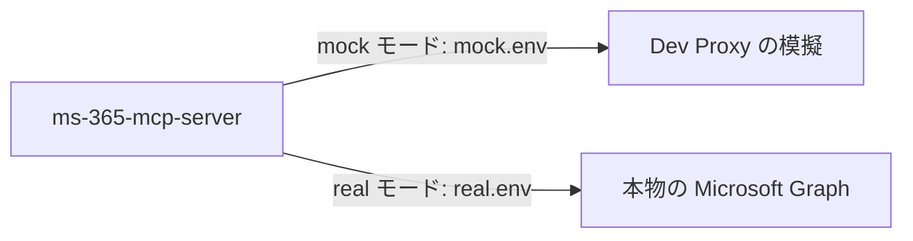

# Microsoft Graph の E2E 関連の設定

Graph に要求を出すのは ms-365-mcp-server だけ。E2E のモードは、ms-365-mcp-server の Graph への要求を Dev Proxy（`../mock/`）に通すかどうかで切り替える。

| ファイル | 役割 |
|---|---|
| `mock.env` | mock モードで ms-365-mcp-server のコンテナに渡す環境変数（`NODE_USE_ENV_PROXY=1`、`HTTPS_PROXY`、`NODE_EXTRA_CA_CERTS`）。`external/ms-365-mcp-server/e2e/mock.env` と同じ値 |
| `real.env` | real モードの説明。プロキシと Dev Proxy の証明書を渡さない |

## mock モードの手順

1. 外へ出られない docker ネットワークに Dev Proxy（`ghcr.io/dotnet/dev-proxy:4.0.0`）を起動し、`../mock/` を `/config` にマウントする。
2. Dev Proxy のルート証明書を PEM にする（API で取り出すか、`rootCert.pfx` を変換する。手順は `../mock/README.md`）。
3. PEM を ms-365-mcp-server のコンテナの `/certs/devproxy-root.pem` にマウントし、`mock.env` を環境ファイルとして渡して起動する。両方のモードで共通の設定（組織用のモード、権限、回数の制限と回路遮断器を外す設定など）は `external/ms-365-mcp-server/` の一覧のとおり。
4. シナリオを実行する。どの要求がどの模擬に当たったかは、Dev Proxy のログで確かめる。

- `NODE_USE_ENV_PROXY=1` が無いと、`HTTPS_PROXY` を設定しても Node の fetch は Dev Proxy を通らない（本物の Graph に出ようとして、外へ出られないネットワークでは `fetch failed` になる）。
- ルート証明書は `NODE_EXTRA_CA_CERTS` で渡す。OS の証明書ストアに入れる方法（`update-ca-certificates`）は Node に効かず、ms-365-mcp-server のイメージは非 root で動くので実行もできない。
- 大きさの上限の試験では、ms-365-mcp-server に `MS365_MCP_BLOB_OUTPUT=true`・`MS365_MCP_BLOB_MAX_BYTES`・`MS365_MCP_MAX_ITEMS`・`MS365_MCP_MAX_TOP` を足して作り直す。模擬の側の値と期待する結果は `../mock/README.md` の「大きさの上限の試し方」にある。
- `mock-429-then-ok` は Dev Proxy の起動後 1 回目しか 429 を返さない。E2E の 1 回の実行で 1 度だけ使うか、使う前に Dev Proxy を起動し直す。

## real モード

- `real.env` のとおり、プロキシの環境変数と Dev Proxy の証明書を渡さない。ms-365-mcp-server は本物の Graph に直接つなぐ。
- Graph 用のトークンは、FastMCP が Entra ID の OBO で得て、要求ごとに ms-365-mcp-server へ渡す。
- 模擬の決まった ID（`mock-401` など）は real モードでは使えない。異常系は mock モードで確かめる。

## 決まり

- モードは、テスト実行コマンドに渡す環境ファイルと、docker compose のプロファイルで切り替える。compose の定義は詳細設計で作る。
- 実装時・CI の必須ゴールは mock モードの全件通過。real モードは手動実行だけを必須にする。
- プロジェクトの `e2e/` からは、`external/microsoft-graph/mock/` をシンボリックリンクで参照し、リンクも Git で管理する。
