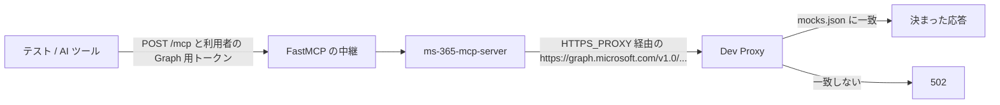
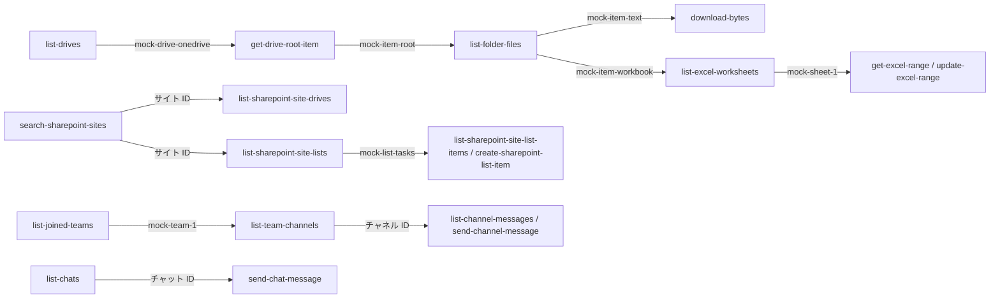

# Microsoft Graph の模擬（Dev Proxy）

E2E の mock モードで、ms-365-mcp-server（0.178.0）が Microsoft Graph へ送る要求に、本物の Graph の代わりに応答を返す。方式は既存モックサーバーツール方式（Microsoft Dev Proxy v4.0.0、公式イメージ `ghcr.io/dotnet/dev-proxy:4.0.0`）。

## ファイル

| ファイル | 役割 |
|---|---|
| `devproxyrc.json` | Dev Proxy の設定。MockResponsePlugin だけを使う。`graph.microsoft.com`（v1.0 と beta の全部）、模擬のダウンロード先 `mock-download.sharepoint.com`、`login.microsoftonline.com` を横取りし、模擬の無い要求は 502 にする（`blockUnmockedRequests`）。外へ出られないネットワークではスキーマを取りに行けず起動時に失敗の行が出るので、`validateSchemas` は切ってある |
| `mocks.json` | 応答の一覧（50 件）。上から順に照合し、最初に一致したものを返す |
| `large-file.txt` | ダウンロードの上限を試すためのファイルの中身（約 10 KiB）。`mocks.json` から `@large-file.txt` で参照する |

## 起動のしかた

1. 外へ出られない docker ネットワーク（`docker network create --internal <名前>`）を作り、Dev Proxy と ms-365-mcp-server を同じネットワークに置く。本物の Graph・Entra ID に誤って届かないようにするため。
2. Dev Proxy を、このディレクトリを `/config` に読み取り専用でマウントして起動する。プロキシは 8000 番、API は 8897 番で待ち受ける。
   - ルート証明書の置き場所（`/home/devproxy/.config/dev-proxy/rootCert`）を名前付きボリュームかホストのディレクトリにして、起動のたびに証明書が変わらないようにする。初回の起動で `rootCert.pfx` ができる。
   - API のトークンは起動のたびに乱数で作られ、Dev Proxy のログに出る。決まった値にしたいときは、Dev Proxy のコンテナに環境変数 `DEV_PROXY_API_TOKEN`（32 文字以上）を渡す。
3. ルート証明書を PEM で取り出す。次のどちらでも同じ証明書（`CN=Dev Proxy CA`、10 年有効）が得られることを実機で確かめた。
   - API：同じネットワークの別のコンテナから `GET http://<Dev Proxy>:8897/proxy/rootCertificate?format=crt` を、API のトークンを `Authorization: Bearer` に付けて呼ぶ。トークンなしは 401。
   - ファイル：ボリュームの `rootCert.pfx`（パスワードなし）を取り出して変換する。`openssl pkcs12 -in rootCert.pfx -clcerts -nokeys -passin pass: -out devproxy-root.pem`（OpenSSL 3 で読めない場合は `-legacy` を足す）。
4. 取り出した PEM を ms-365-mcp-server のコンテナにマウントし、次の環境変数を渡す（`e2e/mock.env` と同じ）。

   | 環境変数 | 値の例 | 理由 |
   |---|---|---|
   | `NODE_USE_ENV_PROXY` | `1` | 必須。ms-365-mcp-server は Node 組み込みの fetch で Graph を呼ぶ。これが無いと `HTTPS_PROXY` を読まず、Dev Proxy を通らない |
   | `HTTPS_PROXY` | `http://devproxy:8000` | Graph への要求を Dev Proxy に通す |
   | `NODE_EXTRA_CA_CERTS` | `/certs/devproxy-root.pem` | Dev Proxy のルート証明書を Node に信頼させる。無いと `fetch failed` になる |

   - OS の証明書ストアに入れる方法（`update-ca-certificates`）は使わない。Node は OS のストアを読まず、ms-365-mcp-server のイメージは非 root（`node`）で動くので実行もできない。
   - `NO_PROXY` は要らない。mock モードの ms-365-mcp-server は Graph にしか要求を出さない。自分の OAuth の受け口（`/token`・`/revoke`）が `login.microsoftonline.com` へ出ようとしても、Dev Proxy が横取りして 502 にする。
5. ms-365-mcp-server は `--http 3000 --org-mode` で起動し、`MS365_MCP_GRAPH_CIRCUIT_DISABLED=true` を渡す。回路遮断器が有効なままだと、429・503 を続けて返す試験の後に、別のツールの呼び出しまで 30 秒止まる。
6. 確かめ方の例：期限内の偽の JWT（ヘッダー `{"alg":"none"}`、ペイロード `{"exp": 今から 1 時間後}`、署名部 `x`）を `Authorization: Bearer` に付け、`POST /mcp`（`Accept: application/json, text/event-stream`）で `tools/call` を送る。ms-365-mcp-server は期限しか見ないので、この形で通る。どの模擬に一致したかは Dev Proxy のログ（`req` の行と `mock` の行）で分かる。

## 照合のきまり

- 上から順に照合し、最初に一致したものを返す。具体的な URL を先に、広い URL を後に並べる。Excel（`/drives/*/items/mock-item-workbook/workbook/...`）は `/drives/*/items/*` より前に置いてある。
- URL はクエリ文字列まで含めて照合する。クエリが付く要求には末尾に `*` を付ける。`*` は任意の文字列（`/` も含む）に一致する。
- メソッドも照合する（`GET` と `POST` で別の応答を返せる）。`bodyFragment` を付けた模擬は、本文にその文字列を含む要求にだけ一致する。
- ms-365-mcp-server はパスの引数を `encodeURIComponent` で符号化する。Dev Proxy は**符号化されたままの形**で照合する（実機で確認。戻した形だけを書いた模擬は、先に並べても一致しない）。そのため模擬の URL も符号化した形で書く。
  - SharePoint のサイト ID のカンマ：`,` → `%2C`
  - Teams のチャット・チャネル ID：`:` → `%3A`、`@` → `%40`
  - アップロード先の `root:/<名前>:`：`root%3A%2F<名前>%3A`（日本語の名前も `%E3%83...` に符号化される）
  - Excel の `range(address='A1:B2')` と OneDrive の検索 `search(q='...')` の括弧と引用符はそのまま。検索語は符号化される。
- クエリの `$top`・`$search`・`$skiptoken` などの `$` は符号化されない。`startDateTime` の値の `:` は `%3A` になる。
- `@odata.nextLink` は、ms-365-mcp-server がホスト部を捨ててパスとクエリだけを使う。模擬の中の nextLink も `https://graph.microsoft.com/v1.0/...` で書けばよい。

## 決まった応答を返す ID

### 正常系（ID のつながり）

模擬の応答に含まれる ID を次のツールにそのまま渡すと、次の模擬に当たる。

| 領域 | ツール | 要求 | 応答 |
|---|---|---|---|
| プロフィール | get-current-user | `GET /me`（`$select` 付きも） | 利用者 Alice Mock |
| メール | list-mail-messages | `GET /me/messages?...` | 2 件と `@odata.nextLink`（`$skiptoken=mock-page-2`）。続きのページは 1 件で終わり。`fetchAllPages` で 3 件 |
| メール | get-mail-message | `GET /me/messages/mock-msg-*` | 1 件 |
| メール | send-mail | `POST /me/sendMail` | 202 |
| 予定表 | get-calendar-view | `GET /me/calendarView?...` | 2 件 |
| 予定表 | get-calendar-event | `GET /me/events/mock-event-*` | 1 件 |
| 予定表 | create-calendar-event | `POST /me/events` | 201（`mock-event-created`） |
| OneDrive | list-drives | `GET /me/drives` | ドライブ `mock-drive-onedrive` |
| OneDrive | get-drive-root-item | `GET /drives/*/root` | `mock-item-root` |
| OneDrive | list-folder-files | `GET /drives/*/items/*/children` | フォルダー `mock-item-folder`、テキスト `mock-item-text`、ブック `mock-item-workbook`、大きなファイル `mock-item-large` |
| OneDrive | search-onedrive-files | `GET /drives/*/search(q='...')` | `mock-item-text` |
| OneDrive | upload-file-content | `PUT /drives/*/items/*/content`（`root%3A%2F<名前>%3A` も） | 201（`mock-item-uploaded`） |
| OneDrive | download-bytes | `GET /drives/*/items/mock-item-text/content` | 302 で `mock-download.sharepoint.com` へ転送し、転送先がテキスト（52 バイト）を返す |
| OneDrive | download-bytes | `GET /drives/*/items/mock-item-large/content` | `large-file.txt`（10,246 バイト） |
| SharePoint | search-sharepoint-sites | `GET /sites?$search=...` | サイト ID `mock-tenant.sharepoint.com,00000000-0000-0000-0000-00000000a001,00000000-0000-0000-0000-00000000b001` |
| SharePoint | list-sharepoint-site-drives | `GET /sites/<サイト ID>/drives` | `mock-drive-site` |
| SharePoint | list-sharepoint-site-lists | `GET /sites/<サイト ID>/lists` | `mock-list-tasks` |
| SharePoint | list-sharepoint-site-list-items | `GET /sites/<サイト ID>/lists/mock-list-tasks/items?$expand=fields` | 2 件 |
| SharePoint | create-sharepoint-list-item | `POST /sites/<サイト ID>/lists/mock-list-tasks/items` | 201 |
| Teams | list-chats | `GET /me/chats` | チャット `19:mock-chat-1@thread.v2` |
| Teams | send-chat-message | `POST /chats/*/messages` | 201 |
| Teams | list-chat-messages | `GET /chats/*/messages` | 1 件 |
| Teams | list-joined-teams | `GET /me/joinedTeams` | チーム `mock-team-1` |
| Teams | list-team-channels | `GET /teams/mock-team-1/channels` | チャネル `19:mock-general@thread.tacv2` |
| Teams | list-channel-messages | `GET /teams/mock-team-1/channels/<チャネル ID>/messages` | 1 件 |
| Teams | send-channel-message | `POST /teams/mock-team-1/channels/<チャネル ID>/messages` | 201 |
| Excel | list-excel-worksheets | `GET /drives/*/items/mock-item-workbook/workbook/worksheets` | `mock-sheet-1`（名前 Sheet1） |
| Excel | get-excel-range | `GET .../worksheets/*/range(address='...')` | A1:B2 の値 |
| Excel | update-excel-range | `PATCH .../worksheets/*/range(address='...')` | 更新後の値 |

### 異常系

| 起こし方 | 応答 | ms-365-mcp-server の動き（実機で確認） |
|---|---|---|
| get-mail-message に `mock-401` | 401 `InvalidAuthenticationToken` | 再試行せず失敗を返す |
| get-mail-message に `mock-403` | 403 `ErrorAccessDenied` | 同上 |
| get-mail-message に `mock-404` | 404 `ErrorItemNotFound` | 同上 |
| get-mail-message に `mock-429-then-ok` | 1 回目だけ 429（`Retry-After: 1`）、2 回目から 200 | 約 1 秒待って再試行し、成功を返す（Dev Proxy に 2 回届く） |
| get-mail-message に `mock-429-always` | 毎回 429（`Retry-After: 1`） | 3 回再試行（計 4 回）して失敗を返す |
| get-mail-message に `mock-503` | 毎回 503（`Retry-After: 1`） | 読み取りなので 3 回再試行（計 4 回）して失敗を返す |
| send-mail の本文（件名など）に `mock-503` を含める | 503 | 送信（POST）なので再試行しない（1 回だけ届く） |
| send-chat-message に チャット ID `mock-503` | 503 | 同上 |
| 模擬の無い要求 | 502 `No mock response found for ...` | 失敗を返す。要求の組み立て間違いに気づける |

失敗は、JSON-RPC としては成功（`isError: true`）で返り、本文に `Microsoft Graph API error: <状態> <理由> - <Graph の本文>`、`_meta` に `http_status` と `error_code` が入る。

### 利用者ごとの分離の代わり（他人の ID）

mock モードでは利用者を区別できないので、他人のデータを指す決まった ID に 403 を返し、エラーが利用者に伝わることを確かめる。

| 起こし方 | 応答 |
|---|---|
| get-mail-message に `mock-other-user` | 403 `ErrorAccessDenied` |
| get-calendar-event に `mock-other-user` | 403 `ErrorAccessDenied` |
| list-chat-messages・send-chat-message に チャット ID `mock-other-user` | 403 `Forbidden` |
| ドライブ ID `mock-other-user`（list-folder-files など） | 403 `accessDenied` |

## 大きさの上限の試し方

| 試すこと | 起こし方 | 既定の値での結果 | 上限を変えたときの結果（実機で確認） |
|---|---|---|---|
| 上限より多い一覧 | list-mail-folder-messages に フォルダー ID `mock-folder-endless` と `fetchAllPages: true`。1 ページ 10 件で、`@odata.nextLink` が同じページを指し続ける | ページ数の上限（100 ページ）で止まり、1,000 件と `_meta.result_has_more: true` | `MS365_MCP_MAX_ITEMS=25` で 30 件（ページ単位でまとめるため 25 を超えた最初のページまで）と `result_has_more: true` |
| `$top` の上限 | list-mail-messages に `top: 50` | `$top=50` のまま送られる | `MS365_MCP_MAX_TOP=5` で `$top=5` に切り詰めて送られる（Dev Proxy のログで確かめる） |
| 大きなファイルの中身 | download-bytes に `/drives/mock-drive-onedrive/items/mock-item-large/content` | 10,246 バイトを返す（既定の上限 5 MiB より小さい） | `MS365_MCP_BLOB_OUTPUT=true` と `MS365_MCP_BLOB_MAX_BYTES=4096` で `The file is larger than the download limit of 4096 bytes.` の失敗 |

- download-bytes の上限は `MS365_MCP_BLOB_OUTPUT=true` のときだけ働く。無効（既定）のときは上限がない。
- 大きなファイルは、**上限の値を小さく設定して試す前提**にしている。既定の上限（5 MiB）を超える中身を返すには 5 MiB を超えるファイルをリポジトリに置く必要があり、Dev Proxy には大きな本文を作る機能がない。gzip で小さく持って受け手に展開させる手も試したが、Dev Proxy は模擬の応答の `Content-Encoding` を落とすので使えない。

## 限界

- 状態を持たない。作成・送信・更新した項目は、その後の一覧や取得に現れない（real モードで確かめる）。
- 利用者ごとのデータの分離は、決まった ID への 403 で代わりに確かめるだけ。トークンの中身（利用者）で応答を変えることはできない。
- `nth`（何回目の要求か）の数は Dev Proxy を再起動しないと戻らない。`mock-429-then-ok` は、起動後 1 回目の呼び出しだけが「429 の後に成功」になり、2 回目からは最初から 200 になる。E2E の 1 回の実行につき 1 度だけ使う。
- 503 と 429 を続けて返す試験は、回路遮断器（既定で有効）を開く。`MS365_MCP_GRAPH_CIRCUIT_DISABLED=true` を渡すか、遮断器の動きを確かめる試験として順番を決めて行う。
- 一覧は `$top`・`$filter`・`$search` の値で中身を変えない（どの値でも同じ応答）。`$top` の値が効いたかは Dev Proxy のログの URL で確かめる。
- ID が具体的でない要求（たとえば `/drives/*/items/<任意の ID>`）は、広い模擬に当たってテキストファイルの情報を返す。存在しない ID で 404 を期待する試験には、`mock-404` を使う。
- 本物の Graph の応答の大きさ・項目の完全さは再現していない。ツールが必要とする主な項目だけを返す。
- ms-365-mcp-server の要求のうち、ログイン・OBO の宛先、get-download-url が返す URL は模擬の対象外。
